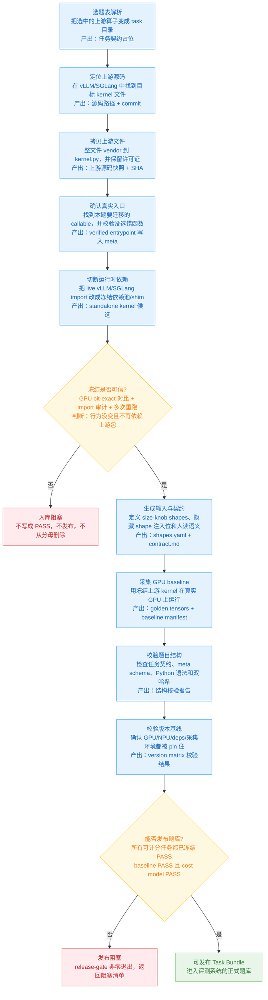
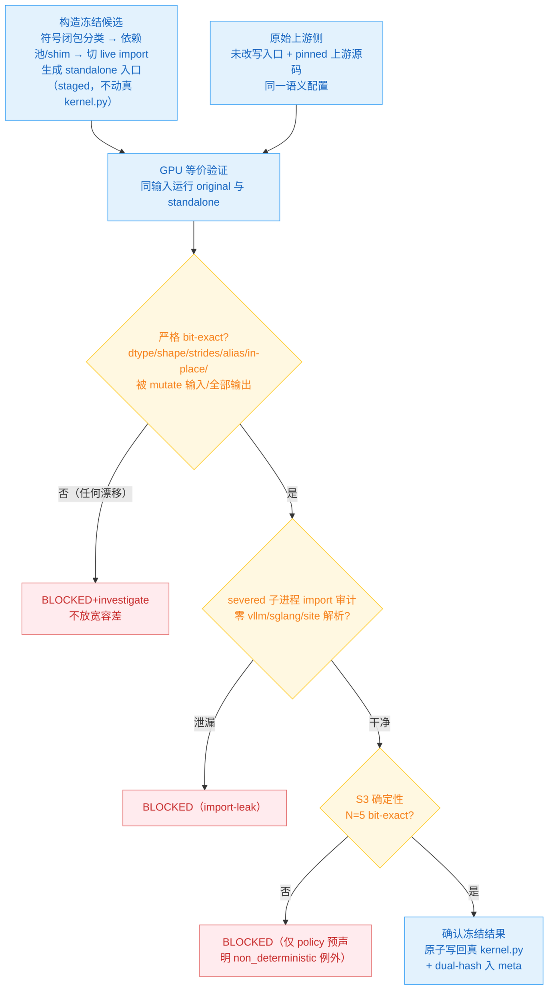
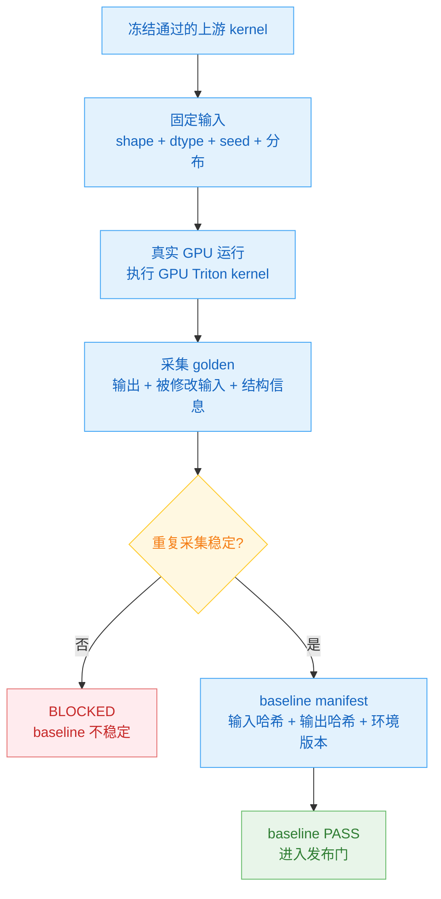

# TritonAscendBench 构建架构与数据流

## 1. 一句话与硬边界

TritonAscendBench 是 **GPU-triton → 昇腾 910B NPU-triton 迁移基准**。它的全部价值
建立在一件事上：**每道题的 ground truth 必须可信、可复现、与被迁移的上游生产
kernel 语义等价**。构建侧（Provider 离线管线）的唯一职责就是把这个保证做实，并
在做不到时**硬阻塞题目入库**。

构建侧不可违反的原则（贯穿全文）：

- **迁移基准的真值 = 被迁移的上游 GPU Triton kernel 在真实 GPU 上实际跑出的结果**。
  PyTorch / eager 参考实现不是 baseline；如有保留，也只是开发辅助或解释材料。

---

## 2. 题目入库流程（ingestion pipeline）

一道题从上游源码到"可发布题库条目"，经过一条**单向、每步带 fail-closed 门**的离线
管线。核心顺序（图中每个节点都写明"做什么"和"产出什么"）：

逐步详解（与上图主流程和判断门一一对应）：

| # | 流程节点 | 模块在干什么 | 产出什么 | 不通过怎么处理 |
|---|---|---|---|---|
| ① | **选题表解析** | 把选题表里的每个上游算子物化成一个 task 工作目录，并放入必要的任务契约占位 | 结构完整但尚未填真实代码的 task 目录 | 选题行解析失败则该题不入库 |
| ② | **定位上游源码** | 根据题目记录的 repo、文件路径和 kernel 名，在 pinned 的 vLLM/SGLang 源码中找到目标 kernel 所在文件和 commit | 上游源码路径、commit、目标符号信息 | 找不到或存在歧义则阻塞该题，不能用猜测结果入库 |
| ③ | **拷贝上游文件** | 把目标上游文件整文件 vendor 到本题 `kernel.py`，保留许可证和 provenance，并把 commit、文件 SHA 写入 `meta.yaml` | 可哈希的上游源码快照 | 只能说明“源码已固定”，还不等于“行为已冻结”；后续必须继续做依赖切断 |
| ④ | **确认真实入口** | 从上游文件中确认本题真正要迁移的 callable，并用题目契约、输出结构和 GPU smoke 执行确认没有选错函数 | verified entrypoint 写入 `meta.yaml` | 找不到匹配入口或输出语义不匹配，则 `BLOCKED(no-verified-upstream-entrypoint)` |
| ⑤ | **切断运行时依赖** | 把 `kernel.py` 对 live vLLM/SGLang 的依赖改写到冻结依赖池或 shim，构造不依赖运行时上游包的 standalone kernel 候选 | standalone kernel 候选、冻结依赖池、默认拒绝 shim | 发现未知依赖、无法分类依赖或构造失败，则该题 `BLOCKED` |
| ⑥ | **冻结是否可信** | 对比“原始上游入口”和“standalone 候选”是否 GPU bit-exact；同时检查 import 是否泄漏、重复运行是否确定 | 冻结 PASS 状态和 dual-hash 冻结凭证 | 任一等价、审计、确定性门不过，则 `BLOCKED`；不写 PASS、不发布、不从分母删除 |
| ⑦ | **生成输入与契约** | 定义 size-knob 输入、公开/隐藏 shape、输入分布、接口语义和人读说明 | `shapes.yaml`、`contract.md` | 缺少必填 shape、参数无默认值或接口无法物化，则 `BLOCKED(shapes-incomplete)` |
| ⑧ | **采集 GPU baseline** | 使用冻结后的上游 GPU Triton kernel，在真实 GPU 上对每个 shape/seed 运行并保存 golden 输出 | golden tensors、baseline manifest、输入与输出哈希 | GPU baseline 无法运行、结果不确定或 provenance 不完整，则该题不可发布 |
| ⑨ | **校验题目结构** | 检查任务契约齐全、`meta.yaml` schema、Python 语法、哈希一致性，以及发布门所需的任务状态 | 结构校验报告和发布阻塞清单 | 普通结构校验失败则该题无效 |
| ⑩ | **校验版本基线** | 确认 GPU/NPU/deps、采集环境、910B 峰值表等版本信息都被 pin 住，避免同一题在不同环境下漂移 | 版本矩阵校验结果 | 版本不一致或仍有未冻结字段，则 baseline 失效 |
| ⑪ | **能否发布题库** | 汇总所有 score-eligible 任务，检查是否都完成冻结 PASS、GPU baseline PASS 且 cost model PASS | 可发布 Task Bundle，或发布阻塞清单 | 任一可计分任务未 PASS，则整库不可发布 |

---

## 3. baseline 精度对齐

### 3.1 baseline 定义

这是 **migration** 基准。精度 baseline 不是 PyTorch eager，也不是重新写的数学参考实现，
而是：

> pinned 上游 GPU Triton kernel，在真实 GPU 上，对固定输入实际运行得到的输出。

也就是说，baseline 的权威来源是 GPU Triton 的真实执行结果。可选的 PyTorch 参考实现
可以用于开发调试或解释语义，但不进入 baseline 定义，也不是题目入库的必经产物。

### 3.2 baseline 需要对齐什么

baseline 不只是一个数值张量，还要覆盖迁移语义：

| 对齐项 | 要求 |
|---|---|
| 输出结构 | 返回值数量、名称、嵌套结构必须固定 |
| 张量属性 | dtype、shape、stride、layout 必须记录 |
| 原地语义 | 被 in-place 修改的输入也要进入 golden |
| 特殊值 | NaN / Inf 的位置必须一致 |
| 随机语义 | 采样类任务固定 seed，并要求 bit-exact |
| provenance | 上游 commit、冻结后哈希、输入哈希、输出哈希、GPU 环境版本都要记录 |

### 3.3 依赖切断与等价验证

依赖切断阶段不"修"上游算法，只做两件事：切断 live 依赖，并证明切断后语义没有改变。
这一步保证后续采集 GPU baseline 时，运行的是可复现冻结后的上游 kernel。

关键点：

- **比的是 severed-staged-候选 vs 未改写的上游入口**，两侧同样的输入、Class-C/S
  双侧同 accel-disabled + 同 pinned config，否则比较无效。
- **严格 bit-exact，不用候选评测的 `tolerance_class`，无 ULP 逃逸**：severing 是
  同代码的纯 import 改写，任何数值漂移=未冻结副作用的证据 → BLOCKED+investigate，
  **不许靠放宽容差通过**。
- **确认冻结前不动真 `kernel.py`**：候选在 staging，只有全门通过才原子写回——非循环、
  失败不留半成品。

### 3.4 GPU baseline 采集

冻结通过后，使用冻结后的上游 GPU Triton kernel 在真实 GPU 上采集 golden：

如果 GPU baseline 无法运行、重复采集不稳定、或者 provenance 不完整，该题不能发布。
