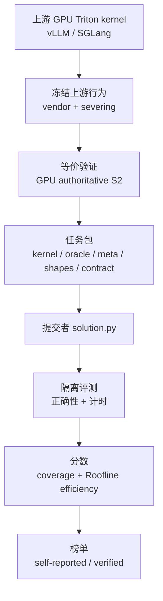
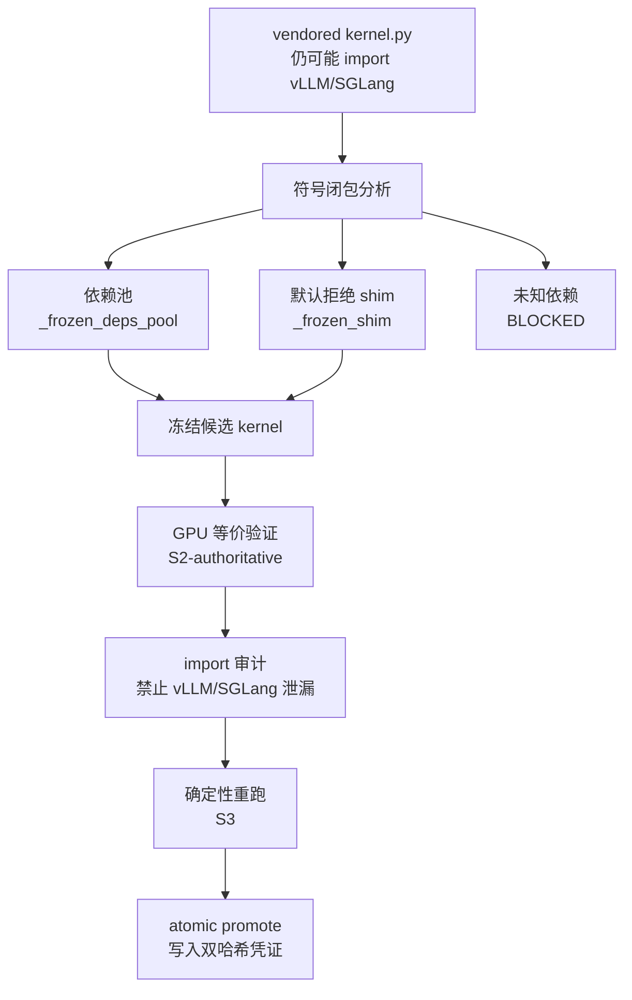
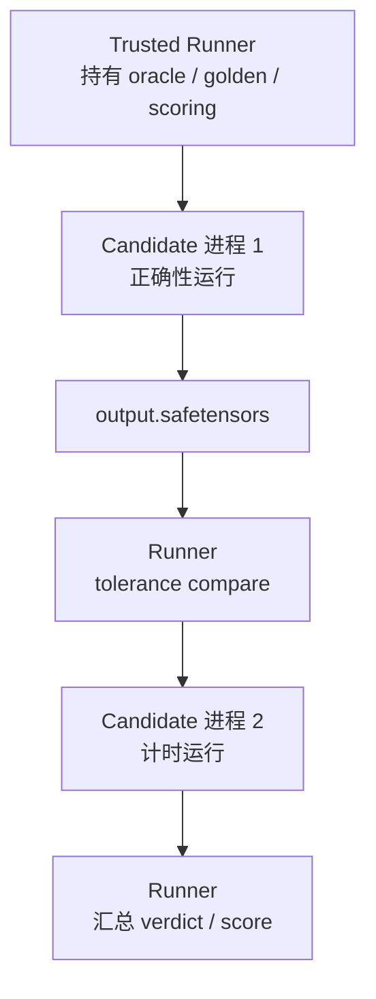

# TritonAscendBench — 对外交流版设计方案

> 本文是 `docs/DESIGN.md` 的概念优化版，面向外部专家交流。整体设计、判定逻辑、门禁条件、评分公式和工程边界保持不变；变化仅在于把内部代号先翻译成可理解的问题、保证和流程，再保留必要的代码术语用于落地实现对齐。

---

## 一句话摘要

TritonAscendBench 要回答一个具体问题：

> 已经在 vLLM / SGLang 里运行的 GPU Triton 算子，迁移到昇腾 910B 的 `triton-ascend` 后端后，是否还能保持上游真实语义，并在 910B 上达到可解释、可复现的性能水平？

因此，本基准不是“从算法描述生成新 kernel”，而是一个 **GPU Triton 到 NPU Triton 的迁移基准**。它同时评测两件事：

1. **迁移是否正确**：NPU 实现必须复现被冻结的上游 GPU Triton kernel 行为。
2. **迁移是否高效**：正确通过后，按 910B Roofline 理论上限归一化，比较 NPU 实测效率。

正确性是进入排名的资格门；性能是进入资格门后的排名指标。

---

## 0. 先把核心概念说清楚

原设计中的很多名词来自实现阶段编号，直接交流时容易造成理解门槛。本节先给出面向读者的解释，再标注对应的内部术语。

| 对外解释 | 内部术语 | 作用 |
|----------|----------|------|
| **冻结上游行为** | reproducible freeze / severing | 把上游 GPU Triton kernel 固定下来，使它不再受当前环境中 vLLM/SGLang 版本影响 |
| **证明冻结没有改语义** | S2-authoritative | 原始上游 kernel 和冻结后 kernel 在 GPU 上严格 bit-exact 对比；只有 GPU 实测能判 PASS |
| **入口选对了没有** | dual anchoring / 双锚 | 在写入任务元数据前，用 oracle 一致性和 smoke 对比确认入口函数确实是目标算子 |
| **冻结后是否稳定** | S3 deterministic check | 冻结候选多次重跑必须 bit-exact 一致 |
| **能不能发布题库** | S6 release gate | 只要任一可计分任务没有完成冻结和性能基线校验，整套基准不可发布 |
| **哪些任务进入分母** | score-eligible set | oracle 非 stub 且 shapes 非手工占位的任务集合，作为正确率和性能分母 |
| **性能分母是什么** | 910B Roofline `t_ref` | 按 910B 峰值算力/带宽推导出的理论最快时间，不拿 GPU 延迟当分母 |
| **候选是否绕过规则** | reward hacking defense | 通过静态检查、沙箱隔离、隐藏输入、canary、计时仲裁等防止作弊 |

可以把整个设计理解成三条链：

1. **真值链**：上游 GPU kernel → 可复现冻结 → golden 输出。
2. **评测链**：提交者 `solution.py` → 隔离运行 → 正确性比较 → 910B 计时。
3. **治理链**：静态规则、进程隔离、发布门、固定分母、防作弊和榜单复核。

---

## 1. 背景与目标

### 1.1 为什么需要这个基准

vLLM / SGLang 等推理引擎中已经积累了大量生产级 GPU Triton 算子，例如采样、归一化、KV-cache、LoRA、MoE、Flash-Attention、Mamba 等。把这些推理路径迁移到华为昇腾 Atlas 910B A2 系列时，目标不是重新定义算法，而是让 NPU 版本保持上游 kernel 的真实行为。

这里的困难在于，上游 kernel 的“真实行为”通常不等于一个简单的数学公式。生产 kernel 里可能包含：

- 特定的 fp32 累加顺序；
- fused epilogue；
- masking 细节；
- in-place 写回；
- 特定 stride / layout；
- NaN / Inf 传播位置；
- 为性能做出的近似。

如果只拿一个重新写的 PyTorch 参考实现当真值，可能会把这些真实细节抹掉。因此，本基准把真值定义为：

> 经过可复现冻结并通过等价验证的上游 GPU Triton kernel 行为。

### 1.2 它不是哪类基准

| 维度 | KernelBench | TritonBench | TritonAscendBench |
|------|-------------|-------------|-------------------|
| 任务类型 | PyTorch 到 CUDA 生成 | PyTorch 到 Triton 生成 | GPU Triton 到 NPU Triton 迁移 |
| 起点 | 算法描述 | 算法描述 | 生产环境中的 GPU Triton 源码 |
| 真值 | 功能等价 | 功能等价 | 冻结后的上游 kernel 行为 |
| 保真要求 | 主要看输出近似 | 主要看输出近似 | 输出、dtype、shape、stride、in-place、NaN/Inf 等语义均需匹配 |
| 性能指标 | 原始加速比 | 原始加速比 | 910B Roofline 归一化效率 |

被测对象是 `triton-ascend` 后端。提交者只提供 NPU Triton 形式的 `solution.py`，由基准框架负责输入构造、隔离运行、正确性判定和性能计分。

### 1.3 设计目标

本基准的目标是：

- 为 100+ 个真实生产 GPU Triton 算子建立可复现的 NPU 迁移评测；
- 让“真值可信”成为可执行、可审计、可失败的机制，而不是文档承诺；
- 在 910B 上用 Roofline 归一化效率评价性能，避免 GPU/NPU 绝对延迟直接比较；
- 提供 self-reported 和 verified 两层榜单；
- 把防作弊、防回退、防选择性规避设计进基准结构，而不是事后补丁。

### 1.4 非目标

本基准不做以下事情：

- 不维护或提交 NPU kernel 实现；
- 不做 PyTorch 到 Triton 的生成评测；
- 不做 GPU 与 NPU 的绝对延迟竞速；
- 不以场内最优实现作为性能分母；
- 不允许用 AscendC、torch 高层算子或运行时查表绕过 NPU Triton 迁移目标。

---

## 2. 总体设计

### 2.1 端到端流程

整个系统分为五层：

1. **离线构建**：从 vLLM/SGLang 抽取 GPU Triton kernel，冻结上游行为，生成 oracle、shapes、contract 和性能 cost model。
2. **题库发布**：每个任务以 5 个核心文件发布，并带有可复现冻结凭证。
3. **提交**：提交者只写 `solution.py` 和 manifest。
4. **评测**：框架构造输入、隔离运行、比较输出、测量 NPU 延迟。
5. **榜单**：按正确性资格门和 Roofline 性能指标生成 self-reported / verified 结果。



### 2.2 三个信任边界

设计中有三个必须明确的信任边界：

| 边界 | 可信侧 | 不可信侧 | 规则 |
|------|--------|----------|------|
| 真值边界 | provider 生成的冻结 kernel、oracle、golden | 提交者代码 | oracle/golden 不挂载到 candidate 沙箱 |
| 运行边界 | verified runner | `solution.py` | candidate 在独立进程中运行，只能通过 data-only IPC 交回输出 |
| 计分边界 | catalogue、`meta.yaml`、`eligibility.py` | result 文件、submission artifact | 可计分任务集合和分母由 catalogue 冻结，提交者不能改变 |

### 2.3 设计原则

| 原则 | 含义 | 具体体现 |
|------|------|----------|
| 可复现优先 | 不能只保存一份源码快照，还要消除运行环境漂移 | `severing + S2 bit-exact` |
| 真值必须有证据 | 每个入口必须证明自己对应目标语义 | oracle 一致性 + S2-smoke 双锚 |
| 失败不能被隐藏 | 冻结失败、cost model 失败不能从分母中剔除 | S6 硬发布门 |
| 正确性先于性能 | 错误或回退实现不能靠快拿分 | coverage 资格门 |
| 性能分母固定 | 不用 GPU 延迟，也不用场内最优 | 910B Roofline `t_ref` |
| 防作弊内建 | 隔离、静态检查、隐藏输入、canary、计时仲裁共同工作 | reward hacking defense |

---

## 3. 真值如何建立

这是本基准最核心的部分。目标是让“真值 = 冻结后的上游 kernel 行为”这句话可以被验证，而不是只靠信任。

### 3.1 为什么单纯 vendor 源码不够

第一步会把上游文件整体拷贝为任务中的 `kernel.py`，保留许可证、commit、SHA 等来源信息。这一步叫 whole-file vendoring。

但仅做这一步还不够。因为 `kernel.py` 里可能仍然包含：

```python
from vllm ...
from sglang ...
```

这意味着它的行为仍然依赖当前机器安装的上游包版本。今天和明天的环境不同，golden 就可能不同。因此，whole-file vendoring 只是源码快照，不是可复现冻结。

### 3.2 可复现冻结：把 live 依赖切断

真正的冻结要做两件事：

1. **依赖切断**：分析 `kernel.py` 对外部符号的依赖，把需要的依赖放进内容寻址的 `_frozen_deps_pool`，把可证明惰性的符号放进默认拒绝的 `_frozen_shim`，把稳定第三方依赖写进版本矩阵。
2. **等价证明**：在 GPU 上比较“原始上游 kernel”和“切断依赖后的 kernel”，要求输出严格 bit-exact 一致。

依赖切断在设计中称为 `severing`。它不是为了改 kernel，而是为了让 kernel 不再从运行时环境里偷偷读上游包。



### 3.3 等价验证为什么必须严格 bit-exact

S2 验证只检查一件事：依赖切断有没有改变 kernel 行为。

由于 severing 的目标只是改 import 来源，不应该改变计算逻辑，所以这里不能使用候选评测中的数值容差。如果输出出现任何差异，就说明冻结过程可能引入了副作用，必须阻塞任务并调查。

S2 的不变量是：

- 原始上游 kernel 与冻结候选必须严格 bit-exact；
- dtype、shape、stride、alias、in-place 修改、被 mutate 的输入都要覆盖；
- 不使用 `tolerance_class`；
- 不给 ULP 逃逸；
- CPU / `TRITON_INTERPRET=1` 只能做 smoke，不能判定 PASS；
- 唯一能判 PASS 的来源是 GPU-authoritative S2；
- 无 GPU 时状态是 `UNRUN(needs-gpu)`，不是 PASS。

### 3.4 入口为什么需要双锚

上游文件中可能有多个可调用对象。解析到一个函数名并不等于找到了正确入口。因此，在入口写入 `meta.yaml` 前，要通过两类证据：

1. **oracle 一致性锚**：至少两个不同 shape 上，入口输出和 `oracle_pytorch.py::run` 输出一致，并且输出结构、命名、dtype 匹配。
2. **S2-smoke 锚**：用 staged-vs-original 的真实比对确认入口在 smoke 环境下行为一致。

只有双锚通过的入口才允许写入 `meta.yaml`。不通过的入口不会被“勉强收录”，而是记录为 `BLOCKED(no-verified-upstream-entrypoint)`。

这里的 oracle 不是独立真值源。它是经过双锚对齐后，用来在评测阶段生成 golden 的 PyTorch eager 参考实现。真值仍然来自冻结上游 kernel。

### 3.5 发布门：不能让阻塞任务悄悄消失

题库发布前会运行 S6 release gate：

```text
release_status = PASS
    iff phase_a_prime.status = PASS
    and cost_model.status = PASS
```

也就是说，一个可计分任务必须同时满足：

- 上游 kernel 已经可复现冻结；
- 性能 cost model 已经通过交叉校验。

只要 score-eligible 集中任一任务不是 PASS，基准不可发布。score-eligible 集为空、检查集合为空、检查集合与期望数量不一致，也都直接失败。这个规则防止出现“困难任务被冻结失败，于是从分母里拿掉”的选择性规避。

---

## 4. 任务数据模型

每个任务是一个目录，核心由 5 个文件组成：

```text
tasks/levelN/<task_id>/
  kernel.py          # 冻结后的上游 GPU Triton kernel
  oracle_pytorch.py  # 经过双锚对齐的 PyTorch eager oracle
  meta.yaml          # 机器可读的权威元数据
  shapes.yaml        # 参数化 shape 和输入生成规则
  contract.md        # 面向人的语义说明
```

### 4.1 五个文件的职责

| 文件 | 职责 | 关键约束 |
|------|------|----------|
| `kernel.py` | 保存冻结后的上游 Triton kernel | 通过 severing + S2 后写入双哈希 |
| `oracle_pytorch.py` | 生成 golden 输出 | 非独立真值源；candidate 沙箱永不挂载 |
| `meta.yaml` | 机器可读权威 | 记录接口、容差、runner 检查、冻结状态、cost model |
| `shapes.yaml` | 定义公开/隐藏 shape 与输入分布 | 同 seed 下 oracle 和 candidate 输入字节一致 |
| `contract.md` | 解释语义 | 不得引入 `meta.yaml` 没有的事实 |

辅助目录包括：

- `_frozen_deps_pool/`：内容寻址依赖池；
- `_frozen_shim/`：默认拒绝 shim；
- `_canary/`：反作弊陷阱题；
- `_vendored/`：原始 vendored 快照，不直接计分。

### 4.2 shape 不是死列表，而是 size-knob 公式

`shapes.yaml` 用命名旋钮表达输入规模，例如：

```yaml
size_knobs: {B: 2, L: 8, D: 16}
public_shapes:
  - {id: P1, name: tiny, knobs: {B: 1, L: 4, D: 8}}
hidden_shapes:
  - {id: H1, name: h_odd, knobs: {B: 3, L: 13, D: 40}}
inputs:
  x: {dims: [B, L, D], dtype: float32, dist: randn}
  eps: {scalar: 1.0e-5}
```

评测时由 `inputs.build_inputs(shapes_doc, shape_id, seed)` 解析公式并物化张量。公开 shape 用于本地迭代；隐藏 shape 只在 verified 模式注入，防止硬编码。

### 4.3 数值容差只用于迁移候选，不用于冻结证明

候选 NPU 实现和 golden 比较时，需要按算子族使用不同容差，因为 GPU/NPU 的规约顺序可能不同。例如：

| 类别 | 典型任务 | 容差策略 |
|------|----------|----------|
| `elementwise` | silu / gelu / bias | 小容差 allclose |
| `vector_reduce` | RMSNorm / LayerNorm / softmax | 小容差 allclose |
| `cube_matmul_fp16` | FP16 GEMM with FP32 accumulate | 较宽 atol |
| `int8_w8a8` | 量化 matmul | 更宽量化容差 |
| `sampling_rng` | 采样 | bit-exact |
| `attention_flash` | online softmax + matmul | 融合注意力容差 |
| `recurrent_chunk` | Mamba / GDN / KDA chunk | recurrent 容差 |

重要边界：

- S2 冻结等价验证永远严格 bit-exact；
- `tolerance_class` 只用于 candidate vs golden；
- NaN / Inf 位置必须一致；
- 整数、bool、采样类任务必须 bit-exact。

### 4.4 可计分任务集合

可计分任务集合 `S` 由 `triton_ascend_bench/eligibility.py` 单一来源计算：

```text
task is score-eligible
    iff oracle source is not stub
    and shapes.yaml is not PHASE-C-MANUAL
```

stub 和手工占位任务不进入分母。除此之外，失败、缺失、BLOCKED、回退实现都不能从分母中消失。

---

## 5. 提交与执行契约

### 5.1 提交者唯一需要写的接口

提交者只实现：

```python
def npu_triton_impl(inputs: dict) -> dict:
    """inputs 键来自 meta.interface.alias_map；返回键匹配 oracle 输出 schema。"""
```

返回值必须和 oracle 输出结构一致。候选可以使用 NPU Triton kernel，但不能使用高层 torch 算子、AscendC 原生实现、oracle、隐藏输入信息或运行时查表。

### 5.2 评测状态拆分

一次评测会产生三个主要状态：

| 状态 | 含义 |
|------|------|
| `correctness_status` | 输出是否符合 golden 和容差 |
| `runtime_status` | 运行是否成功、是否超时、是否崩溃 |
| `performance_status` | 计时是否有效、是否可用于性能分 |

另有：

- `fallback_detected`：发现 torch 高层路径、AscendC 等回退实现；
- `performance_flags`：计时异常、stream 异常、profiler 异常等标记。

`fallback_detected` 会在评分前归一为 correctness fail。也就是说，正确但回退的实现不能通过资格门。

### 5.3 隔离运行模型

verified runner 使用三进程模型：



关键规则：

- candidate 进程不挂载 oracle 和 golden；
- oracle、candidate、比对逻辑不共享 Python 解释器状态；
- 进程间只用 safetensors 传数据，避免 pickle RCE；
- 正确性阶段结束后 SIGKILL candidate 并清理 cache / 显存；
- 计时阶段使用 fresh 输入，防止正确性阶段预计算后计时查表；
- 超时或 hung 由 timeout + 进程组 SIGKILL 终止。

### 5.4 计时策略

`triton-ascend` 首次执行可能触发 Python 层 JIT 编译，因此计时必须：

- warmup 剔除编译开销；
- measured trial 使用 fresh 输入；
- 在前后 `synchronize()` 包围的窗口内测量；
- 以 host `CLOCK_MONOTONIC_RAW` 为权威时间；
- NPU event 作为交叉信号；
- host 与 event 偏差超过 `specs/timing_arbitration.md` 阈值时标记 invalid。

选择 host 计时为主，是为了防止非默认 stream 或异步不同步导致 event 低估耗时。

---

## 6. 防作弊设计

本基准的攻击面很大：提交者可能 import oracle、硬编码 shape、查表、返回输入本身、复用缓冲区、使用高层 torch、绕 stream 计时、提前预计算或读取隐藏信息。因此防御必须内建在结构中。

### 6.1 防御分层

| 层级 | 目标 | 机制 |
|------|------|------|
| 进程隔离 | 让候选看不到真值 | oracle/golden 不挂载；candidate 独立进程 |
| 静态规则 | 运行前拦截明显违规代码 | AST 正向白名单、import 白名单、字符串黑名单 |
| 输入硬化 | 防查表和恒等返回 | hidden shapes、runner-secret seed、metamorphic checks |
| 计时仲裁 | 防异步和 stream 操纵 | host 权威计时、event 交叉、profiler sanity |
| canary | 捕捉语义级作弊 | identity / lookup / async / fallback 等陷阱题 |
| 榜单治理 | 防刷榜和复现漂移 | self-reported / verified、broker、限流、审计 |

### 6.2 静态检查

`static_checker.py` 采用正向 AST 白名单。核心策略是：

- 先做源码字符串黑名单，拦截 `oracle/golden/hidden_shape/answer/cheat` 等明显意图；
- 再 `ast.parse`；
- 只允许白名单 AST 节点；
- 显式禁止 `ast.MatMult`，防止用 `@` 绕过 matmul 禁令；
- 拒绝 wildcard import；
- import 白名单限定为 `torch/torch_npu/triton` 及少量标准库；
- 符号级禁止 `importlib`、`ctypes`、`cpp_extension`、`os`、`time`、`*.Event`、`oracle_pytorch`、`tasks` 等；
- 对函数别名和属性别名做跨函数污点传播，例如 `f = open; f(...)`。

静态检查不是唯一防线。verified runner 还会安装运行时 audit hook，作为静态层的回退防线。

### 6.3 canary 和 metamorphic checks

canary 不计入主分数，但用于触发 `suspicious` 人工 review。典型 canary 包括：

- identity return；
- zero-out；
- cache reuse；
- non-default stream；
- torch fallback；
- shape route；
- lookup table；
- async no sync；
- partial compute；
- alibi attention。

metamorphic checks 用输入变换验证输出关系，补充静态检查无法识别的语义级作弊。

---

## 7. 性能评分

### 7.1 为什么不用 GPU 延迟做分母

迁移目标是在 910B 上正确且高效运行。GPU 和 NPU 的峰值算力、带宽、cache、调度和 kernel launch 特性都不同，直接用 GPU 延迟做分母会把硬件差异混进分数。

因此，本基准使用 910B 自身的 Roofline 理论下界作为性能分母。它回答的问题是：

> 这个 NPU 实现在 910B 上达到了自身理论上限的多少比例？

### 7.2 Roofline 理论延迟

对任务 `t` 的 shape `s`，cost model 给出：

- `W_c(t,s)`：第 `c` 类计算的 FLOPs；
- `M_r(t,s)`：第 `r` 类数据资源的字节数；
- `pi_c`：910B 对应计算类峰值算力；
- `beta_r`：910B 对应数据资源峰值带宽。

理论延迟：

```text
t_ref(t,s) = max( max_c W_c / pi_c,
                  max_r M_r / beta_r )
```

单一计算类、单一数据资源时退化为：

```text
t_ref = max(W / pi, M / beta)
```

这是标准 Roofline 下界：假设计算与访存等资源可以理想重叠，取最紧约束作为理论最快时间。

### 7.3 cost model 也必须可验证

每个任务的 `meta.yaml.cost_model` 用 size-knob 公式声明 FLOPs 和 bytes。provider 侧用插桩 GPU-Triton 参考运行交叉校验解析声明：

- 解析声明和实测偏差在容差内：cost model PASS；
- 偏差超容差：cost model BLOCKED；
- BLOCKED 进入 S6 发布门，不能发布；
- 评测时 cost-model BLOCKED 的任务性能计 epsilon，不用错误基线产出加速比。

这相当于性能侧的“双锚”：解析模型 + 真实运行交叉证伪。

### 7.4 正确性资格门

令 `S` 为 score-eligible 集。正确性覆盖率为：

```text
coverage =
  #{t in S: correctness_t = ok and not fallback_t} / |S|
```

排名资格：

```text
coverage >= 0.70
```

注意：

- 分母 `|S|` 固定；
- correctness fail 计 0；
- 缺失任务计 0；
- fallback 计 0；
- 正确性资格门不使用 epsilon。

### 7.5 性能排名指标

对每个 shape：

```text
e(t,s) = min(P_cap, t_ref(t,s) / t_npu(t,s))
P_cap = 5.0
```

理论上 `e` 应在 `(0, 1]`，表示达到 910B 屋脊的比例。超过 1 通常说明 cost model 低估或计时噪声，因此用 `P_cap` 钳制并标记复核。

任务分数：

```text
s_t =
  geometric_mean_s e(t,s),  if task all status ok and no fallback
  epsilon = 0.01,           otherwise
```

整体性能分：

```text
capped_geomean_native =
  exp( (1 / |S|) * sum_{t in S} log(s_t) )
```

这保证了失败任务、缺失任务、fallback 任务都不能从分母消失。少做难题不会抬高性能分。

---

## 8. 模块边界

本节把设计映射回实现模块，方便专家追问时快速定位。

| 模块 | 作用 |
|------|------|
| `dataset.py` | 加载任务目录，解析 5 文件契约，计算 `kernel.py` SHA-256 |
| `inputs.py` | 把 `shapes.yaml` 的 size-knob 公式物化为张量输入 |
| `eval.py` | 编排静态检查、输入构造、隔离运行、正确性比较和性能计算 |
| `static_checker.py` | AST 正向白名单和静态防作弊 |
| `tolerance.py` | 按算子族执行输出比较，处理 dtype、NaN/Inf、bit-exact 等 |
| `process_isolation.py` | candidate / oracle / 计时隔离，safetensors IPC，timeout 和 SIGKILL |
| `timing.py` | warmup、host 计时、event 交叉、计时异常标记 |
| `scoring.py` | 计算 coverage 和 Roofline geomean |
| `eligibility.py` | score-eligible 集的单一来源 |
| `adversarial.py` | canary 和 metamorphic checks |
| `manifest.py` | 校验提交包的版本、容器、组织身份等信息 |
| `cli.py` | `init-solution/run/run-suite/package/submit/validate/analyze` 等入口 |

离线构建脚本：

| 脚本 | 作用 |
|------|------|
| `scripts/phase_a_freeze.py` | whole-file vendor |
| `scripts/resolve_upstream_entrypoints.py` | 入口双锚解析 |
| `scripts/phase_a_prime.py` | severing + S2 可复现冻结 |
| `scripts/_pa_subproc_runner.py` | S2 原始侧 / severed 侧子进程运行 |
| `scripts/_pa_oracle_check_runner.py` | oracle 一致性锚 |
| `scripts/phase_b_oracle.py` | 生成 `oracle_pytorch.py::run` |
| `scripts/phase_c_docs.py` | 生成 shapes 和 contract |
| `scripts/validate_tasks.py --release-gate` | S6 发布门 |
| `scripts/verify_version_matrix.py` | 版本矩阵校验 |

---

## 9. 关键工程决策

| 问题 | 选择 | 不选择 | 原因 |
|------|------|--------|------|
| 真值来自哪里 | 冻结上游 GPU Triton kernel | 独立数学 oracle | 迁移应复现生产 kernel 的真实行为 |
| 如何冻结 | whole-file vendor + severing | 只拷贝源文件 | 只拷贝仍会受 live import 影响 |
| 如何证明冻结没改语义 | S2 GPU bit-exact | 用容差比较 | severing 不应改变计算，任何漂移都是风险 |
| CPU smoke 能否判 PASS | 不能 | 允许 CPU smoke PASS | `TRITON_INTERPRET` 不等于真实 GPU 行为 |
| 入口如何写入 | 双锚通过后写入 | 解析到就写 | 防止收录错误可调用对象 |
| BLOCKED 如何处理 | 发布门硬失败 | 从分母剔除 | 防止选择性规避难题 |
| 正确性和性能关系 | 正确性资格门 + 性能排名 | 加权为单一标量 | 加权容易让错误实现靠性能稀释 |
| 性能分母 | 910B Roofline `t_ref` | GPU 延迟或场内最优 | 避免硬件代差和榜单漂移 |
| 计时权威 | host `CLOCK_MONOTONIC_RAW` | 只信 NPU Event | 防 stream / async 低估耗时 |
| IPC 格式 | safetensors | pickle / `.pt` | 避免加载即执行 |
| 高层 matmul 绕过 | 禁 `ast.MatMult` | 只禁 `Tensor.matmul` | 防 `@` 运算符绕过 |

---

## 10. 对外交流时的推荐讲法

可以按以下顺序向专家介绍，避免一开始进入内部术语：

1. **先讲问题**：这是 GPU Triton 到 910B NPU Triton 的迁移基准，不是生成基准。
2. **再讲真值**：真值不是手写 PyTorch 公式，而是冻结后的上游生产 kernel 行为。
3. **解释冻结为什么难**：只 vendor 文件不够，因为 live import 会让行为随环境漂移。
4. **说明如何保证冻结可信**：severing 切断依赖，S2 在 GPU 上 bit-exact 证明行为没变。
5. **说明入口如何避免选错**：双锚确保入口和 oracle、原始上游行为对齐后才写入元数据。
6. **说明评测如何防作弊**：candidate 看不到 oracle/golden，三进程隔离，静态检查和 canary。
7. **说明性能为什么这样算**：不用 GPU 延迟做分母，而用 910B Roofline 理论延迟衡量硬件利用率。
8. **最后讲发布门和固定分母**：失败任务不能消失，BLOCKED 会阻塞发布或计 epsilon。

这套讲法能把所有内部术语收束为三个判断：

- 真值是否可信；
- 候选是否真的完成迁移；
- 性能分数是否可复现、不可被选择性操纵。

---

## 11. 术语表

| 术语 | 优化后的解释 |
|------|--------------|
| GPU Triton 算子 | vLLM/SGLang 生产推理路径中的 `@triton.jit` kernel，是迁移源对象 |
| `triton-ascend` | Triton 面向昇腾 NPU 的编译后端，是被测后端 |
| golden | 评测用参考输出，由冻结上游语义生成 |
| oracle | PyTorch eager 参考实现，用于生成 golden；经过双锚对齐，不是独立真值 |
| severing | 切断 `kernel.py` 对运行时上游包的 live import 依赖 |
| 可复现冻结 | severing 后通过 S2 等价验证的 `kernel.py` |
| 双锚 | 入口写入前的两类证据：oracle 输出一致性 + S2-smoke 比对 |
| S2-smoke | CPU / `TRITON_INTERPRET=1` 的真实比对，只能提示问题，不能判 PASS |
| S2-authoritative | GPU 实测 bit-exact 等价验证，唯一 PASS 来源 |
| S3 | 冻结候选多次重跑 bit-exact 一致的确定性检查 |
| S6 | 发布门：可计分任务必须冻结 PASS 且 cost model PASS |
| score-eligible 集 | 进入分母的任务集合，由 `eligibility.py` 唯一计算 |
| `t_ref` | 910B Roofline 理论延迟，作为性能分母 |
| Roofline 效率 | `t_ref / t_npu`，表示达到 910B 理论上限的比例 |
| 操作强度 `I` | `W / M`，用于判断算子偏计算受限还是带宽受限 |
| cost model | 每个任务的 FLOPs / bytes 公式，并经 GPU-Triton 插桩校验 |
| size-knob shapes | 用 B/L/D 等命名旋钮表达 shape，而不是硬编码维度列表 |

---

## 12. 附录：核心公式

### 12.1 正确性资格门

```text
coverage =
  #{t in S: correctness_t = ok and not fallback_t} / |S|

ranking eligible iff coverage >= 0.70
```

### 12.2 Roofline 理论延迟

```text
t_ref(t,s) =
  max( max_c W_c(t,s) / pi_c,
       max_r M_r(t,s) / beta_r )
```

### 12.3 per-shape 效率

```text
e(t,s) = min(P_cap, t_ref(t,s) / t_npu(t,s))
P_cap = 5.0
```

### 12.4 任务性能分

```text
s_t =
  geometric_mean_s e(t,s), if all status ok and no fallback
  epsilon = 0.01,          otherwise
```

### 12.5 总性能分

```text
capped_geomean_native =
  exp( (1 / |S|) * sum_{t in S} log(s_t) )
```

---

## 13. 附录：文件速查

| 用途 | 文件 |
|------|------|
| 可复现冻结 | `scripts/phase_a_prime.py`、`scripts/_pa_subproc_runner.py` |
| 入口双锚 | `scripts/resolve_upstream_entrypoints.py`、`scripts/_pa_oracle_check_runner.py` |
| 发布门 | `scripts/validate_tasks.py --release-gate` |
| 可计分任务集合 | `triton_ascend_bench/eligibility.py` |
| 静态防御 | `triton_ascend_bench/static_checker.py` |
| 评分 | `triton_ascend_bench/scoring.py` |
| 容差 | `triton_ascend_bench/tolerance.py` |
| 评测编排 | `triton_ascend_bench/eval.py` |
| 隔离运行 | `triton_ascend_bench/process_isolation.py` |
| CLI | `triton_ascend_bench/cli.py` |

---

## 14. 设计参考

- KernelBench：评测流程、计时和对抗 kernel 设计参考；
- TritonBench：Triton 算子基准参考；
- vLLM / SGLang：真实生产 GPU Triton kernel 来源；
- Roofline 模型：Williams, Waterman, Patterson, CACM 2009；
- `docs/DESIGN.md`：完整内部设计规范和实现字段来源。
