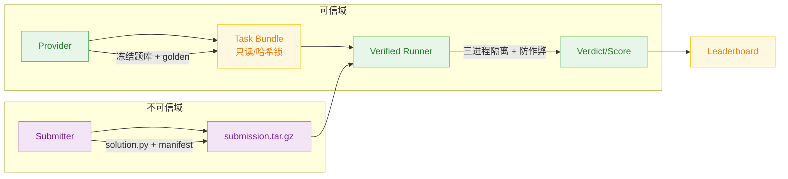
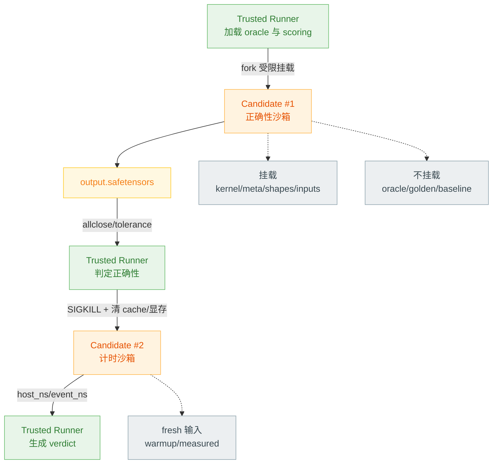
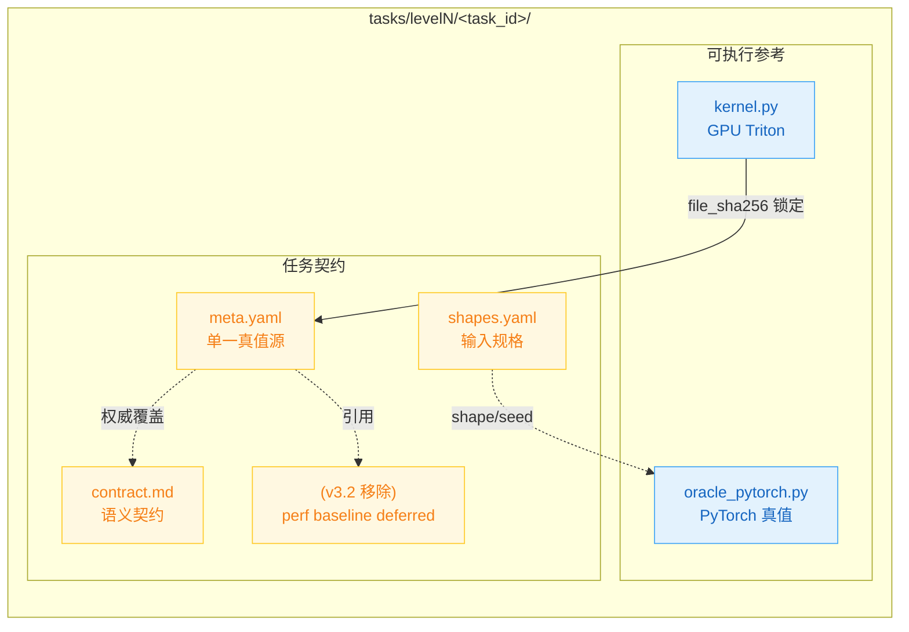
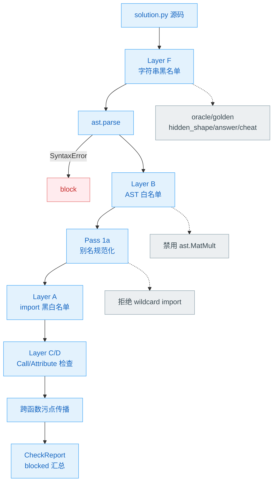
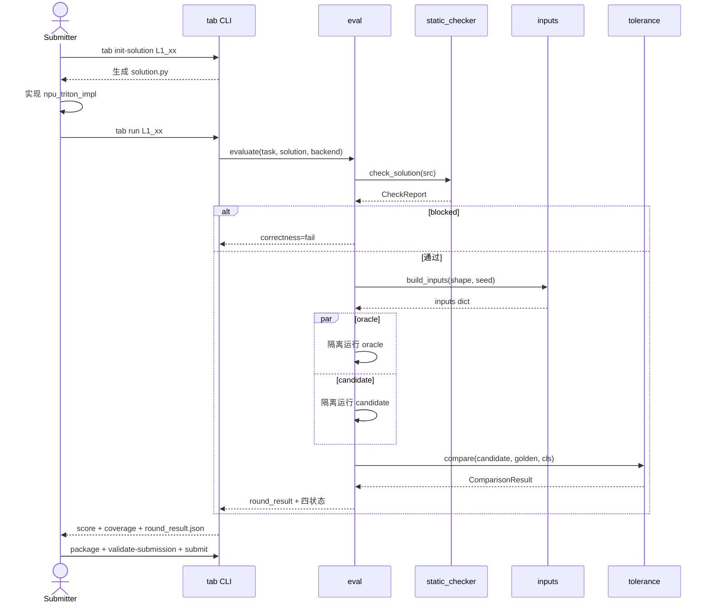
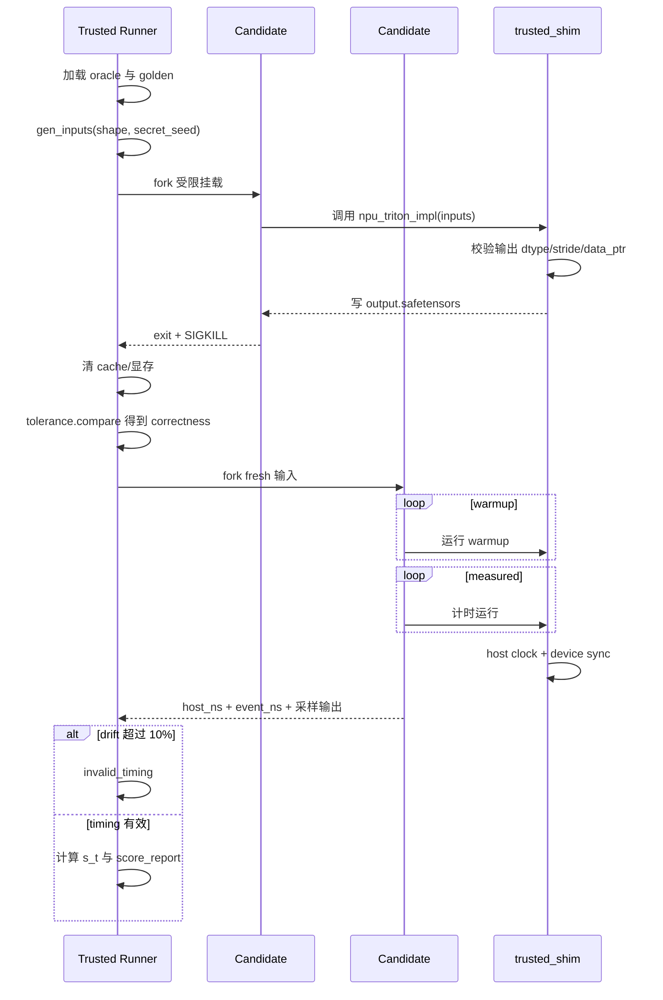
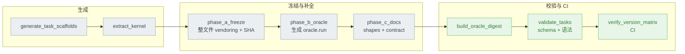
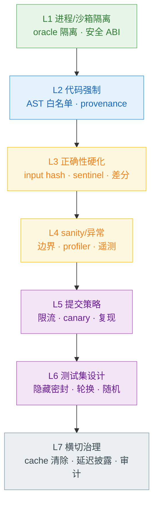
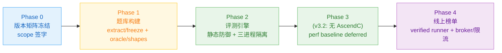

# TritonAscendBench — 设计方案

> **v3.2 ERRATA — AscendC removed.** This is a GPU-triton → NPU-triton *migration* benchmark; there is no AscendC native baseline, no `ascendc_baseline.yaml`, no `in_s_native`/`oracle.ascendc`. Correctness is the scored axis; performance is raw NPU latency (deferred to 910B). AscendC-specific text below is **superseded** and kept only as historical context.


> **文档类型**：架构与模块设计方案（Design Specification）
> **对象**：`triton-ascend-bench` —— GPU Triton → 昇腾 910B NPU Triton 迁移评测基准
> **范围**：整体背景 → 整体架构 → 每个模块的设计初衷与设计细节，配架构图 / 数据时序图 / 数据流图
> **格式参考**：`docs/npu/gpu_triton_to_npu_triton benchmark设计.pdf`（在其概念基础上重写、扩展、补全工程细节）

---

## 目录

1. [背景与动机](#1-背景与动机)
2. [设计目标与核心原则](#2-设计目标与核心原则)
3. [整体架构](#3-整体架构)
4. [数据模型与契约](#4-数据模型与契约)
5. [模块详细设计](#5-模块详细设计设计初衷--设计细节)
6. [评测流程时序](#6-评测流程时序)
7. [Reward Hacking 防御体系](#7-reward-hacking-防御体系)
8. [评分体系数学定义](#8-评分体系数学定义)
9. [关键工程决策与权衡](#9-关键工程决策与权衡)
10. [演进路线](#10-演进路线)
11. [附录](#11-附录)

---

## 1. 背景与动机

### 1.1 问题陈述

vLLM / SGLang 等推理引擎已在 NVIDIA H100/A100 上沉淀了大量成熟的 **GPU Triton 算子**（采样、归一化、KV-cache、LoRA、MoE、Flash-Attention、Mamba 等）。要把这些推理栈迁移到华为昇腾 **Atlas 910B（A2 系列）**，需用 `triton-ascend` 后端把这些 GPU Triton kernel 一一移植，且**不能在正确性或性能上回退**。

TritonAscendBench 要回答的核心问题：

> 一个 NPU `triton-ascend` 实现，能否在 910B 上匹配被迁移的 GPU Triton 参考的**正确性**（计分轴），并报告其 NPU **性能**（原始延迟；v3.2 起无 AscendC 基线，性能比值指标 deferred）？

### 1.2 为什么是 Migration Benchmark，不是 Generation Benchmark

| 维度 | KernelBench | TritonBench | **TritonAscendBench** |
|------|-------------|-------------|----------------------|
| 任务 | PyTorch → CUDA 生成 | PyTorch → Triton 生成 | **GPU Triton → NPU Triton 迁移** |
| 起点 | 算法描述 | 算法描述 | **现网生产 GPU Triton 源码** |
| 考察 | "能否从零写 kernel" | 同左 | **"生产 kernel 能否无回退移植到 NPU"** |
| 保真要求 | 功能等价即可 | 功能等价即可 | **必须忠于上游语义（含 stride / in-place / NaN 语义）** |

被测对象是 **`triton-ascend`**（Triton 的昇腾编译后端，`pip install triton-ascend`）。**v3.2 ERRATA：AscendC 已从本基准移除**——这是 GPU-triton→NPU-triton 迁移基准，不以手写 AscendC native 为分母；correctness 是计分轴，performance 为原始 NPU 延迟（baseline deferred 到 910B）。【历史】早期设计曾以 t_ascendc 为性能分母，已废弃。

### 1.3 与参考 PDF 的关系（设计演进）

参考 PDF 描述早期 **NPUKernelBench 三评测扩展**概念草案（`ascendc_migration` / `cuda_to_ascendc` / `gpu_triton_to_npu_triton`），文件结构为 `model.py` + `input_cases.json` + `gpu_triton_kernel/`。本设计是其中 **`gpu_triton_to_npu_triton` 这条线的完整工程化方案**：

| PDF 草案 | 本设计 | 演进原因 |
|----------|--------|---------|
| 2 level、示例 1–2 算子 | **3 level、~100 真实任务**（L1 单算子 / L2 融合 / L3 子系统） | 覆盖 vLLM/SGLang 真实推理路径 |
| `model.py`（PyTorch 标杆） | `oracle_pytorch.py` + **三档 oracle 分级** | 防 oracle 失真，不盲信 PyTorch |
| `input_cases.json` | `shapes.yaml`（size-knob 公式）+ `inputs` 桥 + `meta.yaml`（单一真值源） | shape 可执行化、真值源单一化 |
| `gpu_triton_kernel/kernel.py` | `kernel.py`（whole-file vendored + Apache 头 + SHA 锁定） | 保留上游许可与可哈希冻结 |
| "增加代码检视 skill" 一句 | **Layer A–F 静态防御 + 7 层 reward-hack 防御 + canary 陷阱题** | 防作弊从口号变为可执行机制 |
| 单一 `allclose(1e-3)` | **12 类 tolerance class + bit-exact + NaN/Inf 一致性** | 算子族数值特性差异巨大 |
| 离线 GPU 双向交叉验证（概念） | Phase A 冻结 + Phase B oracle + Phase C 文档生成 + schema 校验流水线 | 概念变为可复现的离线构建管线 |

### 1.4 核心技术挑战

1. **浮点加法不满足结合律**（$(a+b)+c \neq a+(b+c)$）：Triton 的分块 / SRAM 暂存 / 级联规约与 PyTorch、与 AscendC 三方计算顺序不同，必然有微小数值漂移 → 需**分级 oracle + 分类容差**，且**绝不把 PyTorch 自动当作真值**。
2. **Reward Hacking 空间巨大**：提交者只交 `solution.py`，可通过 import oracle、identity 返回、hardcode 查表、buffer 复用、空 kernel、异步不同步、非默认 stream 计时、隐藏 shape 探测等 31 类手段刷分 → 防御必须**设计进基准本身**。
3. **跨硬件公平性**：910B 与 H100 峰值算力差异大，不能直接比绝对延迟。v3.2：**不引入 AscendC 分母**；性能以 NPU triton-ascend 原始延迟报告，比值指标待 perf baseline 设计（deferred）。【历史】早期方案曾以 910B 原生 AscendC 为分母。
4. **JIT 编译干扰计时**：`triton-ascend` 是 Python 层 JIT，首次执行触发编译 → 计时必须 warmup 后剔除编译耗时，且每 trial 用新输入防 cache 命中。

---

## 2. 设计目标与核心原则

### 2.1 设计目标
- 为 100+ 真实生产 GPU Triton 算子建立可复现的 NPU 迁移评测；
- 在**正确性**与**性能**两个维度给出可排名指标；
- 把 reward-hacking 防御做成基准的结构性属性；
- 提供 self-reported（迭代用）与 verified（公开排名用）双层榜单。

### 2.2 非目标
**Provider-only 基准**：维护方维护题库 / 评测引擎 / 基线 / 榜单，**不写** NPU kernel 实现（那是 submitter 的职责）；不做 PyTorch→Triton 生成；910B 无硬件支持的算子（如 FP8 cube）只做正确性、不计性能。

### 2.3 核心设计原则

| # | 原则 | 设计体现 |
|---|------|---------|
| P1 | **Migration fidelity 优先** | `kernel.py` 整文件冻结 + 上游 commit/SHA 锁定 + 三档 oracle 分级 |
| P2 | **Reward-hacking by design** | 进程隔离 / AST 正向白名单 / broker 产物签名 是结构，不是事后补丁 |
| P3 | **Provider / Submitter 严格隔离** | oracle / golden / 隐藏 shape 永不进入 candidate 沙箱 |
| P4 | **单一真值源** | `meta.yaml` 是机器可读权威；`contract.md` 只解释、不引入新事实 |
| P5 | **Host 计时权威** | 以 `CLOCK_MONOTONIC_RAW` 为准，NPU event 仅作交叉校验 |
| P6 | **失败贡献 ε 而非 0** | 防"少做几道难题反而抬高几何均值"的博弈 |
| P7 | **增量交付（Two-tier）** | self-reported 先打通迭代闭环，再扩展到 verified 公开排名 |

---

## 3. 整体架构

### 3.1 系统全景

系统由五层构成，自上而下为一条 **离线构建 → 题库 → 提交 → 评测 → 隔离运行与榜单** 的流水线：


- **① Provider 离线构建**：从 vLLM/SGLang 抽取并冻结 GPU Triton kernel，生成分级 oracle、shape 配置、契约文档，并通过 schema + 语法校验。
- **② Task Bundle**：每个任务是一个 6 文件目录，只读且哈希锁定；`_canary/` 存放看似真题、实为陷阱的反作弊题。
- **③ Submitter**：提交者只能写 `solution.py`，连同 manifest 打成 `submission.tar.gz`。
- **④ Harness 评测引擎**：`tab` CLI 驱动 `dataset → static_checker → eval → (inputs / tolerance / timing / adversarial) → scoring`。
- **⑤ 隔离运行时与榜单**：三进程隔离沙箱执行 candidate，broker 对编译产物签名，限流 / Sybil 防御后进入 self-reported / verified 双层榜单。

### 3.2 三角色与信任边界



信任规则：`oracle_pytorch.py`、golden 输出、隐藏 shape **永不挂载**进 candidate 沙箱；submitter 提供的 `solution_artifacts.json` / `*.so` 在 verified 模式下一律视为不可信而忽略；`meta.yaml` 是单一真值源——`tab analyze` 的计分分母 = **score-eligible 集**（真可评分 oracle，从可信 repo metadata 冻结，排除 stub/manual），submitter 无法影响该集合（`in_s_native`/`ascendc_baseline.yaml` 已于 v3.2 移除）。

### 3.3 进程隔离三进程模型

reward-hacking 防御的物理基础：可信 Runner 在受限挂载下 fork 两个独立的 candidate 进程，正确性与计时**完全隔离**。



**为什么必须两个 candidate 进程**：若正确性 pass 与计时 pass 共享状态，candidate 可在正确性阶段预计算答案、缓存到 `/tmp` 或 device 显存，在计时阶段查表（measured trial 几乎 0 计算）。设计上以 **每阶段独立进程 + SIGKILL + 阶段间全量 cache 清除** 切断这条路径。

### 3.4 仓库结构

```
triton-ascend-bench/
├── triton_ascend_bench/          # Harness 评测引擎
│   ├── cli.py                    # tab CLI（9 子命令）
│   ├── dataset.py                # TaskDef 加载器
│   ├── static_checker.py         # Layer A–F 静态防御（核心防御模块）
│   ├── eval.py                   # 单次 (task, solution) 评测编排
│   ├── inputs.py                 # shapes.yaml → 张量 dict 桥
│   ├── tolerance.py + .yaml      # 12 类数值容差判定
│   ├── timing.py + trusted_shim/ # host 权威计时
│   ├── scoring.py                # s_t / 几何均值 / FastP 指标
│   ├── adversarial.py            # canary + metamorphic 检测
│   ├── manifest.py               # 提交清单 schema
│   └── backends/                 # GPU / NPU 后端抽象
├── tasks/                        # Task Bundle 题库（L1/L2/L3 + _canary + _vendored）
├── specs/                        # 11 份契约规范（设计真值源）
├── scripts/                      # 离线构建流水线（Phase A/B/C + 校验）
├── infra/                        # version_matrix.toml · Dockerfile · RFC
└── docs/                         # 设计文档（本文件）
```

---

## 4. 数据模型与契约

### 4.1 Task 目录布局（6 文件契约）



| 文件 | 职责 | 关键约束 |
|------|------|---------|
| `kernel.py` | 上游 GPU Triton 纯算子 | 至少一个 `@triton.jit`；导出算子函数；`file_sha256` 锁进 `meta` |
| `oracle_pytorch.py` | 独立 PyTorch eager 真值 | 无 triton；device-agnostic；导出 `run(inputs)->dict`；**永不挂载 candidate** |
| `meta.yaml` | 机器可读权威 | `interface.alias_map` / `tolerance_class` / `oracle_simplified` / `runner_checks`（`in_s_native` 已于 v3.2 移除） |
| `shapes.yaml` | shape + 输入规格 | size-knob 公式（见 §4.3）；公开 shape 与隐藏 shape 分离 |
| `contract.md` | 人读语义 | 不得引入 `meta.yaml` 没有的事实（P4） |
| ~~`ascendc_baseline.yaml`~~ | **v3.2 移除** | 迁移基准不依赖 AscendC native 基线；perf baseline deferred |

### 4.2 meta.yaml 关键字段

`interface.alias_map`（每个输入张量的可变性：`ro` / `rw_in_place` / `wo_candidate_allocated`）、`tolerance_class`（引用 §4.4 的 12 类之一）、`oracle_simplified`（三档：`simple_pytorch_ok` / `formula_exact_manual` / `upstream_oracle_required`，决定 oracle 的可信构造方式）、`runner_checks`（`expected_kernel_count_range` / `min_dram_bytes` / `min_flops` / `metamorphic_checks` / `static_checks`）。（`in_s_native` 已于 v3.2 移除；计分集 = score-eligible 集，从 repo metadata 冻结。）

### 4.3 shapes.yaml — size-knob 可执行 schema

shape 不再硬编码具体维度，而是**尺寸旋钮（size-knob）公式**，让"一个输入规格块覆盖所有 shape 行"：

```yaml
size_knobs: {B: 2, L: 8, D: 16}              # 默认旋钮
public_shapes:
  - {id: P1, name: tiny,   knobs: {B: 1, L: 4,  D: 8}}
  - {id: P3, name: medium, knobs: {B: 4, L: 32, D: 64}}
hidden_shapes:
  - {id: H1, name: h_odd,  knobs: {B: 3, L: 13, D: 40}}   # verified 模式才注入
inputs:
  x:      {dims: [B, L, D], dtype: float32, dist: randn}
  weight: {dims: [D],       dtype: float32, dist: ones}
  eps:    {scalar: 1.0e-5}
  idx:    {dims: [B], dtype: int64, dist: "randint:0:B"}
```

`inputs.build_inputs(shapes_doc, shape_id, seed)` 按旋钮解析维度公式（支持 `2*D` / `L+1` 等简单算术）、按 `dist`（`randn`/`ones`/`eye`/`tril`/`randint:lo:hi`/`softmax_rows`/`offsets`/`arange` 等）+ **固定 seed** 物化张量，保证 oracle 与 candidate 见到完全相同的输入。

### 4.4 数值容差 12 类（节选）

| Class | dtype | atol | rtol | 用途 |
|-------|-------|------|------|------|
| `elementwise` | FP16/BF16 | 1e-3 | 1e-3 | 逐点算子（silu/gelu/bias） |
| `vector_reduce` | FP16/BF16 | 1e-3 | 1e-3 | RMSNorm/LayerNorm/softmax |
| `cube_matmul_fp16` | FP16→FP32 acc | 5e-3 | 1e-3 | FP32 累加 GEMM |
| `int8_w8a8` | INT8→FP16 | 5e-2 | 1e-2 | W8A8 量化 matmul |
| `sampling_rng` | int/float | 0 | 0 | seed 一致时 bit-exact |
| `attention_flash` | FP16/BF16 | 5e-3 | 1e-3 | online softmax + matmul 融合 |
| `recurrent_chunk` | FP16/BF16 | 5e-3 | 5e-3 | Mamba/GDN/KDA chunk 流水线 |

### 4.5 solution.py 契约（submitter 唯一可写文件）

```python
def npu_triton_impl(inputs: dict) -> dict:
    """inputs 键来自 meta.interface.alias_map（张量在 NPU 上）
       返回键匹配 oracle 输出 schema（candidate 自行分配输出）"""
```

`solution.py` **禁止**：import oracle/harness/tasks；高层 torch 算子（`F.*` / `@` / `Tensor.matmul`）；原生 AscendC（`torch_npu.npu_*` / `sgl_kernel_npu.*`）；代码执行（`exec`/`eval`/`compile`/`ctypes`/`cpp_extension`）；IPC/网络；计时 API（`*.Event` / `time.perf_counter` / `LD_PRELOAD`）；文件/线程——由 §5.4 的静态防御强制。

### 4.6 端到端数据流

```mermaid
flowchart LR
    subgraph BUILD["离线构建"]
        direction LR
        RAW["上游 .py"] -->|"extract/freeze"| KP["kernel.py<br/>meta.sha"]
        KP -->|"Phase B"| OR["oracle_pytorch.run"]
        SH["shapes.yaml<br/>size-knob"] -->|"seed 物化"| IN["inputs dict"]
    end
    subgraph EXEC["评测执行"]
        direction TB
        IN --> OR
        IN --> SOL["solution.py<br/>npu_triton_impl"]
        OR --> GOLD["golden 输出"]
        SOL --> OUT["candidate 输出"]
        GOLD --> CMP["tolerance.compare"]
        OUT --> CMP
        CMP --> ST["四状态"]
        OUT -->|"host_ns"| TMR["timing.measure"]
    end
    subgraph SCORE["计分与报告"]
        direction LR
        AB["v3.2 无 AscendC<br/>baseline deferred"] -.->|"perf unavailable"| SCO["scoring.s_t"]
        TMR -->|"measured_ns"| SCO
        ST --> SCO
        SCO --> RR["round_result.json"]
        RR -->|"run-suite"| SUI["suite_results.json"]
        SUI -->|"tab analyze"| REP["score_report.json"]
    end
    classDef build fill:#ECEFF1,stroke:#90A4AE,color:#37474F;
    classDef eval fill:#E3F2FD,stroke:#42A5F5,color:#1565C0;
    classDef score fill:#E8F5E9,stroke:#66BB6A,color:#2E7D32;
    class RAW,KP,OR,SH,IN build;
    class SOL,GOLD,OUT,CMP,ST,TMR eval;
    class AB,SCO,RR,SUI,REP score;
```



---

## 5. 模块详细设计（设计初衷 + 设计细节）

> 每个模块按 **设计初衷 → 设计与机制** 组织。

### 5.1 `dataset.py` — Task 加载器

**设计初衷**：把磁盘上 6 文件的任务目录解析成一个**不可变的 `TaskDef` 数据类**，作为评测引擎唯一的题库入口，并在加载时即计算 `kernel.py` 的 SHA-256 以支撑后续防篡改。

**设计与机制**：`load_task(task_id)` 顺序在 `level1/2/3` 下定位任务目录，解析 `meta.yaml / shapes.yaml / contract.md / kernel.py`，构造 `TaskDef`，加载时立即算 `kernel_py_sha256`。属性访问层做 schema 兼容兜底（`tolerance_class` 既支持顶层也支持嵌套；`oracle_tier` 兼容字符串与旧嵌套）。`iter_all_tasks()` 跳过 `_` 前缀目录（`_vendored`/`_canary` 不计入计分集）。【v3.2】`is_in_s_native` 属性已移除；计分集 = score-eligible 集（真可评分 oracle，非 stub/manual），由 `tab analyze` 从可信 repo metadata 冻结。

### 5.2 `inputs.py` — shapes → 张量桥

**设计初衷**：让 `shapes.yaml` **真正可执行**——用尺寸旋钮公式而非硬编码维度，使一个 `inputs` 规格块覆盖任意 shape 行；并保证 oracle 与 candidate 在同一 seed 下看到字节一致的输入。

**设计与机制**：`build_inputs(shapes_doc, shape_id, seed)` 合并 `size_knobs` 与该 shape 行的 `knobs`，`_resolve_dims` 解析维度公式，`_make_tensor` 按 `dist` 用固定 `torch.Generator(seed)` 物化张量并做整数/fp8 dtype 后处理；标量（`{scalar: v}`）原样透传；`shape_ids` 返回 `(public_ids, hidden_ids)`，verified 模式才注入 hidden。这是把"shape 配置"变成"可运行输入"的关键桥。

### 5.3 `eval.py` — 评测编排

**设计初衷**：编排一次 `(task, solution, backend)` 评测的完整流水线，并把判定拆成**四个显式状态**（`correctness / runtime / performance` + `performance_flags`），下游评分**只信状态字段**，绝不从"静态检查通过"推断"输出正确"。

**设计与机制**：流水线为 加载任务 → 静态检查（`blocked` 即正确性判负并短路）→ 经 `inputs` 物化逐 shape 生成输入 → 在隔离 candidate 进程跑 solution、可信进程跑 oracle → `tolerance.compare` 逐 shape 比对 → `timing.measure` 计时 → `scoring` 汇总 → 产出 `round_result.json`。四状态分离的设计意图：静态检查只证明代码合法，不证明输出正确，二者绝不能混为一谈。

### 5.4 `static_checker.py` — Layer A–F 静态防御 ★

**设计初衷**：在代码**运行之前**就拦住绝大多数 reward-hacking 与沙箱逃逸——import oracle、`exec`/`ctypes` 加载原生 so、调用高层 torch 算子绕开 Triton、字符串里藏 `oracle`/`golden`。策略是**正向 AST 白名单**（不在允许集内即拒），比黑名单严格。



**设计与机制**：
- **Layer F**（最先、最便宜）：源码字符串黑名单，命中 `oracle`/`golden`/`hidden_shape`/`answer`/`cheat` 即 block。
- **Layer B**：AST 节点正向白名单，不在 `_AST_ALLOW` 即拒；`ast.MatMult`（`@`）被**显式移除**，与"禁高层 matmul"一致。
- **Layer A**：import 黑名单（`functools.partial`/`importlib`/`ctypes`/`cpp_extension`/`os`/`time`/`*.Event`/`oracle_pytorch`/`tasks` …）+ 仅允许 `torch/torch_npu/triton/triton.language/math/typing/…` 的白名单（可由 `version_matrix.toml` 扩充）。
- **Layer C/D + 别名/污点传播**：把 `f = open; f(...)`、`g = F.silu` 这类别名重绑定一路追踪，跨函数传播污点，dotted-path 命中黑名单即拒。
- **Layer E**（设计）：运行时 `sys.addaudithook`，拦 `exec`/`compile`/`subprocess`/`open` 等审计事件，作为静态层的运行时兜底。

这是 7 层防御里**最关键也最便宜的第一道线**——31 类攻击约 1/3 是代码层（import oracle / 别名 / 反射 / so 加载），必须把别名与污点传播做透。

### 5.5 `tolerance.py` + `tolerance_policy.yaml` — 数值容差判定

**设计初衷**：浮点不可结合 → NPU Triton 与 PyTorch 必然有数值漂移，但容许度因算子族而异（elementwise 与 INT8 matmul 完全不同）；整数/采样类必须 bit-exact；NaN/Inf 位置必须严格一致，防"用 NaN 抹平 diff"。

**设计与机制**：`compare(actual, expected, cls)` 三段式——
1. shape 不匹配直接 fail；
2. 整数 / bool / `bit_exact` 类走 `torch.equal`（**绝不**走 float32 cast + allclose，否则 `int64(2^24+1)` 会被静默舍入到 `2^24`）；
3. 浮点：先做 inf/nan 掩码一致性检查（位置必须逐元素一致），再对有限元素 `allclose(atol, rtol)`。

采样 fast-fail 不是终判：抽样 allclose 失败可早退，但抽样**通过**仍须跑全量 allclose，防止 NaN/Inf 或大漂移落在采样窗口外混过。容差**不自动升级**：三方 oracle 在标准容差下不一致时，必须人工裁决（收紧/修 oracle/移出 $S_{native}$/skip），绝不自动把 PyTorch 当真值。

### 5.6 `timing.py` + `trusted_shim/` — 权威计时

**设计初衷**：`torch.npu.Event.elapsed_time` 只计当前 stream，会漏掉跨 stream 的工作（B2 攻击：把计算丢到非默认 stream 让 event 计不到）。故以 host `CLOCK_MONOTONIC_RAW` 为权威，event 仅作交叉校验。

**设计与机制**：`measure(fn, n_warmup, n_repeat, sync)` = warmup 剔除 JIT 编译耗时 + n_repeat 次测量，每次在 `sync()` 夹住的窗口内用 `clock_gettime_ns(CLOCK_MONOTONIC_RAW)` 取 host 时长；同时记录 NPU event 作为次级信号，host 与 event 偏差超阈值（10%）即标 `invalid_timing` / `invalid_stream` 并排除排名。`trusted_shim` 提供 runner 持有的 host 计时原语，candidate 无法篡改。

### 5.7 `scoring.py` — 评分指标

**设计初衷**：correctness 为计分轴（per-shape tolerance.compare vs oracle）；失败贡献 ε 而非 0（防"少做难题抬均值"）；分母固定为 score-eligible 集（防"只挑能做的题"，从 repo metadata 冻结）。【v3.2 ERRATA】早期以"相对 910B 原生 AscendC 加速比"为主指标的设计已废弃——本基准是 GPU→NPU triton 迁移，不引入 AscendC；性能为原始 NPU 延迟，比值指标 deferred 到 910B（`perf_status=unavailable` 显式标注，不伪造分数）。

**设计与机制**：`s_t_value` —— 四状态非全 ok 或 fallback → ε(0.01)；否则 $\max(\epsilon, \min(5, baseline/measured))$；NaN/Inf/≤0 一律塌缩到 ε（`min(cap, nan)` 在多数平台返回 cap，是博弈向量，必须堵）。`capped_geomean_native` 对 $|S_{native}|$ 个任务取几何均值，缺失任务补 ε，重复 task_id 抛错（会把 coverage 抬过 1.0）。排名资格：`native_coverage` ≥ 0.70。

### 5.8 `adversarial.py` — canary + metamorphic

**设计初衷**：静态/容差挡不住的语义级作弊（identity 返回、partial compute、lookup table），用 **metamorphic 变换**（对输入做语义保持/破坏变换看输出是否合理变化，无法靠查表通过）和 **canary 陷阱题**（看似真题但 oracle 故意错/shape 不可能，过了就是作弊信号）兜底。

**设计与机制**：`run_metamorphic_checks` 按 `meta.runner_checks.metamorphic_checks` 跑变换并比对；`check_canaries` 比对 canary 提交结果与真值，`C1/C2/C3` 前缀判 `hard`、其余 `soft`。canary 题（C1 identity / C2 zero-out / C3 cache-reuse / … / C10 alibi-attention）存放 `tasks/_canary/`，不计入主指标，但 `canary_caught > 0` → 提交标 `suspicious`，公开排名前需人工 review。

### 5.9 `manifest.py` — 提交清单

**设计初衷**：每个 submission 是 `tar.gz`（`manifest.yaml` + `solution.py` + 可选 runtime_env/notes），manifest 锁定 `triton_ascend_version` / `cann_version` / `container_digest` / `org_identity`，支撑版本一致性与限流/Sybil 防御。

**设计与机制**：`SolutionManifest.from_dict/load/to_dict`，缺必填键即抛错并被 CLI 转成 schema 错误，使格式不合规的提交在打包/校验阶段就被拒。

### 5.10 `backends/` — GPU/NPU 后端抽象

**设计初衷**：oracle 跑在 GPU（参考真值），candidate 跑在 NPU；用统一 `Backend` 接口（`.device` / `.synchronize()` / `.dtype_supported()`）隔离差异。

**设计与机制**：`get_backend(name)` 工厂返回 `GpuBackend`/`NpuBackend`；`NpuBackend.dtype_supported` 对 FP8 返回 False（910B 无 FP8 cube 算术，仅软件模拟），与 `fp8_software_emulated` 容差类"只测正确性不计性能"呼应。

### 5.11 `cli.py` — `tab` 命令行

**设计初衷**：单一 `tab` 入口承载 submitter 全流程与 provider 的 analyze，所有不安全输入（tar 包、manifest、结果 JSON）在入口处即做严格 schema/安全校验。

**设计与机制**：9 子命令 `init-solution / run / run-suite / package / submit / validate-submission / validate-result / static-check / analyze`。`submit` 先跑 `validate-submission`、失败即拒发；解包 tar 时拒绝路径穿越/符号链接/设备文件并以 `filter="data"` 二次防护；`analyze` 以题库 catalogue 为权威反查 $|S_{native}|$、统计伪造计数、对重复 task_id 取最坏值传播——使提交 JSON 只是输入、不是权威。

### 5.12 离线构建流水线（`scripts/`）

`generate_task_scaffolds`（按选题表生成骨架）→ `extract_kernel`（从 vLLM/SGLang AST 抽取 kernel）→ `phase_a_freeze`（**whole-file vendoring**：原样保留 Apache 头、commit/SHA 锁定、`_vendored/` 快照）→ `phase_b_oracle`（按 kernel 签名生成 `oracle_pytorch.run`）→ `phase_c_docs`（生成 size-knob `shapes.yaml` + `contract.md`）→ `build_oracle_digest`（紧凑摘要供 review）→ `validate_tasks`（6 文件齐全 + meta schema + `ast.parse` 语法门禁 + kernel hash + native 门禁）→ `verify_version_matrix`（检测未冻结字段）。whole-file vendoring 而非 per-function 抽取是刻意选择：更简单、保留上游许可、与静态检查输入形式一致。

---

## 6. 评测流程时序

### 6.1 Submitter 评测流程



### 6.2 Verified Runner 三进程隔离时序



### 6.3 Provider 离线构建时序



---

## 7. Reward Hacking 防御体系

### 7.1 7 层防御

核心理念：**防御内建于基准设计，运行时检测只是兜底层**。



### 7.2 攻击 → 缓解映射（节选）

| 攻击 | 缓解机制 |
|------|---------|
| A1 import oracle | oracle 永不挂载 candidate + 静态 import 拦截 |
| A3 identity hack | differential 3 随机输入 + canary C1 |
| A4 hardcode 查表 | runner-secret RNG 输入 + canary C7 |
| A5 buffer 复用 | 按 dtype 的 byte-pattern sentinel 检测 |
| B1 异步不同步 | trusted shim 强制 device-wide sync |
| B2 非默认 stream | host_ms 权威 + event 交叉，drift>10% → invalid |
| B5 空 kernel | profiler NPU kernel event 存在性检查 |
| B7 shape routing | 隐藏 adversarial 集 + 3-随机生成 |
| C2/C3 tar 攻击 | 路径穿越/symlink/设备文件拒绝 + filter="data" |
| F2 native 洗白 | broker-only 产物签名 |

### 7.3 Canary 陷阱（C1–C10）

`_canary/` 收录看似真题、实为陷阱的题（identity / zero-out / cache-reuse / non-default-stream / torch-fallback / shape-route / lookup-table / async-no-sync / partial-compute / alibi-attention）。canary 不计入主指标，`canary_caught` 计数 > 0 即触发 `suspicious` 审计标记。设计灵感来自 KernelBench 的对抗 kernel 测试，适配到 NPU triton-ascend。

---

## 8. 评分体系数学定义

【v3.2：以下为已废弃的 AscendC-基线评分公式，仅作历史记录；现行 = correctness 计分 + perf_status=unavailable 直到 910B baseline】对每个 $t \in S_{eligible}$：

$$
s_t=\begin{cases}\max\!\big(\epsilon,\ \min(5,\ t_{ascendc}/t_{npu\_triton})\big)&\text{四状态全 ok 且无 fallback}\\ \epsilon=0.01&\text{否则}\end{cases}
$$

头部指标：

$$
\text{capped\_geomean\_native}=\exp\!\Big(\tfrac1{|S_{native}|}\textstyle\sum_t\log s_t\Big),\qquad \text{FastP}_{native}@p=\frac{|\{t:s_t\ge p\}|}{|S_{native}|}
$$

排名资格：$\text{native\_coverage}=\dfrac{|\{t\in S_{native}:\text{correctness}=ok\}|}{|S_{native}|}\ge 0.70$，否则只上 self-reported 榜。

**关键设计**：$|S_{native}|$ 是**固定分母**（全部 native 任务），缺失/失败任务贡献 ε、不缩小分母——这是反"挑题博弈"的数学保证。$p=\infty$（仅正确性）**不是头部指标**，太易刷。数据流：`run-suite` → `suite_results.json` → `tab analyze`（以 catalogue 反查 $|S_{native}|$、过滤伪造）→ `score_report.json`。

---

## 9. 关键工程决策与权衡

| 决策 | 选择 | 替代方案 | 理由 |
|------|------|---------|------|
| 计时权威源 | host `CLOCK_MONOTONIC_RAW` | `Event.elapsed_time` | event 只计当前 stream，漏跨 stream 工作（B2 攻击面） |
| 输出序列化 | `safetensors` | `.pt`/`.pkl` | pickle 加载即任意代码执行，runner 读 candidate 输出会被攻击 |
| candidate 进程数 | 2（正确性/计时分离） | 1 进程复用 | 防正确性阶段预计算缓存到计时阶段查表 |
| 产物 provenance | broker 运行时签名 | 编译期 allowlist 枚举 | 隐藏 shape 的 JIT 在 build 期无法枚举，broker 运行时编译+签名解决 |
| 失败贡献 | ε=0.01、不缩分母 | 0 / 缩小分母 | 防"少做难题抬几何均值" |
| 上游冻结粒度 | whole-file vendoring | per-function 抽取 | 更简单、保 Apache 头、与静态检查输入一致 |
| oracle 分级 | 3 档 `oracle_simplified` | 单一 PyTorch oracle | 浮点漂移下不能盲信 PyTorch，按算子族分级 |
| 容差升级 | 人工裁决，不自动 | 自动放宽 | 自动放宽给作弊留口子 |
| `@` 运算符 | AST 层禁用 `ast.MatMult` | 仅黑名单 `Tensor.matmul` | 防 `@` 绕开高层算子禁令 |
| shape 表达 | size-knob 公式 + seed | 列举具体维度 | 一个 inputs 块覆盖所有 shape 行，且可注入隐藏 shape |

---

## 10. 演进路线

按风险与依赖分阶段交付：



| Phase | 目标产出 |
|-------|---------|
| 0 计划/冻结 | `version_matrix.toml` 锁定 GPU/NPU/deps 版本；scope RFC 签字 |
| 1 题库 | 100+ 任务目录（kernel 冻结 + 分级 oracle + size-knob shapes + 契约） |
| 2 评测引擎 | 静态防御 + inputs 桥 + candidate 三进程隔离 + tolerance/timing/scoring |
| 3 perf | 【v3.2: 无 AscendC】910B 上 NPU triton 原始延迟测量；perf baseline / 比值指标 deferred |
| 4 榜单 | self-reported / verified 双层榜单 + verified runner + broker + 限流/Sybil |

---

## 11. 附录

### 11.1 specs/ 契约清单（设计真值源）

`scoring_spec` · `task_api_contract` · `tolerance_policy` · `process_isolation` · `reward_hack_defense` · `canary_task_design` · `timing_arbitration` · `ast_denylist` · `submission_throttling` · `artifact_provenance` · `extraction_failure_taxonomy`

### 11.2 关键文件速查

| 用途 | 文件 |
|------|------|
| 评测入口 | `triton_ascend_bench/cli.py`（`tab`） |
| 单次评测编排 | `triton_ascend_bench/eval.py` |
| 静态防御 | `triton_ascend_bench/static_checker.py` |
| 容差策略 | `triton_ascend_bench/tolerance_policy.yaml` |
| 评分实现 | `triton_ascend_bench/scoring.py` |
| 版本矩阵 | `infra/version_matrix.toml` |
| 离线构建 | `scripts/phase_{a,b,c}_*.py` · `scripts/validate_tasks.py` |

### 11.3 设计参考

- KernelBench（Apache 2.0）—— eval / timing 模式、对抗 kernel 测试灵感
- vLLM / SGLang（Apache 2.0）—— 任务源 kernel
- 参考 PDF `gpu_triton_to_npu_triton benchmark设计.pdf` —— 概念草案来源

---

> **交付物**：`docs/DESIGN.md`（设计方案）。
