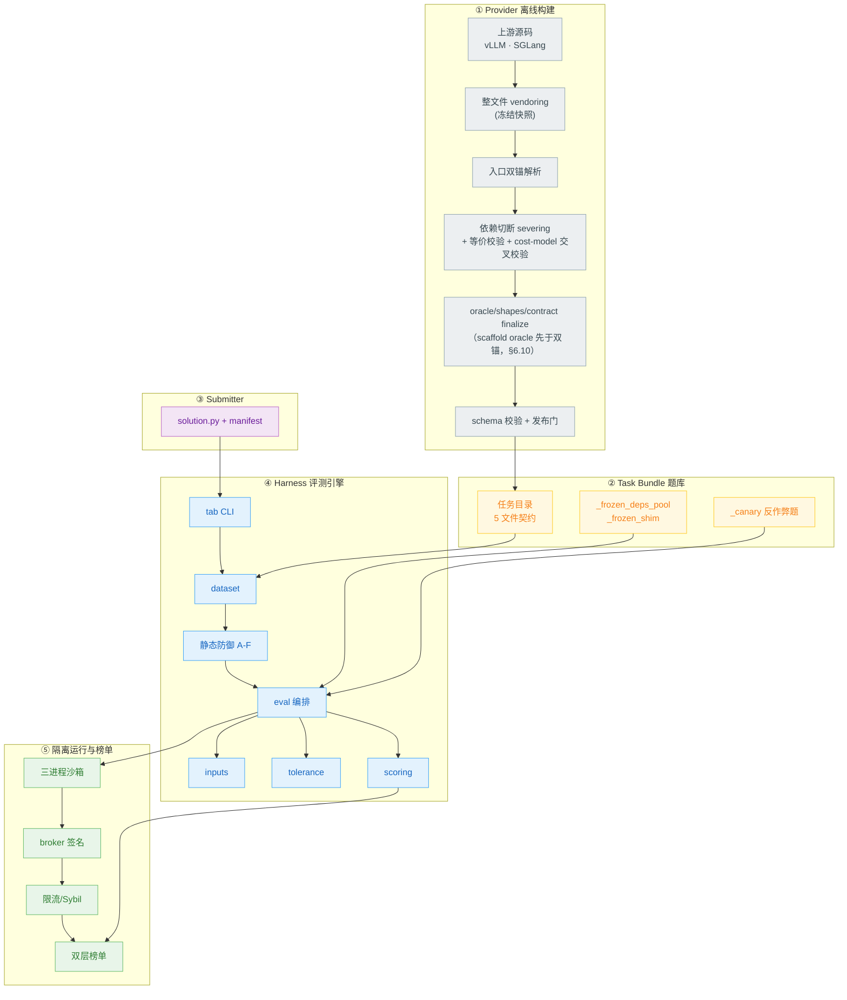
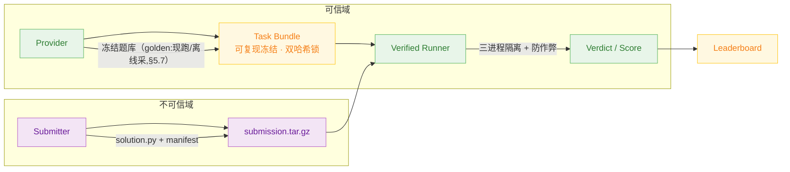
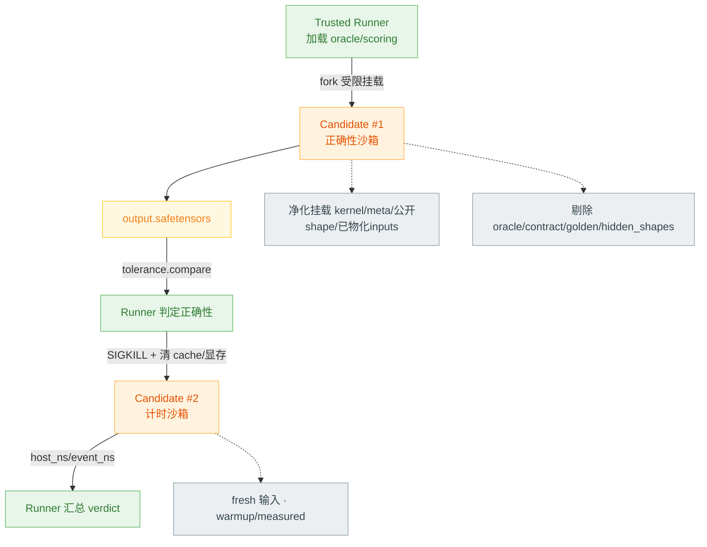
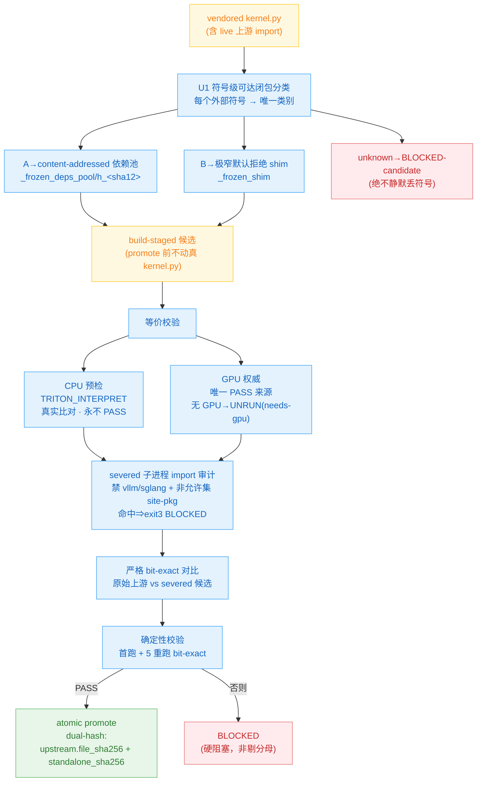
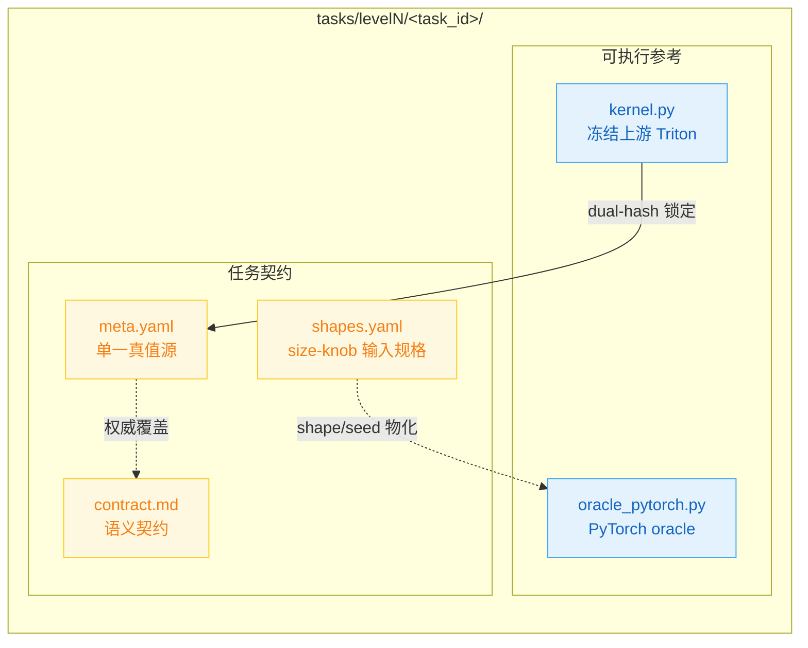
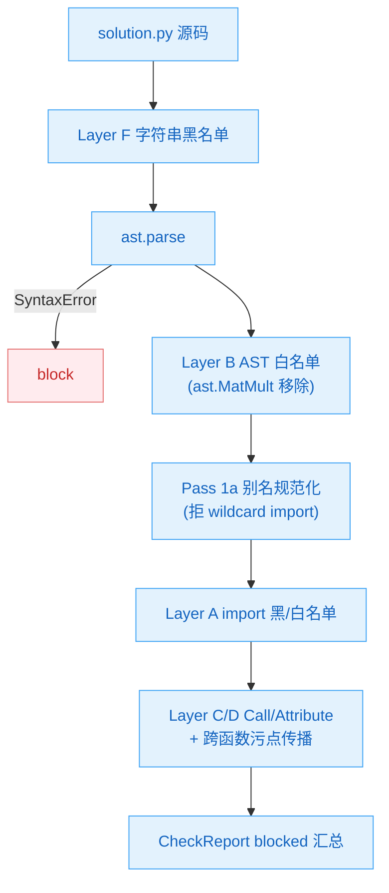
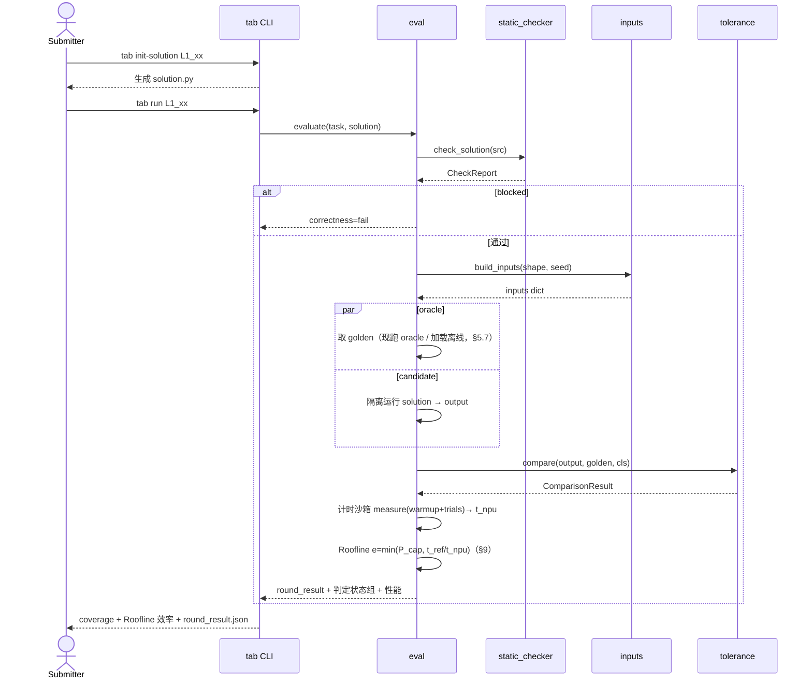
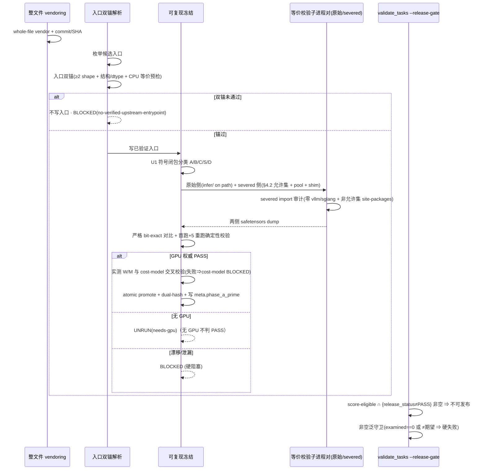
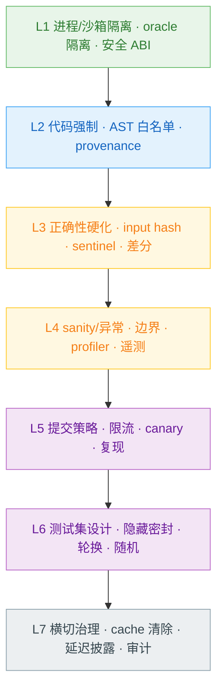

# TritonAscendBench — 最终设计规范

> **对象**：`triton-ascend-bench` —— GPU Triton → 昇腾 910B NPU Triton **迁移**评测基准的架构与模块设计规范。

## 一句话摘要

TritonAscendBench 回答一个具体问题:

> 已在 vLLM / SGLang 生产推理路径中运行的 GPU Triton 算子,迁移到昇腾 910B 的 `triton-ascend` 后端后,能否保持被冻结的上游真实语义,并在 910B 上达到可解释、可复现的性能?

因此这是一个 **GPU Triton → NPU Triton 迁移基准**(不是"由算法描述生成新 kernel"),**双目标**评测:

1. **迁移是否正确**:NPU 实现必须复现被可复现冻结的上游 GPU Triton kernel 行为;
2. **迁移是否高效**:通过正确性资格门后,按 910B Roofline 理论上限归一化,比较 NPU 实测效率。

**正确性是进入排名的资格门;性能是进入资格门后的排名指标。**

---

## 目录

0. [核心概念](#0-核心概念)
1. [背景与动机](#1-背景与动机)
2. [设计目标、非目标与核心原则](#2-设计目标非目标与核心原则)
3. [整体架构](#3-整体架构)
4. [可复现冻结 Provenance 链（核心）](#4-可复现冻结-provenance-链核心)
5. [数据模型与契约](#5-数据模型与契约)
6. [模块详细设计](#6-模块详细设计)
7. [评测流程时序](#7-评测流程时序)
8. [Reward Hacking 防御体系](#8-reward-hacking-防御体系)
9. [评分体系数学定义](#9-评分体系数学定义)
10. [关键工程决策与权衡](#10-关键工程决策与权衡)
11. [系统构成层次](#11-系统构成层次)
12. [附录](#12-附录)

---

## 0. 核心概念

正式术语表（下一节）给精确定义;本节先用读者视角把整套设计讲清楚。

**概念对照**（读者视角 → 本规范术语 / 标识 → 作用）：

| 读者视角 | 本规范术语 / 标识 | 作用 |
|----------|------------------|------|
| 冻结上游真实行为 | 可复现冻结 / `severing` | 固定上游 GPU Triton kernel,使其行为不再随环境中 vLLM/SGLang 版本漂移 |
| 证明冻结没改语义 | 等价与确定性校验 | 原始 vs 切断后 kernel 在 GPU 上严格 bit-exact;**唯一权威 PASS 来源是 GPU 实测**,CPU 形式只预检不判 PASS |
| 入口选对了没有 | 入口双锚校验 | 写入 `meta.yaml` 前,用 ≥2 shape 的 oracle 一致性 + CPU 等价预检确认入口确为目标算子 |
| 冻结后是否稳定 | 确定性校验(首跑 + 5 重跑) | 冻结候选多次重跑必须 bit-exact 一致 |
| 题库能否发布 | 发布门 / `validate_tasks --release-gate` | 任一可计分任务未达 `release_status=PASS`（冻结 PASS ∧ cost-model PASS）⇒ 整套基准不可发布 |
| 哪些任务进分母 | score-eligible 集 / `eligibility.py` | oracle 非 stub 且 shapes 非手工占位的任务,作为正确率与性能的固定分母 |
| 性能分母是什么 | 910B Roofline $t_{ref}$ | 按 910B 峰值算力/带宽推导的理论最快时间,不拿 GPU 延迟当分母 |
| 候选是否绕规则 | reward hacking 防御 | 静态检查 + 进程隔离 + 隐藏输入 + canary + 计时仲裁协同 |

整套设计可归为**三条链**：

1. **真值链**：上游 GPU kernel → 可复现冻结（severing + 等价与确定性校验）→ golden 输出。
2. **评测链**：提交者 `solution.py` → 三进程隔离运行 → 正确性比对 → 910B 计时 → Roofline 效率。
3. **治理链**：静态规则 + 进程隔离 + 发布门 + 固定分母 + 防作弊 + 双层榜单。

三条链对应专家需要判断的三件事:**真值是否可信 · 候选是否真正完成迁移 · 性能分是否可复现且不可被选择性操纵。**

## 术语表

| 术语 | 定义 |
|------|------|
| **GPU Triton 算子** | vLLM/SGLang 现网推理路径中的 `@triton.jit` kernel，迁移的源对象 |
| **`triton-ascend`** | Triton 面向昇腾 NPU 的编译后端（被测对象，`pip install triton-ascend`，版本见 `infra/version_matrix.toml`） |
| **oracle / golden** | oracle = `oracle_pytorch.py::run`（PyTorch eager，经入口双锚对齐冻结上游语义，**非独立真值源**）；golden = 评测期参考输出——PyTorch 可对齐题由 oracle **现跑生成**，`upstream_oracle_required` 题由 provider **离线采自冻结上游 kernel**（§4 / §5.7） |
| **可复现冻结** | 符号级切断 `kernel.py` 对运行时安装上游包的依赖（severing），并经**等价与确定性校验**证明"行为不变"后的 `kernel.py`（§4） |
| **等价与确定性校验** | 原始上游 vs 切断后候选的**严格 bit-exact** 比对（等价）+ 首跑后 5 次重跑全一致（确定性）。GPU 实测是**唯一权威 PASS 来源**；CPU/`TRITON_INTERPRET=1` 形式做真实比对但**永不判 PASS**（无 GPU 记 `UNRUN(needs-gpu)`） |
| **入口双锚校验** | 上游入口写入 `meta.yaml` 前的双重锚定：≥2 个 shape 的 oracle 输出一致 + 输出结构/dtype 匹配 + CPU 等价预检（§4.3） |
| **发布门** | 任一 score-eligible 任务 $\text{release\_status}\neq\textsf{PASS}$ ⇒ 基准不可发布；$\text{release\_status}{=}\textsf{PASS}\iff\text{phase\_a\_prime.status}{=}\textsf{PASS}\wedge\text{cost\_model.status}{=}\textsf{PASS}$（§4.4） |
| **score-eligible 集 $S$** | oracle 源非 stub（无 `raise NotImplementedError` 文本）且 `shapes.yaml` 非 `PHASE-C-MANUAL` 的任务集，由 `eligibility.py` 单一来源计算 |
| **$t_{ref}$** | **910B Roofline 理论延迟** $\max\!\big(\max_c W_c/\pi_c,\,\max_r M_r/\beta_r\big)$（计算类 $c$、数据资源 $r$；单类单资源即 $\max(W/\pi,M/\beta)$）：由算子工作量与 910B 算力/带宽峰值推导的硬件归一化性能基线（§9） |
| **Roofline 效率** | $\min(P_{cap},\,t_{ref}/t_{npu})$：候选达到 910B 屋脊的比例，理论 $\in(0,1]$（$t_{ref}$ 为下界）；$>1$ 仅源于 cost-model 低估或计时噪声，由 $P_{cap}{=}5.0$ 钳制并标记需复核。算子计算受限/带宽受限由操作强度 $W/M$ 与屋脊点 $\pi/\beta$ 的相对位置决定 |
| **cost model** | 每任务按**计算类**声明 $\{c:W_c(\text{shape})\}$（FLOPs）、按**数据资源**声明 $\{r:M_r(\text{shape})\}$（HBM/通信字节）的解析公式（单类单资源退化为标量 $W/M$，与 $t_{ref}$ 公式同源），经插桩 GPU-Triton 参考实测交叉校验（fail-closed，§5.6）|
| **size-knob shapes** | 以命名整型旋钮（B/L/D 等）的参数化公式表达张量维度的 `shapes.yaml` schema |

---

## 1. 背景与动机

### 1.1 问题陈述

vLLM / SGLang 等推理引擎已在 NVIDIA H100/A100 上沉淀了大量成熟的 **GPU Triton 算子**（采样、归一化、KV-cache、LoRA、MoE、Flash-Attention、Mamba 等）。把推理栈迁移到华为昇腾 **Atlas 910B（A2 系列）** 需用 `triton-ascend` 后端把这些 kernel 一一移植，且**不能在语义上回退**。

核心问题：

> 一个 NPU `triton-ascend` 实现，能否在 910B 上**正确复现被冻结的上游 GPU Triton 算子语义**，并在 910B 上**高效执行**？

本基准为**双目标**评测：

- **正确性（排名资格门）**：以"被冻结、可复现的上游 kernel 语义"为真值参考，按算子族分级容差判定迁移是否保真；coverage 须 ≥ 0.70 方具排名资格。
- **性能（排名指标）**：在 910B 上实测延迟，按 910B 算力/带宽峰值归一化为 **Roofline 效率**（达到 910B 理论上限的比例，硬件无关、绝对可复现）；入门提交按其 geomean 排名（§9）。

迁移的实践目的是在 NPU 上**既正确又高效**——只测正确性会把"正确但低效（如回退到慢通用路径）"误判为成功，故性能为一等排名指标，正确性为其前置资格门。

### 1.2 为什么是 Migration Benchmark，不是 Generation Benchmark

| 维度 | KernelBench | TritonBench | **TritonAscendBench** |
|------|-------------|-------------|----------------------|
| 任务 | PyTorch → CUDA 生成 | PyTorch → Triton 生成 | **GPU Triton → NPU Triton 迁移** |
| 起点 | 算法描述 | 算法描述 | **现网生产 GPU Triton 源码** |
| 真值定义 | 功能等价即可 | 功能等价即可 | **被冻结且可复现的上游 kernel 行为** |
| 保真要求（与真值的语义匹配严格度）| 功能近似即可 | 功能近似即可 | **严格匹配上游语义：输出 stride 布局、in-place 原地修改语义、NaN/Inf 位置均须一致** |
| 性能评分 | 原始加速比 | 原始加速比 | **910B Roofline 归一化效率（硬件无关，正确性门 + 性能排名）** |

被测对象是 **`triton-ascend`**（Triton 的昇腾编译后端，`pip install triton-ascend`）。提交者只写 NPU Triton `solution.py`，由 `triton-ascend` 编译执行。

### 1.3 真值从哪来：本基准最关键的科学问题

迁移基准的真值由**被迁移的上游 kernel 的实际计算行为**定义，而非该算子的解析参考实现：上游 kernel 常含 fp32 累加、fused epilogue、masking、有意近似，独立从数学定义重推的参考实现可能在数值上偏离上游 kernel 的真实行为。本设计将"真值可信"落为一条可执行、可证伪的主线：

> **切断依赖 → 证明等价 → 得到可信冻结真值**

1. **可复现冻结**：对 `kernel.py` 做**符号级依赖切断（severing）**，使其不再依赖运行时安装的上游包版本；并由 **GPU 权威的严格 bit-exact 等价校验**证明"切断后行为 ≡ 切断前上游行为"，从而使"基准真值 = 被冻结的上游 kernel"在来源（provenance）层得到可验证保证（§4）。
2. **入口双锚校验**：每个任务的上游入口在写入 `meta.yaml` 前，必须同时通过"≥2 个 shape 的 oracle 输出一致性（算子族 `tolerance_class` 容差下的**错误算子过滤**，非精度认证，详见 §4.3）+ 输出结构/dtype 匹配 + 真实 CPU 等价预检"两道锚定校验；未通过校验的可调用对象一律不写入，不得为提升通过计数而纳入。
3. **golden 来源分级（§5.7）**：score-eligible 集中 **≥80%** 的任务其 PyTorch oracle 经公式级对齐冻结上游语义，评测期**现跑生成 golden（零预存、训练循环零额外存储）**；其余 **≤20%** 不可约融合题（在线 softmax / chunk-recurrent 等）的 golden 由 provider 侧**离线在 GPU 上跑冻结上游 kernel 一次性采集**。两类真值均系冻结上游 kernel，均留在固定计分分母。

> **保证强度**：双锚提供强经验保证（高置信度），非形式化完备性证明；等价校验的权威 PASS 仅由 GPU 实测判定（无 GPU 时记 `UNRUN(needs-gpu)`，不判 PASS）。

### 1.4 核心技术挑战

1. **浮点不可结合**（$(a+b)+c \neq a+(b+c)$）：oracle / 上游 GPU kernel / NPU 候选三方分块/规约顺序不同必有微小漂移 → 分级 oracle + 分类容差，**绝不**把 PyTorch 自动当真值放宽。
2. **冻结陷阱**：whole-file vendoring 仍保留 live `from vllm…/sglang…` import，行为随运行时安装的包版本漂移 → 仅为文件快照、并非可复现冻结，必须经符号闭包 severing + 等价验证方能成立（§4）。
3. **评分操纵（reward hacking）空间巨大**：提交者可通过 import oracle、恒等返回、硬编码查表、缓冲区复用、空 kernel、异步不同步、非默认 stream 计时、隐藏 shape 探测等多类手段操纵评分（完整攻击面分类见 `specs/reward_hack_defense.md`）→ 防御机制内建于基准设计本身。
4. **跨硬件性能不可直接比 + JIT 干扰计时**：910B 与源 GPU 峰值不同，绝对延迟不可跨硬件直接比 → 性能按 910B 算力/带宽峰值归一化为 Roofline 效率 $\min(P_{cap},\,t_{ref}/t_{npu})$（$t_{ref}=\max(\max_c W_c/\pi_c,\max_r M_r/\beta_r)$，§9），分数为"达到 910B 自身理论上限的比例"，硬件代差在基线推导中被构造性消去，故性能可计分而非仅报告；`triton-ascend` Python 层 JIT 首次执行触发编译 → 计时须 warmup 剔编译、每 trial 新输入防 cache。

---

## 2. 设计目标、非目标与核心原则

### 2.1 设计目标
- 为 100 个真实生产 GPU Triton 算子建立可复现的 NPU 迁移**正确性**评测；
- 把"真值可信"与"防作弊"做成基准的**结构性、可执行**属性；
- 在 910B 上以 Roofline 归一化效率对迁移性能计分排名（正确性资格门 + 性能排名指标）；
- 提供 self-reported（迭代）与 verified（公开排名）双层榜单。

### 2.2 非目标
**Provider-only 基准**：维护方维护题库 / 引擎 / 榜单，**不写** NPU kernel 实现；不做 PyTorch→Triton 生成；**不做 GPU↔NPU 绝对延迟竞速**——性能以 910B Roofline 归一化效率度量（硬件无关），不以手写算子做跨硬件分母。

### 2.3 核心设计原则

| # | 原则 | 设计体现 |
|---|------|---------|
| P1 | **可复现冻结优先** | 整文件 vendoring → **符号闭包 severing + bit-exact 等价校验** 方构成可复现冻结 |
| P2 | **真值来源需双重证据** | 入口须经双锚校验（≥2 shape + 结构/dtype + CPU 等价预检）后方可写入 meta；未通过则不写入 |
| P3 | **防作弊内建** | 进程隔离 / AST 正向白名单 / broker 签名是结构，不是补丁 |
| P4 | **单一真值源** | `meta.yaml` 机器可读权威；`contract.md` 只解释 |
| P5 | **正确性门 + 性能 Roofline 排名** | correctness coverage≥0.70 为排名资格门；入门后按 910B Roofline 归一化效率 geomean 排名 |
| P6 | **固定分母，不剔分母** | 资格门与性能指标共用固定分母 $|S|$；正确性失败计 0、性能非 ok/fallback 计 ε，BLOCKED 均不剔分母（防"少做难题反而抬指标"）|
| P7 | **硬发布门** | 发布门：任一 score-eligible 任务 `release_status≠PASS`（`phase_a_prime.status=PASS ∧ cost_model.status=PASS`）⇒ benchmark 不可发布 |

---

## 3. 整体架构

### 3.1 系统全景

五层流水线：**离线构建（含可复现冻结）→ 题库 → 提交 → 评测 → 隔离运行与榜单**。



### 3.2 三角色与信任边界



信任规则：`oracle_pytorch.py`、golden、隐藏 shape **永不挂载** candidate 沙箱；submitter 的 `solution_artifacts.json`/`*.so` 在 verified 模式忽略；`meta.yaml` 单一真值。**score-eligible 集**由 `triton_ascend_bench/eligibility.py` 单一来源计算（cli 与 validate_tasks 共用，禁漂移），submitter 无法影响其成员资格。

### 3.3 进程隔离三进程模型



正确性 pass 与计时 pass **每阶段独立进程 + SIGKILL + 阶段间全量 cache 清除**，切断"正确性阶段预计算→计时阶段查表"路径。candidate 子进程仅获**净化挂载**——`kernel.py` + `meta.yaml` + 公开 shape 视图/已物化输入 + `solution.py`，**`oracle_pytorch.py`/`contract.md`/golden/`shapes.yaml` 的 hidden_shapes 段一律剔除**（非原样挂载整个任务目录）；输入由固定 seed 确定性物化、与 oracle 侧字节一致（公开 shape 候选侧可重建，hidden shape 由可信 runner 物化注入）；IPC 仅 safetensors（data-only，无 pickle RCE）；hung/超时由 timeout+SIGKILL 进程组终止。完整 Docker/seccomp/cgroup/NPU 设备白名单属 verified runner 的 GPU/NPU 部署层（规范 `specs/process_isolation.md`）。

---

## 4. 可复现冻结 Provenance 链（核心）

> 本基准相对一般"benchmark 收题"的关键科学增量：让"真值 = 冻结上游 kernel"成为**可执行、可证伪**的保证。主线只有一条——**切断依赖 → 证明等价与确定性 → 得到可信冻结真值 → 发布门强制**。

### 4.1 为什么 whole-file vendoring 不是可复现冻结

第一步是**整文件 vendoring**（`scripts/phase_a_freeze.py`）：把整个上游文件原样 vendored 为 `kernel.py`（保留 Apache 头、锁定 commit/SHA）——实现简单、保留上游许可、与静态检查输入形式一致。但此时 `kernel.py` 仍保留 live `from vllm… / from sglang…` import，其行为**依赖运行时安装的包版本**，golden **不可复现**。因此它仅是文件快照，尚未构成可复现冻结。

### 4.2 符号闭包 severing 与等价校验



**符号分类（U1，不可静默丢任何符号——"doubtful → A/BLOCKED"）**：

| 类 | 含义 | 处置 |
|----|------|------|
| **A** | 默认 / 不可证惰性 | vendor 进 content-addressed 依赖池 |
| **B-rewrite-public** | `tl`/`triton` re-export | 改写为公开 `triton` import |
| **B-inert-shim** | 可证惰性 | 进极窄默认拒绝 shim |
| **C** | 可选加速 fork | 标注，按规则处理 |
| **S** | env/device/file 驱动配置 | 标注（如 `vllm.envs`） |
| **D** | 已 pin 稳定 PyPI（einops） | `version_matrix [gpu_capture].extra_pins`，不 vendor 不 shim |
| **torch+triton** | stdlib/torch/triton | always-available，永不 severed |
| 未知第三方 | 不在 D 白名单、非 stdlib | **BLOCKED-candidate**（surface，绝不静默） |

**等价校验不变量（不可违反）**：
- **严格 bit-exact**，**不用** `tolerance_class`、**无 ULP 逃逸**——severing 是同代码纯 import 改写，任何数值漂移即"未冻结副作用"证据，必须 BLOCKED+investigate 而非放宽容差；比对覆盖 dtype/shape/strides/alias/in-place/被 mutate 输入。
- **唯一 PASS 来源是 GPU 权威实测**；CPU 预检（`TRITON_INTERPRET=1`）做真实比对但**永不** PASS；无 CUDA 时返回 `UNRUN(needs-gpu)`，**绝不**伪造 PASS。
- **severed 侧 import 审计**：fresh 子进程，`infer/` 上游根**不在** `sys.path`，依赖池/shim 前置；severed 侧允许集仅 `{torch, triton, einops, numpy, yaml, safetensors, _yaml}`（Class-D + safetensors/yaml IPC 管道）。`sys.meta_path` finder 在 kernel 执行**前**安装 + 运行后 `sys.modules` 重扫，判定 leak 的两类：① **任何** `vllm`/`sglang` 模块（无论何时加载，恒为 leak）；② kernel 引入的、不在上述允许集的 site-packages 顶层模块。命中（import-time / runtime / post-run 任一）⇒ exit 3 ⇒ BLOCKED（防"等价过但干净盒子失败"）。
- **PASS 才 atomic promote**，写双哈希：`upstream.file_sha256`（provenance）+ `phase_a_prime.standalone_sha256`（盘上 severed 产物）；`meta.yaml` 的 `phase_a_prime.*` 字段在 promote 时写入，是"已可复现冻结"的机器可读凭证。

### 4.3 入口双锚校验（resolver）

任务的真实上游入口由 `resolve_upstream_entrypoints.py` 解析。写入 `meta.yaml` **前**必须过**强双锚**：

1. **CPU 等价预检锚**：CPU/`TRITON_INTERPRET=1` 的 staged-vs-original 比对必须过（`UNRUN(needs-gpu)` = 预检已过、仅缺 GPU）；
2. **oracle 一致性锚**：用等价校验同款 by-name 签名适配器，在 **≥2 个不同 shape**（小+中）上跑入口，与 `oracle_pytorch.py::run` 同输入比对，且**输出 arity + 每张量 dtype 必须匹配**（同名键优先；键不同则按 shape/dtype 回退配对）；多出无法解释的输出张量 ⇒ 错误算子。

可解析但与 oracle 不匹配的可调用对象判为**错误算子（与目标语义不符），不写入 `meta.yaml`**，记录 `BLOCKED(no-verified-upstream-entrypoint)`（含所有尝试过的候选及拒绝原因）。双锚提供强经验保证，非形式化完备性证明。

> **锚 2 的定位 = "选对入口" 而非 "认证精度"**：值比对在该题算子族 `tolerance_class` 容差下进行（足以排除完全不同的错误算子，不据此认证数值精度）。对 `upstream_oracle_required` 题——其 PyTorch oracle 与冻结上游存在**已知数值偏离**（§5.7）——入口身份由 arity/dtype/输出结构 + 锚 1（staged-vs-original CPU 等价预检，与 oracle 无关）+ 族容差 sanity 共同确认即可通过；该类题的**精度真值由 §5.7 的 provider 离线冻结上游 golden 确立，不依赖 oracle 精度**。两类题真值始终系冻结上游 kernel，§4.3 与 §5.7 无冲突。

**验证可复现性（fail-closed）**：resolver 每条 verdict 绑定 provenance——读路径权威校验字段为 `code_fingerprint`（解析逻辑本身）与全局 `infer_state`（`infer/` 上游的干净 pin 状态带）；每条 verdict 另记录 per-task `input_fp`（该任务输入构造）与 `upstream_fp`（该任务上游闭包 sha256），作为复算依据。**陈旧缓存在任何情况下都不被静默复用**：① `infer/` 上游为可验证干净 pin 检出时，`code_fingerprint`/`infer_state` 漂移（`fingerprint-mismatch` / `no-infer-state` / `infer-state-mismatch`）返回**可再生陈旧标记**，读路径在当前 code+upstream 下按 `input_fp`/`upstream_fp` 自动复算；② `infer/` 上游不可验证（脏树 / HEAD 漂移 / 无 pin），或自动复算失败/被抑制 ⇒ 抛 `StaleResolverCacheError`（附"pin 并清理"修复指引）。verdict 因此可在相同锚点下复现重算、不因脏环境静默漂移。

### 4.4 发布门（硬门）

`validate_tasks.py --release-gate`（与 schema/hash 模式**分离**）：score-eligible 集中任一任务 $\text{release\_status}\neq\textsf{PASS}$ ⇒ 非零退出 + 阻塞清单，其中 $\text{release\_status}{=}\textsf{PASS}\iff\text{phase\_a\_prime.status}{=}\textsf{PASS}\ \wedge\ \text{cost\_model.status}{=}\textsf{PASS}$（可复现冻结 ∧ cost-model 经 GPU 交叉校验，§5.6）。**非空泛守卫**：score-eligible 集与其期望计数同源于 `eligibility.py`；若该期望计数为 0、examined 集为空、或 examined 集与期望计数不一致，则硬失败——杜绝"无任务 ⇒ 无阻塞 ⇒ 可发布"的空泛通过，并捕获 catalogue 两次物化之间的不一致（生成器耗尽 / 迭代不确定）。可复现冻结 BLOCKED 与 cost-model BLOCKED 同为硬阻塞，不可通过从分母剔除该任务规避（对应原则 P6/P7）。

---

## 5. 数据模型与契约

### 5.1 Task 目录布局（5 文件契约）



| 文件 | 职责 | 关键约束 |
|------|------|---------|
| `kernel.py` | 冻结上游 GPU Triton 算子 | ≥1 `@triton.jit`；导出经双锚验证的真实入口；经 severing + 等价校验后双哈希 |
| `oracle_pytorch.py` | PyTorch eager oracle（经双锚对齐冻结上游语义，非独立真值源）| 无 triton；导出 `run(inputs)->dict`；**永不挂载 candidate** |
| `meta.yaml` | 机器可读权威 | `interface.alias_map`/`tolerance_class`/`oracle_simplified`/`runner_checks`；等价校验 PASS promote 后写入 `phase_a_prime.{status,standalone_sha256}` 作为可复现冻结凭证 |
| `shapes.yaml` | size-knob 输入规格 | 公开/隐藏 shape 分离；缺必填无默认参数即拒绝（不静默 skip+shift） |
| `contract.md` | 人读语义 | 不得引入 meta 没有的事实 |

辅助目录：`_frozen_deps_pool/`（content-addressed 依赖池）、`_frozen_shim/`（默认拒绝 shim）、`_canary/`（反作弊陷阱题）、`_vendored/`（整文件 vendoring 快照，不计分）。

### 5.2 size-knob 可执行 shapes

shape 不硬编码维度，而是**尺寸旋钮公式**，一个 `inputs` 块覆盖所有 shape 行：

```yaml
size_knobs: {B: 2, L: 8, D: 16}
public_shapes: [{id: P1, name: tiny, knobs: {B: 1, L: 4, D: 8}}, ...]
hidden_shapes: [{id: H1, name: h_odd, knobs: {B: 3, L: 13, D: 40}}]  # verified 模式注入
inputs:
  x: {dims: [B, L, D], dtype: float32, dist: randn}
  eps: {scalar: 1.0e-5}
```

`inputs.build_inputs(shapes_doc, shape_id, seed)` 解析维度公式（`2*D`/`L+1`）、按 `dist`（`randn/ones/eye/tril/randint:lo:hi/softmax_rows/offsets/arange`）+ **固定 seed** 物化张量，保证 oracle 与 candidate 见**字节一致**输入。

### 5.3 数值容差（按算子族分类，节选；完整定义见 `tolerance_policy.yaml`）

| Class | atol | rtol | 用途 |
|-------|------|------|------|
| `elementwise` | 1e-3 | 1e-3 | silu/gelu/bias |
| `vector_reduce` | 1e-3 | 1e-3 | RMSNorm/LayerNorm/softmax |
| `cube_matmul_fp16` | 5e-3 | 1e-3 | FP32 累加 GEMM |
| `int8_w8a8` | 5e-2 | 1e-2 | W8A8 量化 matmul |
| `sampling_rng` | 0 | 0 | seed 一致 bit-exact |
| `attention_flash` | 5e-3 | 1e-3 | online softmax+matmul 融合 |
| `recurrent_chunk` | 5e-3 | 5e-3 | Mamba/GDN/KDA chunk |

> 等价校验**不用** tolerance_class（严格 bit-exact）；tolerance_class 只用于 candidate vs golden 的迁移正确性判定。

### 5.4 solution.py 契约（submitter 唯一可写）

```python
def npu_triton_impl(inputs: dict) -> dict:
    """inputs 键来自 meta.interface.alias_map（NPU 张量）；返回键匹配 oracle 输出 schema"""
```

禁止：import oracle/harness/tasks；高层 torch（`F.*`/`@`/`Tensor.matmul`）；原生 AscendC（`torch_npu.npu_*`/`sgl_kernel_npu.*`）；代码执行（`exec/eval/compile/ctypes/cpp_extension`）；IPC/网络；计时 API（`*.Event`/`time.perf_counter`/`LD_PRELOAD`）；文件/线程——由 §6.4 静态防御强制。

### 5.5 score-eligible 集（单一来源）

`eligibility.py`：任务 score-eligible **当且仅当** oracle 源非 stub（源码无 `raise NotImplementedError` 文本）**且** `shapes.yaml` 非 `PHASE-C-MANUAL`。stub/manual **排除出分母**（不计为失败，否则系统性压低有效提交）。纯函数、零 import-time I/O；cli 与 validate_tasks 共用此唯一来源（API parity，禁两处漂移）。

### 5.6 性能 cost model（每任务 $W/M$ 契约）

性能计分需硬件归一化的理论延迟基线（§9）。算子可混合多种计算类（cube fp16/bf16、int8、vector）与多种数据资源（HBM、跨设备通信），故**按资源分别建模、取约束最紧资源为下界**（标准 Roofline：假设各资源理想重叠，得最紧理论地板；若计算与访存完全串行不重叠则为 $\sum$ 即 $W/\pi+M/\beta$）：$t_{ref}=\max\!\big(\max_c W_c/\pi_c,\ \max_r M_r/\beta_r\big)$，$W_c$=第 $c$ 计算类 FLOPs、$\pi_c$=910B 该类峰值算力，$M_r$=第 $r$ 资源字节、$\beta_r$=该资源峰值带宽（单类/单资源时退化为 $\max(W/\pi,\,M/\beta)$）。各 $W_c$/$M_r$ 由每任务 cost model 提供：

- **解析声明**：`meta.yaml.cost_model` 以 size-knob 公式（与 §5.2 shapes 同一参数化体系）按**计算类**给出 `flops`（$\{c:W_c(\text{knobs})\}$）、按**数据资源**给出 `bytes`（$\{r:M_r(\text{knobs})\}$），随 shape 确定取值；单计算类/单资源时退化为标量 `flops`/`bytes`（与 $t_{ref}$ 公式同源的退化形）；
- **GPU 实测交叉校验（双锚，fail-closed）**：provider 侧 GPU 权威的 GPU-Triton 参考运行经插桩实测 FLOPs/字节，与解析声明逐 shape 比对；偏差超容差 ⇒ 该任务 cost-model `BLOCKED`（硬阻塞，进发布门，§4.4），绝不以未经校验的基线产出加速比；
- **910B 峰值表**：`infra/` 维护 910B 各计算类/精度的 $\pi$（fp16/bf16 cube、int8、vector）与 $\beta$（HBM / 通信带宽）峰值，与 `version_matrix.toml` 同级锁定。

此为正确性侧"双锚"在性能侧的同构镜像：解析模型 + 真实运行交叉证伪，杜绝错误基线静默扭曲性能分。

### 5.7 oracle 保真度分级与 golden 来源

`meta.yaml.oracle_simplified` 按"PyTorch oracle 能否忠实复现冻结上游语义"将每题分三级：

| 分级 | 含义 | 评测期 golden 来源 |
|------|------|-------------------|
| `simple_pytorch_ok` | 朴素 PyTorch 实现即足够 | 现跑 PyTorch oracle |
| `formula_exact_manual` | 手写公式级 oracle（匹配 fp32 累加序等）可落入算子族容差 | 现跑 PyTorch oracle |
| `upstream_oracle_required` | 融合 / 在线 softmax / chunk-recurrent 等，PyTorch 必偏离真实上游 | provider 侧用冻结上游 kernel **离线 GPU 提前跑** 采集固定 golden |

**策略**：score-eligible 集中 **≥80% 须为 PyTorch 可对齐档**（`simple_pytorch_ok` ∪ `formula_exact_manual`）——评测期 golden 由现跑 PyTorch oracle 生成，**零预存、训练循环零额外存储**；其余 **≤20%** `upstream_oracle_required` 题的 golden 由 provider 侧离线在 GPU 上跑冻结上游 kernel 一次性采集，覆盖该题**完整评测 shape 集（公开 + 密封 hidden）**（仅这 ≤20% 题，固定有界小数据集，不进训练循环；hidden golden 与 hidden shapes 同等密封）。该比例是验收准则,而非把难题从评测中拿掉。

**不变量（no-subset-escape）**：三级题**全部留在计分分母 $|S|$**；`upstream_oracle_required` 仅表示"golden 系冻结上游而非 PyTorch 近似"，**不**从分母剔除、不放松其计分约束（§4.4 发布门、§9 固定分母同等适用）。这条与"≥2 shape 双锚 + 严格 bit-exact 等价校验"正交：双锚保的是"入口选对"，本分级定的是"golden 由谁生成"，真值始终是冻结上游 kernel。

---

## 6. 模块详细设计

> 每模块：**设计初衷 → 设计与机制**（描述系统应当如何工作）。

### 6.1 `dataset.py` — Task 加载器
**初衷**：把 5 文件目录解析成不可变 `TaskDef`，加载即算 `kernel.py` SHA-256 防篡改。
**机制**：`load_task` 在 level1/2/3 定位，解析 meta/shapes/contract/kernel（`oracle_pytorch.py` 仅记录路径，由 verified runner 评测期加载、不在 loader 内执行——5 文件契约的第 5 个文件以路径形态纳入 `TaskDef`）；属性层对 `tolerance_class`/`oracle_simplified`（兼容 legacy `oracle_tier` 别名）做 schema 回退处理；`iter_all_tasks` 跳过 `_` 前缀目录。

### 6.2 `inputs.py` — shapes→张量桥
**初衷**：让 shapes.yaml 真正可执行，oracle 与 candidate 同 seed 见字节一致输入。
**机制**：`build_inputs` 合并 size_knobs+行 knobs，`_resolve_dims` 解维度公式，`_make_tensor` 按 dist 用固定 `torch.Generator(seed)` 物化 + 整数/fp8 后处理；`shape_ids` 返回 `(public, hidden)`，verified 才注入 hidden。

### 6.3 `eval.py` — 评测编排
**初衷**：编排一次 `(task, solution)` 评测，判定显式拆成**判定状态组**——三个状态枚举 `correctness_status` / `runtime_status` / `performance_status`，外加 `fallback_detected` 标志与 `performance_flags` 列表；下游评分仅依据这些字段，不从"静态检查通过"推断"输出正确"。
**机制**：加载 → 静态检查（blocked 即 correctness=fail 短路）→ `inputs` 逐 shape 物化 → `process_isolation` 隔离 candidate 子进程跑 solution、可信进程取 golden（PyTorch 可对齐题现跑 oracle；`upstream_oracle_required` 题加载 provider 离线固定 golden，§5.7）→ 逐 shape `tolerance.compare` 得 correctness（缺输出/不符即 fail）→ Roofline 效率计算（$t_{ref}$ 见 §5.6/§9）→ `scoring` 汇总。`fallback_detected` 直接判 `correctness_status=fail`（正确但回退实现不得过资格门）；cost-model BLOCKED 任务性能计 ε。

### 6.4 `static_checker.py` — Layer A–D/F 静态防御 + Layer E 运行时回退 ★
**初衷**：在候选代码运行**前**拦截 `specs/ast_denylist.md` 中静态可判定的评分操纵与沙箱逃逸向量；策略为**正向 AST 白名单**（不在允许集内即拒绝），强于黑名单。



**机制**：Layer F 源码字符串黑名单（`oracle/golden/hidden_shape/answer/cheat`，最先执行、开销最低）→ Layer B AST 节点白名单（`ast.MatMult` 即 `@` 显式移除）→ 别名规范化（拒绝 `import *`）→ Layer A import 黑/白名单（模块白名单 = `torch/torch_npu/triton` + `math/typing/dataclasses/functools/numbers/warnings/__future__`；符号级再禁 `functools.partial`/`functools.partialmethod`/`importlib`/`ctypes`/`cpp_extension`/`os`/`time`/`*.Event`/`oracle_pytorch`/`tasks`）→ Layer C/D dotted-path 检查 + **跨函数污点传播**（追踪 `f=open;f(...)`、`g=F.silu` 等别名重绑定）→ Layer E 运行时 `sys.addaudithook` 由 verified runner 侧安装，作为静态层的运行时回退防线。

### 6.5 `tolerance.py` + `tolerance_policy.yaml`
**初衷**：浮点不可结合 → 漂移容许度按算子族而异；整数/采样 bit-exact；NaN/Inf 位置严格一致防"用 NaN 抹差"。
**机制**：`compare` 三段——shape 不符直接 fail；整数/bool/`bit_exact` 走 `torch.equal`（绝不 float32 cast+allclose）；浮点先 inf/nan 掩码一致再有限元素 `allclose`。采样 fast-fail 不是终判（抽样过仍跑全量）。容差**不自动升级**，人工裁决。

### 6.6 `process_isolation.py` + `timing.py` + `trusted_shim/`
**初衷**：candidate 与 oracle/golden/计时物理隔离；host 计时权威（`Event.elapsed_time` 漏跨 stream，B2 攻击面）。
**机制**：candidate 在受限子进程跑（无共享解释器状态、timeout+SIGKILL 进程组、子进程仅获净化挂载（kernel/meta/公开 shape/已物化输入/solution，剔除 oracle/contract/golden/hidden_shapes），输入固定 seed 确定性物化、与 oracle 字节一致），safetensors-only IPC（无 pickle）；`measure` = warmup 剔除 JIT 编译耗时 + n_repeat 次测量，在前后 `synchronize()` 包围的窗口内以 `CLOCK_MONOTONIC_RAW` 测 host 时长，NPU event 作次级交叉信号；二者偏差超过 `specs/timing_arbitration.md` 规定阈值即标 `invalid_timing`/`invalid_stream`（阈值以该规范为单一来源，本文不复述具体数值以免漂移）；NPU 延迟（median/p99/cv）随结果披露，并作为 §9 Roofline 效率计分输入。

### 6.7 `scoring.py` — 评分
**初衷**：正确性为排名资格门，性能为排名指标——以 910B Roofline 归一化效率计分，硬件无关、绝对可复现。
**机制（与 §9 一致）**：`analyze` 计算两项。**资格门**：`native_coverage = #{correctness=ok ∧ ¬fallback}/|S|`——固定分母、**无 ε**、失败/缺失计 0、`fallback_detected` 评分前归一为 correctness fail、`coverage≥0.70` 为排名资格；`eval.coverage_for_ranking` 仅为单任务本地 per-shape 诊断值。**排名指标**：`capped_geomean_native = exp((1/|S|)Σ log s_t)`，其中 per-shape 效率 $e=\min(P_{cap}{=}5.0,\ t_{ref}/t_{npu})$、$t_{ref}=\max(\max_c W_c/\pi_c,\ \max_r M_r/\beta_r)$（cost model，§5.6）；任务全状态 ok 且无 fallback 时 $s_t$ = 各 shape $e$ 的几何均值，否则 $s_t=\epsilon$。`baseline_ns`=$t_{ref}$、`measured_ns`=$t_{npu}$；ε-fill 与固定 $|S|$ 分母作用于性能指标、与资格门同源杜绝选择性规避。`scoring` 对重复 `TaskMeasurement` 抛错（`cli analyze` 已先按最坏值合并重复 result 行，§6.9）。`*_native` 指 **NPU-triton track**（非 AscendC）。

### 6.8 `adversarial.py` — canary + metamorphic
**初衷**：对静态检查与容差判定无法识别的语义级作弊（恒等返回 / 部分计算 / 硬编码查表），以变换检验（metamorphic）+ 陷阱任务（canary）作为最后一道拦截。
**机制**：`run_metamorphic_checks` 按 meta 跑变换比对；`check_canaries` 比对 canary 结果与真值，`C1/C2/C3` 判 hard 其余 soft；canary 不计主指标，`canary_caught>0` ⇒ `suspicious` 人工 review。

### 6.9 `manifest.py` / `backends/` / `cli.py`
- **manifest.py**：submission tar.gz 清单，锁 `triton_ascend_version/cann_version/container_digest/org_identity`；缺键抛错。
- **backends/**：`get_backend` 工厂；`NpuBackend.dtype_supported` 对 FP8 返 False（910B 无 FP8 cube）。
- **cli.py**：9 子命令 `init-solution/run/run-suite/package/submit/validate-submission/validate-result/static-check/analyze`；`submit` 先 validate 失败拒发；解 tar 拒路径穿越/symlink/设备文件 + `filter="data"`；`analyze` 以 catalogue 权威冻结 score-eligible、统计伪造计数、对重复 task_id 的 result 行先按最坏值合并后交 `scoring`（`scoring` 再对残留重复 `TaskMeasurement` 抛错，§6.7）。

### 6.10 离线构建流水线（`scripts/`）
`generate_task_scaffolds`（建任务骨架，含 scaffold `oracle_pytorch.py::run`）→ `extract_kernel` → `phase_a_freeze`（whole-file vendor）→ **`resolve_upstream_entrypoints`（入口双锚校验，比对已存在的 scaffold/手工 `oracle_pytorch.py::run`）→ `phase_a_prime`（severing + 等价校验 + cost-model GPU 交叉校验 → 可复现冻结）** → `phase_b_oracle`（**升级/规范化**已存在的 `oracle_pytorch.py::run`）→ `phase_c_docs`（size-knob shapes+contract）→ `build_oracle_digest`（review 摘要）→ `validate_tasks`（5 文件+schema+`ast.parse`+hash，及独立 `--release-gate` 发布门）→ `verify_version_matrix`。等价校验子进程入口：`_pa_subproc_runner.py`（每侧 fresh 子进程 + import 审计）、`_pa_oracle_check_runner.py`（oracle 一致性锚）。

---

## 7. 评测流程时序

### 7.1 Submitter 评测



### 7.2 Provider 可复现冻结 + 发布门



### 7.3 Verified Runner 三进程隔离
见 §3.3：Runner 算 golden → fork C1 正确性沙箱（写 output.safetensors，SIGKILL+清 cache）→ tolerance 判定 → fork C2 计时沙箱（warmup/measured，host clock + event 交叉，偏差超 `specs/timing_arbitration.md` 阈值→invalid）→ 汇总 score_report。submitter 与评测期**不依赖 NVIDIA CUDA GPU**（CUDA GPU 仅 provider 侧离线 GPU 权威等价校验使用；verified 评测在 910B NPU 上运行）。

---

## 8. Reward Hacking 防御体系

核心理念：**防御内建于基准设计，运行时检测仅为回退防线**。



| 攻击 | 缓解 |
|------|------|
| A1 import oracle | oracle 永不挂载 + 静态 import 拦截 |
| A3 identity / A4 查表 | differential 随机输入 + canary C1/C7 + runner-secret RNG（仅用于 canary/metamorphic 反作弊探针，**非计分输入**；计分输入恒为固定 seed 确定性物化）|
| A5 buffer 复用 | 按 dtype byte-pattern sentinel |
| B1 异步不同步 / B2 非默认 stream | trusted shim 强制 sync + host 权威，drift 超 `timing_arbitration.md` 阈值→invalid |
| B5 空 kernel | profiler NPU kernel event 存在性 |
| C2/C3 tar 攻击 | 路径穿越/symlink/设备文件拒绝 + `filter="data"` |
| F1 oracle 进程污染 | candidate/oracle/比对 分进程 + severed import 审计 |

`_canary/` 定义 10 类陷阱题（identity / zero-out / cache-reuse / non-default-stream / torch-fallback / shape-route / lookup-table / async-no-sync / partial-compute / alibi-attention），不计入主指标，`canary_caught>0` 触发 `suspicious`；`adversarial.py` 提供 `run_metamorphic_checks` / `check_canaries` 判定原语。

---

## 9. 评分体系数学定义

本基准为**双目标**：正确性是**排名资格门**，性能（910B Roofline 归一化效率）是**排名指标**。两者共用固定的 score-eligible 集 $S$（`eligibility.py` 单一来源）；分母 $|S|$ 固定，缺失/失败任务不从分母剔除（杜绝"选择性规避难题"的数学约束）。

**目标一·正确性资格门（无 ε，固定分母）**：$S$ 中每个任务 $t$ 的每个 shape 经 `tolerance.compare(candidate, golden, class)` 得 pass/fail，聚合为判定状态组（§6.3）。`fallback_detected` 在评分前归一为 correctness fail，故资格门计数谓词显式为 $\text{correctness}_t{=}\textsf{ok}\wedge\neg\text{fallback}_t$（正确但回退实现不得过门）：

$$
\text{coverage}=\frac{\big|\{t\in S:\ \text{correctness}_t=\textsf{ok}\ \wedge\ \neg\,\text{fallback}_t\}\big|}{|S|},\qquad \text{排名资格}:\ \text{coverage}\ge 0.70
$$

**目标二·Roofline 归一化性能（排名指标）**：910B 与源 GPU 峰值不同，绝对延迟不可跨硬件直接比，故按 910B 算力/带宽峰值归一化。对任务 $t$ 的每个 shape $s$：

- 按资源分解：$W_c(t,s)$=第 $c$ 计算类 FLOPs、$M_r(t,s)$=第 $r$ 资源（HBM/通信）字节，均由 cost model 解析给出并经插桩 GPU-Triton 参考实测交叉校验（§5.6，fail-closed）；$\pi_c$/$\beta_r$=910B 对应峰值（`infra/` 峰值表）；
- **Roofline 理论延迟** $t_{ref}(t,s)=\max\!\big(\max_c W_c/\pi_c,\ \max_r M_r/\beta_r\big)$（标准 Roofline 下界：各资源理想重叠，取约束最紧者）；实测 $t_{npu}(t,s)$（host 权威计时，§6.6）；per-shape 效率 $e(t,s)=\min\!\big(P_{cap},\ t_{ref}/t_{npu}\big)$，理论 $\in(0,1]$（$t_{ref}$ 为下界），$>1$ 仅源于 cost-model 低估/噪声并由 $P_{cap}{=}5.0$ 钳制。

$$
s_t=\begin{cases}\Big(\textstyle\prod_{s} e(t,s)\Big)^{1/n_t}&\text{全部状态 ok 且无 fallback}\\[1mm]\epsilon=0.01&\text{否则}\end{cases}\qquad \text{capped\_geomean\_native}=\exp\!\Big(\tfrac1{|S|}\textstyle\sum_{t\in S}\log s_t\Big)
$$

$s_t\!\approx\!1$ 表示打满 910B 屋脊。ε-fill 与固定 $|S|$ 分母作用于性能指标：非 ok / fallback 任务计 $\epsilon$ 而**不**从分母剔除——与资格门同源杜绝选择性规避（与 P6 一致）。

**性能基线 provenance**：`baseline_ns`=$t_{ref}$（910B Roofline 理论延迟），`measured_ns`=$t_{npu}$（实测）。cost model 解析 $W/M$ 与插桩 GPU-Triton 参考实测不一致超容差 ⇒ 该任务 cost-model `BLOCKED`（硬阻塞，发布门，§4.4/§5.6），其性能计 $\epsilon$，绝不以错误基线产出加速比。

数据流：`run-suite → suite_results.json → tab analyze（catalogue 冻结 S）→ score_report.json`。

---

## 10. 关键工程决策与权衡

| 决策 | 选择 | 替代 | 理由 |
|------|------|------|------|
| 真值来源 | **冻结上游 kernel**（severing + 等价证明）| 独立从数学重推的 oracle | 迁移真值取决于上游 kernel 的实际计算行为，而非其解析参考实现 |
| 冻结粒度 | whole-file vendor + **符号闭包 severing** | 仅 whole-file | 仅 whole-file 仍保留 live import，行为随安装版本漂移，不构成可复现冻结 |
| 冻结正确性 | **严格 bit-exact 等价校验**（无 tolerance_class/无 ULP）| 信任 vendored 即冻结 | severing 是纯 import 改写，任何漂移=未冻结副作用，必须 BLOCKED |
| 等价校验 PASS 来源 | **仅 GPU 权威实测** | CPU 预检也算 PASS | TRITON_INTERPRET ≠ 真实 GPU 数值；无 GPU 时记 UNRUN，不判 PASS |
| 入口写入 | **双锚校验通过后才写** | 解析到即写 | 未验证入口不写入，避免引入与目标语义不符的算子 |
| 发布门 | **硬门**（eligible 非 PASS ⇒ 不可发布）| BLOCKED 从分母剔除 | 从分母剔除会形成新的选择性规避通道；BLOCKED 必须具备强制力 |
| 正确性角色 | **排名资格门**（coverage≥0.70，固定分母失败计 0）| 与性能加权成单一标量 | 加权标量易被操纵；门 + 独立性能指标更抗博弈、语义清晰 |
| 性能计分 | **910B Roofline 归一化效率**（$t_{ref}=\max(\max_c W_c/\pi_c,\max_r M_r/\beta_r)$，正确性门 + 性能排名）| 仅报告 NPU 原始延迟、不计性能 | 迁移目标是 NPU 上既正确又高效；只测正确性会把"正确但低效/回退"误判为成功 |
| 性能基线来源 | **910B Roofline 理论延迟**（cost model + GPU 实测交叉校验）| GPU 绝对延迟做分母 / 场内最优做分母 | Roofline 硬件归一化、绝对可复现、标准模型；GPU 绝对比混淆硬件代差，场内最优跨轮漂移不可复现 |
| 计时源 | host `CLOCK_MONOTONIC_RAW` | `Event.elapsed_time` | event 漏跨 stream（B2） |
| 输出序列化 | `safetensors` | `.pt`/`.pkl` | pickle 加载即 RCE |
| `@` 运算符 | AST 禁 `ast.MatMult` | 仅黑名单 `Tensor.matmul` | 防 `@` 绕高层算子禁令 |

---

## 11. 系统构成层次

系统按依赖顺序由以下能力层构成：


| 能力层 | 内容 |
|--------|------|
| 版本基线 | `version_matrix.toml` 锁定 GPU/NPU/deps 版本 |
| 题库构建 | 任务目录（kernel / oracle / size-knob shapes / contract）|
| 可复现冻结链 | 符号 severing + 等价校验 + 发布门，使"基准真值 = 冻结上游 kernel"在 provenance 层成立 |
| 评测引擎 | 静态防御 + inputs 桥 + 三进程隔离 + tolerance + 正确性计分 |
| 性能轴 | 910B 实测延迟 + Roofline 理论延迟 $t_{ref}=\max(\max_c W_c/\pi_c,\max_r M_r/\beta_r)$ + 归一化效率 geomean 排名 |
| 线上榜单 | self-reported / verified 双层榜单 + verified runner + broker + 限流/Sybil |

---

## 12. 附录

### 12.1 specs/ 契约清单
`scoring_spec`（评分契约）· `task_api_contract` · `tolerance_policy` · `process_isolation` · `reward_hack_defense` · `canary_task_design` · `timing_arbitration` · `ast_denylist` · `submission_throttling` · `artifact_provenance` · `extraction_failure_taxonomy`

### 12.2 关键文件速查

| 用途 | 文件 |
|------|------|
| 可复现冻结 severing + 等价校验 | `scripts/phase_a_prime.py` · `scripts/_pa_subproc_runner.py` |
| 入口双锚校验 | `scripts/resolve_upstream_entrypoints.py` · `scripts/_pa_oracle_check_runner.py` |
| 发布门 | `scripts/validate_tasks.py --release-gate` |
| score-eligible 单一来源 | `triton_ascend_bench/eligibility.py` |
| 静态防御 / 评分 / 容差 | `static_checker.py` / `scoring.py` / `tolerance.py` |
| 评测入口 / 编排 / 隔离 | `cli.py` / `eval.py` / `process_isolation.py` |

### 12.3 设计参考
KernelBench（Apache 2.0，eval/timing/对抗 kernel 灵感）· vLLM / SGLang（Apache 2.0，任务源 kernel）· Roofline 模型（Williams, Waterman, Patterson, CACM 2009，硬件归一化性能分析）· 参考 PDF（概念草案来源）

---
