# TritonAscendBench (TAB) — 详细设计方案

> **文档类型**：架构与实现设计方案（深度分析产出）
> **对象代码**：`/data1/code/agentic-rl/kernel/triton-ascend-bench/`
> **分析日期**：2026-05-16（代码在分析期间仍在演进，本文反映 Phase C 状态快照）
> **方法**：逐模块源码精读 + specs/ 契约交叉验证 + 任务样本剖析 + codex 独立复核（1 轮，全部采纳）
> **格式参考**：`docs/npu/gpu_triton_to_npu_triton benchmark设计.pdf`（在其概念基础上重写、扩展、补全工程细节）

### 阅读约定（务必先读）

本文最核心的纪律是**严格区分"已写进 specs 的规范" 与 "已落进代码的实现"**。每个机制都带状态标签：

| 标签 | 含义 |
|------|------|
| 【CODE】 | 已在 `triton_ascend_bench/` 或 `scripts/` 中实现，并有源码行证据 |
| 【SPEC】 | 仅写在 `specs/*.md` 规范里，**当前无对应运行代码** |
| 【PLAN】 | 计划项，spec 与代码都尚未/仅部分落地 |

置信度：`[confirmed]` 有源码/数据直接证据 · `[likely]` 有间接证据 · `[speculative]` 推测。
specs 一律按 **章节名（§）** 引用，不写行号（这些是设计规范，非可执行代码）；代码引用用经核对的 `file:line`，但**快速变动的文件按函数名引用**。
**LOC 均为 2026-05-16 当日快照的约值**——代码在分析期间仍在主动演进（`inputs.py`/`phase_c_docs.py`/`eval.py` Phase C 当日新增），精确行数会漂移，结构性计数（101 任务 / 9 脚本 / 11 模块 / 11 specs）则稳定。

---

## 目录

1. [背景与动机](#1-背景与动机)
2. [设计目标、非目标与核心原则](#2-设计目标非目标与核心原则)
3. [整体架构](#3-整体架构)
4. [数据模型与契约](#4-数据模型与契约)
5. [模块详细设计](#5-模块详细设计设计初衷--实现细节)
6. [评测流程时序](#6-评测流程时序)
7. [Reward Hacking 防御体系](#7-reward-hacking-防御体系)
8. [评分体系数学定义](#8-评分体系数学定义)
9. [关键工程决策与权衡](#9-关键工程决策与权衡)
10. [当前实现状态与差距分析](#10-当前实现状态与差距分析)
11. [演进路线](#11-演进路线)
12. [附录：清单与局限性](#12-附录清单与局限性)

---

## 1. 背景与动机

### 1.1 问题陈述

vLLM / SGLang 等推理引擎已在 NVIDIA H100/A100 上沉淀了大量成熟的 **GPU Triton 算子**（采样、归一化、KV-cache、LoRA、MoE、Flash-Attention、Mamba 等）。要把这些推理栈迁移到华为昇腾 **Atlas 910B（A2 系列）**，就必须用 `triton-ascend` 后端把这些 GPU Triton kernel 一一移植过去，且 **不能在正确性或性能上回退**。

TAB 要回答的核心问题：

> 一个 NPU triton-ascend 实现，能否在 910B 上**同时**匹配 GPU Triton 参考的**正确性**与**性能**（对标 910B 原生 AscendC baseline）？

### 1.2 为什么是 Migration Benchmark，不是 Generation Benchmark

| 维度 | KernelBench | TritonBench | **TAB（本项目）** |
|------|-------------|-------------|------------------|
| 任务 | PyTorch → CUDA 生成 | PyTorch → Triton 生成 | **GPU Triton → NPU Triton 迁移** |
| 起点 | 算法描述 | 算法描述 | **现网生产 GPU Triton 源码** |
| 考察 | "能否从零写 kernel" | 同左 | **"生产 kernel 能否无回退移植到 NPU"** |
| 保真要求 | 功能等价即可 | 功能等价即可 | **必须忠于上游语义（含 stride/in-place/NaN）** |

`[confirmed]` `README.md` "What/Why"：TAB 明确定位为 *Migration Benchmark*，起点是 *existing production GPU Triton code*，目标是 *fidelity to upstream semantics, not creativity*。

### 1.3 与参考 PDF 的关系（设计演进）

参考 PDF 描述早期 **NPUKernelBench 三评测扩展**概念草案（`ascendc_migration`/`cuda_to_ascendc`/`gpu_triton_to_npu_triton`），文件结构为 `model.py`+`input_cases.json`+`gpu_triton_kernel/`。TAB 是其中 **`gpu_triton_to_npu_triton` 这条线的工程落地与硬化版本**：

| PDF 草案 | TAB 实际 `[confirmed]` | 演进原因 |
|----------|----------------------|---------|
| 2 level、示例 1-2 算子 | **3 level、101 真实任务**（L1=40 / L2=38 / L3=23） | 覆盖 vLLM/SGLang 真实推理路径 |
| `model.py` PyTorch 标杆 | `oracle_pytorch.py` + 三档 oracle 分级 | 防 oracle 失真 |
| `input_cases.json` | `shapes.yaml`（size-knob 公式）+ `inputs.py` 桥接 + `meta.yaml` 单一真值 | shape 可执行化、真值源单一化 |
| `gpu_triton_kernel/kernel.py` | `kernel.py`（whole-file vendored + Apache 头 + SHA 锁） | 保许可与可哈希冻结 |
| "增加代码检视 skill" 一句 | **Layer A–F 静态防御【CODE】 + 7+1 层 reward-hack 防御【多为 SPEC】** | 防作弊从口号变机制（落地程度见 §10） |
| 单一 `allclose(1e-3)` | **12 类 tolerance_class + bit-exact + NaN/Inf 一致性【CODE】** | 算子族数值特性差异巨大 |
| 离线 GPU 双向交叉验证（概念） | Phase A freeze + Phase B oracle + Phase C docs + `validate_tasks.py`【CODE】 | 概念变可复现脚本 |

> 一句话：PDF 是"想做什么"，本文是"已经怎么做、为什么、还差什么"。

### 1.4 核心技术挑战

1. **浮点加法不结合**（`(a+b)+c ≠ a+(b+c)`）：Triton 分块/SRAM 暂存/级联规约与 PyTorch、与 AscendC 三方计算顺序不同，必有微小漂移 → 需分级 oracle + 分类容差，**绝不把 PyTorch 自动当真值**。
2. **Reward Hacking 空间巨大**：提交者只交 `solution.py`，可 import oracle / identity 返回 / hardcode 查表 / buffer 复用 / 空 kernel / 异步不同步 / 非默认 stream 计时 / 隐藏 shape 探测等 31 类刷分 → 防御必须**设计进基准本身**。
3. **跨硬件公平性**：910B FP16 256 TFLOPS vs H100 989，不能直接比绝对延迟 → 以 **910B 原生 AscendC** 为分母比相对加速。
4. **JIT 编译干扰计时**：triton-ascend 是 Python 层 JIT，首次执行触发编译 → 计时须 warmup 剔除编译耗时，每 trial 用新输入防 cache 命中。

---

## 2. 设计目标、非目标与核心原则

### 2.1 设计目标
- 为 100+ 真实生产 GPU Triton 算子建立可复现 NPU 迁移评测；正确性 + 性能双指标；防作弊结构化；self-reported / verified 双层榜。

### 2.2 非目标
`[confirmed]` `README.md` "Contributing"：**provider-only 仓库**——维护方不写 NPU kernel 实现；不做 PyTorch→Triton 生成；910B 无硬件支持的算子（如 FP8 cube）只做正确性不计性能。

### 2.3 核心设计原则

| # | 原则 | 体现 | 落地状态 |
|---|------|------|---------|
| P1 | Migration fidelity 优先 | kernel.py 整文件冻结 + 上游 SHA + 三档 oracle | 【CODE】部分（见 §10 SHA 占位） |
| P2 | Reward-hacking by design | 进程隔离 / AST 白名单 / broker provenance | 静态白名单【CODE】；隔离/broker【SPEC】 |
| P3 | Provider/Submitter 隔离 | oracle/golden/隐藏 shape 不进 candidate | 隔离机制【SPEC】（见 §10 G2/G3） |
| P4 | 单一真值源 | `meta.yaml` 机器可读权威；`contract.md` 只解释 | 【CODE】(`dataset.py`/`cli.py` analyze) |
| P5 | Host 计时权威 | `CLOCK_MONOTONIC_RAW` 主，event 校验 | host 计时【CODE】；event 校验【SPEC】 |
| P6 | 失败贡献 ε 非 0 | `scoring.s_t_value` | 【CODE】`scoring.py:76-93` |
| P7 | 增量交付 Two-tier | v0.1 self-reported 先跑通 | 【PLAN】|

---

## 3. 整体架构

### 3.1 系统全景

> 图中实线框=【CODE】已实现；虚线框 + ⚠=【SPEC/PLAN】仅规范或计划，当前无运行代码。

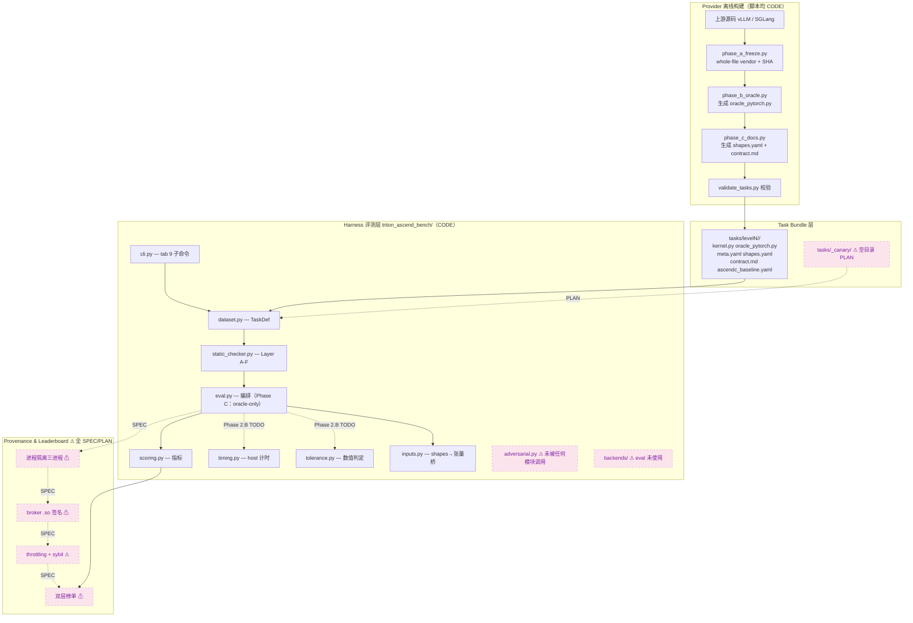

**关键事实**：评测核心链路 `cli → dataset → static_checker → eval → inputs/scoring` 是 **【CODE】**；但 `eval` 当前**只能跑 oracle**（`oracle_only`），candidate 子进程 + `tolerance.compare` + `timing` 是 **Phase 2.B TODO**（`eval.py:131`）；整个 Provenance/Leaderboard 层与 `adversarial.py`/`backends/` 调用链是 **【SPEC/PLAN】**。

### 3.2 三角色与信任边界

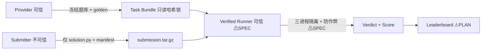

**信任规则**（【SPEC】`specs/process_isolation.md`、`specs/task_api_contract.md` §3）：`oracle_pytorch.py`、golden、`ascendc_baseline.yaml`、隐藏 shape 永不挂载 candidate；submitter 的 `solution_artifacts.json`/`*.so` 在 verified 模式忽略；`meta.yaml` 是单一真值。`tab analyze` 以题库 catalogue 反查 `|S_native|`、伪造 `in_s_native:true` 计入 `forged_count`——**这条 analyze 防伪是【CODE】**（`cli.py:585-606`）。其余隔离/挂载规则当前是 **【SPEC】**。

> ⚠ **隐藏 shape 泄漏差距**（codex 复核发现，`[confirmed]`）：spec（`specs/submission_throttling.md` §Hidden Result）描述隐藏 shape 应密封在不公开的 `shapes_hidden.yaml`；**实际仓库 0 个 `shapes_hidden.yaml`，96 个公开 `shapes.yaml` 直接内联 `hidden_shapes:` 段**，`inputs.py` 的 `build_inputs()` 也把 public 与 hidden 行合并后从同一公开文档读取。即当前隐藏 shape **未密封、随 task bundle 公开** → 是 §10 的关键差距，不是已实现的防御。

### 3.3 进程隔离三进程模型【SPEC，无运行代码】

依据 `specs/process_isolation.md` §Three-Process Model。**这是规范设计，当前仓库无 fork/docker/seccomp/cgroup/safetensors-runner 实现**（codex 复核 `[confirmed]`：无 runner 实现，仅 `eval.py:131` 的 Phase 2.B TODO 指向它）。

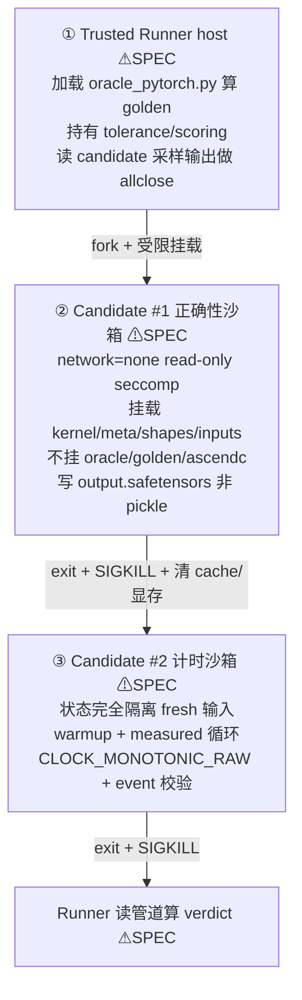

**设计意图（为何两个 candidate 进程）**（`process_isolation.md` §Why Two Candidate Processes）：若正确性 pass 与计时 pass 共享状态，candidate 可在正确性阶段预计算缓存到 `/tmp`/显存，计时阶段查表。缓解：每阶段独立进程 + SIGKILL + 阶段间全量 cache 清除。**意图清晰，落地为 0。**

### 3.4 仓库目录结构（计数经核对 `[confirmed]`）

```
triton-ascend-bench/
├── triton_ascend_bench/          # Harness（11 个 .py 模块，含子包 ≈6.1k LOC，快照约值）
│   ├── cli.py            (734)   # tab CLI 9 子命令
│   ├── static_checker.py (4159)  # ★ Layer A-F 静态防御（最成熟，单测 3596 LOC）
│   ├── scoring.py        (240)   # s_t / geomean / FastP
│   ├── tolerance.py      (173)   # 12 类容差判定
│   ├── inputs.py         (~167)  # ★ shapes.yaml → 张量 dict 桥（Phase C 新增）
│   ├── eval.py           (148)   # 编排（Phase C：仅 oracle-only）
│   ├── dataset.py        (122)   # TaskDef 加载
│   ├── adversarial.py    (86)    # canary/metamorphic 原语（未被调用）
│   ├── manifest.py       (86)    # 提交清单 schema
│   ├── timing.py         (84)    # host 计时（event 校验未接线）
│   ├── __init__.py       (23)
│   ├── backends/  gpu.py npu.py __init__.py  # 后端抽象（eval 未用）
│   └── trusted_shim/__init__.py  (21)        # host 计时 shim（Python fallback）
├── tasks/  level1/(40) level2/(38) level3/(23) = 101 任务
│   ├── _vendored/ (93 whole-file 上游冻结快照)
│   └── _canary/ _appendix/ _shared/  # 当前空目录
├── specs/   (11 份契约规范，894 LOC，设计真值源)
├── scripts/ (9 个脚本，≈5.2k LOC：generate_task_scaffolds / extract_kernel /
│             phase_a_freeze / phase_b_oracle / phase_c_docs / build_oracle_digest /
│             freeze_source / validate_tasks / verify_version_matrix)
├── infra/   version_matrix.toml · Dockerfile.{gpu,npu} · RFC_0001_scope.md
├── results/ 4 后端目录（全空）
├── tests/unit_tests/ (9 套，4813 LOC)；adversarial_kernels/ test_kernels/ 空
└── docs/    (本文件)
```

---

## 4. 数据模型与契约

### 4.1 Task 目录布局（6 文件）

`[confirmed]` `specs/task_api_contract.md` §1 + 样本 `tasks/level1/L1_01_bias_kernel/`：

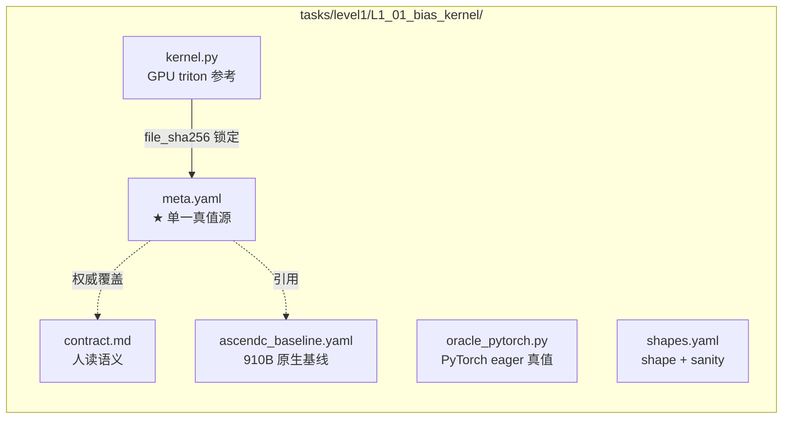

| 文件 | 职责 | 实际入口（`[confirmed]` 与 spec 有出入，见下） |
|------|------|------------------------------------------------|
| `kernel.py` | 上游 GPU Triton 纯算子 | 实际导出**算子名函数**（如 `apply_logit_bias`），`meta.oracle.gpu_triton` 指向它 |
| `oracle_pytorch.py` | 独立 PyTorch eager 真值 | 实际导出 **`run(inputs)->dict`**（101/101 任务用 `def run`，0 用 `run_oracle`）|
| `meta.yaml` | 机器可读权威 | `interface.alias_map` / `tolerance_class` / `oracle_simplified` / `runner_checks` / `in_s_native` |
| `shapes.yaml` | shape 配置 | **两种 schema 并存**（见 §4.3） |
| `contract.md` | 人读语义 | 不得引入 meta 没有的事实（P4） |
| `ascendc_baseline.yaml` | NPU 原生基线 | `in_s_native:true` 要求此处 `available:true` |

> ⚠ **spec↔impl 契约不一致**（codex 复核 `[confirmed]`）：`specs/task_api_contract.md` §2/§3 写的是 `kernel.py::run_kernel` 与 `oracle_pytorch.py::run_oracle`；**实际 101 个任务全用 `oracle_pytorch.py::run` + `kernel.py::<算子名>`**，`eval.py:123` 调的也是 `mod.run(inp)`。规范文本已过时，应以代码为准并同步 spec。

### 4.2 题库实测分布 `[confirmed]`（101 任务）

- **oracle_simplified**：`formula_exact_manual` 72 · `upstream_oracle_required` 21 · `simple_pytorch_ok` 8
- **tolerance_class**：`vector_reduce` 25 · `attention_flash` 21 · `atomic_scatter` 19 · `recurrent_chunk` 15 · `elementwise` 11 · `sampling_rng` 8 · `int8_w8a8` 1 · `elementwise_exact_or_inf_safe` 1
- **in_s_native: true = 0**；`ascendc_baseline.yaml` 状态：`placeholder_scaffold` 96 + `placeholder_v0.1` 5 ← **S_native 为空**（§10 G2）

### 4.3 两种 shapes.yaml schema 并存 `[confirmed]`

| schema | 任务数 | 形态 | 来源 |
|--------|--------|------|------|
| **PoC 旧式** | 9 | `public_shapes:` 列举具体维度 + `sanity_bounds` | 5 个手工 PoC + errata 残留 |
| **Phase C size-knob** | 92 | `size_knobs` + `public_shapes`(knobs) + `hidden_shapes`(knobs) + `inputs`(dims/dtype/dist 公式) | `phase_c_docs.py` 生成 |

Phase C schema 让 shape 真正可执行：`inputs.py:build_inputs(shapes_doc, shape_id, seed)` 按 size-knob 公式 + 固定 seed 物化张量，oracle 与 candidate 见相同输入。**96 个 shapes.yaml 内联 `hidden_shapes:` 段**——这是 §3.2 标注的隐藏 shape 泄漏来源。

### 4.4 solution.py 契约（submitter 唯一可写）

`[confirmed]` `specs/task_api_contract.md` §4：`def npu_triton_impl(inputs: dict) -> dict`；禁 import oracle/harness/tasks、高层 torch（`F.*`/`@`/`Tensor.matmul`）、原生 AscendC、代码执行、IPC、计时 API、文件/线程（由 `static_checker.py` Layer A-F 强制）。

### 4.5 结果/提交 schema
- `round_result.json`（`cli.py:125-141`）：`task_id`/`static_checks_passed`/`aggregate_score`/`coverage`/四状态/`fallback_detected`/`findings`
- `SolutionManifest`（`manifest.py:33-66`）：`submission_id`/`task_id`/`submitter{org_identity,contact}`/`triton_ascend_version`/`cann_version`/`declared_mode`/`container_digest`

### 4.6 端到端数据流（实线=【CODE】，虚线=Phase 2.B TODO）

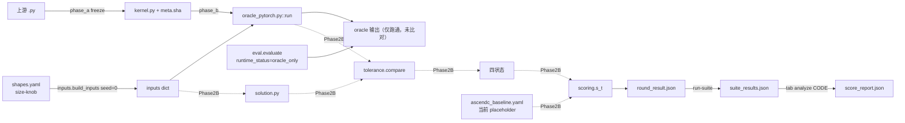

---

## 5. 模块详细设计（设计初衷 + 实现细节）

### 5.1 `dataset.py` — Task 加载器【CODE】

**初衷**：把 6 文件目录解析成不可变 `TaskDef`，加载时即算 `kernel.py` SHA-256 支撑防篡改。
**实现** `[confirmed]`：`load_task` 顺序在 level1/2/3 查找（`dataset.py:69-78`）；`kernel_py_sha256` 加载即算（`:65-66,109`）；`@property tolerance_class`/`oracle_tier` 做 schema 兼容兜底（`:43-58`，说明 schema 演进过）；`iter_all_tasks` 跳过 `_` 目录（`:120-121`）。

### 5.2 `eval.py` — 评测编排【CODE，Phase C：oracle-only】

**初衷**：编排 `(task,solution,backend)` 全流水线：加载 → 静态检查 → 隔离子进程跑 oracle/candidate → 逐 shape 容差 → 评分。
**实现实况** `[confirmed]`（148 LOC）：
- 已实现：加载 + 静态检查；`blocked` 即 `correctness_status=fail` 返回（`eval.py:90-94`）；
- **Phase C 桥接**（`eval.py:96-129`）：`shapes.yaml` 经 `inputs.build_inputs` 可执行后，对每个 public shape **在进程内 import 并跑 `oracle_pytorch.run(inp)`**；成功则 `runtime_status="oracle_only"`——显式表示"oracle 跑通但**未评分**"，下游 analyze 仍视为 not-yet-graded（绝不算 pass）；
- **未实现（明确 TODO，`eval.py:131-133`）**：隔离 candidate 子进程、收集输出、`tolerance.compare`、翻四状态——**Phase 2.B**；
- `backend` 参数签名存在但 **eval 体内未使用**（codex 复核 `[confirmed]`：`backends/` 不在 eval 路径）。
- 纪律（codex round-3 N-P0-1，`eval.py:47-53`）：四状态字段必须显式，analyze **禁止从 `static_checks_passed` 推断正确性**。

> **置信度**：这是全系统最关键差距——`eval` 当前**不能产出真实迁移评分**，只能验证 oracle 可执行。`[confirmed]`

### 5.3 `inputs.py` — shapes→张量桥【CODE，Phase C 新增】

**初衷**（模块 docstring 自述）："the bridge eval.py was missing (was a Phase 2.B TODO)"——让 `shapes.yaml` 真正可执行。
**实现** `[confirmed]`（按函数名引用——该文件 Phase C 后仍在变动）：`build_inputs(shapes_doc,shape_id,seed)` 按 size-knob 公式 + 固定 `torch.Generator(seed)` 物化输入，oracle 与 candidate 见相同张量；`_make_tensor` 支持 `randn/rand/ones/zeros/eye/tril/randint:lo:hi/softmax_rows/offsets/arange` 多种分布，整数/fp8 dtype 后处理；`shape_ids` 返回 `(public_ids, hidden_ids)`——**注意：`build_inputs` 把 public 与 hidden 行合并读取，印证隐藏 shape 未隔离**。
**风险点** `[confirmed]`：`_resolve_dims`/`randint` 用 `eval(d,{"__builtins__":{}},knobs)` 解析维度公式，输入来自 task bundle（provider 控），非 submitter，风险可控但仍是 `eval`。

### 5.4 `static_checker.py` — Layer A–F 静态防御【CODE，最成熟】★

**初衷**：代码运行前拦住绝大多数 reward-hack 与沙箱逃逸（import oracle、`exec`/`ctypes` 加载 so、高层算子绕 Triton、字符串藏 `oracle`/`golden`）。策略=**正向 AST 白名单**。
**实现** `[confirmed]`（4159 LOC，单测 3596 LOC，全系统最重）：

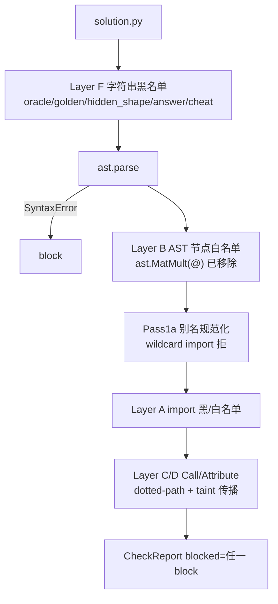

- Layer A（`static_checker.py:52-91`）：黑名单含 `functools.partial`、`importlib`、`ctypes`、`torch.utils.cpp_extension`、`os`、`time`、`*.Event`、`oracle_pytorch`/`tasks` 等；白名单仅 `torch/torch_npu/triton/triton.language/math/typing/...`，可由 `version_matrix.toml` 的 `import_allowlist.modules` 扩充（`:311-317`）；
- Layer B：节点白名单，`ast.MatMult`(`@`) 显式移除（与禁高层 matmul 一致）；
- 别名/taint 传播：大量 helper（`_canonical`/`_is_dotted_banned`/`_scan_fn_formal_taint`/`_propagate_one_fn`，`:386-2101`）做跨函数污点传播，防 `f=open;f(...)`/`g=F.silu` 别名绕过。
- 注释密集 `codex round-N R-P0-x` 标记 `[confirmed]`——19 轮 review 反复加固的产物。

> **范围澄清**（codex 复核 P2，采纳）：Layer A/B/C/D/F 的**静态分析完整且重测**；但 Layer E 运行时 `sys.addaudithook` 与 runner 侧强制属 **【SPEC】**，不在当前执行路径。说"static_checker 完整"指**静态层**，非全链路防御。

### 5.5 `tolerance.py` + `tolerance_policy.yaml` — 数值容差【CODE】

**初衷**：浮点漂移容许度按算子族而异；整数/采样须 bit-exact；NaN/Inf 位置严格一致防"用 NaN 抹差"。
**实现** `[confirmed]`：12 类容差（policy yaml）；`compare()`（`tolerance.py:128-173`）三段：shape 不符直接 fail；整数/bool/`bit_exact` 走 `torch.equal`（防 int64 被 float32 静默舍入）；浮点先 inf/nan 掩码一致再有限元素 allclose；采样 fast-fail 通过后仍跑全量 allclose（防漂移落采样窗外混过）。
**已声明未实现** `[confirmed]`：`atomic_scatter` 类在 policy 标 `rerun_count:3`/`non_deterministic`，但 `ToleranceClass`（`tolerance.py:23-31`）**未读这两个字段**，`compare()` 不做任何重跑——即"非确定算子重跑 3 次取一致"是 **policy 声明、代码未实现**。容差升级不自动（`specs/tolerance_policy.md` §Special Rules），须人工裁决（【SPEC】流程）。

### 5.6 `timing.py` + `trusted_shim/` — 计时【CODE host / SPEC event】

**初衷**：`Event.elapsed_time` 只计当前 stream，会漏跨 stream（B2 攻击）→ host `CLOCK_MONOTONIC_RAW` 权威，event 仅交叉校验。
**实现** `[confirmed]`：`_host_ns`=`clock_gettime_ns(CLOCK_MONOTONIC_RAW)`（`timing.py:29-30`）；`measure()`=n_warmup 剔编译 + n_repeat（`:64-84`）。
**未实现** `[confirmed]`：`time_one_run(use_event=True)` 直接 `raise NotImplementedError("event timing wiring is per-backend")`（`timing.py:45-47`）；故"host vs event drift>10% → invalid_timing"是 **`specs/timing_arbitration.md` §Arbitration Rules 的规范，非当前代码行为**。`trusted_shim.host_clock_ns` 是 **Python fallback**（`trusted_shim/__init__.py:14-21`），v1.0 应换 C 扩展——未实现。

### 5.7 `scoring.py` — 评分指标【CODE】

**初衷**：以"NPU Triton / 910B 原生 AscendC"加速比抹平硬件代差；失败贡献 ε 非 0（防"少做难题抬均值"）；分母固定 `|S_native|`（防挑题）。
**实现** `[confirmed]`：`s_t_value`（`scoring.py:76-93`）：四状态非全 ok 或 fallback → ε(0.01)；否则 `max(ε,min(5.0,baseline/measured))`；NaN/Inf/≤0 全塌缩 ε（codex round-6 #5：`min(cap,nan)` 多平台返回 cap，是博弈向量）；`capped_geomean_native`（`:148-185`）对 |S_native| 取几何均值，缺失补 ε，`_dedupe_by_task_id` 拒重复；`native_coverage`≥0.70 才有排名资格。

### 5.8 `adversarial.py` — canary/metamorphic 原语【CODE 原语 / 未接线】

**初衷**：静态/容差挡不住的语义级作弊（identity/partial/lookup）用 metamorphic 变换 + canary 陷阱兜。
**实现实况** `[confirmed]`：`run_metamorphic_checks`（`adversarial.py:33-53`）、`check_canaries`（`:56-86`，`C1/C2/C3` 前缀判 hard）已实现为**纯函数原语**；但 **没有任何模块 import 它**（codex 复核：`eval.py`/`cli.py` 均不调用），`tasks/_canary/` 空目录。即"canary 防御"是 **原语就绪、未接入评测链路、无 canary 题**。

### 5.9 `manifest.py` — 提交清单【CODE】
`[confirmed]`：`SolutionManifest.from_dict/load/to_dict`（`manifest.py:47-86`）；`from_dict` 缺键抛 `KeyError`，被 `cli.py:367-374` 转 schema 错误。

### 5.10 `backends/` — GPU/NPU 抽象【CODE 定义 / eval 未用】
`[confirmed]`：`get_backend`（`backends/__init__.py:14-23`）；`NpuBackend.dtype_supported` 对 FP8 返 False（910B 无 FP8 cube，`backends/npu.py:26-30`）。但 `eval.py` 不 import backends，当前评测链路不经过它——**接口就绪，未接线**。

### 5.11 `cli.py` — `tab` 命令行【CODE】
`[confirmed]`（注释密集标 codex 修订）：9 子命令 `init-solution/run/run-suite/package/submit/validate-submission/validate-result/static-check/analyze`；`_cmd_submit`（`cli.py:279-313`）先 validate 失败拒发；`_unpack_submission`（`:698-722`）拒路径穿越/symlink/设备文件 + `tarfile filter="data"`；`_cmd_analyze`（`:540-692`）以题库 catalogue 反查 `|S_native|`、`forged_count`、重复 task_id 取最坏值传播。**`submit` 不真正 HTTP POST**（`:308-312` 自述 v0.1 由 leaderboard 服务负责）。

### 5.12 脚本流水线【CODE，9 脚本 ≈5.2k LOC】
`generate_task_scaffolds`（解析 select.md 表生成骨架）→ `extract_kernel`（AST 抽取）→ `phase_a_freeze`（**whole-file vendor**：更简单、保 Apache 头、与 PoC 静态检查输入一致）→ `phase_b_oracle`（按 kernel 签名生成 `oracle_pytorch.run`）→ `phase_c_docs`（生成 size-knob `shapes.yaml` + `contract.md`，**也是 96 个内联 hidden_shapes 的产生源**）→ `build_oracle_digest` → `validate_tasks --strict` → `verify_version_matrix`。
> **`validate_tasks.py` 盲区**（codex 复核 2 轮 → 已部分修复）：原校验查 6 文件齐全/顶层字段/tolerance class/`@triton.jit`/hash/native 门禁，但**不做 `ast.parse`**、不拦 96 个 `meta.gpu_triton: ...::placeholder`、也不校验 `run` vs spec 的 `run_oracle/run_kernel`。
> **G11 修复（本次）`[confirmed]`**：已在 `validate_tasks.py` 新增 **Step 6 语法门禁**——对每个任务的 `kernel.py` 与 `oracle_pytorch.py` 跑 `ast.parse(src, filename=...)`，`SyntaxError` 即报 `{tid}: {fname} SyntaxError at line {n}: {msg}`。门禁经**隔离单元验证**（注入损坏 `kernel.py` / 损坏 `oracle_pytorch.py` 均被精确拦下并报出行号；干净任务无误报）；`py_compile` 通过、0 新增 ruff 错误。修复当时实测对真实损坏的 `L3_07/kernel.py` 报出 `SyntaxError at line 17` 并非零退出（与独立全库 ast.parse 扫描一致）。
> **代码演进注记**：分析期间并发开发**已把 `L3_07/kernel.py` 改为可解析**（全库现 0 处语法错误），其错误转为 `meta.upstream.file_sha256` 与改后 kernel 不匹配，由**原有 Step 8（sha256 校验）正确拦下**——门禁链路按预期工作，只是已无语法损坏样本。
> **残留**：`gpu_triton::placeholder`(96) 与 `run` vs `run_oracle/run_kernel` 不一致仍未加门禁（本次未扩展，超出 G11 范围）。

---

## 6. 评测流程时序

### 6.1 Submitter 本地（当前 = oracle-only，非完整评测）

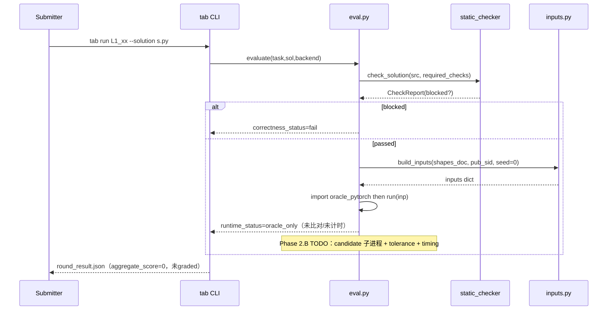

### 6.2 Verified Runner 三进程隔离【SPEC 目标态，无代码】

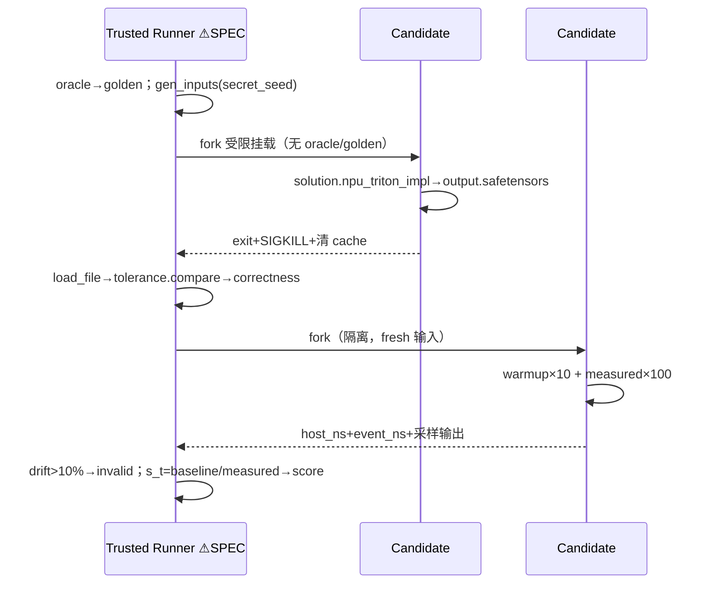

### 6.3 Provider 离线构建【CODE】

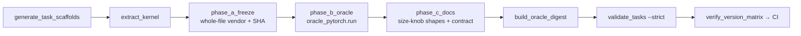

---

## 7. Reward Hacking 防御体系

### 7.1 7+1 层（`specs/reward_hack_defense.md` §7-Layer Defense）

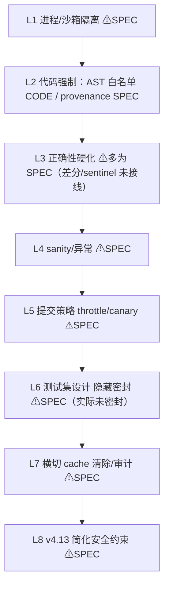

**当前唯一全链路落地的防御层是 L2 的静态白名单（`static_checker.py`）与 `cli.analyze` 的反伪逻辑**；其余层是规范设计（核心理念正确："防御内建于基准设计"，但落地见 §10）。

### 7.2 攻击→缓解映射（节选；落地标签）

| 攻击 | 缓解 | 落地 |
|------|------|------|
| A1 import oracle | oracle 不挂 candidate + 静态拦 import | 静态【CODE】/ 挂载【SPEC】|
| A3 identity | differential 3 随机 + canary C1 | 【SPEC/PLAN】(_canary 空) |
| A5 buffer 复用 | byte-pattern sentinel | policy 有 sentinel 表【CODE】/ 检测【SPEC】|
| B1 异步不同步 | shim 强制 device sync | 【SPEC】|
| B2 非默认 stream | host 权威 + event 校验 | host【CODE】/ drift 判定【SPEC】|
| C2/C3 tar 攻击 | 路径穿越/symlink 拒 | 【CODE】`cli._unpack_submission` |
| F2 native 洗白 | broker provenance | 【SPEC】(无 broker.so / pem) |

### 7.3 Canary（C1–C10）【SPEC/PLAN】
`specs/canary_task_design.md` §5-10：canary 不计 `FastP_native`，`canary_caught>0`→`suspicious`。**`tasks/_canary/` 空，`adversarial.py` 未接线**——机制设计完整，零落地。

---

## 8. 评分体系数学定义【CODE】

`[confirmed]` `specs/scoring_spec.md` §Primary Metric + `scoring.py`。对每个 `t∈S_native`：

$$
s_t=\begin{cases}\max\!\big(\epsilon,\ \min(5,\ t_{ascendc}/t_{npu\_triton})\big)&\text{四状态全 ok 且无 fallback}\\ \epsilon=0.01&\text{否则}\end{cases}
$$

$$
\text{capped\_geomean\_native}=\exp\!\Big(\tfrac1{|S_{native}|}\textstyle\sum_t\log s_t\Big),\quad \text{FastP}_{native}@p=\tfrac{|\{t:s_t\ge p\}|}{|S_{native}|}
$$

排名资格 `native_coverage = #{correctness=ok}/|S_native| ≥ 0.70`。**`|S_native|` 固定分母**，缺失/失败贡献 ε 不缩分母（反挑题数学保证，`scoring.py:148-185`）。`p=∞` 非头部指标（太易刷）。
数据流：`run-suite`→`suite_results.json`→`tab analyze`（catalogue 反查 |S_native|，过滤 forged）→`score_report.json`。**注意：当前 `|S_native|=0`，主指标无法产出非平凡值**（§10 G2）。

---

## 9. 关键工程决策与权衡

| 决策 | 选择 | 替代 | 理由 | 落地 |
|------|------|------|------|------|
| 计时权威源 | host `CLOCK_MONOTONIC_RAW` | `Event.elapsed_time` | event 漏跨 stream（B2）`timing_arbitration.md` | host 【CODE】/ event 校验【SPEC】|
| 输出序列化 | `safetensors` | `.pt`/`.pkl` | pickle 加载即 RCE `process_isolation.md` §Why Safetensors | 【SPEC】(runner 未实现) |
| candidate 进程 | 2（正确性/计时分离） | 1 复用 | 防预计算缓存查表 `process_isolation.md` §Why Two | 【SPEC】|
| provenance | broker 运行时签 | two-stage allowlist | 隐藏 shape JIT build 期无法枚举 `artifact_provenance.md` §Hidden Shape JIT | 【SPEC】|
| 失败贡献 | ε=0.01 不缩分母 | 0 / 缩分母 | 防"少做难题抬均值" `scoring_spec.md` | 【CODE】|
| 上游冻结 | whole-file vendor | per-function 抽取 | 简单 + 保 Apache 头 + 静态检查输入一致 | 【CODE】`phase_a_freeze` |
| oracle 分级 | 3 档 `oracle_simplified` | 单一 oracle | 浮点漂移下不盲信 PyTorch | 【CODE】(meta 字段) |
| 容差升级 | 人工裁决不自动 | 自动放宽 | 自动放宽给作弊留口 `tolerance_policy.md` | 流程【SPEC】|
| `@` 运算符 | AST 禁 `ast.MatMult` | 仅黑名单 `Tensor.matmul` | 防 `@` 绕高层算子禁令 `ast_denylist.md` §Layer B | 【CODE】|
| shapes 可执行化 | size-knob 公式 + seed | 列举具体维度 | 一个 inputs 块覆盖所有 shape 行 | 【CODE】`inputs.py` |

---

## 10. 当前实现状态与差距分析

### 10.1 模块成熟度（按现源码 `[confirmed]`）

| 模块 | LOC | 状态 |
|------|-----|------|
| `static_checker.py` | 4159(+3596 测试) | ★★★★★ 静态层完整，19 轮加固（Layer E/runner 强制属 SPEC）|
| `scoring.py` | 240(+238) | ★★★★☆ 完整 |
| `tolerance.py` | 173(+135) | ★★★★☆ 完整（`atomic_scatter` rerun 未实现）|
| `cli.py` | 734(+576) | ★★★★☆ 完整（submit 不真发）|
| `inputs.py` | ~167 | ★★★★☆ 完整（Phase C 桥）|
| `dataset/manifest/backends` | 小 | ★★★★☆ 完整（backends 未接 eval）|
| `timing.py` | 84 | ★★★☆☆ host 完整；event 校验未接线 |
| `adversarial.py` | 86 | ★★★☆☆ 原语完整，未接任何调用方 |
| `trusted_shim/` | 21 | ★★☆☆☆ Python fallback |
| **`eval.py`** | 148 | ★★★☆☆ Phase C oracle-only；**candidate 评测（2.B）未实现** |

### 10.2 关键差距

| # | 差距 | 证据 `[confirmed]` | 影响 |
|---|------|------|------|
| G1 | `eval` candidate 子进程评测未实现 | `eval.py:131-133` TODO；现仅 `oracle_only` | **无法产出真实迁移评分**，只验证 oracle 可跑 |
| G2 | **`in_s_native:true`=0；baseline 全占位**（96 `placeholder_scaffold`+5 `placeholder_v0.1`）| grep 全题库 | **S_native 空 → 主指标分母 0** |
| G3 | `tasks/_canary/` 空 + `adversarial.py` 无调用方 | `find`/grep | canary/metamorphic 零落地 |
| G4 | 隐藏 shape **未密封**：0 `shapes_hidden.yaml`，96 公开 shapes.yaml 内联 `hidden_shapes` | grep | 与 spec 密封要求相悖，可被探测/过拟合 |
| G5 | spec↔impl 入口不一致：spec 要 `run_oracle/run_kernel`，实际全用 `run` | 101 `def run` / 0 `run_oracle` | 规范文本过时，validator 不拦 |
| G6 | **96** 个 `meta.gpu_triton: ...::placeholder`（真未冻结，不可评）；kernel.py **纯 no-op stub = 3**（`TODO(scaffold)`）；oracle stub = 4。另 **12** 个 kernel.py 是**真实 `@triton.jit`**，仅对锁定外子分支 `raise NotImplementedError()`（如 L1_16 锁非量化变体，属设计而非未完成，锁定变体可评）| grep（codex R2/R3 精确化）| 不可评的是 96+3+4，**非** 12 锁定分支 kernel |
| G7 | `trusted_shim` Python fallback；无 broker.so/pem；无 docker/seccomp/cgroup runner | grep/find | v1.0 verified 计时精度 + provenance + 隔离全未就绪 |
| G8 | `timing` event 交叉校验未接线（`use_event` raise NotImplementedError）| `timing.py:45-47` | drift 判定是 spec 非行为 |
| G9 | `results/` 4 目录空；`submit` 不真发 | `find`/`cli.py:308` | 无基线数据；提交闭环未通 |
| G10 | `backends/` 接口就绪但 `eval` 未使用 | grep | GPU/NPU 切换未接线 |
| G11 | ~~校验门禁假阴性：语法损坏任务过 strict~~ **已修 + 隔离单测通过** | 新增 `ast.parse` 门禁（Step 6），单测证明可拦损坏 kernel/oracle 且干净任务无误报；L3_07 syntax 经并发开发独立修复后转为 sha256 mismatch（原 Step 8 正确拦下）| 假阴性已消除，门禁链路验证通过 |

### 10.3 综合判断

`[confirmed]` **当前是"契约与静态防御层成熟、执行层 oracle-only"的状态**：specs/ 11 份契约 + `static_checker`/`scoring`/`tolerance`/`cli`/`inputs` 是经多轮 review 的高质量实现，101 任务骨架齐全（93 vendored 真实上游，Phase C 让 shapes 可执行）。但 **G1（candidate 评测未实现）+ G2（S_native 空）+ G3/G4（canary 未落地、隐藏 shape 未密封）+ G7（隔离/broker/shim 全 SPEC）** 意味着：**现在还不能产出一个真实、可防作弊、可排名的迁移评测分数**。G11（校验门禁假阴性）**本次已修**：`validate_tasks.py` 加了 `ast.parse` 语法门禁，损坏任务不再静默通过。关键路径：G1 → G2 → G4 → G7。本文 §3/§6/§7 的隔离/榜单/canary 图均为**目标态规范**，不代表已实现行为。

---

## 11. 演进路线

`[confirmed]` `README.md` "Project Status" + `infra/RFC_0001_scope.md`：

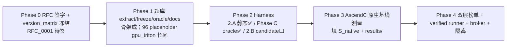

| Phase | 状态 | 卡点 |
|-------|------|------|
| 0 | ✅ Plan v4.13 FROZEN；🟡 RFC_0001 待签 | — |
| 1 | 🟡 骨架成，96 placeholder / 3 纯 stub / 12 锁定分支 长尾（L3_07 语法已修，转 sha256 待同步） | 真实 kernel 冻结；L3_07 meta sha 同步 |
| 2 | 🟡 静态 + Phase C oracle 完成；candidate(2.B) 未做 | G1 |
| 3 | ⬜ 未开始（S_native 空）| G2 |
| 4 | ⬜ 未开始 | G3/G4/G7 |

---

## 12. 附录：清单与局限性

### 12.1 置信度汇总
- 架构/契约/模块职责/落地状态标签：`[confirmed]`（源码 + grep/find 直接证据 + codex 独立复核 1 轮全采纳）
- 差距 G1–G10：`[confirmed]`（行号/计数直接验证）
- `inputs.py` 维度公式 `eval` 风险：`[confirmed]` 代码存在；可控性 `[likely]`（输入源 provider 控）
- 运行时性能/行为：**未测**（开发机无 GPU/NPU），本文不对性能下结论

### 12.2 codex 复核采纳记录（2 轮）
- **R1**：14 条（6×P0 / 7×P1 / 1×P2），经 CLAUDE.md "先评审证据再采纳" 流程**逐条独立验证后全部采纳**：修正所有 spec 行号（改按 § 引用）、隐藏 shape 泄漏、`run` 入口、`eval` Phase C 状态、stub/placeholder 计数、补 `inputs.py`/`phase_c_docs.py`、`timing`/`broker`/`canary`/`backend`/`atomic_scatter` 从"已实现"降级"SPEC/未接线"、`validate_tasks` 盲区、`static_checker` 范围澄清。
- **R2**：R1 的 14 条复核确认全部 FIXED；新增 1×P1（`L3_07` 语法损坏过 strict 校验 → 本文新增 G11 + §5.12）+ 4×P2（脚本/Harness/`inputs.py` LOC staleness、`inputs.py` 行号、"16 kernel stub" 计数不精确），独立复核后全部采纳：LOC 改约值快照、易变文件改按函数名引用。
- **R3**：确认 R2 全部 FIXED，最终判定 **SHIP（0 P0/P1）**；残留 1×P2——"15 stub" 措辞仍不精确（12 个 `NotImplementedError` 实为真实 `@triton.jit` 仅锁子分支，非 stub）。独立复核（12/12 含 `@triton.jit`）后采纳，G6 精确为 **纯 stub=3 + 锁定分支=12（可评）+ 96 placeholder + 4 oracle stub**。
- 无反驳项——codex 三轮引用证据均独立复核成立（`[confirmed]`）。
- **复核后修复（G11）**：给 `scripts/validate_tasks.py` 新增 `ast.parse` 语法门禁（Step 6）。验证：隔离单测（注入损坏 kernel.py/oracle_pytorch.py → 精确报行号；干净任务无误报）全部通过；`py_compile` 通过；0 新增 ruff 错误（仅残留 1 处**先前已存在**的 RUF002 en-dash，与本改动无关）。注：分析期间并发开发已独立修复 `L3_07/kernel.py` 语法（现转为 sha256 mismatch，由原 Step 8 拦下），故门禁正确但已无语法损坏样本可现场演示——单测覆盖此场景。

### 12.3 局限性
1. 未运行任何评测（无 GPU/NPU），结论基于静态源码阅读 + codex 交叉核对；
2. 未审计 `static_checker.py` 4159 行每条规则正确性，仅梳理分层与意图；
3. `external/fbgemm/` 第三方依赖未纳入；
4. `docs/benchmark_impl_plan.md`(v4.13,122KB)/`benchmark_select.md` 仅读标题级，未逐行核对计划↔实现一致性——如需该审计应另起专项；
5. 代码在分析期间仍主动演进（`inputs.py`/`phase_c_docs.py`/`eval.py` Phase C 当日新增，脚本 LOC 在两轮 codex 复核间从 4808→5160 漂移）→ 本文所有 **LOC 为 2026-05-16 快照约值**，易变文件按函数名而非行号引用；结构性计数稳定。`validate_tasks.py` 的 `ast.parse` 门禁（G11）已补（见 §5.12/§12.2）。

---

> **交付物**：`docs/DESIGN.md`。后续可专项：①计划↔实现一致性审计 ②`static_checker` 规则逐条正确性审查 ③Phase 2.B candidate-runner 实现设计。
