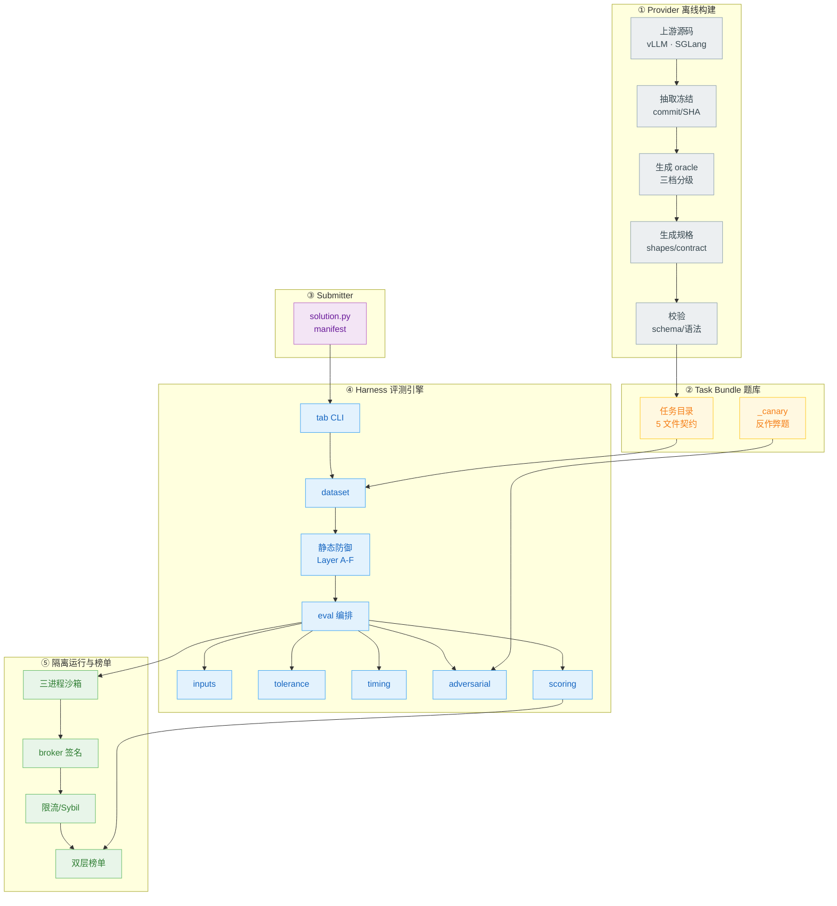
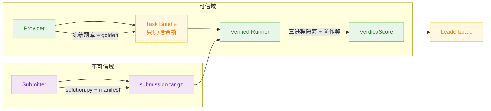
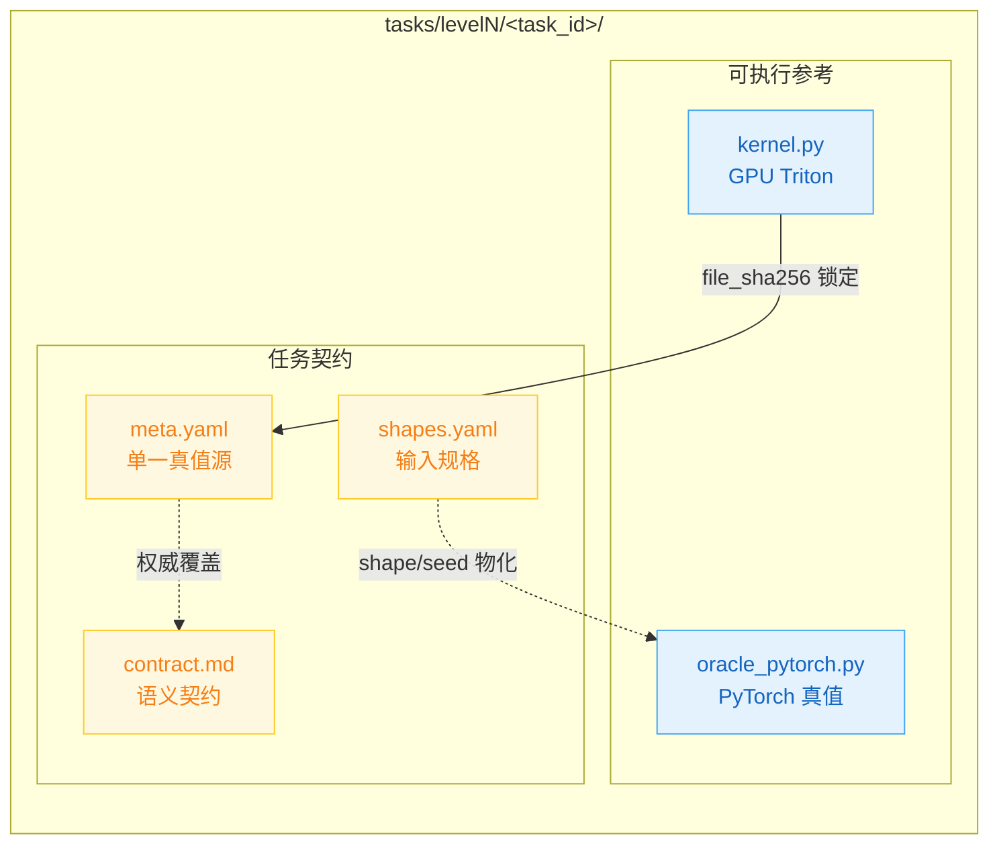
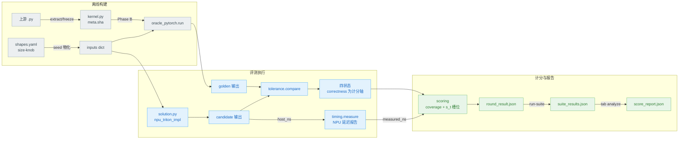
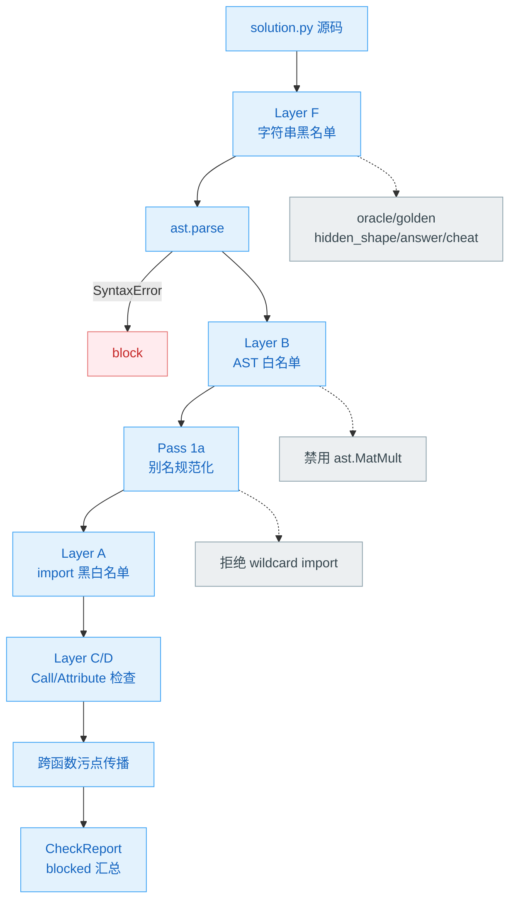
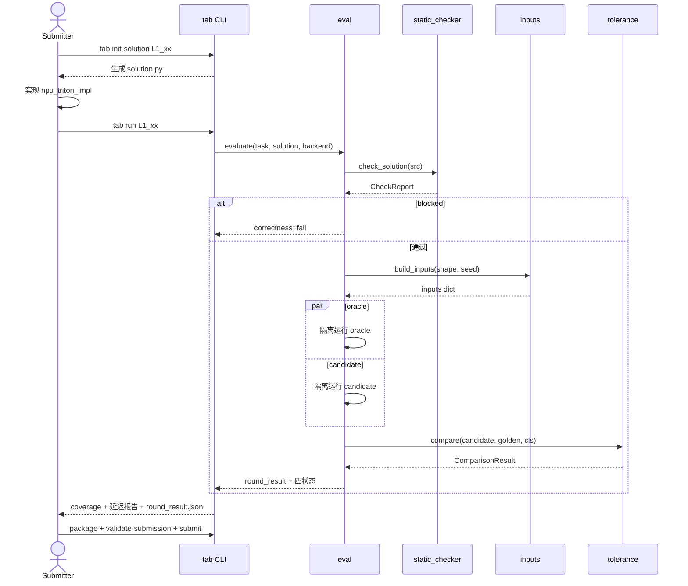
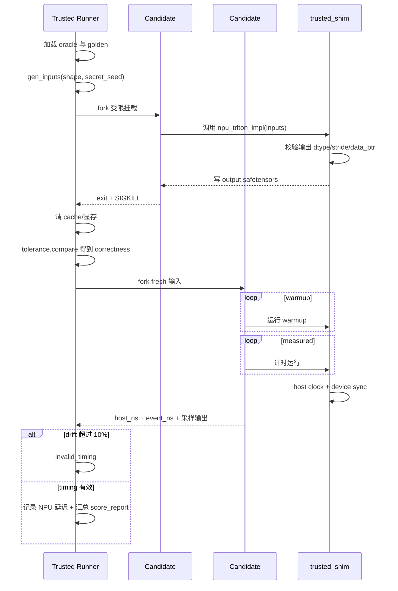
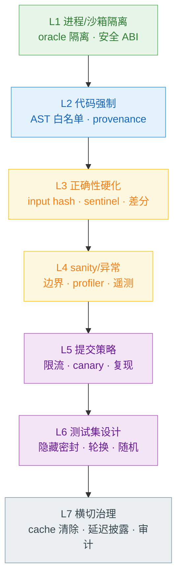
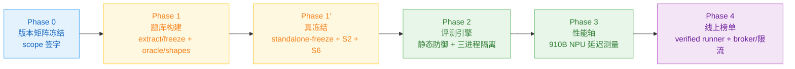

# TritonAscendBench — 设计方案

> **文档类型**：架构与模块设计方案（Design Specification）
> **对象**：`triton-ascend-bench` —— GPU Triton → 昇腾 910B NPU Triton 迁移评测基准
> **范围**：整体背景 → 整体架构 → 每个模块的设计初衷与设计细节，配架构图 / 数据时序图 / 数据流图
> **格式参考**：`docs/npu/gpu_triton_to_npu_triton benchmark设计.pdf`（在其概念基础上重写、扩展、补全工程细节）

---

## 目录

1. [背景与动机](#1-背景与动机)
2. [设计目标与核心原则](#2-设计目标与核心原则)
3. [整体架构](#3-整体架构)
4. [数据模型与契约](#4-数据模型与契约)
5. [模块详细设计](#5-模块详细设计设计初衷--设计细节)
6. [评测流程时序](#6-评测流程时序)
7. [Reward Hacking 防御体系](#7-reward-hacking-防御体系)
8. [评分体系数学定义](#8-评分体系数学定义)
9. [关键工程决策与权衡](#9-关键工程决策与权衡)
10. [演进路线](#10-演进路线)
11. [附录](#11-附录)

---

## 1. 背景与动机

### 1.1 问题陈述

vLLM / SGLang 等推理引擎已在 NVIDIA H100/A100 上沉淀了大量成熟的 **GPU Triton 算子**（采样、归一化、KV-cache、LoRA、MoE、Flash-Attention、Mamba 等）。要把这些推理栈迁移到华为昇腾 **Atlas 910B（A2 系列）**，需用 `triton-ascend` 后端把这些 GPU Triton kernel 一一移植，且**不能在语义上回退**。

TritonAscendBench 要回答的核心问题：

> 一个 NPU `triton-ascend` 实现，能否在 910B 上**正确复现**被迁移的 GPU Triton 参考语义（计分轴），并报告其 NPU 运行性能？

**正确性是计分轴**：以独立 PyTorch eager 实现为参考真值，按算子族分级容差判定迁移是否保真。**性能是报告维度**：在 910B 上测量 NPU 原始延迟并随结果披露；规范化的性能排名指标在演进路线中作为后续轴。

### 1.2 为什么是 Migration Benchmark，不是 Generation Benchmark

| 维度 | KernelBench | TritonBench | **TritonAscendBench** |
|------|-------------|-------------|----------------------|
| 任务 | PyTorch → CUDA 生成 | PyTorch → Triton 生成 | **GPU Triton → NPU Triton 迁移** |
| 起点 | 算法描述 | 算法描述 | **现网生产 GPU Triton 源码** |
| 考察 | "能否从零写 kernel" | 同左 | **"生产 kernel 能否无回退移植到 NPU"** |
| 保真要求 | 功能等价即可 | 功能等价即可 | **必须忠于上游语义（含 stride / in-place / NaN 语义）** |

被测对象是 **`triton-ascend`**（Triton 的昇腾编译后端，`pip install triton-ascend`）。提交者写 NPU Triton kernel，由 `triton-ascend` 编译执行；基准以独立 PyTorch oracle 为参考真值判定正确性。

### 1.3 与参考 PDF 的关系（设计演进）

参考 PDF 描述早期 **NPUKernelBench 三评测扩展**概念草案（`ascendc_migration` / `cuda_to_ascendc` / `gpu_triton_to_npu_triton`），文件结构为 `model.py` + `input_cases.json` + `gpu_triton_kernel/`。本设计是其中 **`gpu_triton_to_npu_triton` 这条线的完整工程化方案**：

| PDF 草案 | 本设计 | 演进原因 |
|----------|--------|---------|
| 2 level、示例 1–2 算子 | **3 level、~100 真实任务**（L1 单算子 / L2 融合 / L3 子系统） | 覆盖 vLLM/SGLang 真实推理路径 |
| `model.py`（PyTorch 标杆） | `oracle_pytorch.py` + **三档 oracle 分级** | 防 oracle 失真，不盲信 PyTorch |
| `input_cases.json` | `shapes.yaml`（size-knob 公式）+ `inputs` 桥 + `meta.yaml`（单一真值源） | shape 可执行化、真值源单一化 |
| `gpu_triton_kernel/kernel.py` | `kernel.py`（whole-file vendored + Apache 头 + SHA 锁定，**Phase A′ 再做 standalone-freeze + S2 等价验证**才是真冻结） | 保留上游许可与可哈希冻结 |
| "增加代码检视 skill" 一句 | **Layer A–F 静态防御 + 7 层 reward-hack 防御 + canary 陷阱题** | 防作弊从口号变为可执行机制 |
| 单一 `allclose(1e-3)` | **12 类 tolerance class + bit-exact + NaN/Inf 一致性** | 算子族数值特性差异巨大 |
| 离线 GPU 双向交叉验证（概念） | Phase A 冻结 + **Phase A′ standalone-freeze + S2 等价 gate** + Phase B oracle + Phase C 文档生成 + schema 校验流水线 | 概念变为可复现的离线构建管线，A′ 让"冻结"在 provenance 层真正成立 |

### 1.4 核心技术挑战

1. **浮点加法不满足结合律**（$(a+b)+c \neq a+(b+c)$）：PyTorch oracle、GPU Triton 参考、NPU Triton 候选三者的分块 / SRAM 暂存 / 级联规约顺序不同，必然有微小数值漂移 → 需**分级 oracle + 分类容差**，且**绝不把 PyTorch 自动当作真值**而无脑放宽。
2. **Reward Hacking 空间巨大**：提交者只交 `solution.py`，可通过 import oracle、identity 返回、hardcode 查表、buffer 复用、空 kernel、异步不同步、非默认 stream 计时、隐藏 shape 探测等 31 类手段刷分 → 防御必须**设计进基准本身**。
3. **性能不可跨硬件直接比**：910B 与 GPU 峰值算力不同，绝对延迟无法跨硬件直接对比。本基准计分只用**正确性**；性能以 NPU 原始延迟报告，规范化的性能参考与比值指标作为演进路线中的独立轴。
4. **JIT 编译干扰计时**：`triton-ascend` 是 Python 层 JIT，首次执行触发编译 → 计时必须 warmup 后剔除编译耗时，且每 trial 用新输入防 cache 命中。

---

## 2. 设计目标与核心原则

### 2.1 设计目标
- 为 100+ 真实生产 GPU Triton 算子建立可复现的 NPU 迁移**正确性**评测；
- 把 reward-hacking 防御做成基准的结构性属性；
- 在 910B 上**报告** NPU 运行性能，并为规范化性能指标预留可插拔接口；
- 提供 self-reported（迭代用）与 verified（公开排名用）双层榜单。

### 2.2 非目标
**Provider-only 基准**：维护方维护题库 / 评测引擎 / 榜单，**不写** NPU kernel 实现（那是 submitter 的职责）；不做 PyTorch→Triton 生成；不以手写算子为性能分母做跨硬件竞速。

### 2.3 核心设计原则

| # | 原则 | 设计体现 |
|---|------|---------|
| P1 | **Migration fidelity 优先** | `kernel.py` 整文件冻结 + 上游 commit/SHA 锁定 + **Phase A′ standalone-freeze + S2 等价验证**（真冻结，非仅文件快照）+ 三档 oracle 分级 |
| P2 | **Reward-hacking by design** | 进程隔离 / AST 正向白名单 / broker 产物签名 是结构，不是事后补丁 |
| P3 | **Provider / Submitter 严格隔离** | oracle / golden / 隐藏 shape 永不进入 candidate 沙箱 |
| P4 | **单一真值源** | `meta.yaml` 是机器可读权威；`contract.md` 只解释、不引入新事实 |
| P5 | **正确性计分，性能报告** | 计分轴 = correctness coverage；NPU 延迟随结果披露 |
| P6 | **失败贡献 ε 而非 0** | 固定分母 + 失败补 ε，防"少做几道难题反而抬高指标"的博弈 |
| P7 | **增量交付（Two-tier）** | self-reported 先打通迭代闭环，再扩展到 verified 公开排名 |

---

## 3. 整体架构

### 3.1 系统全景

系统由五层构成，自上而下为一条 **离线构建 → 题库 → 提交 → 评测 → 隔离运行与榜单** 的流水线：



- **① Provider 离线构建**：从 vLLM/SGLang 抽取并冻结 GPU Triton kernel（Phase A whole-file vendoring → Phase A′ standalone-freeze + S2 等价验证才是真冻结），生成分级 oracle、shape 配置、契约文档，并通过 schema + 语法 + S6 release-gate 校验。
- **② Task Bundle**：每个任务是一个 5 文件目录，只读且哈希锁定；`_canary/` 存放看似真题、实为陷阱的反作弊题。
- **③ Submitter**：提交者只能写 `solution.py`，连同 manifest 打成 `submission.tar.gz`。
- **④ Harness 评测引擎**：`tab` CLI 驱动 `dataset → static_checker → eval → (inputs / tolerance / timing / adversarial) → scoring`。
- **⑤ 隔离运行时与榜单**：三进程隔离沙箱执行 candidate，broker 对编译产物签名，限流 / Sybil 防御后进入 self-reported / verified 双层榜单。

### 3.2 三角色与信任边界



信任规则：`oracle_pytorch.py`、golden 输出、隐藏 shape **永不挂载**进 candidate 沙箱；submitter 提供的 `solution_artifacts.json` / `*.so` 在 verified 模式下一律视为不可信而忽略；`meta.yaml` 是单一真值源。计分集 = **score-eligible 集**（拥有可信、可评分 oracle 的任务，从可信上游 metadata 冻结，排除 stub / 手工占位），由 `tab analyze` 从 catalogue 权威确定，submitter 无法影响该集合的成员资格。

### 3.3 进程隔离三进程模型

reward-hacking 防御的物理基础：可信 Runner 在受限挂载下 fork 两个独立的 candidate 进程，正确性与计时**完全隔离**。


**为什么必须两个 candidate 进程**：若正确性 pass 与计时 pass 共享状态，candidate 可在正确性阶段预计算答案、缓存到 `/tmp` 或 device 显存，在计时阶段查表（measured trial 几乎 0 计算）。设计上以 **每阶段独立进程 + SIGKILL + 阶段间全量 cache 清除** 切断这条路径。

### 3.4 仓库结构

```
triton-ascend-bench/
├── triton_ascend_bench/          # Harness 评测引擎
│   ├── cli.py                    # tab CLI（9 子命令）
│   ├── dataset.py                # TaskDef 加载器
│   ├── static_checker.py         # Layer A–F 静态防御（核心防御模块）
│   ├── eval.py                   # 单次 (task, solution) 评测编排
│   ├── inputs.py                 # shapes.yaml → 张量 dict 桥
│   ├── tolerance.py + .yaml      # 12 类数值容差判定
│   ├── timing.py + trusted_shim/ # host 权威计时
│   ├── scoring.py                # 正确性 coverage + 可插拔性能槽位
│   ├── adversarial.py            # canary + metamorphic 检测
│   ├── manifest.py               # 提交清单 schema
│   └── backends/                 # GPU / NPU 后端抽象
├── tasks/                        # Task Bundle 题库（L1/L2/L3 + _canary + _vendored）
├── specs/                        # 契约规范（设计真值源）
├── scripts/                      # 离线构建流水线（Phase A/B/C + 校验）
├── infra/                        # version_matrix.toml · Dockerfile · RFC
└── docs/                         # 设计文档（本文件）
```

---

## 4. 数据模型与契约

### 4.1 Task 目录布局（5 文件契约）



| 文件 | 职责 | 关键约束 |
|------|------|---------|
| `kernel.py` | 上游 GPU Triton 纯算子 | 至少一个 `@triton.jit`；导出算子函数；`file_sha256` 锁进 `meta` |
| `oracle_pytorch.py` | 独立 PyTorch eager 真值 | 无 triton；device-agnostic；导出 `run(inputs)->dict`；**永不挂载 candidate** |
| `meta.yaml` | 机器可读权威 | `interface.alias_map` / `tolerance_class` / `oracle_simplified` / `runner_checks` |
| `shapes.yaml` | shape + 输入规格 | size-knob 公式（见 §4.3）；公开 shape 与隐藏 shape 分离 |
| `contract.md` | 人读语义 | 不得引入 `meta.yaml` 没有的事实（P4） |

### 4.2 meta.yaml 关键字段

`interface.alias_map`（每个输入张量的可变性：`ro` / `rw_in_place` / `wo_candidate_allocated`）、`tolerance_class`（引用 §4.4 的 12 类之一）、`oracle_simplified`（三档：`simple_pytorch_ok` / `formula_exact_manual` / `upstream_oracle_required`，决定 oracle 的可信构造方式）、`runner_checks`（`expected_kernel_count_range` / `min_dram_bytes` / `min_flops` / `metamorphic_checks` / `static_checks`）。计分集由 `tab analyze` 从可信上游 metadata 冻结为 score-eligible 集，不由单任务 meta 自声明。

### 4.3 shapes.yaml — size-knob 可执行 schema

shape 不硬编码具体维度，而是**尺寸旋钮（size-knob）公式**，让"一个输入规格块覆盖所有 shape 行"：

```yaml
size_knobs: {B: 2, L: 8, D: 16}              # 默认旋钮
public_shapes:
  - {id: P1, name: tiny,   knobs: {B: 1, L: 4,  D: 8}}
  - {id: P3, name: medium, knobs: {B: 4, L: 32, D: 64}}
hidden_shapes:
  - {id: H1, name: h_odd,  knobs: {B: 3, L: 13, D: 40}}   # verified 模式才注入
inputs:
  x:      {dims: [B, L, D], dtype: float32, dist: randn}
  weight: {dims: [D],       dtype: float32, dist: ones}
  eps:    {scalar: 1.0e-5}
  idx:    {dims: [B], dtype: int64, dist: "randint:0:B"}
```

`inputs.build_inputs(shapes_doc, shape_id, seed)` 按旋钮解析维度公式（支持 `2*D` / `L+1` 等简单算术）、按 `dist`（`randn`/`ones`/`eye`/`tril`/`randint:lo:hi`/`softmax_rows`/`offsets`/`arange` 等）+ **固定 seed** 物化张量，保证 oracle 与 candidate 见到完全相同的输入。

### 4.4 数值容差 12 类（节选）

| Class | dtype | atol | rtol | 用途 |
|-------|-------|------|------|------|
| `elementwise` | FP16/BF16 | 1e-3 | 1e-3 | 逐点算子（silu/gelu/bias） |
| `vector_reduce` | FP16/BF16 | 1e-3 | 1e-3 | RMSNorm/LayerNorm/softmax |
| `cube_matmul_fp16` | FP16→FP32 acc | 5e-3 | 1e-3 | FP32 累加 GEMM |
| `int8_w8a8` | INT8→FP16 | 5e-2 | 1e-2 | W8A8 量化 matmul |
| `sampling_rng` | int/float | 0 | 0 | seed 一致时 bit-exact |
| `attention_flash` | FP16/BF16 | 5e-3 | 1e-3 | online softmax + matmul 融合 |
| `recurrent_chunk` | FP16/BF16 | 5e-3 | 5e-3 | Mamba/GDN/KDA chunk 流水线 |

### 4.5 solution.py 契约（submitter 唯一可写文件）

```python
def npu_triton_impl(inputs: dict) -> dict:
    """inputs 键来自 meta.interface.alias_map（张量在 NPU 上）
       返回键匹配 oracle 输出 schema（candidate 自行分配输出）"""
```

`solution.py` **禁止**：import oracle/harness/tasks；高层 torch 算子（`F.*` / `@` / `Tensor.matmul`）；原生 AscendC 算子（`torch_npu.npu_*` / `sgl_kernel_npu.*`，否则就不是在测 triton-ascend 迁移）；代码执行（`exec`/`eval`/`compile`/`ctypes`/`cpp_extension`）；IPC/网络；计时 API（`*.Event` / `time.perf_counter` / `LD_PRELOAD`）；文件/线程——由 §5.4 的静态防御强制。

### 4.6 端到端数据流



---

## 5. 模块详细设计（设计初衷 + 设计细节）

> 每个模块按 **设计初衷 → 设计与机制** 组织。

### 5.1 `dataset.py` — Task 加载器

**设计初衷**：把磁盘上的任务目录解析成一个**不可变的 `TaskDef` 数据类**，作为评测引擎唯一的题库入口，并在加载时即计算 `kernel.py` 的 SHA-256 以支撑后续防篡改。

**设计与机制**：`load_task(task_id)` 顺序在 `level1/2/3` 下定位任务目录，解析 `meta.yaml / shapes.yaml / contract.md / kernel.py`，构造 `TaskDef`，加载时立即算 `kernel_py_sha256`。属性访问层对 `tolerance_class` / `oracle_tier` 做 schema 兼容兜底（兼容顶层与嵌套写法）。`iter_all_tasks()` 跳过 `_` 前缀目录（`_vendored`/`_canary` 不计入计分集）。计分集成员资格不由单任务自声明，而由 `tab analyze` 从可信上游 metadata 统一冻结。

### 5.2 `inputs.py` — shapes → 张量桥

**设计初衷**：让 `shapes.yaml` **真正可执行**——用尺寸旋钮公式而非硬编码维度，使一个 `inputs` 规格块覆盖任意 shape 行；并保证 oracle 与 candidate 在同一 seed 下看到字节一致的输入。

**设计与机制**：`build_inputs(shapes_doc, shape_id, seed)` 合并 `size_knobs` 与该 shape 行的 `knobs`，`_resolve_dims` 解析维度公式，`_make_tensor` 按 `dist` 用固定 `torch.Generator(seed)` 物化张量并做整数/fp8 dtype 后处理；标量（`{scalar: v}`）原样透传；`shape_ids` 返回 `(public_ids, hidden_ids)`，verified 模式才注入 hidden。这是把"shape 配置"变成"可运行输入"的关键桥。

### 5.3 `eval.py` — 评测编排

**设计初衷**：编排一次 `(task, solution, backend)` 评测的完整流水线，并把判定拆成**四个显式状态**（`correctness / runtime / performance` + `performance_flags`），下游评分**只信状态字段**，绝不从"静态检查通过"推断"输出正确"。

**设计与机制**：流水线为 加载任务 → 静态检查（`blocked` 即正确性判负并短路）→ 经 `inputs` 物化逐 shape 生成输入 → 在隔离 candidate 进程跑 solution、可信进程跑 oracle → `tolerance.compare` 逐 shape 比对得 correctness → `timing.measure` 取 NPU 延迟 → `scoring` 汇总 → 产出 `round_result.json`。四状态分离的设计意图：静态检查只证明代码合法，不证明输出正确，二者绝不能混为一谈。

### 5.4 `static_checker.py` — Layer A–F 静态防御 ★

**设计初衷**：在代码**运行之前**就拦住绝大多数 reward-hacking 与沙箱逃逸——import oracle、`exec`/`ctypes` 加载原生 so、调用高层 torch 算子绕开 Triton、字符串里藏 `oracle`/`golden`。策略是**正向 AST 白名单**（不在允许集内即拒），比黑名单严格。



**设计与机制**：
- **Layer F**（最先、最便宜）：源码字符串黑名单，命中 `oracle`/`golden`/`hidden_shape`/`answer`/`cheat` 即 block。
- **Layer B**：AST 节点正向白名单，不在 `_AST_ALLOW` 即拒；`ast.MatMult`（`@`）被**显式移除**，与"禁高层 matmul"一致。
- **Layer A**：import 黑名单（`functools.partial`/`importlib`/`ctypes`/`cpp_extension`/`os`/`time`/`*.Event`/`oracle_pytorch`/`tasks` …）+ 仅允许 `torch/torch_npu/triton/triton.language/math/typing/…` 的白名单（可由 `version_matrix.toml` 扩充）。
- **Layer C/D + 别名/污点传播**：把 `f = open; f(...)`、`g = F.silu` 这类别名重绑定一路追踪，跨函数传播污点，dotted-path 命中黑名单即拒。
- **Layer E**：运行时 `sys.addaudithook`，拦 `exec`/`compile`/`subprocess`/`open` 等审计事件，作为静态层的运行时兜底。

这是 7 层防御里**最关键也最便宜的第一道线**——31 类攻击约 1/3 是代码层（import oracle / 别名 / 反射 / so 加载），必须把别名与污点传播做透。

### 5.5 `tolerance.py` + `tolerance_policy.yaml` — 数值容差判定

**设计初衷**：浮点不可结合 → NPU Triton 与 PyTorch 必然有数值漂移，但容许度因算子族而异（elementwise 与 INT8 matmul 完全不同）；整数/采样类必须 bit-exact；NaN/Inf 位置必须严格一致，防"用 NaN 抹平 diff"。

**设计与机制**：`compare(actual, expected, cls)` 三段式——
1. shape 不匹配直接 fail；
2. 整数 / bool / `bit_exact` 类走 `torch.equal`（**绝不**走 float32 cast + allclose，否则 `int64(2^24+1)` 会被静默舍入到 `2^24`）；
3. 浮点：先做 inf/nan 掩码一致性检查（位置必须逐元素一致），再对有限元素 `allclose(atol, rtol)`。

采样 fast-fail 不是终判：抽样 allclose 失败可早退，但抽样**通过**仍须跑全量 allclose，防止 NaN/Inf 或大漂移落在采样窗口外混过。容差**不自动升级**：oracle 与候选在标准容差下不一致时，由维护方人工裁决（收紧/修 oracle/调整任务），绝不自动把 PyTorch 当真值放宽。

### 5.6 `timing.py` + `trusted_shim/` — 权威计时

**设计初衷**：`torch.npu.Event.elapsed_time` 只计当前 stream，会漏掉跨 stream 的工作（B2 攻击：把计算丢到非默认 stream 让 event 计不到）。故以 host `CLOCK_MONOTONIC_RAW` 为权威，event 仅作交叉校验。

**设计与机制**：`measure(fn, n_warmup, n_repeat, sync)` = warmup 剔除 JIT 编译耗时 + n_repeat 次测量，每次在 `sync()` 夹住的窗口内用 `clock_gettime_ns(CLOCK_MONOTONIC_RAW)` 取 host 时长；同时记录 NPU event 作为次级信号，host 与 event 偏差超阈值（10%）即标 `invalid_timing` / `invalid_stream` 并排除该计时。`trusted_shim` 提供 runner 持有的 host 计时原语，candidate 无法篡改。计时产出 NPU 原始延迟（median/p99/cv）随结果披露。

### 5.7 `scoring.py` — 评分指标

**设计初衷**：**正确性**是计分轴——以固定的 score-eligible 集为分母，按任务是否在分级容差内复现 oracle 语义计 coverage；失败贡献 ε 而非 0，配合固定分母防"少做难题抬指标"的博弈。性能为报告维度，并预留一个**可插拔的归一化加速比槽位**，便于后续在 910B 延迟参考确立后接入而不改 schema。

**设计与机制**：
- **状态门**：`correctness / runtime / performance` 四状态非全 ok 或检出 fallback → 该任务计 ε(0.01)。
- **正确性指标**：`coverage = #{t ∈ S : correctness=ok} / |S|`，$S$ 为固定 score-eligible 集；排名资格 `coverage ≥ 0.70`。
- **性能槽位**：保留通用形式 `s_t = max(ε, min(P_CAP, t_ref/t_npu))`，`t_ref` 为性能参考；当性能参考未启用时 `perf_status=unavailable`，任务按正确性计分、性能仅作 NPU 原始延迟报告（不伪造分数）。
- **几何均值**：`exp((1/|S|) Σ log s_t)`，缺失/失败任务补 ε；重复 task_id 抛错（否则会把 coverage 抬过 1.0）。
- 仅"正确性单值"作为唯一头部数字会过于易刷，故以 coverage + 逐任务透明四状态替代单一可刷分数。`*_native` 等输出键名仅为 schema 稳定，指 **NPU-triton track**。

### 5.8 `adversarial.py` — canary + metamorphic

**设计初衷**：静态/容差挡不住的语义级作弊（identity 返回、partial compute、lookup table），用 **metamorphic 变换**（对输入做语义保持/破坏变换看输出是否合理变化，无法靠查表通过）和 **canary 陷阱题**（看似真题但 oracle 故意错/shape 不可能，过了就是作弊信号）兜底。

**设计与机制**：`run_metamorphic_checks` 按 `meta.runner_checks.metamorphic_checks` 跑变换并比对；`check_canaries` 比对 canary 提交结果与真值，`C1/C2/C3` 前缀判 `hard`、其余 `soft`。canary 题（C1 identity / C2 zero-out / C3 cache-reuse / … / C10 alibi-attention）存放 `tasks/_canary/`，不计入主指标，但 `canary_caught > 0` → 提交标 `suspicious`，公开排名前需人工 review。

### 5.9 `manifest.py` — 提交清单

**设计初衷**：每个 submission 是 `tar.gz`（`manifest.yaml` + `solution.py` + 可选 runtime_env/notes），manifest 锁定 `triton_ascend_version` / `cann_version` / `container_digest` / `org_identity`，支撑版本一致性与限流/Sybil 防御。

**设计与机制**：`SolutionManifest.from_dict/load/to_dict`，缺必填键即抛错并被 CLI 转成 schema 错误，使格式不合规的提交在打包/校验阶段就被拒。

### 5.10 `backends/` — GPU/NPU 后端抽象

**设计初衷**：oracle 跑在参考设备，candidate 跑在 NPU；用统一 `Backend` 接口（`.device` / `.synchronize()` / `.dtype_supported()`）隔离差异。

**设计与机制**：`get_backend(name)` 工厂返回 `GpuBackend`/`NpuBackend`；`NpuBackend.dtype_supported` 对 FP8 返回 False（910B 无 FP8 cube 算术，仅软件模拟），与 `fp8_software_emulated` 容差类"只测正确性"呼应。

### 5.11 `cli.py` — `tab` 命令行

**设计初衷**：单一 `tab` 入口承载 submitter 全流程与 provider 的 analyze，所有不安全输入（tar 包、manifest、结果 JSON）在入口处即做严格 schema/安全校验。

**设计与机制**：9 子命令 `init-solution / run / run-suite / package / submit / validate-submission / validate-result / static-check / analyze`。`submit` 先跑 `validate-submission`、失败即拒发；解包 tar 时拒绝路径穿越/符号链接/设备文件并以 `filter="data"` 二次防护；`analyze` 以题库 catalogue 为权威冻结 score-eligible 集、统计伪造计数、对重复 task_id 取最坏值传播——使提交 JSON 只是输入、不是权威。

### 5.12 离线构建流水线（`scripts/`）

`generate_task_scaffolds`（按选题表生成骨架）→ `extract_kernel`（从 vLLM/SGLang AST 抽取 kernel）→ `phase_a_freeze`（**whole-file vendoring**：原样保留 Apache 头、commit/SHA 锁定、`_vendored/` 快照）→ `phase_a_prime`（**standalone-freeze + S2 等价 gate**，见下）→ `phase_b_oracle`（按 kernel 签名生成 `oracle_pytorch.run`）→ `phase_c_docs`（生成 size-knob `shapes.yaml` + `contract.md`）→ `build_oracle_digest`（紧凑摘要供 review）→ `validate_tasks`（5 文件齐全 + meta schema + `ast.parse` 语法门禁 + kernel hash）→ `verify_version_matrix`（检测未冻结字段）。

whole-file vendoring 是 Phase A 刻意的**第一步**（简单、保留上游许可、与静态检查输入形式一致），但它**本身不是真冻结**：Phase A′ 实测发现 87/101 vendored `kernel.py` 仍带 live `from vllm…/sglang…` import，行为依赖运行时装的包版本 → golden 不可复现。`phase_a_prime`（`scripts/phase_a_prime.py`）补上真冻结：符号级可达闭包分类（A/B/C/S/D，unknown→A，无符号被静默丢弃）→ content-addressed 依赖池 `tasks/_frozen_deps_pool/h_<sha12>/`（vendoring 传递闭包）+ 极窄默认拒绝 shim `tasks/_frozen_shim/`（仅可证惰性 B；`tl/triton` re-export 改写为公开 triton import）→ per-task 最小 `run(inputs)->dict` 的 build-staged 候选（promote 前不动真 kernel.py）→ **S2 等价 gate**：S2-smoke（CPU/`TRITON_INTERPRET=1`，真实比对，**永不** PASS）+ S2-gpu-authoritative（GPU，唯一 PASS 来源）严格 bit-exact（dtype/shape/strides/alias/in-place/被 mutate 输入；**不用** `tolerance_class`、无 ULP 逃逸）对比未改写的上游入口 vs severed 候选 + severed 子进程 import 审计（零 vllm/sglang/site 解析）+ S3 确定性 N=5 bit-exact。PASS 才 atomic promote（dual-hash：`upstream.file_sha256` provenance + `phase_a_prime.standalone_sha256` 盘上）；否则 BLOCKED。任一 score-eligible 任务 `phase_a_prime.status != PASS` ⇒ benchmark 不可发布（S6 硬发布 gate，强制于 `eligibility.py` + `validate_tasks.py --release-gate` + CI `phase-a-prime-gate`；BLOCKED 是硬阻塞器，**不是**剔分母逃逸）。

**现状与诚实差距（[confirmed]，本机无 GPU 全量跑 101 题，逐题类别由 `scripts/resolve_upstream_entrypoints.py` 的真实 resolver verdict 机器派生，见 `docs/plans/phase_a_prime_status.md`；canonical resolver cache = `results/resolve_all.json`，由 `python3 scripts/resolve_upstream_entrypoints.py --refresh-cache` 在**当前 hardened anchor**下可复现重算，非 /tmp 临时件）**：**这是 POST-HARDENING 真实结果**——resolver 已对每个 meta 已设入口在**当前 ≥2 shape / structure / dtype** anchor 下重新核验（pre-hardening 的 `--apply` 不再保留陈旧 pass）。PASS **0** / BLOCKED(no-upstream-entrypoint) **0**（**0 题真正没有 callable**）/ BLOCKED(upstream-not-invocable-here) **78**（候选入口**存在**，但本 dev 环境缺可选依赖、vendored 上游文件无法 import：missing-dep pybase64 29/zmq 19/cbor2 10/msgspec 2/flashinfer 1=61，relative-import-packaging 12，assertion/precondition 3，triton-api-AttributeError 1，TypeError 1）/ BLOCKED(shapes-incomplete) **17**（含 L3_04 — 其 pre-hardening apply 在 hardened anchor 下命中 shapes-incomplete）/ BLOCKED(oracle-mismatch) **2**（L1_09 + L1_01——L1_01 的 hardened anchor 拒因是 STRUCTURE MISMATCH（候选多出 11 个无法解释的输出张量）⇒ 错算子，与 L1_09 同属"被正确拒绝的错算子"桶，绝非"环境限制"）/ BLOCKED(smoke-fail severing) **0** / BLOCKED(resolver-error) **0** / UNRUN(needs-gpu) **4**（L1_12/L1_16/L1_26/L2_10——均在 hardened anchor 下真实 2/2 shape 通过；L1_26 锚定 H2+H4 两 shape，output/output_lse 均在 elementwise 容差内、结构+dtype 匹配）。**注：相比早先 /tmp 陈旧 cache 的 78/5，真实 post-hardening 为 78/4——L1_01 的 pre-hardening apply 在真正 2-shape anchor 下不通过，且其拒因是结构不匹配（错算子），诚实归为 oracle-mismatch（不是更好看的"环境限制" upstream-not-invocable-here），绝不为保数字而留陈旧 pass、也绝不用更好看的标签掩盖错算子。** 对账 0+0+78+17+2+0+0+4=101。**主导事实不是"没有入口"——入口候选大多存在；主导阻塞器是本 dev 环境缺可选依赖（pybase64/zmq/cbor2/msgspec/flashinfer），vendored 上游文件在此无法 import，是 ENVIRONMENT 限制而非"无入口"**；另有 17 题 shapes.yaml 缺必填无默认参数、2 题为被正确拒绝的错算子。这些是**诚实的 benchmark 内容缺口 + dev 环境约束，不是 severing 缺陷（0 个真实 severing 缺陷）**；缺失依赖**有意未 pip 安装**（装上会掩盖真实 benchmark/env 状态）。Phase A′ 架构本身完备且已实现——它让"ground truth = 冻结上游 kernel"这条保证**真正成立**，同时**诚实暴露**当前题库绝大多数题在此 dep-poor 环境无法被 import/验证、是 Phase A′ S2 能验证这些题之前必须先补全的前置。在补全前 benchmark 按 S6 **不可发布**（0 score-eligible PASS），这是有意的硬门。

---

## 6. 评测流程时序

### 6.1 Submitter 评测流程



### 6.2 Verified Runner 三进程隔离时序



### 6.3 Provider 离线构建时序

```mermaid
flowchart LR
    subgraph GEN["生成"]
        direction LR
        A["generate_task_scaffolds"] --> B["extract_kernel"]
    end
    subgraph FREEZE["冻结与补全"]
        direction LR
        B --> C["phase_a_freeze<br/>整文件 vendoring + SHA"]
        C --> C2["phase_a_prime<br/>standalone-freeze + S2"]
        C2 --> D["phase_b_oracle<br/>生成 oracle.run"]
        D --> E["phase_c_docs<br/>shapes + contract"]
    end
    subgraph CHECK["校验与 CI"]
        direction LR
        E --> F["build_oracle_digest"]
        F --> G["validate_tasks<br/>schema + 语法 + release-gate"]
        G --> H["verify_version_matrix<br/>+ phase-a-prime-gate · CI"]
    end
    classDef provider fill:#ECEFF1,stroke:#90A4AE,color:#37474F;
    classDef check fill:#E8F5E9,stroke:#66BB6A,color:#2E7D32;
    class A,B,C,C2,D,E provider;
    class F,G,H check;
```



---

## 7. Reward Hacking 防御体系

### 7.1 7 层防御

核心理念：**防御内建于基准设计，运行时检测只是兜底层**。



### 7.2 攻击 → 缓解映射（节选）

| 攻击 | 缓解机制 |
|------|---------|
| A1 import oracle | oracle 永不挂载 candidate + 静态 import 拦截 |
| A3 identity hack | differential 3 随机输入 + canary C1 |
| A4 hardcode 查表 | runner-secret RNG 输入 + canary C7 |
| A5 buffer 复用 | 按 dtype 的 byte-pattern sentinel 检测 |
| B1 异步不同步 | trusted shim 强制 device-wide sync |
| B2 非默认 stream | host_ms 权威 + event 交叉，drift>10% → invalid |
| B5 空 kernel | profiler NPU kernel event 存在性检查 |
| B7 shape routing | 隐藏 adversarial 集 + 3-随机生成 |
| C2/C3 tar 攻击 | 路径穿越/symlink/设备文件拒绝 + filter="data" |
| F1 oracle 进程污染 | candidate / oracle / 比对 分进程 |

### 7.3 Canary 陷阱（C1–C10）

`_canary/` 收录看似真题、实为陷阱的题（identity / zero-out / cache-reuse / non-default-stream / torch-fallback / shape-route / lookup-table / async-no-sync / partial-compute / alibi-attention）。canary 不计入主指标，`canary_caught` 计数 > 0 即触发 `suspicious` 审计标记。设计灵感来自 KernelBench 的对抗 kernel 测试，适配到 NPU triton-ascend。

---

## 8. 评分体系数学定义

**计分轴 = 正确性。** 对 score-eligible 集 $S$（拥有可信、可评分 oracle 的固定任务集）中的每个任务 $t$：

每个 shape 经 `tolerance.compare(candidate, golden, class)` 得 pass/fail，聚合为四状态。任务级指标：

$$
\text{coverage}=\frac{\big|\{\,t\in S:\ \text{correctness}_t=\textsf{ok}\,\}\big|}{|S|},\qquad \text{排名资格}:\ \text{coverage}\ge 0.70
$$

评分引擎保留一个**可插拔的归一化加速比槽位**，便于后续接入性能参考而不改 schema：

$$
s_t=\begin{cases}\max\!\big(\epsilon,\ \min(P_{cap},\ t_{ref}/t_{npu})\big)&\text{四状态全 ok 且无 fallback 且 }t_{ref}\text{ 可用}\\[1mm] \epsilon=0.01&\text{否则}\end{cases}
\qquad
\text{geomean}=\exp\!\Big(\tfrac1{|S|}\textstyle\sum_{t\in S}\log s_t\Big)
$$

性能参考 $t_{ref}$ 未启用时 `perf_status=unavailable`，任务按正确性计分、NPU 原始延迟（median/p99/cv）仅作报告，**不伪造分数**。

**关键设计**：$|S|$ 是**固定分母**，缺失/失败任务贡献 ε、不缩小分母——这是反"挑题博弈"的数学保证。"仅正确性"单一可刷分数被刻意避免，改用 coverage + 逐任务透明四状态。数据流：`run-suite` → `suite_results.json` → `tab analyze`（从 catalogue 冻结 $S$、过滤伪造）→ `score_report.json`。

---

## 9. 关键工程决策与权衡

| 决策 | 选择 | 替代方案 | 理由 |
|------|------|---------|------|
| 计分轴 | 正确性 coverage（固定分母 + ε-fill） | 单一"加速比"头部数字 | 单值易刷；coverage + 逐任务四状态更抗博弈 |
| 性能维度 | NPU 原始延迟报告 + 可插拔 $t_{ref}$ 槽位 | 强行用手写算子做跨硬件分母 | 跨硬件绝对延迟不可直接比，规范化参考独立演进 |
| 计时权威源 | host `CLOCK_MONOTONIC_RAW` | `Event.elapsed_time` | event 只计当前 stream，漏跨 stream 工作（B2 攻击面） |
| 输出序列化 | `safetensors` | `.pt`/`.pkl` | pickle 加载即任意代码执行，runner 读 candidate 输出会被攻击 |
| candidate 进程数 | 2（正确性/计时分离） | 1 进程复用 | 防正确性阶段预计算缓存到计时阶段查表 |
| 产物 provenance | broker 运行时签名 | 编译期 allowlist 枚举 | 隐藏 shape 的 JIT 在 build 期无法枚举，broker 运行时编译+签名解决 |
| 上游冻结粒度 | Phase A whole-file vendoring + **Phase A′ 符号闭包 standalone-freeze** | per-function 抽取 | 仅 whole-file 仍留 live 上游 import（行为随安装版本漂移，非真冻结）；A′ 用符号级可达闭包 sever+池化后做真冻结 |
| 冻结正确性保证 | **Phase A′ S2 等价 gate**（严格 bit-exact，不用 tolerance_class，无 ULP） | 信任 vendored 文件即冻结 | severing 是同代码纯 import 改写，任何数值漂移=未冻结副作用证据，必须 BLOCKED+investigate 而非放宽容差 |
| 冻结发布门禁 | **S6 硬发布 gate**（eligible `status!=PASS` ⇒ 不可发布） | BLOCKED 剔出分母 | BLOCKED 必须有牙齿；剔分母会变成新的"挑题"逃逸口（[[feedback-baseline-no-subset-escape]]）|
| oracle 分级 | 3 档 `oracle_simplified` | 单一 PyTorch oracle | 浮点漂移下不能盲信 PyTorch，按算子族分级 |
| 容差升级 | 人工裁决，不自动 | 自动放宽 | 自动放宽给作弊留口子 |
| `@` 运算符 | AST 层禁用 `ast.MatMult` | 仅黑名单 `Tensor.matmul` | 防 `@` 绕开高层算子禁令 |
| shape 表达 | size-knob 公式 + seed | 列举具体维度 | 一个 inputs 块覆盖所有 shape 行，且可注入隐藏 shape |

---

## 10. 演进路线

按风险与依赖分阶段交付：



| Phase | 目标产出 |
|-------|---------|
| 0 计划/冻结 | `version_matrix.toml` 锁定 GPU/NPU/deps 版本；scope RFC 签字 |
| 1 题库 | 100+ 任务目录（kernel 冻结 + 分级 oracle + size-knob shapes + 契约） |
| 1′ 真冻结 | **Phase A′**：符号闭包 standalone-freeze + S2 等价 gate + S6 硬发布门禁，使"ground truth = 冻结上游 kernel"在 provenance 层真正成立 |
| 2 评测引擎 | 静态防御 + inputs 桥 + candidate 三进程隔离 + tolerance + 正确性计分 |
| 3 性能轴 | 910B 上 NPU triton 原始延迟测量与报告；性能参考 $t_{ref}$ 与归一化指标设计 |
| 4 榜单 | self-reported / verified 双层榜单 + verified runner + broker + 限流/Sybil |

#### 现状与诚实差距（Honest status，[confirmed]）

Phase A′ 架构已实现并经 codex 多轮对抗 review 收敛；但在真实 101 题上跑（开发机无 GPU）的**诚实结果**（逐题类别由 `scripts/resolve_upstream_entrypoints.py` 的真实 resolver verdict 机器派生，非 pre-resolver 短路；canonical cache=`results/resolve_all.json`，`--refresh-cache` 在当前 hardened anchor 下可复现重算）——**POST-HARDENING**（每个 meta 已设入口在当前 ≥2 shape/structure/dtype anchor 下重核，pre-hardening apply 不保留陈旧 pass）：**PASS 0 / BLOCKED(no-upstream-entrypoint) 0（0 题真正没有 callable）/ BLOCKED(upstream-not-invocable-here) 78（候选入口存在但本 dep-poor 环境无法 import：missing-dep pybase64 29/zmq 19/cbor2 10/msgspec 2/flashinfer 1=61，relative-import-packaging 12，assertion/precondition 3，triton-api-AttributeError 1，TypeError 1）/ BLOCKED(shapes-incomplete) 17（含 L3_04）/ BLOCKED(oracle-mismatch) 2（L1_09 + L1_01——L1_01 拒因为 STRUCTURE MISMATCH 多出 11 个输出张量 ⇒ 错算子，与 L1_09 同桶）/ BLOCKED(smoke-fail severing) 0 / BLOCKED(resolver-error) 0 / UNRUN(needs-gpu) 4（L1_12/L1_16/L1_26/L2_10，均 hardened 2/2-shape 真实通过）**。**相比早先 /tmp 陈旧 cache 的 78/5，真实 post-hardening 为 78/4——L1_01 的 pre-hardening apply 在真 2-shape anchor 下不过且拒因是结构不匹配（错算子），诚实归 oracle-mismatch（不是更好看的 upstream-not-invocable-here），绝不为保数字留陈旧 pass、也绝不用更好看的标签掩盖错算子。对账 0+0+78+17+2+0+0+4=101。** **真相与早先表述相反：入口候选大多存在；主导阻塞器是本 dev 环境缺可选依赖（pybase64/zmq/cbor2/msgspec/flashinfer），vendored 上游文件在此无法 import，是 ENVIRONMENT 限制而非"无入口"**；另 17 题 shapes.yaml 缺必填无默认参数、2 题为被正确拒绝的错算子。这些是**诚实的 benchmark 内容缺口 + dev 环境约束，不是 severing 缺陷（0 个真实 severing 缺陷）**；缺失依赖**有意未 pip 安装**（装上会掩盖真实状态）。即：Phase A′ 让"冻结上游 kernel 即 ground truth"这条保证**有了可执行的验证机制**，同时**诚实暴露**当前题库绝大多数题在此 dep-poor 环境无法被 import/验证——这是 S2（以及由此而来的 ground-truth 保证）能验证这些题之前 benchmark/环境必须先完成的前置。S6 据此判 benchmark **当前不可发布**（0 score-eligible PASS），这是有意的硬门，不靠缩 scope 回避（[[feedback-baseline-no-subset-escape]]）。机器生成的逐题状态见 `docs/plans/phase_a_prime_status.md`（勿手改）。

---

## 11. 附录

### 11.1 specs/ 契约清单（设计真值源）

`scoring_spec` · `task_api_contract` · `tolerance_policy` · `process_isolation` · `reward_hack_defense` · `canary_task_design` · `timing_arbitration` · `ast_denylist` · `submission_throttling` · `artifact_provenance` · `extraction_failure_taxonomy`

### 11.2 关键文件速查

| 用途 | 文件 |
|------|------|
| 评测入口 | `triton_ascend_bench/cli.py`（`tab`） |
| 单次评测编排 | `triton_ascend_bench/eval.py` |
| 静态防御 | `triton_ascend_bench/static_checker.py` |
| 容差策略 | `triton_ascend_bench/tolerance_policy.yaml` |
| 评分实现 | `triton_ascend_bench/scoring.py` |
| 版本矩阵 | `infra/version_matrix.toml` |
| 离线构建 | `scripts/phase_{a,b,c}_*.py` · `scripts/validate_tasks.py` |

### 11.3 设计参考

- KernelBench（Apache 2.0）—— eval / timing 模式、对抗 kernel 测试灵感
- vLLM / SGLang（Apache 2.0）—— 任务源 kernel
- 参考 PDF `gpu_triton_to_npu_triton benchmark设计.pdf` —— 概念草案来源

---

> **交付物**：`docs/DESIGN.md`（设计方案）。
