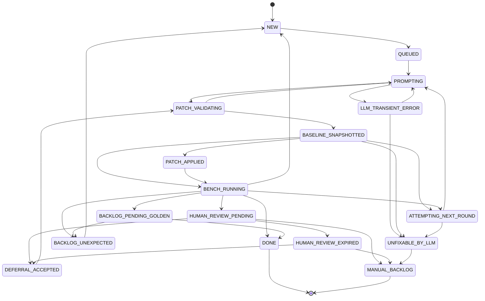
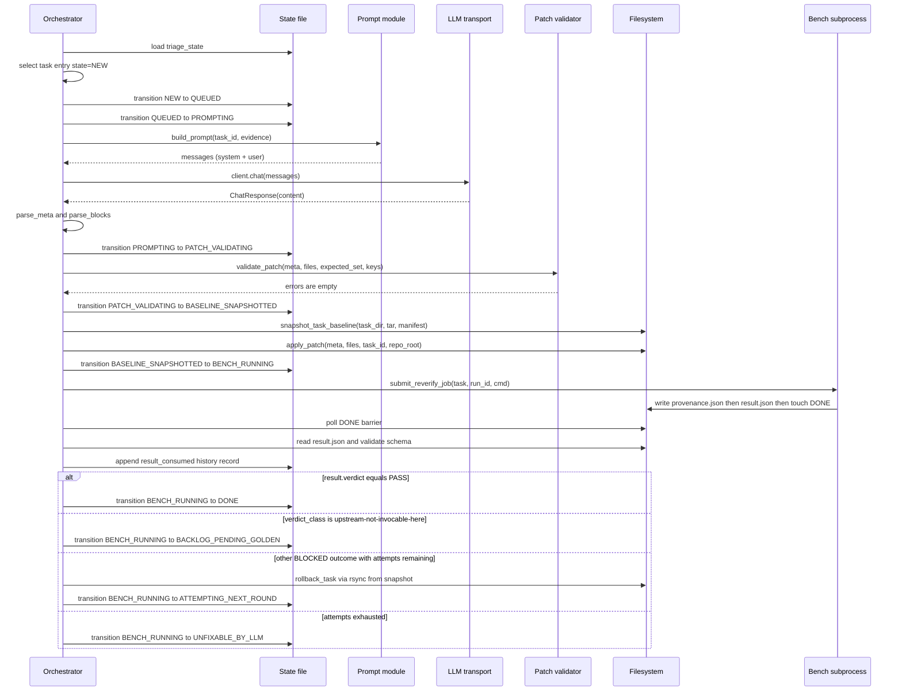

<!-- Last verified against HEAD: 5e68dfb -->

# Autonomous LLM-Driven Code Repair System
## Architecture Specification, v1.0 — 2026-05-24

> Status: Implemented and operational. Reference implementation lives at
> `scripts/automation/` in this repository. Every claim in this document
> is traceable to a `file:line` citation in the implementation tree;
> the few items marked `[design]` describe intent that is encoded in
> tests but does not constrain a single line of code, and `[planned]`
> describes opt-in extensions that the public interfaces already
> anticipate but ship inert.

---

## Executive Summary

A benchmark corpus of 101 GPU Triton kernel tasks contained ~78 entries
that the resolver classified as `BLOCKED` for one of three recurring
reasons: a missing wrapper-signature parameter, an oracle/reference
mismatch beyond tolerance, or an upstream callable that cannot be
invoked from inside the bench's vendored Python environment. Manually
repairing every entry would consume weeks of senior-engineer time and
still leave the next corpus refresh stuck behind the same wall.

This system replaces the manual loop with an autonomous LLM-driven
repair agent. It is not a "let the LLM write code" wrapper. It is a
17-state machine that drives an external LLM through a strictly typed
output protocol (`META + FILE` blocks), runs every candidate patch
through a five-layer validator before any bytes touch the working
tree, snapshots the task before applying so failures roll back to a
byte-exact baseline, and re-verifies on a real GPU before declaring
success. The LLM transport layer is vendor-neutral: an HTTP backend
(any OpenAI-compatible endpoint, plus an Anthropic Messages path) and
an SSH-CLI backend (run an arbitrary remote command-line LLM tool via
`ssh host '<cli> {prompt}'`) sit behind a shared `chat(messages)`
duck-typed interface. The same orchestrator binary runs single-machine
(co-located CPU orchestrator + GPU subprocess) or distributed across
three machines (CPU orchestrator, GPU evaluator daemon, LLM host)
without code changes — only configuration.

The invariant that makes the system worth deploying: **the LLM never
writes a byte to the working tree**. The LLM emits a structured reply;
the orchestrator decides whether to apply it. Any patch that fails any
of the five validation layers is rejected with a typed error code, the
task burns one attempt of its retry budget, and the next prompt
includes the validator's complaint. If a patch passes all five layers,
the orchestrator snapshots the task directory to a tar.gz, applies the
patch with per-file atomic writes, runs a real GPU subprocess to
re-verify, and either records the canonical 9-field `result.json` and
transitions the task to `DONE`, or rolls back via byte-exact `rsync`
restore and re-prompts. The system promotes the LLM from a code
suggestion tool to a verifiable autonomous repair agent.

---

## 1. Problem Statement

### 1.1 Corpus Characterization

The bench corpus contains 101 GPU Triton kernel tasks. At the start of
this work, the resolver (`scripts/resolve_upstream_entrypoints.py`,
not in scope for this document) had emitted a verdict for each task.
The verdict distribution split into roughly the following classes:

- ~23 tasks: `PASS` — resolver verifies the task and an oracle is
  invocable from the bench's vendored Python.
- ~62 tasks: `BLOCKED(shapes-incomplete)` — the wrapper signature is
  missing one or more parameters that the resolver requires to set up
  the call (typical: `BLOCK_SIZE_M`, `GROUP_SIZE_M`, `num_warps`).
- ~9 tasks: `BLOCKED(oracle-mismatch)` — the upstream call succeeds but
  the output differs from the reference oracle beyond tolerance.
- ~7 tasks: `BLOCKED(upstream-not-invocable-here)` — the upstream
  callable is bound to native or external code (typical: a C++ binding,
  a `vllm` or `sglang` runtime path) that cannot be invoked from the
  vendored Python environment.

The remainder are tail cases collapsing to `unexpected-blocked`. The
exact counts shift between corpus refreshes; the proportions are the
point.

### 1.2 Why Manual Repair Doesn't Scale

A single `shapes-incomplete` repair takes a domain expert 5–15 minutes:
read the task, read the upstream wrapper, identify the missing
parameter, edit `shapes.yaml`, run the resolver, confirm. The bench is
expected to refresh quarterly. Even at the optimistic 5-minute mark, a
single human burns about 8 hours per refresh just on this one class,
and `oracle-mismatch` repairs typically take 30–90 minutes each because
they require understanding the operator's numerics. The repair cost
also doesn't compound: the human re-learns each task from scratch
because the patterns are similar but not identical.

### 1.3 Why a Naive LLM Call Fails

The obvious failure modes of a "paste the task into the LLM, paste the
diff back" workflow:

- **Hallucinated edits.** The LLM proposes editing a file that does not
  exist or a function whose signature it misremembered.
- **Scope creep.** The LLM rewrites unrelated code along the way
  ("while I was there I also cleaned up …").
- **Substitution.** Asked to fix a Triton kernel, the LLM substitutes
  `torch.nn.functional.softmax` for the kernel — making the test pass
  by removing the thing under test.
- **No rollback.** A bad apply leaves the working tree in a partially
  patched state with no clean way to recover.
- **No convergence proof.** The LLM may produce different code each
  call; there's no bounded attempt budget and no terminal-state
  guarantee.
- **No audit trail.** When the model produces something subtly wrong
  three weeks later, you cannot reconstruct what it saw or what it was
  asked.

Every one of those failures is addressed by a specific component of
the system specified here.

### 1.4 Derived Requirements

The five non-negotiables driving the design:

1. **Safety.** No patch lands without per-layer validation and a
   byte-exact rollback path. A malformed LLM reply must be detectable
   and dismissible without disturbing the working tree.
2. **Observability.** Every state transition, every LLM call, every
   validator rejection, every reverify result is persisted to a
   tagged-union history record. The four orthogonal "did we make
   progress?" metrics (defined in §9.1) are computable from on-disk
   state alone, with no dependence on in-memory orchestrator state.
3. **Convergence.** Every task reaches a terminal state in bounded
   wall-clock and bounded LLM call budget. Tasks that don't converge
   under the LLM loop land in a clearly-marked backlog state for
   human intervention rather than spinning.
4. **Vendor-neutrality.** The LLM transport must be replaceable
   without touching orchestrator code. The bench source must contain
   zero hardcoded LLM-vendor names.
5. **Boundary integrity.** The bench's public release artifact must
   ship without the orchestrator. The orchestrator is an internal
   operational tool, not a published bench feature.

---

## 2. Design Goals & Non-Goals

### 2.1 Goals

- **G1 — Deterministic safety.** No patch is written to disk until a
  full `validate_patch(...)` pass returns zero errors and the task
  baseline has been captured by `snapshot_task_baseline(...)`.
- **G2 — Per-task convergence.** Every task is guaranteed to reach a
  terminal state within `max_attempts` LLM calls (default 5). Tasks
  that exhaust the budget enter `UNFIXABLE_BY_LLM` and from there to
  `MANUAL_BACKLOG`, with the full history attached.
- **G3 — Observability without correlation by hand.** Four independent
  metrics (`reverify_nonblocked`, `phase_a_promoted`, `golden_ready`,
  `manual_backlog`) plus a per-state backlog report are derivable from
  the state file + `tasks/*/meta.yaml` alone. The history list is a
  tagged union with strict schema validation at load and at write.
- **G4 — Vendor-neutral LLM transports.** Two transports ship in v1:
  OpenAI-compatible HTTP (with an Anthropic Messages variant) and
  SSH-CLI (run any remote CLI over SSH). The bench source contains no
  reference to specific CLI binary names.
- **G5 — Single-binary deployment, multi-topology configuration.** The
  same orchestrator binary runs in Tier 1 (single host, subprocess
  reverify) and Tier 2 (distributed, GPFS queue + remote daemon). The
  selection is a configuration flag.
- **G6 — Release boundary.** The orchestrator and its prompts are
  internal; the bench's release tarball does not include them. The
  boundary is enforced by `.gitattributes export-ignore` rules and a
  CI grep that fails if internal artifacts leak into `git archive`.

### 2.2 Non-Goals

- **LLM training or fine-tuning.** The system uses the LLM as-is via
  whichever transport the operator configures.
- **Prompt engineering specific to a vendor.** Prompts are
  decision-shaped, not vendor-shaped. They reference no proprietary
  model behavior.
- **GPU resource scheduling.** Allocation and scheduling of GPU jobs
  is delegated to the bench runtime (`bench_evaluator_daemon.py`
  serializes per-host).
- **Cross-language repair.** The corpus is Python plus Triton DSL. The
  validator and prompts are scoped to that.

---

## 3. System Overview

### 3.1 Three-Machine Deployment

The fully distributed topology runs across three machine roles. Each
role can be co-located with the others on the same physical host
without code changes — only configuration.

```
+-------------------+     SSH stdin/stdout     +-------------------+
|  B-machine (CPU)  | -----------------------> |  C-machine (LLM)  |
|                   |                          |                   |
|  fix_orchestrator | <-------- stdout ------- |  <vendor cli>     |
|  state machine    |                          |  (HTTP server     |
|  patch validator  |                          |   OR remote CLI)  |
+---------+---------+                          +-------------------+
          |
          |  GPFS shared filesystem
          |  (queue + results + state)
          v
+--------------------------------------------------+
|  GPFS shared root (queue/READY -> CLAIMED -> DONE; |
|  results/<run_id>/{result.json,_provenance.json,DONE};|
|  state/triage_state.json)                        |
+--------------------------------------------------+
          ^
          |  same GPFS root, mounted on A-machine
          |
+---------+---------+
|  A-machine (GPU)  |
|                   |
|  bench_evaluator  |
|  daemon (claims   |
|  jobs, runs       |
|  resolver / Phase |
|  A' verify)       |
+-------------------+
```

The B-machine drives the loop and never touches a GPU. The A-machine
runs the bench subprocess that needs the GPU. The C-machine hosts
whatever LLM endpoint the operator wants to talk to — an HTTP server,
or a logged-in CLI tool, or a tunnel-forwarded internal endpoint. The
GPFS shared filesystem is the only synchronisation surface between A
and B; A and C never talk directly.

### 3.2 Two Deployment Tiers

The implementation supports two tiers from the same codebase
(`scripts/automation/fix_orchestrator.py:1604` — `--tier {1,2}`):

| Tier | Roles | Reverify dispatch | Queue | Use case |
|---|---|---|---|---|
| 1 | A = B (one host) | subprocess `tier1_reverify.py` | none | single-host smoke; one operator, one GPU; or test environments |
| 2 | A and B split | GPFS queue + remote daemon | `<gpfs>/queue/` | production acceptance gate; multiple operators; high task volume |

Tier 1 elides the queue entirely. The orchestrator emits a wrapper
command (`tier1_reverify.py --cmd resolve --task <T> --run-id <R>`)
which the operator (or a subprocess) runs on the same host. The
orchestrator polls the same `results/<run_id>/DONE` barrier in both
tiers — so the consume path is identical, and the test surface for
result consumption does not branch on tier.

Tier 2 enqueues a job onto the GPFS directory-rename queue
(`scripts/automation/lib/queue.py:161`, `enqueue(...)`) which the
daemon (`scripts/automation/bench_evaluator_daemon.py:272`,
`claim_one_job(...)`) claims atomically via `os.rename`. The daemon
runs the bench subprocess, writes the result, and the orchestrator's
next sweep consumes via the same DONE-barrier protocol as Tier 1.

### 3.3 Why This Topology

- **Security boundary.** The LLM host (C) does not need GPU access and
  is not on the same trust domain as the bench host (A). Stripping it
  to "the box where the LLM endpoint lives" lets the operator place
  the LLM behind whatever auth wall they already have.
- **Scale-out.** Multiple A-machines can drain a single shared queue
  if the operator wants horizontal throughput. The single-instance
  daemon guarantee (§8.3) prevents two daemons from racing on the
  same host but does not constrain the cross-host fleet.
- **Fault domain.** A crash on A (GPU host) is detected by orchestrator
  side timeout (§8.4) without losing state. A crash on B (orchestrator
  host) is recovered by re-launching from the state file. A crash on C
  (LLM host) surfaces as `LLMTransportError` and the orchestrator
  retries with backoff.

---

## 4. Core Abstractions

This section introduces the five abstractions the rest of the
specification rests on: verdict class, decision, state enum, history
tagged union, and the META+FILE protocol.

### 4.1 Verdict Class

A **verdict class** is the resolver's coarse classification of why a
task is `BLOCKED`. The closed set has four members, defined in
`scripts/automation/state_machine.py:55` (`CANONICAL_VERDICT_CLASSES`):

| `verdict_class` | Resolver evidence | Repair surface |
|---|---|---|
| `shapes-incomplete` | Wrapper signature is missing tunable kernel parameters | Edit `shapes.yaml` to add the params |
| `oracle-mismatch` | Upstream call succeeds but output diverges from reference oracle | Edit `meta.yaml.tolerance` or rewrite `oracle_pytorch.py` |
| `upstream-not-invocable-here` | Upstream binding cannot be invoked from vendored Python | Edit `meta.yaml` to mark for Phase B golden capture |
| `unexpected-blocked` | Fallback bucket for unrecognised resolver output | None — routed directly to `BACKLOG_UNEXPECTED`; no LLM call |

The verdict class is sourced from `pa_resolve.log` lines of the form
`[<task_id>] BLOCKED ... :: BLOCKED(<reason>: <subclass>)`, parsed by
`fix_orchestrator.parse_resolve_log(...)` at
`scripts/automation/fix_orchestrator.py:550`. The mapping from raw
subclass to canonical class is the orchestrator's responsibility — if
the resolver emits a subclass that is not one of the three canonical
classes, the orchestrator collapses it to `unexpected-blocked` rather
than guessing.

`unexpected-blocked` is intentionally excluded from the LLM patch loop.
The system has no signal for what to do with an unknown blocker, and
asking the LLM to invent one is a recipe for the failure modes
catalogued in §1.3. These tasks are surfaced in the backlog report
(§9.2) for human triage.

### 4.2 Decision Set

A **decision** is the specific repair strategy the LLM commits to for
a given task. Each verdict class admits a closed set of decisions,
defined at `scripts/automation/fix_orchestrator.py:96`
(`_VERDICT_TO_DECISIONS`):

| `verdict_class` | Allowed decisions | Rationale |
|---|---|---|
| `shapes-incomplete` | `patch-shapes` | One repair surface only: add the missing params to `shapes.yaml` |
| `oracle-mismatch` | `tolerance-bump`, `rewrite-primitives`, `defer-to-upstream-oracle` | Three strategies: relax tolerance, rewrite the reference oracle, or delegate to upstream's oracle |
| `upstream-not-invocable-here` | `defer-to-golden` | Cannot repair invocation in-bench; record the upstream callable and mark for Phase B golden capture |
| `unexpected-blocked` | (none — no LLM call) | Routed to `BACKLOG_UNEXPECTED` directly |

The full closed set of decisions is `_ALL_DECISIONS` in
`scripts/automation/lib/file_blocks.py:71`. The validator uses this
set as the universe; the orchestrator narrows it to the
verdict-allowed subset before each LLM call so the LLM cannot pick a
decision that doesn't match the verdict.

Each decision carries its own required META key set (§4.5.4) and its
own reverify command (`_DECISION_TO_REVERIFY_CMD` at
`fix_orchestrator.py:146`). For example, `patch-shapes` re-runs the
resolver (`--cmd resolve`); the other four re-run Phase A' verify
(`--cmd phase_a_verify`) because they affect oracle behaviour, not
resolver-shape behaviour.

### 4.3 Canonical State Enum

The state machine has exactly 17 canonical states, defined in
`scripts/automation/state_machine.py:41` (`CANONICAL_STATES`). The
state enum is closed: any value outside this set is rejected by
`validate_state_name(...)` and the state file is quarantined. There
are no aliases.

States are grouped by lifecycle phase:

| Phase | States | Semantics |
|---|---|---|
| Init | `NEW`, `QUEUED` | Task enrolled, awaiting LLM dispatch |
| Active LLM loop | `PROMPTING`, `PATCH_VALIDATING`, `BASELINE_SNAPSHOTTED`, `PATCH_APPLIED`, `BENCH_RUNNING` | A round of patch attempt is in flight |
| Transient | `LLM_TRANSIENT_ERROR`, `ATTEMPTING_NEXT_ROUND` | Retry coordination |
| Terminal (success) | `DONE` | Task verified and accepted |
| Terminal (backlog) | `BACKLOG_PENDING_GOLDEN`, `BACKLOG_UNEXPECTED`, `UNFIXABLE_BY_LLM`, `MANUAL_BACKLOG` | Task parked; system has no further automatic action |
| Human review | `HUMAN_REVIEW_PENDING`, `HUMAN_REVIEW_EXPIRED`, `DEFERRAL_ACCEPTED` | Human operator-in-the-loop states |

A transition diagram showing every allowed edge, mirroring
`ALLOWED_TRANSITIONS` at `state_machine.py:81`:



Every transition is checked by `validate_transition(...)` at
`state_machine.py:171`. Source state, destination state, and the new
`state_data` are validated together — a destination state with a
declared `REQUIRED_STATE_DATA` set must receive every required field
or the transition is rejected. Two terminal states (`DONE` and
`MANUAL_BACKLOG`) have *zero* outgoing transitions; once entered, a
task is parked forever from the state machine's perspective.

Each state also has a strict `state_data` schema: the per-state set of
required keys defined in `REQUIRED_STATE_DATA` at
`state_machine.py:114`. For example, `BENCH_RUNNING` requires three
fields: `pending_run_id`, `pending_cmd`, `pending_result_dir`. A state
file that loads with `state=BENCH_RUNNING` but a missing `pending_cmd`
field is corrupt — and `validate_task_entry(...)` at
`state_machine.py:235` rejects it on read.

### 4.4 History as Tagged Union

Each task carries a `history` list. Each record is a tagged union: a
required `kind` discriminator plus a required `at` ISO-8601 UTC
timestamp plus the kind-specific required fields enumerated in
`REQUIRED_HISTORY_FIELDS` at `state_machine.py:68`. The eight kinds:

| `kind` | Required fields (besides `at`) | Emitted by |
|---|---|---|
| `transition` | `state` (from), `to` | Every state transition |
| `result_consumed` | `run_id`, `cmd`, `verdict` (+ optional `verdict_class`) | When orchestrator reads a `result.json` past the DONE barrier |
| `capture_done_promoted` | `run_id`, `capture_status_before`, `capture_status_after` | `sweep_backlog_pending_golden` when Phase B capture lands |
| `daemon_timeout` | `run_id` | Tier 2 timeout sweep when daemon didn't respond in budget |
| `llm_call` | `round` (+ usage data) | After each LLM call |
| `patch_validation_failed` | `round`, `errors` | When `validate_patch` returns a non-empty error list |
| `rollback` | `round`, `reason` | When apply failed and snapshot was restored |
| `steal_evicted` | `new_owner_uuid` | When the 3-stage steal protocol evicted the prior lock holder |

`validate_history_record(...)` at `state_machine.py:208` rejects any
record whose `kind` is not in the canonical set or whose required
fields are missing. A state file load fails loud if a single history
record is malformed — there is no silent skip.

### 4.5 META + FILE Protocol

The LLM emits its response as a sequence of `META` and `FILE` blocks
embedded in free-form prose. The parser (`scripts/automation/lib/file_blocks.py:116`)
scans the entire reply for blocks; it does not assume block ordering
and does not require absence of prose. Prose outside blocks is
silently ignored (and explicitly *allowed* — the LLM is encouraged to
explain its reasoning in prose).

#### 4.5.1 Block Grammar

The grammar in EBNF-ish notation:

```
reply           ::= ( prose | meta_block | file_block )*
prose           ::= any text that is not a block; ignored by parser
meta_block      ::= "### META" NL json_object NL "### END" NL
file_block      ::= "### FILE: " relative_path NL file_content NL "### END" NL
json_object     ::= valid JSON object (per stdlib json.loads)
relative_path   ::= "tasks/" level "/" task_id "/" filename
filename        ::= "meta.yaml" | "shapes.yaml" | "oracle_pytorch.py"
file_content    ::= one complete file body (no markdown fences, no diffs)
```

The regular expressions used at parse time
(`file_blocks.py:116-117`):

```python
_META_RE = re.compile(r"^### META\n(.*?)\n### END\n", re.MULTILINE | re.DOTALL)
_FILE_RE = re.compile(r"^### FILE: (.+?)\n(.*?)\n### END\n", re.MULTILINE | re.DOTALL)
```

The parser uses `re.finditer` so every block in the reply is found and
their order in the source does not matter. Both regexes require a
trailing newline after `### END`; the parser injects one if the reply
doesn't end with `\n` so the LLM doesn't have to worry about the
final newline.

#### 4.5.2 Exactly One META Block

The parser raises `MultipleMetaBlocksError` if it finds more than one
META block (`file_blocks.py:108`). Zero META blocks is a Layer 4
validation error (`code="missing_meta"`), not a parser error: the
caller may want to handle "no META" differently from "two META"
(typically: re-prompt with a stricter system message). A malformed
JSON inside the META block is also degraded to "no META found" with a
debug log, on the theory that the LLM either failed to emit a block
or failed to emit valid JSON — both are recoverable by re-prompting.

#### 4.5.3 Per-Decision Required META Keys

The META key set is decision-shaped, not verdict-shaped, because the
audit trail differs by what the LLM committed to do. The required key
map is the single source of truth at
`fix_orchestrator.py:112` (`_DECISION_TO_REQUIRED_KEYS`) and is
mirrored into the prompt-rendered table at
`scripts/automation/prompts/shared.py:35` (`META_KEYS_BY_DECISION`).
A regression test guards the two from drifting apart.

| `decision` | Required META keys |
|---|---|
| `patch-shapes` | `decision`, `missing_params`, `rationale`, `evidence` |
| `tolerance-bump` | `decision`, `rationale`, `evidence`, `tolerance_delta` |
| `rewrite-primitives` | `decision`, `rationale`, `evidence`, `primitives_changed` |
| `defer-to-upstream-oracle` | `decision`, `rationale`, `evidence`, `upstream_callable` |
| `defer-to-golden` | `decision`, `rationale`, `evidence`, `upstream_callable`, `blocker_reason` |

`rationale` and `evidence` are required across every decision. They
exist to force the LLM to record *what it saw* (`evidence`) and *why
that led to this decision* (`rationale`) — both for human triage of
borderline patches and for post-hoc analysis when the same task fails
the same way three weeks later.

#### 4.5.4 Why a Custom Protocol Instead of JSON-Only

A pure-JSON output protocol was considered and rejected. The reasons:

- **Embedded code is brittle in JSON.** A complete Python file body
  inside a JSON string requires escaping every backslash and every
  embedded quote. LLMs miss escapes when their context window is full.
- **Markdown ergonomics.** LLM outputs are usually markdown. The
  `### META` / `### FILE:` / `### END` delimiters are unambiguous
  inside markdown — they're not Python operators, not standard fenced
  code markers, and not common in prose.
- **Block independence.** META and FILE blocks have different
  parsers (JSON for META, free-text for FILE). Mixing them in a
  single JSON envelope means every file blob would carry the
  full JSON-escaping cost. The block protocol lets each block use
  its natural syntax.
- **Forward compatibility.** Unknown keys in the META block are
  silently logged and not rejected (`file_blocks.py:429`). This means
  v2 can add new keys without breaking v1 parsers — a property a
  fixed JSON schema would have to encode separately.

The cost: a parser written from regex and the small risk that a future
LLM emits a literal `### END` inside a file body. We accept the cost;
no test in the suite has ever hit the second risk in practice, and the
parser would reject the file as malformed Python at Layer 5 anyway.

### 4.6 The 9-Field result.json Schema

Every reverify run, in either tier, produces a `result.json` written
by `scripts/automation/extract_verdict.py:245` (`write_verdict(...)`).
The schema is strict (any extra or missing field fails
`validate_result_schema` at `extract_verdict.py:214`):

| Field | Type | Semantics |
|---|---|---|
| `schema_version` | string | Always `"1.0"` in v1; will bump on incompatible change |
| `run_id` | string | Format `tier{1,2}-<UTC_ts>-<uuid8>`; matches `pending_run_id` in state |
| `task_id` | string | Bench task id (matches `tasks/<level>/<task_id>/`) |
| `cmd` | enum | `"resolve" \| "phase_a_verify"` |
| `verdict` | enum | `"PASS" \| "BLOCKED" \| "SKIPPED_BY_DESIGN"` |
| `verdict_class` | enum or null | One of the six known classes, or null when `verdict==PASS` |
| `reason` | string | Free-form one-line summary for human triage |
| `produced_at` | string | ISO-8601 UTC at write time |
| `producer` | enum | `"tier1_reverify" \| "daemon"` |

A sidecar `_provenance.json` carries fields that don't belong in the
strict-9 schema: `code_fingerprint` (SHA256 of
`extract_verdict.py`), `host`, `pid`, `started_at`, `raw_verdict_class`
(the resolver's verbatim subclass before normalisation), and an `extra`
dict for transport-specific fields. The split exists so the strict
schema can be locked while the sidecar carries forward-compat fields
without bumping `schema_version`.

The DONE barrier (§6.4) sits at the end of the writer's sequence: the
provenance file is written first, then `result.json`, then `touch
DONE`. Any reader (orchestrator sweep, daemon health check, manual
inspection) must wait for `DONE` to exist before reading either JSON
file. This prevents the reader from seeing a half-written
`result.json`.

---

## 5. The Repair Loop

This section traces one task end-to-end through the loop. The trace
uses `shapes-incomplete` as the running example because it's the
simplest path; `oracle-mismatch` and `upstream-not-invocable-here`
differ only in which prompt module is invoked and which reverify
command is dispatched.

### 5.1 End-to-End Sequence



### 5.2 Prompt Assembly

Each verdict class has its own prompt module:

- `scripts/automation/prompts/shapes_incomplete.py:build_prompt`
- `scripts/automation/prompts/oracle_mismatch.py:build_prompt`
- `scripts/automation/prompts/defer_to_golden.py:build_prompt`
  (used for `upstream-not-invocable-here`)

Each `build_prompt` returns a `messages` list (`[{"role": "system",
...}, {"role": "user", ...}]`). The system message is composed from
shared building blocks in `scripts/automation/prompts/shared.py`:

- `SYSTEM_PREFIX` — one-paragraph role definition.
- `BLOCK_GRAMMAR` — the META + FILE block syntax (decision-agnostic).
- `render_meta_keys_table(decisions=...)` — a markdown table listing
  required META keys *only for the decisions allowed under this
  verdict class*. The LLM does not see decisions it cannot pick.
- `HIGH_LEVEL_OP_WARNING` — embedded only when the decision space
  includes `rewrite-primitives`; lists the 22 forbidden function names
  and 23 forbidden `torch.nn` class names that Layer 5 enforces.

The user message embeds task-specific evidence pulled from
`pa_resolve.log` and `meta.yaml`. Evidence extractors in
`fix_orchestrator.py`:

- `extract_missing_params_evidence(...)` — for `shapes-incomplete`,
  the resolver reject notes that name the missing params.
- `extract_oracle_mismatch_evidence(...)` — for `oracle-mismatch`,
  the per-line reject notes with the actual error magnitude.
- `extract_upstream_callable_hint(...)` — for
  `upstream-not-invocable-here`, the canonical (module, function)
  pair the resolver guessed.
- `extract_blocker_reason(...)` — for
  `upstream-not-invocable-here`, the trailing reject reason.
- `extract_oracle_log_excerpt(...)` — defensive tail of
  `pa_oracle.log` if present.

The evidence excerpts are length-capped (8 lines / 800 chars
typically) so a noisy log cannot blow up the prompt.

### 5.3 LLM Invocation

The orchestrator calls `client.chat(messages)`. The `client` is one of
two implementations, selected by `create_llm_client(...)` at
`scripts/automation/llm_client.py:548`:

- **HTTP transport** (`LLMClient`, `llm_client.py:178`). Wraps an
  OpenAI-compatible endpoint (`POST /v1/chat/completions`, default)
  or an Anthropic Messages endpoint (`POST /v1/messages`,
  `api_style="anthropic"`). Retry on `{429, 500, 502, 503, 504}` and
  on `requests.Timeout` / `requests.ConnectionError`. 3 attempts
  default, exponential backoff capped at 30s. Non-retryable HTTP
  statuses (e.g. 400/401/403/404) fail loud.

- **SSH-CLI transport** (`SSHCLIClient`, `llm_client.py:375`). Runs
  `ssh <opts> <host> '<cli-cmd> {prompt}'` via `subprocess.run` and
  returns stdout as the model reply. Used when the LLM is only
  exposed as a logged-in CLI tool on a remote host with no HTTP
  service. The CLI command template is supplied by configuration
  with a literal `{prompt}` placeholder; the placeholder is
  validated at construction time (see §7.2).

Both clients share `BudgetTracker` at `llm_client.py:130` — a small
dataclass that records `prompt_tokens`, `completion_tokens`,
`total_calls`, `wall_time_seconds`, and `estimated_cost_usd`. The
HTTP client receives tokens from the API response; the SSH-CLI client
records only call count and wall-time (CLIs typically don't expose
per-call token counts). The orchestrator emits the budget snapshot
on exit to whatever path `BENCH_AUTOMATION_BUDGET_JSON` env var names,
and the acceptance gate runners aggregate per-phase budget stanzas
into the final report.

### 5.4 The Five-Layer Patch Validator

When the LLM reply lands, the orchestrator parses it
(`parse_meta`, `parse_blocks` in `file_blocks.py`) and runs the full
validator pipeline (`validate_patch(...)` at `file_blocks.py:676`).
Five layers run sequentially; every layer returns a list of
`ValidationError(layer, code, message, path)` and all layers' errors
are collected before any decision is made (so a single LLM call burns
exactly one round even if multiple layers reject it):

#### Layer 1 — Path whitelist (`file_blocks.py:168`)

Every FILE block's `path` must satisfy:
- Relative (no leading `/`); no `..` segments.
- Exactly 4 segments: `tasks/<level>/<task_id>/<filename>`.
- First segment literally `tasks`.
- Third segment matches the orchestrator's `task_id`.
- Fourth segment in `{meta.yaml, shapes.yaml, oracle_pytorch.py}` (the
  `_ALLOWED_FILE_NAMES` whitelist at `file_blocks.py:165`).

Defense in depth: `apply_patch(...)` also rejects any path whose
resolved location escapes `repo_root` (`file_blocks.py:711`). Layer 1
should catch path traversal; the apply-time check exists because
Layer 1 has been quietly skipped before in history and the cost of
a second check is one `Path.resolve()`.

#### Layer 2 — Import leak (`file_blocks.py:222`)

The bench's reference oracle (`oracle_pytorch.py`) is supposed to
express the operator in low-level math primitives so the Triton kernel
under test has something independent to be validated against. Letting
the oracle import `vllm` or `sglang` defeats the test — the oracle
would just be calling the same upstream the kernel was supposed to
replace. Layer 2 scans every `oracle_pytorch.py` FILE block with a
regex (`_FORBIDDEN_IMPORT_RE` at `file_blocks.py:216`) and rejects
any `import vllm` or `from sglang ...` line.

#### Layer 3 — Stub signature gate (`file_blocks.py:244`)

The LLM occasionally tries to satisfy the test harness by replacing
the oracle body with an obvious stub — `raise NotImplementedError`,
`pass`, or `return torch.empty_like(x)`. Layer 3 parses every
`oracle_pytorch.py` FILE block with `ast.parse` and walks the
function definitions. A function whose body (after dropping a leading
docstring) is exactly one of these patterns is rejected:

- empty body (just a docstring or `pass`)
- single `raise NotImplementedError(...)`
- single `return torch.empty_like(...)`

Syntactically broken Python is *not* rejected here; Layer 5 surfaces
syntax errors as `code="syntax_error"`. Layer 3 is specifically about
detecting the "I made the test pass by deleting the test subject"
failure mode.

#### Layer 4 — META × FILE consistency (`file_blocks.py:340`)

This layer enforces the cross-cutting constraints between the META
block's `decision` and the FILE block set:

- `decision="patch-shapes"` requires a `shapes.yaml` FILE block.
- `decision="tolerance-bump"` requires `meta.yaml` and forbids
  `oracle_pytorch.py`.
- `decision="rewrite-primitives"` requires `oracle_pytorch.py`.
- `decision="defer-to-upstream-oracle"` or `"defer-to-golden"`
  requires `meta.yaml`; `oracle_pytorch.py` allowed *only if*
  `oracle_action="rewrite-primitives"`.

Plus the META schema checks at `validate_meta(...)` (`file_blocks.py:397`):

- META decision must be in the orchestrator's
  `expected_decision_set` (the verdict-narrowed set).
- META must carry every key in `expected_keys` (the per-decision
  required set; §4.5.3).
- `oracle_action`, if present, must be `unchanged` or
  `rewrite-primitives`.
- Unknown keys are logged at DEBUG, not rejected (forward compat).

#### Layer 5 — Content semantic check (`file_blocks.py:493`)

Layer 5 is per-decision; for the patch decisions that touch
`oracle_pytorch.py`, it AST-walks the file and rejects any reference
to a name in `_HIGH_LEVEL_OP_NAMES` (`file_blocks.py:49`, 22 names) or
`_HIGH_LEVEL_NN_CLASS_NAMES` (`file_blocks.py:57`, 23 names). The two
sets cover the cases:

- `F.gelu(x)` / `torch.nn.functional.gelu(x)` / `torch.gelu(x)` —
  detected via `ast.Attribute` with `attr in _HIGH_LEVEL_OP_NAMES`.
- `torch.nn.SiLU()(x)` — same path, with `attr in
  _HIGH_LEVEL_NN_CLASS_NAMES`.
- `from torch.nn import SiLU; SiLU()(x)` — detected via `ast.Name`
  with `id in _HIGH_LEVEL_NN_CLASS_NAMES`.

For the defer decisions (`defer-to-upstream-oracle`,
`defer-to-golden`), Layer 5 also validates the candidate `meta.yaml`
that the LLM emitted: `phase_b_capture_required` must be
literal `True`; `phase_b_capture.status` ∈ {PENDING, DONE, FAILED};
`phase_b_capture.upstream_callable.module` matches the canonical
dotted-path regex (`_CANONICAL_DOTTED_PATH_RE` at `file_blocks.py:65`);
`phase_b_capture.upstream_callable.function` matches a Python
identifier regex; `phase_a_prime.skip_invocation` literal `True`;
`phase_a_prime.status` literal `"SKIPPED_BY_DESIGN"`; `phase_a_prime.reason`
non-empty string; `oracle_simplified` literal
`"upstream_oracle_required"`. The full field-by-field validator is
`_validate_defer_meta_fields(...)` at `file_blocks.py:571`.

#### Defense in depth, layer by layer

The five layers cover progressively higher-level violations:

| Layer | Catches | Threat closed |
|---|---|---|
| 1 | Path traversal, files outside task dir, wrong task id, unknown filename | Scope violation |
| 2 | Oracle importing upstream runtime | Test subject substitution by import |
| 3 | Empty/stub oracle body | Test subject substitution by stub |
| 4 | META decision doesn't match expected verdict; required META keys missing; FILE set doesn't match decision | Protocol violation |
| 5 | High-level op substituted for math primitives; defer meta.yaml malformed | Test subject substitution by high-level op |

Removing any one layer creates a hole. Layer 1+2 prevent scope
violations; Layer 3 prevents the easy stub bypass; Layer 4 prevents
protocol violations; Layer 5 closes the "use a high-level op instead"
loophole that Layer 4 misses because the FILE set looks correct.

### 5.5 The Three-Step Patch Flow

When `validate_patch` returns `errors=[]`, the orchestrator runs the
three-step apply flow:

1. **Snapshot.** `snapshot_task_baseline(task_dir, tar, manifest)` at
   `scripts/automation/lib/atomic.py:151`. Creates a gzipped tarball of
   the task directory and a JSON manifest with SHA-256 of every file.
   The snapshot lives at
   `patches/<task_id>/round-<NN>/baseline.tar.gz` and
   `.../manifest.json`.

2. **Apply.** `file_blocks.apply_patch(meta, files, task_id, repo_root)`
   at `file_blocks.py:697`. For each FILE block: dispatch by
   `path.name` to `atomic.atomic_write_yaml` (YAML files) or
   `atomic.atomic_write_text` (Python files). Each per-file write is
   atomic (`open + write + flush + fsync + close + os.replace +
   fsync(parent)` at `atomic.py:45`). If any write raises, the
   exception propagates and the orchestrator's surrounding code calls
   `atomic.rollback_task(...)`.

3. **Rollback (on failure).** `atomic.rollback_task(task_dir, tar,
   manifest)` at `atomic.py:205`. Extracts the snapshot to a temp
   directory and `rsync -a --delete` replaces the task directory. The
   `--delete` flag is what makes the restore *byte-exact* — files that
   the patch created and that don't exist in the snapshot get deleted.

The reason for `rsync` over `git apply -R`: the rollback must work
even if the patch was midway through writing files when the failure
happened. `git apply -R` assumes a clean tree before the patch was
applied; mid-write state can leave the index, the working tree, and
the on-disk patch in inconsistent states that `git apply -R` cannot
reliably untangle. `rsync -a --delete` from an extracted tarball is
deterministic — it doesn't care what state the tree was in before.

### 5.6 Reverify

After a successful apply, the orchestrator transitions to
`BENCH_RUNNING` and dispatches a reverify job via
`submit_reverify_job(...)` at `fix_orchestrator.py:854`. The
dispatcher is tier-aware:

- **Tier 1** (`ctx.tier == 1`): no queue. The orchestrator emits a
  wrapper command — `tier1_reverify.py --task <T> --cmd <C>
  --run-id <R>` — which the operator runs on the same host. The
  reverify wrapper subprocesses the resolver (`--cmd resolve`) or
  Phase A' verify (`--cmd phase_a_verify`), writes the 9-field
  `result.json`, and touches `DONE`.
- **Tier 2** (`ctx.tier == 2`): the orchestrator enqueues a task to
  the GPFS queue (`queue_lib.enqueue(queue_root, run_id, task_json)`
  at `queue.py:161`). The remote daemon picks it up (§8.2) and writes
  the same 9-field `result.json` + `DONE` to the shared results
  directory.

Subprocess isolation matters here: the resolver memoises its callable
resolution in `_RESOLVER_CACHE_MEM` (in
`scripts/resolve_upstream_entrypoints.py`). Running it as a subprocess
ensures every re-run starts with a fresh cache; running it in-process
across multiple tasks would leak stale resolutions from a prior
patch. The subprocess boundary is a correctness requirement, not a
performance one.

The orchestrator's `BENCH_RUNNING` sweep polls for the DONE barrier
in the result directory. Once `DONE` exists, the orchestrator reads
`result.json`, validates it against the 9-field schema, appends a
`result_consumed` history record, and dispatches the next transition
based on `verdict` and `verdict_class`:

| `result.verdict` | `result.verdict_class` | Next state |
|---|---|---|
| `PASS` | (null) | `DONE` |
| `SKIPPED_BY_DESIGN` | (null) | `DONE` |
| `BLOCKED` | `upstream-not-invocable-here` | `BACKLOG_PENDING_GOLDEN` |
| `BLOCKED` | other; attempts left | `ATTEMPTING_NEXT_ROUND` |
| `BLOCKED` | other; attempts exhausted | `UNFIXABLE_BY_LLM` |

### 5.7 State Transitions and History

Every state transition is a single atomic write of
`<state-root>/triage_state.json`. The file is a JSON object with
`schema_version: "1.0"` and a `tasks` map keyed by task id. Each
task entry carries the common fields enumerated at
`state_machine.py:137` (`COMMON_FIELDS`): `state`, `verdict_class`,
`attempt`, `last_updated_at`, `history`, `last_consumed_verdict`,
`last_consumed_at`, `last_consumed_run_id`, `state_data`.

Writes go through `write_state(...)` at `fix_orchestrator.py:329`,
which calls `_validate_state_object` (strict) before
`atomic.atomic_write_json`. The strict validator runs
`validate_task_entry` on every task, which in turn runs
`validate_state_name` + `validate_history_record` + the per-state
`REQUIRED_STATE_DATA` check. A write that would land an invalid state
file is refused at the write boundary — there is no way to corrupt
the state file via a programming bug in the orchestrator.

Reads go through `load_existing_triage_state(...)` at
`fix_orchestrator.py:204`. If the file fails JSON decoding or
schema validation, it is moved to
`<state-root>/.corrupt.<UTC_ts>.bak` (quarantine, not delete) and a
`StateFileCorruptError` is raised. The relaxed loader
(`load_existing_triage_state_relaxed`, `fix_orchestrator.py:286`) is
used by read-only consumers like `backlog_report.py` so a transient
mid-write window doesn't crash a report run.

---

## 6. Safety Guarantees

This section is the system's contract: the explicit guarantees the
implementation provides, the mechanisms behind each, and the threat
each closes. The guarantees are layered — each builds on the next.

### 6.1 Atomic Write

**Guarantee.** Every persisted file (`triage_state.json`,
`meta.yaml`, `shapes.yaml`, `oracle_pytorch.py`, `result.json`,
`_provenance.json`, `DONE`, queue task.json) is either fully written
with its final content or absent. There is no observable intermediate
state.

**Mechanism.** `_atomic_replace(path, payload)` at
`scripts/automation/lib/atomic.py:45`:

```python
def _atomic_replace(path, payload):
    tmp = path.parent / f"{path.name}.tmp.{_tmp_suffix()}"
    with open(tmp, "w", encoding="utf-8") as f:
        f.write(payload)
        f.flush()
        os.fsync(f.fileno())
    os.replace(tmp, path)
    dirfd = os.open(path.parent, os.O_RDONLY | os.O_DIRECTORY)
    try:
        os.fsync(dirfd)
    finally:
        os.close(dirfd)
```

The `os.replace` is POSIX-atomic on the same filesystem. The
`fsync(file)` guarantees the file bytes hit disk before the rename;
the `fsync(parent_dir)` guarantees the rename's metadata hits disk
before the function returns. Combined, the property is durable across
both crashes and ungraceful unmounts.

**Wrappers.** `atomic_write_text` (`atomic.py:117`),
`atomic_write_yaml` (`atomic.py:98`), and `atomic_write_json`
(`atomic.py:108`) are the three public entry points; every call site
in the orchestrator goes through them.

**Threat closed.** Concurrent reader observing a half-written file.
Reader-side races: another orchestrator instance, a backlog report,
a Phase B capture sweep, all reading the same state file. The atomic
write ensures the reader sees either the prior fully-written content
or the new fully-written content.

### 6.2 Snapshot + Rollback

**Guarantee.** Any task directory that the orchestrator patches can
be restored to its pre-patch byte-exact state by a single call to
`rollback_task(...)`, regardless of whether the patch completed
partially or fully.

**Mechanism.** `snapshot_task_baseline(...)` at `atomic.py:151`
tar.gzips the task directory and writes a JSON manifest with
`{"path": "<rel>", "sha256": "<hex>"}` for every file.
`rollback_task(...)` at `atomic.py:205` extracts the tarball to a
temp directory, then `rsync -a --delete` from the temp to the task
directory. The `-a` preserves permissions and timestamps; the
`--delete` deletes files in the destination that don't exist in the
source.

**Why `rsync --delete` and not `git apply -R`.** A failed `apply_patch`
can leave the task directory in three states: (a) no files written
yet, (b) some files written, others not, (c) every file written but
something else (e.g. a fsync) failed. `git apply -R` requires the
working tree to be in a known state before the patch; state (b) is
specifically the case where `git apply -R` can't help. `rsync` from
a known-good baseline tarball doesn't care about the intermediate
state — it restores byte-exact regardless. The bench's release-scope
exclusion helper (`apply_release_scope_exclusion` at
`fix_orchestrator.py:618`) also uses the same snapshot/rollback path
when editing `meta.yaml.release_scope`, so the safety guarantee
extends to operator-driven edits, not just LLM-driven patches.

**Threat closed.** A bad patch leaving the working tree in a state
that the next run can't recover from. Combined with §6.5, this is
the "LLM hallucinates an edit" recovery story.

### 6.3 Lock Hierarchy

**Guarantee.** Two orchestrator instances cannot concurrently transition
the same task. Within a single orchestrator instance, two tasks can be
processed concurrently (per-task lock) but the state file write is
serialised behind the global lock.

**Mechanism.** Two locks at `scripts/automation/lib/lock.py`:

- **Global lock**: `<state-root>/.lock`. Acquired once at orchestrator
  startup, released at clean shutdown.
- **Per-task lock**: `<state-root>/.lock.<task_id>`. Acquired before
  each task's transition flow, released after.

Both locks use the same primitive (`acquire_lock(...)` at
`lock.py:108`):
- `os.mkdir(<lock-path>)` is the atomic acquire (POSIX-guaranteed).
- The lock directory contains:
  - `owner.json` with `{uuid, host, pid, starttime, acquired_at}`
  - `heartbeat` file touched every `heartbeat_s` seconds (default 300)
    by a background thread (`_start_heartbeat` at `lock.py:326`).

**3-stage steal protocol.** A lock holder may crash and leave the
lock present. The steal protocol at `_try_steal(...)` in `lock.py:227`:

1. **Stale heartbeat check.** Read `heartbeat`'s mtime; if it's older
   than `heartbeat_s × steal_threshold` (default 3×), consider stealing.
2. **PID liveness check.** Read `owner.json` for `pid`; check `pid` is
   alive (`kill -0 pid` via `os.kill(pid, 0)` at `lock.py:57`). If the
   PID is alive, do not steal.
3. **Starttime defense.** Even if the PID is alive, compare
   `owner.json.starttime` against `/proc/<pid>/stat`'s starttime
   (`_process_starttime` at `lock.py:200`). If they don't match, the
   PID has been reused by an unrelated process; steal.

When all three conditions hold, `_atomic_evict(...)` at `lock.py:303`
renames the lock to `<lock>.evicted.<ts>` and the new owner creates a
fresh lock. The evicted owner detects the eviction on next heartbeat
attempt and raises `LockEvictedError`. The orchestrator catches
`LockEvictedError` at the top of its loop, logs a `steal_evicted`
history event, and exits cleanly.

**Threat closed.** Split-brain orchestrator (two instances both
transitioning the same task), classical lock-holder-died-leaving-stale-lock,
and the subtle PID-reuse race where a long-dead orchestrator's PID
got reassigned to an unrelated shell.

### 6.4 DONE Barrier

**Guarantee.** A reader that observes `DONE` to exist is guaranteed
that `result.json` and `_provenance.json` in the same directory are
fully written.

**Mechanism.** The writer in `extract_verdict.write_verdict(...)` at
`extract_verdict.py:287`:

```python
atomic.atomic_write_json(run_dir / "_provenance.json", provenance)
atomic.atomic_write_json(run_dir / "result.json", result)
done = run_dir / "DONE"
done.touch()
```

Provenance first, result second, DONE last. Every reader (orchestrator
sweep at `fix_orchestrator.py`, daemon's own health-check sweeps,
manual inspection scripts) must check `(run_dir / "DONE").exists()`
before reading `result.json`. The DONE marker is the publication
boundary.

**Threat closed.** Reader sees a partial `result.json`. The atomic
write of `result.json` itself prevents *byte-level* partial writes
(§6.1) but does not prevent the *temporal* race where the reader
opens `result.json` before the writer has called `atomic_write_json`
on it. The DONE barrier closes the temporal race.

### 6.5 5-Layer Defense in Depth

The validator layers (§5.4) work because they're composed, not
because any one is sufficient. Each layer has a different model of
what could go wrong:

- Layer 1+2 model the LLM as a process that might touch the wrong
  files.
- Layer 3 models the LLM as a process that might emit obviously empty
  code.
- Layer 4 models the LLM as a process that might emit
  protocol-violating output (wrong META, wrong decision, wrong FILE
  set).
- Layer 5 models the LLM as a process that might emit
  semantically-correct-looking-but-test-defeating code (high-level op
  substitution for a kernel under test, malformed defer meta.yaml).

The cumulative property: no single layer's bypass causes a bad patch
to land. To pass all five, the LLM has to emit something that touches
only whitelisted files, that doesn't import upstream runtimes, that
isn't a trivial stub, that matches the expected META schema for the
current verdict, *and* doesn't smuggle in high-level ops to bypass
the kernel-under-test. Coupled with the snapshot/rollback in §6.2,
the worst case of any LLM misbehavior is "task burns one attempt of
retry budget".

---

## 7. LLM Transport Layer

The system supports two LLM transports out of the box and is
architected so adding a third is a self-contained extension (§14.3).

### 7.1 Two Transports

**HTTP transport** (`LLMClient` at `llm_client.py:178`). Used when the
LLM is exposed as an OpenAI-compatible HTTP service (or an Anthropic
Messages service). Typical deployment: an internal endpoint reached
via SSH local-port-forward tunnel
(`scripts/automation/lib/ssh_tunnel.py` provides a supervised
tunnel with restart-on-failure for that case). The HTTP client
constructs the URL by appending `/v1/chat/completions` or
`/v1/messages` to the configured endpoint, builds the JSON payload,
attaches the configured auth header, and dispatches via
`requests.Session.post`. Retries on `{429, 500, 502, 503, 504}` and on
`requests.Timeout` / `requests.ConnectionError` with exponential
backoff capped at 30s; non-retryable statuses fail loud.

**SSH-CLI transport** (`SSHCLIClient` at `llm_client.py:375`). Used
when the LLM is only exposed as a logged-in command-line tool on a
remote host. The client runs:

```
ssh <opts> <ssh_host> '<cli-cmd>'
```

where `<cli-cmd>` comes from the configured template with literal
`{prompt}` replaced by `shlex.quote(prompt)`. Two example templates
(the bench source contains no specific vendor name; the operator
supplies the template):

- `'<your-cli> --print {prompt}'`
- `'<your-cli> exec {prompt}'`

The remote CLI's stdout becomes the model reply. Budget tracking
records call count and wall-time; token counts are not generally
available from CLIs.

### 7.2 SSH-CLI Client Internals

The SSH-CLI client is small but security-sensitive. Three invariants
the implementation enforces:

#### Template validation at construction time

`SSHCLIClient.__init__` at `llm_client.py:434` rejects two
classes of malformed template:

- **Wrong number of placeholders.** The template must contain
  `{prompt}` exactly once. Zero placeholders is meaningless; two or
  more would expand the same prompt twice with different quotings.
- **Placeholder inside shell quotes.** `_is_inside_shell_quotes(...)`
  at `llm_client.py:89` walks the template character-by-character
  tracking single/double quote depth (using POSIX shell semantics: a
  `'` inside `"..."` is literal, and vice versa) and rejects the
  template if the `{prompt}` byte position is inside any quoted
  region. The client adds quoting via `shlex.quote`; wrapping the
  placeholder in the template would double-quote and corrupt the
  argument.

Both checks happen at `__init__` time so a malformed configuration
fails at orchestrator startup, not mid-loop after an hour of work.

#### Substitution via literal `str.replace`, not `str.format`

`SSHCLIClient.chat` at `llm_client.py:477`:

```python
cli_cmd = self.cli_cmd_template.replace("{prompt}", shlex.quote(prompt))
```

Literal `.replace`, not `.format()`. The reason: realistic templates
contain other curly-brace text:

- Shell variable expansion: `'${HOME}/bin/foo-cli exec {prompt}'`
- JSON literals: `'foo-cli exec --json {prompt}'`
  (a future template might embed `'{"role":"user"}'`)
- Bash brace expansion: `'foo-cli {a..z} exec {prompt}'`

`str.format` would interpret these as field references and raise
`KeyError`. `str.replace` passes them through untouched and lets the
remote shell handle them. The `__init__` validation guarantees there
is exactly one `{prompt}` to replace, so the substitution is
unambiguous.

#### SSH defaults to BatchMode

The default SSH options at `llm_client.py:367`:

```python
_DEFAULT_SSH_OPTIONS = (
    "-o", "BatchMode=yes",
    "-o", "ConnectTimeout=10",
    "-o", "ServerAliveInterval=30",
    "-o", "ServerAliveCountMax=3",
)
```

`BatchMode=yes` is critical: it disables interactive password prompts.
A missing or expired SSH key fails loud (`LLMTransportError`) rather
than hanging the orchestrator on an invisible password prompt. The
keepalive options match the SSH-tunnel supervisor's defaults so an
operator only has to remember one set of timeouts.

### 7.3 Prompt Injection Resistance

The orchestrator never embeds prompt content into a shell command
without `shlex.quote`. The SSH-CLI substitution does it (`llm_client.py:477`)
and the SSH tunnel layer never receives prompt content. The HTTP
transport posts prompt content as JSON, which has its own escaping
contract.

The threat being defended against here is: an attacker who controls
task metadata (e.g. via a malicious upstream meta.yaml) embeds shell
metacharacters in a `task_id` or `reason` field, and the orchestrator
embeds it raw into an ssh command. `shlex.quote` wraps the entire
prompt in single quotes and escapes any embedded single quotes via
the standard `'\''` idiom. Even multi-line prompts pass through cleanly
because POSIX shell single-quotes preserve newlines literally.

The template validation in §7.2 closes the secondary threat: the
operator misconfigures the template to double-quote the placeholder,
defeating `shlex.quote`'s protection. The `_is_inside_shell_quotes`
check refuses such templates at startup.

### 7.4 The Transport-Agnostic Interface

Both transport classes expose:

```python
def chat(self, messages: list[dict], **kwargs) -> ChatResponse: ...
```

The duck-typed interface means orchestrator code doesn't branch on
transport. The factory `create_llm_client(transport, ...)` at
`llm_client.py:548` selects:

- `transport='http'` → `LLMClient`
- `transport='ssh-cli'` → `SSHCLIClient`

Adding a new transport (§14.3) is a self-contained extension: implement
a class with `.chat(messages) -> ChatResponse`, add a factory branch,
add a `--transport` flag value, add a transport-specific arg group to
the CLI parser.

---

## 8. Distributed Execution (Tier 2)

When the GPU host and orchestrator host are separated, the system
uses a GPFS shared filesystem as the synchronisation surface. This
section specifies the queue protocol, the orchestrator-daemon
coordination, and the timeout / single-instance guarantees.

### 8.1 GPFS Queue Protocol

The queue is a directory tree at `<gpfs-root>/queue/`. Each `run_id`
gets its own subdirectory, and the subdirectory's *contents* are the
state machine for that queue entry. The 5-marker protocol:

| Marker filename | Semantics |
|---|---|
| `task.json` | Job description (always present once enqueued; immutable after enqueue) |
| `READY` | Enqueue-time marker; renames to `CLAIMED.*` on claim |
| `CLAIMED.<host>.<pid>.<starttime>.<ts>` | A daemon has claimed this job and is executing |
| `CLAIMED.*.heartbeat` | Touched periodically by the claiming worker |
| `DONE` | Job complete; result is in the shared results directory |
| `QUARANTINED.<reason>.<ts>` | Bad state terminal; will not be retried |

The atomic state transitions are `os.rename` calls between markers:

```
enqueue:   touch task.json + touch READY        (atomic via dir mkdir)
claim:     os.rename(READY -> CLAIMED.<...>)     (POSIX-atomic rename)
heartbeat: touch CLAIMED.<...>.heartbeat         (in-place mtime update)
complete:  touch DONE                             (atomic create)
quarantine: os.rename(* -> QUARANTINED.<reason>.<ts>)
```

The 5-case `mv` matrix at `scripts/automation/lib/queue.py:23` documents
every possible outcome of the claim rename and how the claimant must
respond:

| Case | rename rc | ready exists? | claim exists? | Interpretation |
|---|---|---|---|---|
| A | 0 | no | yes | we won; proceed |
| B | OSError | no | yes | another worker beat us; back off |
| C | OSError | yes | no | real I/O error; surface |
| D | (any) | yes | yes | race split; another worker is also mid-claim; back off |
| E | OSError | no | no | unexpected; quarantine |

The atomic rename on the same filesystem is the synchronisation
primitive. GPFS supports POSIX rename atomicity; the protocol therefore
works without explicit locking, which is critical because lock files
on GPFS have caching delays that make them unreliable for fine-grained
mutual exclusion.

### 8.2 Daemon-Orchestrator Coordination

The daemon (`bench_evaluator_daemon.BenchEvaluatorDaemon` at
`scripts/automation/bench_evaluator_daemon.py:147`) runs a polling
loop:

1. `claim_one_job()` at `bench_evaluator_daemon.py:272`. Lists
   `<queue_root>/*/READY`, attempts `os.rename` to `CLAIMED.<host>.<pid>.<starttime>.<ts>`
   for each. First success wins; returns a `JobClaim` carrying the
   `task_id`, `run_id`, `cmd`, and the claim marker path.
2. `execute_job(claim)`. Subprocesses the same bench script
   `tier1_reverify` would have run, with the same args. The subprocess
   writes to the daemon-local stdout log file; the daemon does not
   parse it.
3. `write_result(claim)`. Calls `extract_verdict.write_verdict(...)`
   (the same writer Tier 1 uses) with `producer="daemon"`. This
   produces the 9-field `result.json`, `_provenance.json`, and the
   `DONE` barrier in the shared results directory.
4. `complete(claim)`. Renames the queue's `CLAIMED.<...>` marker to
   `DONE` so subsequent queue listings won't re-claim.

The orchestrator's side: after `submit_reverify_job` writes the queue
entry, the orchestrator's next sweep polls
`ctx.reverify_results / run_id / DONE` until it exists, reads
`result.json` past the barrier, and dispatches to the next state
based on `verdict` / `verdict_class`.

### 8.3 Single-Instance Daemon Guarantee

Two daemons on the same host racing on the queue would each try to
claim the same READY markers. The first rename wins, but both daemons
might still try to execute concurrent subprocesses that compete for
the GPU. Single-instance enforcement at the daemon entry point:

- `<gpfs-root>/.daemons/<host>.lock` via `flock(LOCK_EX | LOCK_NB)`.
  Second daemon on the same host gets `BlockingIOError` and exits
  immediately.
- A PID file at `<gpfs-root>/.daemons/<host>.pid` carries the
  daemon's PID. The daemon writes the file at startup; on clean
  shutdown it deletes the file *only if* the file's current content
  matches the daemon's PID. This prevents a clean-shutdown handler
  from racing with a fresh daemon that already took over.

The `flock` is per-host, not cross-host: multiple daemons on different
hosts may drain the same queue in parallel, which is the intentional
horizontal scale-out path.

### 8.4 Daemon Timeout Detection

Tier 2 needs to detect "daemon claimed the job and went silent". The
orchestrator's sweep accumulates evidence:

- For each task in `BENCH_RUNNING` state, compute the anchored timeout
  window: `most_recent_daemon_timeout_at` (from history) ∨
  `BENCH_RUNNING_transition_at`.
- If the elapsed time since the anchor exceeds
  `ctx.daemon_timeout_minutes` (default 60), append a
  `daemon_timeout` history event tagged with the current
  `pending_run_id`.
- Count `daemon_timeout` events tagged with the current
  `pending_run_id` (not the older runs'). When the count reaches
  `ctx.daemon_timeout_max_attempts` (default 3), transition to
  `ATTEMPTING_NEXT_ROUND` (which will re-prompt with a fresh
  `run_id` on the next sweep).

The anchor reset to the most recent `daemon_timeout` event is
important: if the orchestrator was offline for 6 hours while the
daemon ran fine, the elapsed time from `BENCH_RUNNING_transition_at`
would falsely trip the timeout. Anchoring to the most recent
`daemon_timeout` event means each new evidence point starts a fresh
window.

The `daemon_timeout_max_attempts` budget is per-`pending_run_id`, not
across the task lifetime. Old `daemon_timeout` events from prior
rounds (with a different `pending_run_id`) do not count toward the
current run's budget.

---

## 9. Observability

The system commits to four independent metrics, a backlog report, a
per-LLM-call budget tracker, and a tagged-union history audit trail.
Each is computable from on-disk state alone; no observability primitive
depends on in-memory orchestrator state. This makes the metrics
auditable retroactively from a static state-file snapshot.

### 9.1 Four Independent Metrics

Defined in `scripts/automation/summary_metrics.py:90`. The four metrics
deliberately overlap: a single task may count toward two, three, or
all four. There is no `sum ≤ total` invariant. Each metric answers a
different question, so a task that progresses on multiple surfaces is
correctly counted on each.

| Metric | Definition | Predicate location |
|---|---|---|
| `reverify_nonblocked` | Tasks whose `last_consumed_verdict ∈ {PASS, SKIPPED_BY_DESIGN}` | `summary_metrics.py:241` |
| `phase_a_promoted` | Tasks where `tasks/*/meta.yaml.phase_a_prime.status == "PASS"` | `summary_metrics.py:251` |
| `golden_ready` | Tasks where `tasks/*/meta.yaml.phase_b_capture.status == "DONE"` ∨ legacy `golden/` directory complete | `summary_metrics.py:257` |
| `manual_backlog` | Tasks where `tasks/*/meta.yaml.release_scope.excluded == True` | `summary_metrics.py:270` |

Why four and not one. The bench has four orthogonal repair surfaces:

- Tier-1 reverify (LLM patch loop) → `reverify_nonblocked`
- Phase A' verify (post-patch oracle re-check) → `phase_a_promoted`
- Phase B golden capture (external capture pipeline) → `golden_ready`
- Manual operator decision (release-scope exclusion) → `manual_backlog`

A single "PASS rate" hides which surface succeeded. With four metrics,
a task that the LLM patched but Phase A' failed is correctly counted
in `reverify_nonblocked` and *not* in `phase_a_promoted`, surfacing the
specific failure mode for triage.

### 9.2 Backlog Report

`scripts/automation/backlog_report.py` partitions tasks by state into
the 7 non-terminal backlog states and renders both markdown and JSON.

The non-terminal backlog states (subset of `CANONICAL_STATES`):

- `BACKLOG_PENDING_GOLDEN` — awaiting Phase B golden capture
- `BACKLOG_UNEXPECTED` — resolver fallback class
- `UNFIXABLE_BY_LLM` — LLM attempts exhausted
- `MANUAL_BACKLOG` — operator-marked exclusion
- `HUMAN_REVIEW_PENDING` — operator review requested
- `HUMAN_REVIEW_EXPIRED` — operator review past deadline
- `DEFERRAL_ACCEPTED` — transient; operator approved deferral

Per-task entry: state, attempt count, last_consumed_verdict,
last_consumed_at, history tail (last 3 events). Output paths:

- `docs/triage_backlog/backlog-report-<YYYY-MM-DD>.md`
- `docs/triage_backlog/backlog-report-<YYYY-MM-DD>.json`

The output directory is `export-ignore` so backlog snapshots don't
ship to external users.

The backlog report uses the relaxed state loader
(`load_existing_triage_state_relaxed`) so a mid-write window in the
orchestrator does not crash a report run; affected cells render `n/a`
placeholders.

### 9.3 LLM Budget Tracking

Every LLM client carries a `BudgetTracker` instance
(`llm_client.py:130`):

- `prompt_tokens` — total prompt tokens billed (HTTP only)
- `completion_tokens` — total completion tokens billed (HTTP only)
- `total_calls` — total chat invocations across all tasks
- `estimated_cost_usd` — `Σ (prompt_tokens/1k × price + completion_tokens/1k × price)`
- `wall_time_seconds` — cumulative wall-time of all calls (SSH-CLI
  uses this exclusively; HTTP records both)
- `max_budget_usd` — optional pre-flight cap; `BudgetExceededError`
  is raised before the call when the projected cost would exceed
  the cap

The orchestrator dumps the budget snapshot to `<env
BENCH_AUTOMATION_BUDGET_JSON>` on exit. The three-machine runner
scripts thread the env var through per-phase invocations and the
final acceptance report aggregates a per-phase budget stanza so the
operator can see the cost breakdown.

### 9.4 History Audit Trail

Every state transition appends a `transition` history record. Every
LLM call appends an `llm_call` record. Every result consumption
appends a `result_consumed` record. Every validator rejection appends
`patch_validation_failed`. Every rollback appends `rollback`. Tier 2
daemon stalls append `daemon_timeout`. Lock evictions append
`steal_evicted`. Phase B promotions append `capture_done_promoted`.

The combined history list is a strict tagged union (§4.4); a single
malformed record fails the state-file load. This is by design: the
audit trail is the system's correctness witness, so a corrupted
audit trail is a state-file corruption, not a recoverable warning.

The `result_consumed` events specifically form a parallel audit trail
for the `reverify_nonblocked` metric: the metric reads
`last_consumed_verdict`, and the history can be cross-checked to see
which `run_id` produced that verdict. If the two disagree,
something has gone wrong upstream and the cross-check surfaces it.

---

## 10. Failure Modes & Recovery

This section catalogues the failure modes the system has been
designed to recover from. Each entry lists the trigger, the detection
mechanism, the blast radius, and the recovery procedure.

### 10.1 LLM Transient Error

- **Trigger.** HTTP 5xx/429/timeout, or SSH connection drop /
  `LLMTransportError`.
- **Detection.** `LLMClient` retry loop logs the failure; if all
  3 attempts fail, raises `LLMRetryExhaustedError`. `SSHCLIClient`
  raises `LLMTransportError` directly.
- **State transition.** `PROMPTING → LLM_TRANSIENT_ERROR`. State data
  carries `last_error_class` and `retry_count`.
- **Recovery.** Next sweep transitions `LLM_TRANSIENT_ERROR →
  PROMPTING` and re-prompts. After `max_attempts` consecutive
  transient errors, transitions to `UNFIXABLE_BY_LLM`.
- **Blast radius.** This task only; no impact on other tasks in
  flight.

### 10.2 Patch Validation Rejection

- **Trigger.** `validate_patch(...)` returns non-empty `errors`.
- **Detection.** Layer-by-layer error list (`ValidationError(layer,
  code, message, path)`).
- **State transition.** `PATCH_VALIDATING → PROMPTING` (re-prompt) or
  `PATCH_VALIDATING → BASELINE_SNAPSHOTTED` (no errors). History
  appends a `patch_validation_failed` record with the round number
  and the full error list.
- **Recovery.** Re-prompt includes the validator feedback. The
  prompt module concatenates `"Validator rejected your last reply
  for these reasons: …"` followed by the rendered errors.
- **Blast radius.** This task; one attempt burned.

### 10.3 Apply Failure

- **Trigger.** `apply_patch(...)` raises (disk full, permission
  error, race with operator).
- **Detection.** Exception in the `try: apply_patch` block.
- **Recovery.** `rollback_task(...)` restores the task directory.
  State transitions to `ATTEMPTING_NEXT_ROUND` with a `rollback`
  history record.
- **Blast radius.** This task; rollback is byte-exact (§6.2). No
  state file corruption because the state write happens after the
  apply, not interleaved with it.

### 10.4 Reverify Failure

- **Trigger.** `result.verdict == BLOCKED` (any class except
  `upstream-not-invocable-here`).
- **Detection.** Orchestrator reads `result.json` past DONE; the
  state machine dispatch table maps the verdict to the next state.
- **Recovery.** If `attempt < max_attempts`: roll back, transition to
  `ATTEMPTING_NEXT_ROUND`, re-prompt with the new evidence (the
  resolver's reject notes from the failed run). If `attempt >=
  max_attempts`: transition to `UNFIXABLE_BY_LLM`.

### 10.5 Daemon Crash (Tier 2)

- **Trigger.** Daemon process dies between `CLAIMED` and `DONE`. Most
  visible symptom: heartbeat file's mtime stops advancing.
- **Detection.** Orchestrator's sweep accumulates `daemon_timeout`
  events when no DONE appears in `daemon_timeout_minutes`.
- **Recovery.** After `daemon_timeout_max_attempts`, the task
  transitions to `ATTEMPTING_NEXT_ROUND` and a fresh `pending_run_id`
  is minted on next prompt.
- **Blast radius.** All tasks that the dead daemon had claimed. The
  next daemon process to start on the same host will re-claim from
  READY only; the dead claims need explicit reaping (operator
  command).

### 10.6 State File Corruption

- **Trigger.** JSON decode failure, schema_version mismatch, or any
  task entry failing `validate_task_entry`.
- **Detection.** `load_existing_triage_state(...)` raises
  `StateFileCorruptError`.
- **Recovery.** The bad file is renamed to
  `<state-root>/.corrupt.<UTC_ts>.bak` (quarantine). The orchestrator
  exits non-zero. Operator inspects the quarantined file and either
  hand-repairs or re-initialises (`--init-empty-state`).
- **Blast radius.** Entire orchestrator instance; no further state
  writes happen.

The quarantine-not-delete policy is deliberate: a corrupt state file
might still carry recoverable history that an operator needs to
examine.

### 10.7 Lock Holder Death Mid-Run

- **Trigger.** Lock holder process dies (SIGKILL, segfault, host
  reboot) without releasing the lock directory.
- **Detection.** New orchestrator instance starts; 3-stage steal
  protocol (§6.3) detects stale heartbeat + dead PID + (defensive)
  PID-reuse mismatch.
- **Recovery.** `_atomic_evict(...)` renames the stale lock; new
  owner creates a fresh lock and proceeds. The evicted owner (if
  somehow still running) detects eviction at next heartbeat and
  exits.
- **Blast radius.** Bounded: one orchestrator instance evicted; the
  new owner inherits the state file as-is.

### 10.8 LLM Template Misconfiguration

- **Trigger.** Operator's `cli_cmd_template` has zero or multiple
  `{prompt}` placeholders, or the placeholder is inside shell quotes.
- **Detection.** `SSHCLIClient.__init__` raises `ValueError` at
  orchestrator startup.
- **Recovery.** Orchestrator exits with code 2 and a message
  explaining the misconfiguration. No state is changed because the
  startup check happens before any task is touched.
- **Blast radius.** None — the failure is at startup before any
  state write.

This is the "fail loud at startup, not per-task during a multi-hour
acceptance gate" design.

---

## 11. Convergence Analysis

The state machine has bounded convergence per task. The argument:

1. **Bounded LLM call budget.** Each task has `max_attempts` (default
   5). The orchestrator increments `attempt` on every transition into
   `PROMPTING` and refuses to re-prompt when `attempt >= max_attempts`,
   forcing the task into `UNFIXABLE_BY_LLM`.

2. **Terminal states are reachable.** From every non-terminal state,
   the transition graph has a path to a terminal (`DONE`,
   `MANUAL_BACKLOG`, `BACKLOG_PENDING_GOLDEN`, `BACKLOG_UNEXPECTED`,
   `UNFIXABLE_BY_LLM`). The transition table in `ALLOWED_TRANSITIONS`
   (`state_machine.py:81`) has been audited for this property.

3. **No infinite cycles among non-retry states.** The only cycles in
   the graph involve `LLM_TRANSIENT_ERROR → PROMPTING` and
   `ATTEMPTING_NEXT_ROUND → PROMPTING`. Both edges burn an attempt
   counter increment; the attempt cap therefore bounds the cycle.

4. **Backlog states are observably parked.** A task in
   `BACKLOG_PENDING_GOLDEN`, `UNFIXABLE_BY_LLM`, `MANUAL_BACKLOG`, or
   `BACKLOG_UNEXPECTED` is observably parked: the backlog report
   surfaces it, the four metrics count it correctly, and the next
   orchestrator sweep does nothing with it. Operator intervention is
   the only path out.

5. **External promotion is monotonic.** `BACKLOG_PENDING_GOLDEN`
   transitions to `DONE` only when an external Phase B capture
   pipeline lands `meta.yaml.phase_b_capture.status == "DONE"`. The
   sweep is idempotent (re-running the sweep without a status change
   is a no-op) and monotonic (once `DONE` is set, it stays).

The convergence story: for every task, the system either reaches a
terminal state (success or backlog) within a bounded LLM budget, or
the operator parks it explicitly. No task spins forever.

---

## 12. Threat Model

### 12.1 LLM Hallucination / Scope Creep / Over-Reach

- **Threat.** LLM emits code that breaks the working tree or replaces
  the kernel under test with a high-level op.
- **Mitigation.** 5-layer validator (§5.4) + snapshot/rollback (§6.2).
- **Worst case.** Validator rejects; one attempt burned; full audit
  trail of what the LLM tried. Working tree unaffected.

### 12.2 Shell Injection via Prompt Content

- **Threat.** Attacker-controlled task metadata (a malicious upstream
  `meta.yaml`) embeds shell metacharacters that flow into the
  SSH-CLI command.
- **Mitigation.** `shlex.quote()` wraps every prompt before
  substitution (§7.3). Template validation in
  `SSHCLIClient.__init__` rejects templates that double-quote the
  placeholder (§7.2).
- **Worst case.** Prompt content is passed verbatim as a single
  argument to the remote CLI; no shell expansion of attacker content
  is possible.

### 12.3 Multi-Instance Daemon Race

- **Threat.** Two daemons launched simultaneously on the same host;
  both try to claim from the same queue and execute concurrent GPU
  subprocesses.
- **Mitigation.** `flock` on `<gpfs-root>/.daemons/<host>.lock`
  (§8.3); second daemon exits at startup.
- **Worst case.** Brief race window during which both daemons hold
  the `flock` but only one wins the `flock(LOCK_EX | LOCK_NB)` —
  this is the design of `flock` itself.

### 12.4 State File Tampering

- **Threat.** Operator hand-edits `triage_state.json` and introduces
  schema-invalid data (missing required state_data field, unknown
  history kind, alias for a canonical state).
- **Mitigation.** `validate_task_entry` strict load (§5.7); corrupt
  files are quarantined, not silently passed through.
- **Worst case.** Orchestrator refuses to load and exits non-zero;
  operator inspects the quarantined file.

### 12.5 Patch File Tampering Mid-Apply

- **Threat.** Concurrent operator edit during `apply_patch` racing with
  the orchestrator's writes.
- **Mitigation.** Atomic writes (§6.1) guarantee per-file consistency;
  per-task lock (§6.3) prevents another orchestrator instance from
  racing on the same task. The operator-vs-orchestrator race remains
  possible but is non-corrupting: the operator's `os.replace` either
  wins or loses the race, never produces a partial file.
- **Worst case.** A task's `meta.yaml` reflects either the
  operator's intent or the orchestrator's, but not a mix. The next
  reverify run uses whichever is on disk.

### 12.6 Quarantined Queue Entry Re-Use

- **Threat.** Operator re-enqueues a `run_id` that was previously
  quarantined; the daemon sees stale `QUARANTINED.*` markers and
  fresh `READY` in the same directory.
- **Mitigation.** `enqueue(...)` at `queue.py:161` refuses to enqueue
  a `run_id` if any terminal marker (`QUARANTINED.*`, `DONE`,
  `STOLEN_BY_REAPER.*`) is already present in the directory. Raises
  `QueueCorruptError`.
- **Worst case.** Operator must mint a fresh `run_id`. Quarantined
  state is preserved for forensics.

---

## 13. Performance Characteristics

The per-task end-to-end latency budget breaks down approximately:

| Phase | Latency (approximate) | Bottleneck |
|---|---|---|
| Prompt assembly | <1s | local file IO |
| LLM call | 10–60s | transport (HTTP RTT or SSH connect+exec) |
| Patch validation (5 layers) | <1s | AST parse + regex scan |
| Snapshot | ~1–5s | tar.gz of ~20KB task dir |
| Atomic apply | <1s | per-file `os.replace` |
| Reverify subprocess | 5–30s | per-kernel GPU run |
| Result consumption | <1s | DONE poll + JSON read |

Per-task wall time is dominated by the LLM call and the GPU subprocess;
the orchestrator's own coordination overhead is sub-second.

Throughput is set by the bottleneck transport. In Tier 2, multiple
A-machines drain the queue in parallel; total throughput =
(min(LLM endpoint capacity, total daemon concurrency) tasks /
mean per-task latency). In Tier 1, throughput is single-task at a
time.

Concrete production constraint observed in this corpus: LLM endpoint
capacity (rate limit or token quota) is typically the throughput
limiter. The orchestrator's budget pre-flight check
(`BudgetTracker.would_exceed(...)`) lets the operator set a per-run
ceiling so a runaway loop can't burn the budget.

---

## 14. Extensibility

The interfaces are designed so that the three most likely extensions
(new verdict class, new decision, new LLM transport) are local edits.

### 14.1 Adding a New Verdict Class

1. Update `scripts/resolve_upstream_entrypoints.py` to emit the new
   subclass label in `BLOCKED(<reason>: <subclass>)`.
2. Add the subclass to `CANONICAL_VERDICT_CLASSES` in
   `state_machine.py:55`.
3. Update `parse_resolve_log(...)` in `fix_orchestrator.py:550` to
   recognise the new subclass (otherwise it collapses to
   `unexpected-blocked`).
4. Add the verdict class to `_VERDICT_TO_PROMPT` and
   `_VERDICT_TO_DECISIONS` dispatch tables at
   `fix_orchestrator.py:88` and `:96`.
5. Add a new prompt module under
   `scripts/automation/prompts/<verdict_class>.py` with a
   `build_prompt(...)` function.
6. Add tests: `tests/unit_tests/test_prompt_<verdict_class>.py` and
   extend `test_fix_orchestrator.py` with end-to-end scenarios.

### 14.2 Adding a New Decision

1. Update `_DECISION_TO_REQUIRED_KEYS` in `fix_orchestrator.py:112`
   with the new decision's required META keys.
2. Update `_DECISION_TO_REVERIFY_CMD` in `fix_orchestrator.py:146`
   to map the new decision to a reverify command.
3. Update `_ALL_DECISIONS` in `file_blocks.py:71`.
4. Update `META_KEYS_BY_DECISION` in
   `scripts/automation/prompts/shared.py:35` so the rendered prompt
   table includes the new decision.
5. Update `validate_meta_file_consistency` (`file_blocks.py:340`) and
   `validate_meta_content` (`file_blocks.py:493`) with the new
   decision's FILE-set and content constraints.
6. Update the relevant prompt module(s) to include the new decision
   in their allowed decision set.

### 14.3 Adding a New LLM Transport

1. Implement a new client class with a `.chat(messages: list[dict],
   **kwargs) -> ChatResponse` method.
2. Extend `create_llm_client(transport, ...)` in `llm_client.py:548`
   with a new factory branch.
3. Add transport-specific arguments to `fix_orchestrator.py`'s arg
   parser and the three-machine runner scripts.
4. Add a test file `tests/unit_tests/test_<transport>_client.py`
   covering the success path and the transport's error modes.

The duck-typed `.chat(messages)` interface is the only requirement.
Token-counting, budget enforcement, and retry are encapsulated inside
the client; the orchestrator does not look inside.

### 14.4 Adding a New Reverify Command

The reverify command set is currently `{resolve, phase_a_verify}` and
expansion would require:

1. Extending `_DECISION_TO_REVERIFY_CMD` (§14.2).
2. Adding the new cmd to `extract_verdict.py`'s `--cmd` choices and
   to its result.json schema validation
   (`_RESULT_SCHEMA_KEYS` at `extract_verdict.py:68`).
3. Extending `tier1_reverify.py`'s subprocess dispatch with the new
   subcommand.
4. Extending the daemon's `execute_job` dispatch similarly.

---

## 15. Implementation Reference

### 15.1 Source Layout

```
scripts/automation/
├── README.md
├── fix_orchestrator.py          # main orchestrator entry-point (1860 lines)
├── state_machine.py             # 17-state enum + validators (400 lines)
├── tier1_reverify.py            # Tier 1 reverify wrapper (140 lines)
├── bench_evaluator_daemon.py    # Tier 2 GPU daemon (615 lines)
├── extract_verdict.py           # result.json writer + schema (354 lines)
├── llm_client.py                # HTTP + SSH-CLI clients (616 lines)
├── backlog_report.py            # backlog .md/.json renderer (567 lines)
├── summary_metrics.py           # four-metric computation (592 lines)
├── lib/
│   ├── atomic.py                # atomic_write_* + snapshot/rollback (296 lines)
│   ├── file_blocks.py           # parser + 5-layer validator (737 lines)
│   ├── lock.py                  # global + per-task locks + steal (465 lines)
│   ├── queue.py                 # GPFS directory-rename queue (512 lines)
│   └── ssh_tunnel.py            # supervised SSH local-port-forward (183 lines)
├── prompts/
│   ├── shared.py                # SYSTEM_PREFIX + BLOCK_GRAMMAR + META_KEYS (159 lines)
│   ├── shapes_incomplete.py     # patch-shapes prompt (212 lines)
│   ├── oracle_mismatch.py       # tolerance/rewrite/defer-upstream prompt (300 lines)
│   └── defer_to_golden.py       # defer-to-golden prompt (271 lines)
└── runners/
    ├── setup_machine_a_gpu.sh           # A-machine setup helper
    ├── setup_machine_b_cpu.sh           # B-machine setup helper
    ├── run_machine_a_daemon.sh          # A-machine daemon entry-point
    ├── run_machine_b_orchestrator.sh    # B-machine orchestrator entry-point
    ├── run_acceptance_gate.sh           # multi-phase acceptance gate
    ├── tab_quickstart.sh                # one-shot operator wrapper
    └── tab_quickstart.conf.example      # sample operator config
```

### 15.2 Test Coverage

Test files in `tests/unit_tests/` covering the components above:

```
test_automation_skeleton.py
test_backlog_report.py
test_extract_verdict.py
test_file_blocks.py
test_fix_orchestrator.py
test_fix_orchestrator_tier2.py
test_gpfs_lock.py
test_lib_atomic.py
test_llm_client.py
test_prompt_defer_to_golden.py
test_prompt_oracle_mismatch.py
test_prompt_shapes_incomplete.py
test_queue_lib.py
test_ssh_tunnel.py
test_summary_metrics.py
```

The test suite has ~1600 test functions across 79 test files; the
automation surface covered above accounts for the majority. Full
pytest passes with zero failures and zero skips at v1.0 release.

### 15.3 Code Volume

Implementation totals (approximate, from `wc -l`):

- Orchestrator + lib + prompts: ~7000 lines.
- Runner shell scripts: ~2700 lines.
- Tests: full pytest suite ~9500 lines.

### 15.4 Release Boundary

`.gitattributes` at the repository root contains:

```
scripts/automation/                              export-ignore
tab_automation/                                  export-ignore
docs/plans/2026-05-23-001-*.md                   export-ignore
docs/plans/2026-05-23-002-*.md                   export-ignore
docs/triage_backlog/                             export-ignore
```

The `git archive` produced for the bench release tarball strips all
of the above. CI verifies the boundary by running `git archive | tar
t | grep` and failing if any internal artifact pattern matches. This
document — `docs/architecture/automation-llm-repair-architecture.md`
— is intentionally *not* `export-ignore`d; it is public-facing
documentation that ships with the bench release.

---

## Appendix A: State Transition Table

Full transition table mirroring `ALLOWED_TRANSITIONS` at
`state_machine.py:81`. Each row lists the source state and every
allowed destination, with the typical reason for the transition.

| From | To | Typical reason |
|---|---|---|
| `NEW` | `QUEUED` | Task enqueued by sweep |
| `QUEUED` | `PROMPTING` | Orchestrator selected task for LLM call |
| `PROMPTING` | `PATCH_VALIDATING` | LLM reply received |
| `PROMPTING` | `LLM_TRANSIENT_ERROR` | HTTP 5xx / timeout / SSH failure |
| `LLM_TRANSIENT_ERROR` | `PROMPTING` | Retry budget allows |
| `LLM_TRANSIENT_ERROR` | `UNFIXABLE_BY_LLM` | Retry exhausted |
| `PATCH_VALIDATING` | `BASELINE_SNAPSHOTTED` | Validator returned errors=[] |
| `PATCH_VALIDATING` | `PROMPTING` | Validator returned errors; re-prompt |
| `BASELINE_SNAPSHOTTED` | `PATCH_APPLIED` | apply_patch succeeded |
| `BASELINE_SNAPSHOTTED` | `BENCH_RUNNING` | Direct dispatch path |
| `BASELINE_SNAPSHOTTED` | `ATTEMPTING_NEXT_ROUND` | apply failed; rolled back |
| `BASELINE_SNAPSHOTTED` | `UNFIXABLE_BY_LLM` | apply failed; budget exhausted |
| `PATCH_APPLIED` | `BENCH_RUNNING` | Reverify job dispatched |
| `BENCH_RUNNING` | `DONE` | result.verdict == PASS |
| `BENCH_RUNNING` | `ATTEMPTING_NEXT_ROUND` | result.verdict == BLOCKED; attempts remaining |
| `BENCH_RUNNING` | `BACKLOG_PENDING_GOLDEN` | verdict_class == upstream-not-invocable-here |
| `BENCH_RUNNING` | `BACKLOG_UNEXPECTED` | verdict_class == unexpected-blocked |
| `BENCH_RUNNING` | `HUMAN_REVIEW_PENDING` | operator-requested review hook |
| `BENCH_RUNNING` | `NEW` | class-switch re-enter (verdict_class changed mid-run) |
| `ATTEMPTING_NEXT_ROUND` | `PROMPTING` | Re-prompt with new evidence |
| `ATTEMPTING_NEXT_ROUND` | `UNFIXABLE_BY_LLM` | Retry exhausted |
| `HUMAN_REVIEW_PENDING` | `HUMAN_REVIEW_EXPIRED` | Review deadline passed |
| `HUMAN_REVIEW_PENDING` | `DEFERRAL_ACCEPTED` | Operator approved defer-to-golden |
| `HUMAN_REVIEW_PENDING` | `MANUAL_BACKLOG` | Operator marked unfixable |
| `HUMAN_REVIEW_EXPIRED` | `DEFERRAL_ACCEPTED` | Late approval |
| `HUMAN_REVIEW_EXPIRED` | `MANUAL_BACKLOG` | Default after expiration |
| `DEFERRAL_ACCEPTED` | `PATCH_VALIDATING` | Apply the deferred patch |
| `BACKLOG_PENDING_GOLDEN` | `DONE` | Phase B capture status -> DONE |
| `BACKLOG_PENDING_GOLDEN` | `BACKLOG_UNEXPECTED` | Phase B capture status -> FAILED with fallback class |
| `BACKLOG_UNEXPECTED` | `NEW` | Operator re-triaged |
| `UNFIXABLE_BY_LLM` | `MANUAL_BACKLOG` | Operator confirmed |
| `MANUAL_BACKLOG` | (terminal) | — |
| `DONE` | (terminal) | — |

`REQUIRED_STATE_DATA` per destination is enforced at every transition;
see `state_machine.py:114` for the full per-state field requirements.

---

## Appendix B: Decision-to-RequiredKeys Map

From `_DECISION_TO_REQUIRED_KEYS` at `fix_orchestrator.py:112`, mirrored
in `META_KEYS_BY_DECISION` at `prompts/shared.py:35`. The two are
guarded against drift by a regression test.

| `decision` | Required META keys | Verdict class(es) it serves |
|---|---|---|
| `patch-shapes` | `decision`, `missing_params`, `rationale`, `evidence` | `shapes-incomplete` |
| `tolerance-bump` | `decision`, `rationale`, `evidence`, `tolerance_delta` | `oracle-mismatch` |
| `rewrite-primitives` | `decision`, `rationale`, `evidence`, `primitives_changed` | `oracle-mismatch` |
| `defer-to-upstream-oracle` | `decision`, `rationale`, `evidence`, `upstream_callable` | `oracle-mismatch` |
| `defer-to-golden` | `decision`, `rationale`, `evidence`, `upstream_callable`, `blocker_reason` | `upstream-not-invocable-here` |

Field semantics:

- `decision`: one of the keys above, repeated as the META value.
- `missing_params`: list of parameter names the LLM proposes to add
  to `shapes.yaml`.
- `rationale`: free-form explanation of why this decision.
- `evidence`: free-form citation of resolver/oracle log lines the LLM
  used.
- `tolerance_delta`: dict describing the proposed tolerance change
  (typically `{old, new}` per metric).
- `primitives_changed`: list of low-level primitives the rewrite
  introduces.
- `upstream_callable`: dict `{module, function}` matching the
  canonical dotted-path regex (§5.4 Layer 5).
- `blocker_reason`: free-form one-line summary of why the upstream
  is not invocable in-bench.

Optional META keys (logged at DEBUG, not rejected):

- `oracle_action`: `"unchanged" | "rewrite-primitives"`. Determines
  whether a defer decision must also include an
  `oracle_pytorch.py` FILE block.

---

## Appendix C: History Kind Schemas

From `REQUIRED_HISTORY_FIELDS` at `state_machine.py:68`. Every history
record additionally requires `at` (ISO-8601 UTC string), validated by
`validate_history_record(...)` at `state_machine.py:208`.

### `transition`

```json
{
  "kind": "transition",
  "at": "<ISO-8601 UTC>",
  "state": "<source state>",
  "to":    "<destination state>",
  "reason": "<free-form>"
}
```

### `result_consumed`

```json
{
  "kind": "result_consumed",
  "at": "<ISO-8601 UTC>",
  "run_id": "<run id>",
  "cmd": "resolve | phase_a_verify",
  "verdict": "PASS | BLOCKED | SKIPPED_BY_DESIGN",
  "verdict_class": "<class or null>"
}
```

### `capture_done_promoted`

```json
{
  "kind": "capture_done_promoted",
  "at": "<ISO-8601 UTC>",
  "run_id": "<phase B run id>",
  "captured_at": "<ISO-8601 UTC>",
  "capture_status_before": "PENDING | FAILED",
  "capture_status_after": "DONE"
}
```

### `daemon_timeout`

```json
{
  "kind": "daemon_timeout",
  "at": "<ISO-8601 UTC>",
  "run_id": "<pending_run_id>"
}
```

### `llm_call`

```json
{
  "kind": "llm_call",
  "at": "<ISO-8601 UTC>",
  "round": <int>,
  "model": "<optional model name>",
  "prompt_tokens":     <optional int>,
  "completion_tokens": <optional int>,
  "wall_time_s":       <optional float>
}
```

### `patch_validation_failed`

```json
{
  "kind": "patch_validation_failed",
  "at": "<ISO-8601 UTC>",
  "round": <int>,
  "errors": [
    {"layer": <int>, "code": "<error code>", "message": "<text>", "path": "<rel path or null>"}
  ]
}
```

### `rollback`

```json
{
  "kind": "rollback",
  "at": "<ISO-8601 UTC>",
  "round": <int>,
  "reason": "<free-form>"
}
```

### `steal_evicted`

```json
{
  "kind": "steal_evicted",
  "at": "<ISO-8601 UTC>",
  "new_owner_uuid": "<uuid>",
  "evicted_owner_uuid": "<uuid>",
  "reason": "stale_heartbeat | dead_pid | pid_reuse"
}
```

---

## Appendix D: result.json 9-Field Schema

From `extract_verdict.py:13` (docstring) and validated by
`validate_result_schema(...)` at `extract_verdict.py:214`.

```json
{
  "schema_version": "1.0",
  "run_id": "tier1-20260524T120000Z-abcd1234",
  "task_id": "level1-add-fwd",
  "cmd": "resolve",
  "verdict": "PASS",
  "verdict_class": null,
  "reason": "resolver PASS",
  "produced_at": "2026-05-24T12:01:23Z",
  "producer": "tier1_reverify"
}
```

| Field | Type | Allowed values | Semantics |
|---|---|---|---|
| `schema_version` | string | `"1.0"` | Bump on incompatible schema change |
| `run_id` | string | `tier{1,2}-<UTC_ts>-<uuid8>` | Unique per reverify run |
| `task_id` | string | bench task id | Matches `tasks/<level>/<task_id>/` |
| `cmd` | enum | `resolve`, `phase_a_verify` | Reverify command run |
| `verdict` | enum | `PASS`, `BLOCKED`, `SKIPPED_BY_DESIGN` | Top-level outcome |
| `verdict_class` | enum or null | `shapes-incomplete`, `oracle-mismatch`, `upstream-not-invocable-here`, `no-host-wrapper`, `smoke-fail`, `unexpected-blocked`, null | Null iff `verdict==PASS` |
| `reason` | string | (free-form) | One-line summary for human triage |
| `produced_at` | string | ISO-8601 UTC | Write timestamp |
| `producer` | enum | `tier1_reverify`, `daemon` | Which writer produced this file |

Strictness: any extra key fails schema validation. Any missing key
fails. Any out-of-enum value fails. This is enforced at write time
(`extract_verdict.py:274`), so a malformed result.json cannot land
on disk in the first place.

Sidecar `_provenance.json` (non-strict) carries forward-compat fields:
`code_fingerprint` (SHA-256 of `extract_verdict.py`), `host`, `pid`,
`started_at`, `raw_verdict_class`, and a free-form `extra` dict.

---

## Executive Summary (中文)

本系统是一个面向 GPU Triton 内核基准测试语料库的自主 LLM
代码修复架构。语料库包含 101 个任务,其中约 78 个被解析器标记为
`BLOCKED`,人工逐个修复成本极高。系统用一个外部 LLM 通过严格的
`META + FILE` 块协议输出补丁建议,由编排器(orchestrator)在 17
状态机驱动下完成完整闭环:5 层校验器(路径白名单、上游导入泄漏、
桩函数检测、META×FILE 一致性、AST 语义扫描)、原子写入 + 任务级
快照/回滚、跨 GPFS 的目录-rename 队列、远程 GPU daemon、HTTP 与
SSH-CLI 双传输层。系统的核心不变量是 **LLM 永远不会直接写盘**;
任何补丁必须先通过 5 层校验,然后才会以 byte-exact 快照保护下
写入工作树,失败时通过 `rsync --delete` 完整回滚。

该架构把 LLM 从一个 "代码建议工具" 升级为 "可验证的自主修复
代理":每一次修复都有完整审计追踪、有界尝试预算、可观察终态。
单机部署(Tier 1)与分布式三机部署(Tier 2,CPU 编排机 / GPU
daemon / LLM 主机)共用同一份代码,仅通过配置区分。供应商中立
的 LLM 传输层意味着系统不绑定任何特定厂商,既支持 OpenAI 兼容的
HTTP 端点,也支持通过 SSH 调用远程 CLI 工具。释放产物边界由
`.gitattributes export-ignore` 与 CI 守卫,本架构文档不在排除
范围内,会随基准测试发布一起对外。本文档每一处实现声明均可在
仓库中通过 `file:line` 引用回溯到具体源文件。

---
