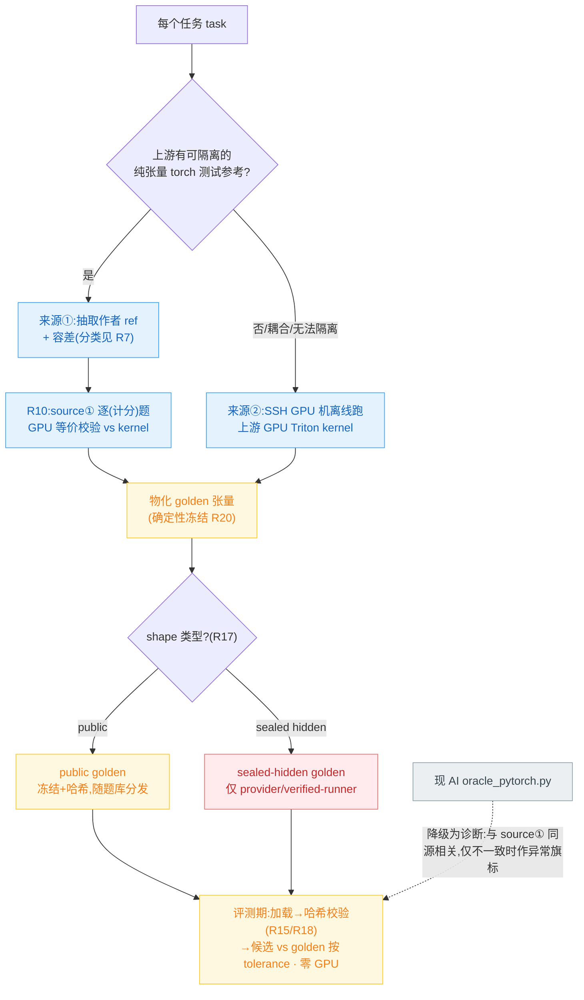

# 迁移基准的正确性 baseline（golden）来源改造

## Problem Frame

TritonAscendBench 是 **GPU Triton → NPU Triton 迁移**基准,核心命题是"忠于上游语义"。当前正确性真值(`oracle_pytorch.py::run`)是 **AI/脚本按算子文档数学定义生成**的——无对上游 GPU Triton kernel 的机器等价验证,无人工专家 review(代码中唯一 review 信号是 "codex-review + self-diagnosis";`provenance.authors` 全 101 题为泛化占位)。`formula_exact_manual` 占 **73%(74/101)**。**真值本身是未经证明的 AI 产物 = 整个基准最根本的 soundness 缺口。**

更可信来源就在本地、但流水线从未利用:`infer/vllm`(HEAD `18f6bf5a…`)、`infer/sglang`(HEAD `409d350f…`)已 checkout 且**带 `.git`**,带作者自己的 torch 参考 + 容差。注意:`phase_a_freeze.py` 的 `tests/` 过滤只是 kernel 源定位去误报过滤器(whole-file vendor 只取 kernel 源,从不抽取作者参考),并非"丢弃 golden 参考"——当前流水线无作者参考抽取逻辑,本改造是**净新增抽取阶段**。

**前提澄清(经两轮 review 修正)**:① 上游作者 torch 参考**本身也是从数学的重推**,作者只在自己声明的容差内接受它——它**不等于 kernel 精确行为**。来源①更权威**不是因为更贴近 kernel,而是因为带维护者 review/接受信号 + 维护者背书容差带**;要确认它确实匹配 kernel,仍需对 kernel 抽样等价校验(R10)。② commit 对应**大部分已存在**:`meta.yaml.upstream.commit_sha` 已逐题记录,95/101 与本地 `infer` HEAD 精确匹配(`version_matrix.toml` 亦声明 per-task SHA 在 meta);真实残余只有 (a) 5 个 PoC `snapshot-no-git`(无可断言 SHA)、(b) L3_08 记录的 `bf6dce360…` 在本地 `infer/vllm` **不可达**、(c) 记录的是 *kernel 源* SHA,非"作者 *test* 在同一 commit 捕获"的证明。R12 据此**收窄**为验证已记录 SHA + 处理这 3 类,而非"无机制、强行建立"。

## Golden 来源决策（已定）

> 安全边界:**public golden 可随题库分发;sealed-hidden golden 绝不进入 submitter 域**(仅 provider / verified-runner 持有)。

## Threat Model

对手 = 不可信 submitter + 可能被污染的上游。

- **T1 submitter 读取/查表 golden**：→ sealed-hidden golden 绝不进入 submitter 域;且 public golden 的发布**不得足以重构同题 hidden golden**(R14/R17)。
- **T2 上游供应链投毒**：被篡改 commit 让攻击者选定值成为计分真值。→ pin + 验签 + 隔离生成 + **对生成产物做范围/合理性约束**(R16)。
- **T3 golden 在冻结与使用间被换/损坏**：→ 评测期前强制哈希校验,权威哈希清单**独立带外信任根**(R15/R18);源②非确定性不得掩盖篡改(R20)。
- **T4 commit 错配**：kernel.py 与抽取的作者 test 来自不同 commit。注意此风险**已大幅缩小**(95/101 已记录且匹配),收窄为 R12 的 3 类残余。

## Requirements

**Golden 来源与优先级**
- R1. 每个 score-eligible 任务 golden 二选一:**来源①**=上游作者 unit test 抽取的可隔离纯张量 torch 参考 + 容差(分类见 R7);**来源②**=SSH GPU 机离线跑上游 GPU Triton `kernel.py` 输出。
- R2. 优先级:有可隔离纯张量上游测试参考 → 来源①;无/深度耦合/无法隔离 → 来源②。**R1/R2 优先级是 census 后可被推翻的初始决策**:若 census(见 Resolve-Before-Planning)显示来源① 可隔离率低,来源② 升为主路径、成本模型反转——本需求不预判,以 census 数据定。
- R3. AI `oracle_pytorch.py` 不作计分真值;保留为诊断。独立性限定:对来源②是独立第三估计,与来源① 同为按 spec 数学重推、**构造相关**——仅在与 golden **不一致时**作异常旗标(触发人工核查),一致**不**作正确性证据。
- R10. **来源① 等价校验**:对**进入计分集的每个**来源① 任务,在 SSH GPU 机验证"抽取 ref 输出 vs 上游 kernel 输出"落在该任务容差内(全覆盖,非仅抽样——成本模型见 R10b);未过者不得以来源① 计分(回退来源②或排除)。**R10b**:若 census 证明逐题 GPU 校验成本不可接受,降级为按算子族分层抽样,但此时未抽样任务**不得**标"verified correctness",须归入 R13b 单独披露层。

**容差来源与门禁**
- R7. 容差来源记录于 `golden_tolerance_source ∈ {upstream_test_explicit, upstream_test_default, migration_drift_budget}`:上游显式声明 `atol/rtol`→`upstream_test_explicit`;依赖框架默认→`upstream_test_default`(逐字继承且显式标注,**非作者背书容差**);来源②→`migration_drift_budget`。约束:须在**不重写 `tolerance.compare`** 前提下把容差注入现有 `tolerance_class`-keyed 比对(seam 方案见 Deferred)。
- R7c. **`golden_tolerance_source` 是 score-eligibility 门禁,非仅元数据**:`upstream_test_default` 任务**不得**对外标"已验证正确性",归入 R13b 单独披露层(或须额外过 R11 级非-AI 容差论证方可进 verified)。
- R11. `migration_drift_budget` 须**非任意且记录非-AI 推导依据**;不得 AI 拍脑袋。**注记(经 review)**:对融合/规约/attention 类(占比大),先验解析界通常不紧、"校准集实测 GPU-vs-NPU 漂移"对*正确性* baseline **有循环风险**(用被测 NPU 实现自身标定其容差)。具体推导方法学(解析界 vs 校准集 vs 其他)及其循环性规避列入 Deferred,本需求只要求"非任意 + 记录依据"。

**安全与完整性**
- R14. sealed-hidden golden 绝不分发到 submitter 域(机制方向见 Resolve-Before-Planning)。
- R17. **明确 public/sealed 划分准则 + 不可重构论证**:须有 requirement 定义哪些 task/shape 归 public、哪些 sealed、由谁定;并须论证**仅凭 public golden 不足以曲线拟合/查表重构同题 sealed golden**(否则 T1 在 R14 完美执行下仍部分成立)。
- R15. 评测期前强制重算 golden 内容哈希并与出处比对,不符→排除+标完整性失败。
- R18. **带外信任根**:R15 的权威哈希清单与 R12 的 commit manifest 必须有**独立于题库/vendored 树的 pin 公钥/签名信任根**,verified-runner 用带外 pin 的根校验;否则能改 golden 者亦能改 manifest,控制退化为自洽检查而非完整性门。须定义签名算法、密钥托管/轮换。
- R16. golden 生成隔离 + 供应链验签:隔离环境(无网络出口、专用用户、每题 ephemeral 文件系统、无法访问他题 golden/密钥),执行前按可信 manifest 验 commit;**且对执行不可信上游代码产出的 golden 张量做范围/合理性约束(output sanity gate)后方可签为权威**——commit 验签证明出处,不证明良性。
- R19. **verified-runner 信任边界**:须定义"verified"runner 的构成,以及 submitter 候选代码执行**与 sealed-hidden golden、签名密钥隔离**(不同进程/沙箱);否则恶意候选可在 runner 内 exfiltrate hidden golden 或密钥,T1 经此重开。
- R12. **commit 对应验证(已收窄)**:对已记录 `commit_sha` 的 95/101 任务,断言其在 pin 的上游可达且 `kernel.py` 出处 SHA == 抽取作者 test 捕获时的 SHA(后者需 R4 记录 test 捕获 SHA);不符落 `needs_manual`。**3 类残余**显式处理:(a) 5 个 `snapshot-no-git` 与 (b) L3_08 等不可达 SHA → 不得走来源①、不得标 verified,只能来源②或排除;(c) "kernel-SHA == test-SHA" 须实际比对,非假设。

**流水线改造**
- R4. 新增上游作者参考抽取阶段(净新增,非"停 skip"):定位上游对应 kernel 的作者测试,抽取可隔离纯张量 torch 参考 + 输入构造 + 容差 + **记录 test 捕获 commit SHA**(供 R12);抽取失败(无独立 test/深度耦合 `current_platform`/分布式/GPU-skip-gated/无法隔离)按规则回退来源②。
- R5. "golden 冻结"离线步骤**仅 provider 侧执行**;且**整体序在 Resolve-Before-Planning 之后**(census + R13 + R14 机制 + R20 方案定后才执行冻结,避免"先冻结再发现假设错"的时序环)。public 与 sealed-hidden 按 R14/R17 分别处置。
- R6. 评测期 `eval` 改为"加载→哈希校验(R15/R18)冻结 golden→候选 vs golden 按任务 tolerance 判定";替换当前 `eval.py` live 调 `oracle_pytorch.run` 路径,新增 golden 解析层;缺失/哈希不符/无 golden 的错误路径须定义;submitter 与评测期均无需 GPU。
- R20. **确定性冻结或容差带 golden**:源② kernel 若非确定(atomics/非确定规约/autotune/库漂移),exact-hash 完整性门(R15)无法区分篡改与良性非确定。要求:固定 seed/env 并**冻结前验证 run-to-run 位级稳定**方可 exact-hash;不稳定者改用"容差带 golden"(冻结多次采样的统计带,校验改为带内判定),并在出处标注。
- R8. 每任务记录 golden 出处:`golden_source`、`golden_tolerance_source`、上游 commit/SHA、test 捕获 SHA、抽取 test 路径或 GPU 环境指纹、golden 工件哈希、`reviewers`(真实署名)。
- R9. score-eligible 集 = 满足 {R1 二者之一、过 R10(若来源①)、`golden_tolerance_source` 过 R7c 门、R12 commit 对应已验证、R20 冻结方案确定、工件哈希齐全} 的任务;不满足者不进计分集、不公开排名,对外不得表述为"已验证正确性"。
- R13. **最小计分集 guardrail**(值待 Resolve-Before-Planning 用户决):定义可发布 verified 排名所需最小 score-eligible 规模 + 跨算子族/难度构成约束。**R13b**:低于 guardrail 或含 R10b 抽样未覆盖/`upstream_test_default` 任务时,这些任务进**单独披露层**(标 provisional + 覆盖率),不混入 verified 排名。
- R13c. **go/no-go 决策函数(显式)**:census 后计算 `projected_eligible = {过 R10 的来源① 任务} ∪ {源② 可行任务}`;PROCEED 当 `projected_eligible ≥ R13 规模 且 满足 R13 构成`;否则 (a) 以 R13b provisional+披露发布,或 (b) 停。R13 阈值与构成须在 census **之前**由用户定,使 census 输出**确定性**映射 proceed/provisional/stop,非看结果再定。

## Success Criteria

**过程/出处(必要)**
- 零 score-eligible 任务 golden 仅依赖未验证 AI oracle(R3/R9)。
- 每 score-eligible 任务可追溯 `golden_source`+`golden_tolerance_source`+commit 对应+test 捕获 SHA+工件哈希+真实 `reviewers`(R8/R12)。
- 评测期零 GPU;sealed-hidden golden 零 submitter 可见性;评测期 100% 经哈希完整性门(R14/R15/R18);verified-runner 候选与 golden/密钥隔离(R19)。
- 对外措辞与实际 golden 可信度一致:`upstream_test_default`/R10b 未覆盖/R13b 任务不标"已验证正确性"(R7c/R9)。

**结果(充分——证明排名真的更可信)**
- AI oracle vs golden 一致性按算子族**作为诊断统计披露**(非 pass 门;R3 已述一致无正面证据力);不一致项有书面调查解释,不静默接受。
- 经 R13c 决策函数后,verified 排名规模/构成满足 R13——仍能区分迁移保真度。

## Scope Boundaries
- 评测期/submitter 零 GPU(GPU 仅 provider 离线);成本模型可能因 census 反转(来源② 升主),不预判。
- 不重写 `tolerance.compare`/`scoring` 计分公式;只换"真值从哪来"+ 容差注入接缝。
- 不涉及性能 baseline(性能轴 `perf_status=unavailable` 现状)。
- 不人工逐题重写 74 题 oracle 数学。

## Key Decisions
- **Golden=上游权威,权威性来自"维护者 review 信号 + 背书容差带",非"更贴近 kernel"**:source① 与 AI oracle 同属数学重推;故 source① 进计分集须过 R10 等价校验才算证据(默认逐题全覆盖;成本不可接受才退 R10b 抽样+单独披露层)。
- **commit 对应大部分已工程存在**(95/101 已记录且匹配 HEAD);R12 是"验证 + 处理 3 类残余",非"从零建立"。
- **安全控制与威胁一一对应**(经 scope review 确认非 gold-plating):T1↔R14/R17/R19,T2↔R16,T3↔R15/R18/R20,T4↔R12。
- **AI oracle 仅作不一致旗标**(与 source① 同源相关,一致无信息量)。

## Dependencies / Assumptions
- `infer/{vllm,sglang}` 已带 `.git`、HEAD 与 95/101 题 `meta.upstream.commit_sha` 精确匹配——commit 对应**大部分已可验证**(残余 5 snapshot-no-git + L3_08 不可达,见 R12)。git 在 root-owned checkout 上对非 root 用户报 `dubious ownership`,需配 `safe.directory`(R12 实现障碍,非"无机制")。
- `phase_a_freeze.py` SHA 来源用硬编码常量、`extract_kernel.py` 用 `git rev-parse`——两工具 SHA 真值源不一致,R12 须统一为单一权威(实现注意点)。
- whole-file vendored `kernel.py` 独立 GPU 可调用需合成 grid/stride/constexpr launch harness + 完整上游 import 环境,当前不合成——source② 与 R10 共享此未解技术风险。
- 源② kernel run-to-run 位级可复现性未验证(R20 应对)。

## Outstanding Questions

### Resolve Before Planning
- [Affects R2/R9/R13c][Needs research] **覆盖+可行性 census(go/no-go)**:对 `infer/{vllm,sglang}` 按每题 kernel 实测——(a) 可隔离纯张量 ref 率、(b) 显式声明容差 vs 框架默认率、(c) GPU/platform `pytest.skip` 阻断率、(d) SHA 可验证率(扣除 snapshot-no-git/不可达)、**(e) 源② end-to-end 可行性**(launch harness 合成 + run-to-run 位稳)抽样实测。建议 8-10 题分层 spike,**(a)-(e) 联合**喂入 R13c 决策函数。
- [Affects R9/R13][User decision] **R13 阈值与构成**:最小 score-eligible 规模 + 跨算子族/难度约束,且取向(宁缺毋滥的小而真 vs R13b provisional+披露的大而部分验证)。须在 census **之前**定。
- [Affects R14/R17][User decision] sealed-hidden golden 机密机制:完全 withhold / 加密 at-rest(provider 持密钥,须答未来密钥泄露 replay)/ server-side 取——load-bearing 反作弊控制,须先定方向 + 闭 T1 的论证。

### Deferred to Planning
- [Affects R4][Technical] 作者 ref 抽取架构:ref 常在 kernel 自身模块(如 `rms_norm_ref`、registry 间接 `impls["native"]`)而非 test 文件,耦合 `current_platform`/`vllm._custom_ops`;`extract_kernel.py` 现仅 AST kernel 抽取,无 ref+import 隔离设施。
- [Affects R7][Technical] 容差注入 seam:在 eval 调用点合成 ad-hoc `ToleranceClass` vs 扩展 `load_policy`/`ToleranceClass`;`assert_close`(上游)vs `allclose`+bit_exact(本仓库)的 NaN/dtype 语义差异逐类处理。
- [Affects R11][Needs research] `migration_drift_budget` 非-AI 推导方法学及"校准集自标定循环性"规避;是否需独立校准数据采集 deliverable。
- [Affects R5/R6][Technical] golden 工件格式/存储(safetensors + 每 (task,shape,seed) 哈希)、题库体积、`static_checker` `\bgolden\b` 黑名单与题库内 golden 路径冲突。
- [Affects R12][Technical] 统一 `phase_a_freeze`/`extract_kernel` SHA 真值源;`safe.directory` 配置。
- [Affects R8][Technical] `reviewers` schema 迁移(`schema_version` bump、默认值、101 已冻结 meta 兼容)与人工签署轻量流程/责任人。

## Next Steps
→ 先做 census spike + 用户定 R13 阈值 / R14 机制(三 Resolve-Before-Planning 项),再 `/ce:plan`。
