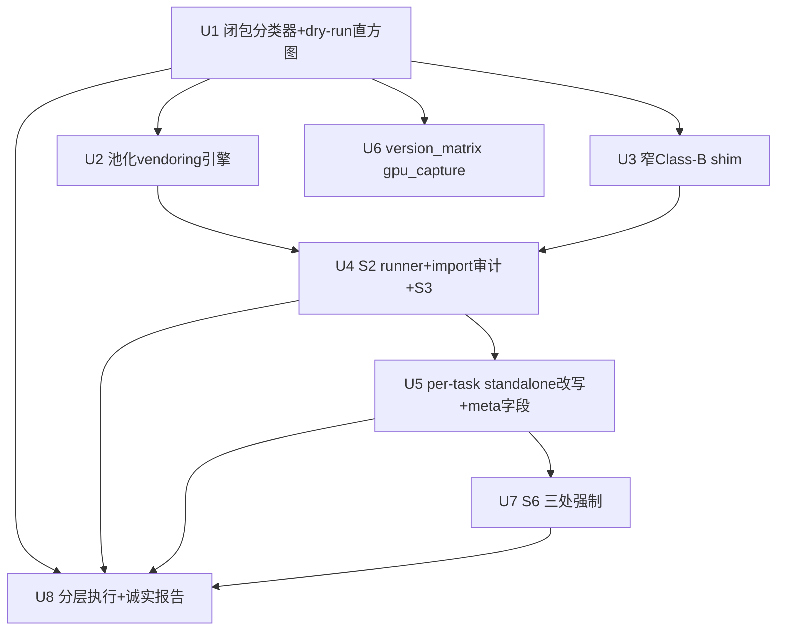

# feat: Phase A′ — 把 101 个冻结 kernel.py 做成真 standalone + 确定性 + S2 等价验证

## Overview

当前 `phase_a_freeze.py` 整文件 vendoring，导致 87/101 `kernel.py` 仍带 live
`from vllm…/sglang…` import → 行为依赖运行时装的包版本 → **不是真冻结，golden
不可复现**，直接打穿 baseline 精度保证。Phase A′ 把每个 kernel.py 改造成
standalone（仅 torch+triton+CUDA+Class-D 可跑）+ 确定性 + version-pinned + S2
行为等价已验证，使 ground-truth 采集（B′）不需要可运行 vLLM/SGLang 的机器，
且"冻结"在 provenance 层真正成立。

设计决策已由 codex 三轮对抗 review 收敛冻结（origin 文档 status:
codex-shipped），本计划**只做 HOW，不重议 WHAT**。

## Problem Frame

迁移基准的 ground truth 定义上是"被迁移的上游 GPU triton 生产 kernel 算出
什么"。`oracle_pytorch.py` 是 GPU-less 替身，从未证明 ≡ 上游 kernel；而
带 live import 的 kernel.py 连"冻结"都不成立。用户明确：精度问题不许靠缩
scope 回避（[[feedback-baseline-no-subset-escape]]），必须 101 全量在
provenance 层立住。详见 origin: `docs/plans/2026-05-17-phase-a-prime-standalone-freeze.md`。

## Requirements Trace

- R1（origin S1）101/101 kernel.py 在仅 `torch==2.5.1 triton==3.2.0`+CUDA
  13.0.0+Class-D 环境 import 成功、`run(inputs)->dict` 可执行，零
  vllm/sglang/site 解析。
- R2（origin S2）每 task severed vs original 经 S2-gpu-authoritative 严格
  bit-exact（dtype/shape/stride/alias/mutated-input/all-output），不用
  tolerance_class；不过→BLOCKED。
- R3（origin S3）确定性 N=5 bit-exact；仅 policy 声明的 non_deterministic 例外。
- R4（origin S4）每 standalone kernel.py 记 provenance（commit_sha/sha256/
  frozen_deps/classB 证明/reference_path/pinned_semantic_config）。
- R5（origin S5）`infra/version_matrix.toml` 增 `[gpu_capture]`。
- R6（origin S6）任一 score-eligible 任务 `phase_a_prime.status != PASS` →
  benchmark 不可发布（validate + cli analyze + CI 三处强制）。
- R7（origin §3/§4/C5）分类无残留不可判定：unknown→A；unvendorable/
  unauditable/no-triton-path/未冻结副作用→BLOCKED。
- R8（origin §6 + [[project-tab-pertask-tail]]）诚实 T0-T3 分层，报告真实
  通过数，不 fake 全量。

## Scope Boundaries

- 不做 B′ ground-truth 采集本身。
- 不改 scoring/分母语义（除 R6 的 release_blocked 发布判定）。
- 不在 910B 上跑。
- 不改 `oracle_pytorch.py` 语义（B′ 才降级为 cross-check）。
- 不"修正"upstream kernel 算法——只等价切依赖；改数值=失败。

## Context & Research

### Relevant Code and Patterns（本会话 [confirmed] 实测）

- `scripts/phase_a_freeze.py`：整文件 vendoring；可复用
  `resolve_source()`/`_provenance_header()`/`_commit_sha()`/`VENDORED_ROOT`/
  whole-file 抄录约定。Phase A′ = 其增量（切依赖+S2 gate）。
- `triton_ascend_bench/cli.py` L597-615：score-eligible 集计算（排除
  `raise NotImplementedError` / `PHASE-C-MANUAL`）——R6 在此注入 release 判定。
- `scripts/validate_tasks.py`：REQUIRED_FILES/REQUIRED_META 校验模式——R6
  新增 phase_a_prime.status 检查挂这里。
- `.github/workflows/ci.yml`：现仅 schema/version step——R6 增
  `phase-a-prime-gate` step。
- `infra/version_matrix.toml` v4.13：`[gpu]` cuda13/py3.11/torch2.5.1/
  triton3.2.0，"Any deviation invalidates baseline"——R5 增 `[gpu_capture]`。
- `triton_ascend_bench/tolerance.py` + `tolerance_policy.yaml`：分档容差 +
  `non_deterministic`/`rerun_count`——S2 **不复用**其 tolerance_class（origin
  §5 明确），仅复用 `non_deterministic` 声明读取。
- `triton_ascend_bench/frozen/snapshots/`：96 个 `<task>_<sha>.py` 快照命名约定（参考，非复用）。
- `infer/{vllm,sglang,vllm-ascend,sgl-kernel-npu}` 本地可得 → S2 original 侧
  可跑（等价性可验证非假设）。
- 测试基建：`tests/unit_tests/`（现 375 passed，pytest）。

### Institutional Learnings

- [[project-tab-pertask-tail]]：本仓每 Phase 都有抗机械化长尾；T3 诚实标
  per-task，不 fake 全量。
- [[feedback-baseline-no-subset-escape]]：精度问题禁用缩 scope；BLOCKED 是
  硬发布阻塞器不是剔分母。

### External References

不需要：纯仓内工具（依赖图/AST 闭包/子进程隔离/CI），无外部框架决策面。

## Key Technical Decisions

- **符号级可达闭包分类（非模块名）**：`ast` + import 解析做从 `run`/
  `@triton.jit`/launcher 出发的可达符号闭包；unknown→A；B 需逐符号正向数值
  惰性证明（默认拒绝）。理由：codex 证明"静态依赖链判 A/B"不可判定，模块名
  会骗（`platform_utils.num_compute_units` 影响 tiling）。
- **content-addressed 池 `triton_ascend_bench/frozen/deps/<sha12>/`**：跨 task 去重，
  sha 即 pin。理由：去重 + 可审计闭包 + 防版本漂移（origin D1）。
- **S2 = S2-smoke（CPU/interpret，不可 PASS）+ S2-gpu-authoritative（GPU，
  PASS 唯一来源）**，各在全新子进程 + severed 侧 import 审计断言零泄漏，严格
  bit-exact 无 ULP 逃逸。理由：codex 证明 interpret 不能验 CUDA/atomic/FP8；
  tolerance_class 过松且 fp32 cast 放过 dtype 错配；severing 同代码不应漂移。
- **S6 三处强制**：meta.yaml 字段 + validate_tasks.py + cli.py analyze
  release_blocked + CI step。理由：codex 指出 S6 原为口号，需可执行落点。
- **诚实分层执行**：先跑 `--classify --dry-run` 出真实闭包直方图定 Tier，
  按 Tier 批处理，报告真实 PASS/BLOCKED，T3 per-task 不 fake。

## Open Questions

### Resolved During Planning

- Tier 真实分布？→ U1 dry-run 直方图为准（origin D3），计划不预设数字。
- Class-D 白名单？→ 仅 `einops`（实测）；存疑降 A（origin §3 Class-D）。
- S2 采样种子是否泄漏 B′？→ A′ 用 disjoint provider-only validation-hidden
  种子（origin D2，codex-r1 FIX#6）。

### Deferred to Implementation

- 每个 A 类符号的传递闭包实际深度/是否环 → U2 运行时发现，设深度上限+环检测，
  超阈值入 T3。
- 具体哪些 task 属 T3（深纠缠）→ U1 dry-run 后定，U8 据实报告。
- `original` 侧能否在最小 `infer/` 环境 import 成功（缺二级依赖）→ U4 跑时
  发现，跑不起即该 task BLOCKED（origin R4）。

## High-Level Technical Design

> 以下为方向性评审辅助，非实现规范；实现 agent 视作上下文不照抄。

```
phase_a_prime.py 流水线（per task）:

  classify(task)                      # U1 符号级可达闭包
    └─> {A:[…], B:[…+proof], C:[…], S:[…], D:[…], tier∈T0..T3, BLOCKED?}
         │
  vendor(A∪C-fallback closure) ──> triton_ascend_bench/frozen/deps/<sha12>/   # U2
  shim(B provably-inert)     ──> triton_ascend_bench/frozen/shim/                  # U3
  pin(S)                     ──> meta.pinned_semantic_config          # U1/U5
         │
  rewrite kernel.py imports ──> 指向 pool/shim（standalone）          # U5
         │
  S2-smoke (CPU/interpret, 预筛, 不产 PASS)                            # U4
  S2-gpu-authoritative:                                               # U4
    subprocess(original, infer/ on path)  ─┐
    subprocess(severed,  import-audit=0 leak) ─┴─> bit-exact assert
    + S3 determinism N=5
         │
   PASS ─> write standalone + provenance + meta.phase_a_prime.status=PASS
   FAIL ─> meta.phase_a_prime.status=BLOCKED (+reason)  ── 触发 S6      # U7
```

依赖图：



## Implementation Units

- [ ] **Unit 1: 符号级可达闭包分类器 + dry-run 直方图（origin D3 首步）**

**Goal:** `phase_a_prime.py --classify [--dry-run]`：对每 task 从
`run`/`@triton.jit`/launcher 出发做符号级可达闭包，归类 A/B/C/S/D，判 Tier
T0-T3 与初步 BLOCKED；`--dry-run` 出全量 `import→Class` 直方图。

**Requirements:** R7, R8

**Dependencies:** None

**Files:**
- Create: `scripts/phase_a_prime.py`（classify 子命令 + 闭包引擎）
- Create: `tests/unit_tests/test_phase_a_prime_classify.py`
- Create（产物）: `docs/plans/phase_a_prime_classification.md`

**Approach:**
- `ast` 解析 kernel.py：BFS 闭包种子 = **(a) entrypoint**（`run`/host
  wrapper/`@triton.jit`/14 jit-only 待补 launcher）**+ (b) 全部 module-scope
  可执行/import/装饰器语句**（codex-cep-r1 U1 FIX [confirmed]）——import-time
  副作用如 `direct_register_custom_op(...)`、`CustomOp.register`、
  `logger = init_logger(__name__)`、`FP8_DTYPE = current_platform.fp8_dtype()`、
  顶层 env 读取、模块级 `@triton.autotune` 对象**必须**作为种子，否则会被
  静默丢弃。跨 import 解析到 `infer/<repo>` 源继续闭包。
- 分类规则严格按 origin §3 v3：默认 A；B 仅"可证明数值/形状/调度/dtype/
  stride/副作用惰性"（纯 logging sink / 纯 typing import / 值=上游默认且记录
  的确定常量），逐符号产证明串；C=可选 accel fork（deep_gemm/flash_attn/
  `torch.ops._C.*`/`cuda_arch>=80` 分支）；S=env/device/file 驱动 config
  选择（`VLLM_TUNED_CONFIG_FOLDER`/`VLLM_BATCH_INVARIANT`/device→config）；
  D=einops。unknown 动态/相对 import/`torch.ops`/custom-op 注册/模块级常量/
  env·文件·平台读取 → A。
- Tier：T0 闭包仅 torch+triton；T1 仅可证惰性 B；T2 浅 A（少量符号收敛）；
  T3 深纠缠（多 A / pipeline / `torch.ops.vllm.*` / 大闭包 / 环 / no-triton-path）。
- no-triton-path C 类、unvendorable、unauditable → 标 BLOCKED-candidate。

**Patterns to follow:** `phase_a_freeze.py` 的 `resolve_source()` 解析
repo→源路径；`ast` 遍历参考其 `_parse_kernel()`。

**Test scenarios:**
- Happy path: 一个 T0 fixture（无外部 import）→ 分类 {tier:T0, A:[],B:[]}。
- Happy path: 含 `vllm.triton_utils` re-export 的 fixture → `tl` 入 B 且带
  证明串，`HAS_TRITON`/autotune helper 入 A。
- Edge: 相对 import `from .utils import input_guard` → 解析到 infer 源、
  闭包含 contiguity 强制 → 归 A（非 B）。
- Edge: `VLLM_TUNED_CONFIG_FOLDER` 读取 → 归 S 不归 B。
- Edge: `torch.ops._C.x` + `if cuda_arch>=80` → C；同文件无 triton 分支 →
  BLOCKED-candidate。
- Edge（codex-cep-r1 U1）: **side-effect-only 顶层语句**（如裸
  `direct_register_custom_op(...)`、`logger = init_logger(...)`、
  `FP8_DTYPE = current_platform.fp8_dtype()`）即使不被 entrypoint 引用，也
  必须进闭包并分类（current_platform→A，logger→B-with-proof），断言**不被
  静默丢弃**。
- Error: 闭包成环 → 环检测报错并标 task T3，不死循环。
- Error: 闭包深度超上限 → 标 T3 + 记录闭包大小，不静默截断。
- Integration: `--dry-run` 跑全 101 → 产 `phase_a_prime_classification.md`
  含每 task 每符号→类+证明，行数=Σ闭包符号，可被 U8 读取。

**Verification:** `--dry-run` 在 101 题产出确定性直方图（重复跑 byte 一致）；
单测覆盖 A/B/C/S/D 五类 + 环/深度/相对 import 边界；无 unknown 漏判（unknown
必落 A 或 BLOCKED-candidate，断言无第三态）。

- [ ] **Unit 2: content-addressed 池化 vendoring 引擎（origin D1）**

**Goal:** 对 U1 判定的 A（及 C 的 triton-fallback 闭包）符号，从
`infer/<repo>@commit_sha` 抽取符号+传递闭包，写
`triton_ascend_bench/frozen/deps/h_<sha12>/<module>.py`，去重，保留 Apache 头+provenance。
（codex-cep-r1 U2 FIX [confirmed]：包段必须 **`h_<sha12>`** 前缀——裸 sha 可能
数字开头，作 Python 包段非法，import 改写会语法错误。）

**Requirements:** R4, R7

**Dependencies:** Unit 1

**Files:**
- Modify: `scripts/phase_a_prime.py`（vendor 引擎）
- Modify: `NOTICE`（仓库根，新增被 vendoring 上游的归属，codex-cep-r1 U2）
- Create: `tests/unit_tests/test_phase_a_prime_vendor.py`
- Create（产物根）: `triton_ascend_bench/frozen/deps/`（包段 `h_<sha12>/`）

**Approach:**
- 复用 `phase_a_freeze._commit_sha()` 取 pin；按符号闭包抽取最小可运行单元
  （函数/类/常量 + 其文件内传递依赖），sha256[:12] 内容寻址命名去重。
- 改写被抽符号内部的再依赖 import 指向池内相对路径；环检测 + 深度上限
  （超→标 task T3 BLOCKED-candidate，记录闭包，不强行展开）。
- 每池条目头：源 repo+commit_sha+原文件 sha256+Apache 头保留；更新根 NOTICE。

**Patterns to follow:** `phase_a_freeze._provenance_header()` 头格式；
`triton_ascend_bench/frozen/snapshots/` 的 `<id>_<sha>` 命名精神（这里改 content-addressed）。

**Test scenarios:**
- Happy path: 单函数无再依赖 → 池内 1 文件，sha 稳定，重复 vendor 不重复写。
- Happy path: 两 task 引同一 `quant_utils.fn` → 池内单条目被两 task 引用。
- Edge: 符号带文件内传递依赖（helper→helper）→ 闭包完整抽取，import 改写
  指池。
- Error: 闭包成环 → 报错 + task 标 T3，不写半成品。
- Error: 闭包深度>上限 → task BLOCKED-candidate + 记录，不静默截断。
- Integration: vendor 后池条目可被 `python -c import` 在仅 torch+triton 环境
  加载（无 vllm/sglang 解析）。

**Verification:** 池内容寻址去重正确（同源同 sha 单份）；任一池文件在干净
torch+triton 环境可 import；provenance 头完整含 commit_sha+原 sha256。

- [ ] **Unit 3: 极窄 Class-B 共享 shim（默认拒绝）**

**Goal:** `triton_ascend_bench/frozen/shim/` 提供 U1 判为"可证明惰性"的 B 符号的确定性
no-op/常量实现；每符号附 U1 产的证明串引用。

**Requirements:** R4, R7

**Dependencies:** Unit 1

**Files:**
- Create: `triton_ascend_bench/frozen/shim/__init__.py`（+ 子模块如 `_logging.py`）
- Modify: `scripts/phase_a_prime.py`（shim 注册/改写）
- Create: `tests/unit_tests/test_phase_a_prime_shim.py`

**Approach（codex-cep-r1 U3 FIX [likely]：B 处置必须二分）:**
- **B-rewrite-public**：`vllm.triton_utils` 等再导出的 `tl`/`triton` **不入
  shim**——直接改写为合法公开 import（`import triton` /
  `import triton.language as tl`，Class-D 同级）。shim 不是 triton 的替身。
- **B-inert-shim**：仅 *真正惰性* 符号入 `triton_ascend_bench/frozen/shim/`：纯 logging
  sink（no-op logger）、纯 typing-only import、确定常量（值=上游默认且 U1
  记录）。
- shim 不含任何会改 dtype/shape/调度/副作用的逻辑；"看似环境但影响 tiling"
  （如 `num_compute_units`）**不入 shim**（U1 已判 A）；`triton_utils` 的
  `HAS_TRITON`/autotune helper/capability gate 也**不入 shim**（U1 判 A）。
- 改写：B-rewrite-public → 公开 triton import；B-inert-shim → `triton_ascend_bench.frozen.shim`。

**Patterns to follow:** 无现成；保持 shim 文件极小、纯函数、零外部 import。

**Test scenarios:**
- Happy path: no-op logger 调用不抛、无副作用、返回与上游默认同型。
- Happy path（codex-cep-r1 U3）: `from vllm.triton_utils import tl, triton`
  → 改写为公开 `import triton; import triton.language as tl`（**不**进 shim），
  改写后 `tl.*` 调用行为不变。
- Edge: typing-only 符号被 import 不触发运行时行为。
- Error: 试图把无证明符号注册进 shim → U1 契约拒绝（B 默认拒绝断言）。
- Error（codex-cep-r1 U3）: 试图把 `tl`/`triton` 塞进 inert-shim → 拒绝
  （断言 B-rewrite-public 与 B-inert-shim 不混用）。
- Integration: 一个仅含 Class-B 的 task 改写后在干净环境 import+run 成功。

**Verification:** shim 内每符号可回溯到 U1 证明串；shim 零 vllm/sglang
import；含无证明符号时分类器/改写拒绝（test 断言）。

- [ ] **Unit 4: 子进程 S2 runner（smoke/gpu 双层）+ import 审计 + S3**

**Goal:** `phase_a_prime.py --verify <task>`：S2-smoke(CPU/interpret 预筛
不产 PASS) + S2-gpu-authoritative(GPU)；original/severed 各全新子进程；
severed 子进程 import 审计零泄漏；严格 bit-exact 等价 + S3 N=5；判 PASS/BLOCKED。

**Requirements:** R1, R2, R3, R7

**Dependencies:** Unit 2, Unit 3

**Files:**
- Modify: `scripts/phase_a_prime.py`（verify 子命令 + 子进程 harness）
- Create: `tests/unit_tests/test_phase_a_prime_verify.py`
- Create: `scripts/_pa_subproc_runner.py`（子进程入口：跑 original 或 severed
  并 safetensors 输出 + import 审计 dump）

**Approach:**
- original 子进程：`sys.path` 含 **`infer/vllm`** 与 **`infer/sglang/python`**
  （codex-cep-r1 U4 FIX [confirmed]，已实测：`sglang/python/sglang/__init__.py`
  → 需 `infer/sglang/python`；`vllm/vllm/__init__.py` → `infer/vllm`），
  跑未切版冻结前源；
  Class-C/S task 强制 accel-disabled + 同 pinned semantic config（origin §3
  C/S，codex C4 双契约）。
- severed 子进程：仅 torch+triton+Class-D+池+shim；跑前 import 审计——
  遍历 `sys.modules`/import hook，断言零 `vllm|sglang|site-packages` 解析，
  否则 BLOCKED（codex-r1 FIX#2 防 sys.modules 污染）。
- 输入：`build_inputs` `{small,med,large}×seed{V0..V2}` + A′ 专属
  validation-hidden `hidden×2×seed{V3,V4}`（与 B′ sealed score-hidden
  disjoint，origin D2），含非连续/转置/边界 dtype/mask-boundary。
- 等价断言（origin §5 v3）：dtype/shape/strides/alias-in-place/被 mutate
  输入/全部输出 **严格 bit-exact**；**无 ULP 逃逸**；非确定性差异 →
  BLOCKED+investigate（除非 policy 预声明 non_deterministic：用其
  rerun_count+声明 band，band 来源=original-vs-original 重复实测，非
  severed-vs-original，codex-r3 C1）。
- S2-smoke：interpret 仅 import/path/shape 冒烟，结果**永不**=PASS。
- 无 GPU 时：只能产 S2-smoke 结果 + 标 `status:UNRUN(needs-gpu)`，绝不 PASS
  （codex-r1 FIX#8 / origin R6 修正）。

**Execution note:** S2 等价判定逻辑 test-first（先写 bit-exact 断言的失败
测，再实现），因这是 soundness 命门。

**Patterns to follow:** `process_isolation.py` 的 safetensors-only IPC +
subprocess 隔离精神（本会话已知存在）。

**Test scenarios:**
- Happy path: 一个无依赖 fixture，severed≡original bit-exact → PASS。
- Happy path: 同 fixture 重复 N=5 → S3 bit-exact 通过。
- Edge: 非连续/转置输入 → 等价断言覆盖 strides，severed 改了 layout 即 fail。
- Edge: 输出 dtype fp16 vs fp32（数值近）→ **必须 fail**（不经
  tolerance.compare 的 fp32 cast，codex-r2 scenario）。
- Edge: in-place mutate 输入 → 被 mutate 输入纳入断言。
- Error: severed 子进程解析到 `vllm.*` → import 审计 fail → BLOCKED。
- Error: original 子进程缺二级依赖跑不起 → task BLOCKED+reason（不静默跳）。
- Error: 确定性 task 出 1-ULP 差 → BLOCKED+investigate（不放行）。
- Error（codex-cep-r1 U4，C1 后门负测，**显式封口**）:
  · 未 policy 预声明却出非确定性 → BLOCKED（**不得**临时加 tag 放行）。
  · `non_deterministic` band 若取自 severed-vs-original delta → 断言**拒绝**
    （band 只能来自 original-vs-original 重复实测）。
  · 任何 S2 路径试图回退用 `tolerance_class` → 断言**拒绝**。
- Error: 无 GPU 调 --verify → 产 UNRUN(needs-gpu)，断言**不**产 PASS。
- Integration: Class-C task：original 侧未 accel-disable 时 S2 应判契约不一致
  而非误 PASS（codex-r2 #4 / scenario 4）。
- Integration: Class-S task：双侧未用同 pinned config → 判不一致，不 PASS。

**Verification:** PASS 只可能来自 S2-gpu-authoritative；干净盒子 import 审计
零泄漏被强制；bit-exact 无 ULP 后门；非确定性仅 policy 预声明例外且 band 来源
正确；全部边界 test 绿。

- [ ] **Unit 5: per-task standalone 改写 + meta.yaml 字段（含最小 run() 契约）**

**Goal:** S2 PASS 后写 standalone kernel.py（import 指 pool/shim、含
per-task 最小 `run(inputs:dict)->dict`、14 jit-only 补确定性 launcher）+
provenance 头 + meta.yaml 字段。

**Requirements:** R1, R4

**Dependencies:** Unit 4

**Files:**
- Modify: `scripts/phase_a_prime.py`（rewrite/emit）
- Modify: `tasks/level*/<task>/kernel.py`（PASS 的 task，原地 standalone 化）
- Modify: `tasks/level*/<task>/meta.yaml`（新增字段 + dual-hash）
- Modify: `scripts/validate_tasks.py`（codex-cep-r1 U5 + **r2 must-fix
  [confirmed]：phase-aware 混合 rollout**）：hash 完整性校验按 task 状态分支：
  · 若 `meta.phase_a_prime.standalone_sha256` 存在 → 比对它 == 盘上 kernel.py；
  · 否则（未经 A′ 处理的 PoC/errata/遗留 task，kernel.py 仍 == 上游）→
    维持旧行为：比对 `meta.upstream.file_sha256` == 盘上 kernel.py。
  `upstream.file_sha256` 永远保留为原始上游冻结源哈希（provenance）。
  **release gate 与 hash 校验逻辑分离**（U7）：eligible `status!=PASS` 阻塞
  **发布**，但**不**使混合态下普通 schema/hash 校验失败（除非显式
  release-gate 模式）。`validate_tasks.py` 普通模式在 rewritten+legacy 混存
  时仍须全绿。
- Modify（必要时）: `tasks/level*/<task>/contract.md`（Class-C/S reference_path
  与 pinned config 声明）
- Create: `tests/unit_tests/test_phase_a_prime_rewrite.py`

**Approach:**
- 最小 `run()`：只 vendoring 从 `run` 入口可达 host 闭包；显式比对副作用
  （in-place/alias/被 mutate 输入纳入 S2）；module-scope 副作用 import 仅
  三态处置（机械白名单可移除 / 保留+vendoring / 否则 BLOCKED，**无人工"判它
  安全"档**，codex-r2 #6）；绝不整体拖框架。
- 14 jit-only：统一确定性 launcher 模板（grid 由 shape 推、autotune pin 单
  `triton.Config`、单 stream、无分布式）。
- meta.yaml 新增：`phase_a_prime: {status, reason, s2_gpu_run_id,
  classified_at, standalone_sha256}`、`frozen_deps: [<pool h_sha 引用>]`、
  `classB_symbols: [{sym, proof}]`、`reference_path: triton_fallback|native`、
  `pinned_semantic_config: {rule, resolved_value, upstream_default_ref}`。
  **dual-hash（codex-cep-r1 U5）**：`upstream.file_sha256` 不变（=原始冻结
  上游源哈希，provenance），新增 `phase_a_prime.standalone_sha256`（=改写后
  盘上 kernel.py 哈希，validate 改比对此值）。两者并存、语义分离。
- provenance 头扩 `phase_a_freeze._provenance_header()`：加 frozen_deps 清单
  + classB 证明 + reference_path + pinned config。

**Patterns to follow:** `phase_a_freeze._provenance_header()` 扩展；
meta.yaml 现有 `commit_sha/file_sha256` 字段风格（本会话已知）。

**Test scenarios:**
- Happy path: PASS task → kernel.py import 行全部指 pool/shim，无
  vllm/sglang，`run(inputs)->dict` 签名正确。
- Happy path: 14 jit-only 之一 → 补的 launcher 确定性（autotune 已 pin）。
- Edge: 多-kernel pipeline task → 最小 run() 含编排，副作用声明完整。
- Edge: Class-C task → meta.reference_path=triton_fallback + contract 声明
  "golden≠production accel"。
- Edge: Class-S task → meta.pinned_semantic_config 三字段齐全且 resolved_value
  字面 pin（codex-r3 C3 不运行时重解析）。
- Error: module-scope 副作用 import 既非白名单又不可 vendoring → task 不写
  standalone，标 BLOCKED（无第四态）。
- Integration: 改写后 kernel.py 在 `torch+triton+Class-D` 干净 venv import 成功
  （CI smoke）。
- Integration（codex-cep-r1 U5）: 改写后跑 `validate_tasks.py` **通过**——
  `standalone_sha256` 与盘上 kernel.py 一致。
- Integration（codex-cep-r2 must-fix，**混合态**）: 同一仓内 1 个已改写
  task（有 standalone_sha256）+ 1 个遗留 task（无 standalone_sha256、
  kernel.py 仍 == upstream）→ 普通 `validate_tasks.py` **两者都过**
  （phase-aware 分支正确）；与此同时若某 eligible task status
  missing/UNRUN/BLOCKED，**release-gate 模式**仍判不可发布（两个检查逻辑
  独立、不互相误伤）。
- Integration: 改写后全量 `pytest tests/` **0 fail 0 skip**（不破现有 375）。

**Verification:** PASS task 的 kernel.py 零 vllm/sglang import；meta 字段
schema 完整（含 dual-hash）；`validate_tasks.py` 绿（dual-hash 不误报）；
全 pytest 0 fail 0 skip；provenance 头可审计追溯 commit_sha；干净环境 import 通过。

- [ ] **Unit 6: `infra/version_matrix.toml` 增 `[gpu_capture]`**

**Goal:** 固化 A′ S2-gpu-authoritative + B′ 采集环境（设备 identity/
capability/FP8 语义、Class-D pins），偏离即 invalidate。

**Requirements:** R5

**Dependencies:** Unit 1（需知 Class-D 集 + Class-S 设备相关 pin 需求）

**Files:**
- Modify: `infra/version_matrix.toml`
- Create: `tests/unit_tests/test_version_matrix_gpu_capture.py`

**Approach:**
- 新增 `[gpu_capture]`：复用 `[gpu]` 的 cuda/torch/triton/py + 增
  `device_identity`、`compute_capability`、`fp8_semantics`、
  `extra_pins = ["einops==<pin>"]`（codex-r3 C3：Class-S 设备相关默认须
  字面 pin 到该设备解析值）。
- 与现有 "Any deviation invalidates baseline" 注释一致地标注偏离即 invalidate。
- **note（codex-cep-r1 U6 SHIP-w/-note）**：schema + 选值规则可**早落地**；
  但 `device_identity`/`compute_capability`/`fp8_semantics`/Class-S
  `resolved_value` 的**最终字面值依赖真实 GPU 采集主机**，**不得编造**——
  实现期先落 schema + 占位标 `pending: filled-on-capture-host`，真值在 B′
  采集主机上回填（与 codex-r3 C3 一致）。

**Test scenarios:**
- Happy path: 解析 `[gpu_capture]` 必含字段齐全，schema_version 兼容。
- Edge: 缺 device_identity → 校验报错（Class-S 字面 pin 失依据）。
- Edge: 字段值=`pending: filled-on-capture-host` → 校验允许（未采集态），
  但 S6/U7 视该 task 为非可发布（真值未回填不得 PASS-release）。
- Test expectation: 配置+解析校验，无运行时行为外的逻辑。

**Verification:** `[gpu_capture]` 可被 phase_a_prime 读取；缺字段被
test/validate 拒绝。

- [ ] **Unit 7: S6 三处强制（meta + validate + cli analyze + CI）**

**Goal:** 任一 score-eligible 任务 `phase_a_prime.status != PASS` →
benchmark 不可发布，硬强制于 validate_tasks/cli analyze/CI。

**Requirements:** R6

**Dependencies:** Unit 5（meta 字段存在）

**Files:**
- Create: `triton_ascend_bench/eligibility.py`（codex-cep-r1 U7 SHIP-w/-note：
  把 cli.py L597 inline 的 score-eligible 逻辑抽到此**副作用轻**包模块，
  cli.py 与 validate **都从这里 import**，单一真源、非从 CLI 隐式 import）
- Modify: `triton_ascend_bench/cli.py`（改用 `eligibility` 模块；analyze：
  score-eligible∩status!=PASS → score_report `release_blocked:true`+阻塞清单，
  仍出诊断）
- Modify: `scripts/validate_tasks.py`（import `eligibility` + phase_a_prime
  gate 检查）
- Modify: `.github/workflows/ci.yml`（新增 `phase-a-prime-gate` step）
- Modify: `tests/unit_tests/test_cli.py`（analyze release_blocked 用例）
- Create: `tests/unit_tests/test_validate_phase_a_prime_gate.py`
- Create: `tests/unit_tests/test_eligibility.py`（单一真源回归）

**Approach:**
- 抽 `eligibility.compute_score_eligible(tasks)` 到 `triton_ascend_bench/
  eligibility.py`（副作用轻：纯函数、call-time 读文件、无 import 时 I/O——
  codex-cep-r2 已确认 cli.py:597 现逻辑不闭包 CLI 参数/状态，抽取安全）；
  cli.py 现 inline 逻辑改为调用它（行为不变回归测）；validate 同 import。
- **release gate 是 `validate_tasks.py` 的独立模式**（codex-cep-r2 must-fix，
  与 hash/schema 校验逻辑分离）：普通模式只做 phase-aware schema/hash（混合
  态全绿）；`--release-gate` 模式额外 `eligibility ∩ {status!=PASS}` 非空 →
  非零退出 + 列阻塞 task。CI 的 `phase-a-prime-gate` step 跑 `--release-gate`。
- **非真空守卫（codex-cep-r3 must-fix [confirmed]，封真空通过）**：
  `--release-gate` 启动即断言 **eligibility 集非空且 == 仓库 catalogue 预期
  的 score-eligible 集**（≥1，且与 `iter_all_tasks()` 推出的 eligible 数一致）；
  examined/processed eligible 数为 0（坏 `--task`/空 fixture/错 task root/
  eligibility 计算 bug）→ **hard fail**，**绝不真空通过**（"没题所以没
  BLOCKED 所以可发布"是被 S6/[[feedback-baseline-no-subset-escape]] 禁止的
  退化路径）。
- cli analyze：计 eligible 后注入；`release_blocked` 与 `perf_status=
  unavailable` 二态并存且 coherent（codex-r3 C2：诊断 score 可出，发布榜单
  拒绝）——score_report 明示二态。
- CI：新 step 跑 validate 的 gate 检查（现 CI 仅 schema/version，需扩）。

**Patterns to follow:** `validate_tasks.py` REQUIRED_* 校验风格；cli.py
analyze 现有 `non_eligible_count` 报告风格（本会话已知）。

**Test scenarios:**
- Happy path: 全 eligible PASS → validate 0 退出，analyze 无 release_blocked。
- Edge: 1 个 eligible task BLOCKED → validate 非零 + 指名；analyze
  `release_blocked:true`+列该 task，但诊断 score 仍产出。
- Edge: 非 eligible task BLOCKED（stub/manual）→ 不触发 release_blocked
  （只 eligible 集触发）。
- Edge: status 字段缺失（UNRUN）→ 视同非 PASS，触发 release-gate。
- Edge（codex-cep-r2）: 普通 `validate_tasks.py`（非 --release-gate）在含
  UNRUN/BLOCKED 的混合仓上 **仍 0 退出**（hash/schema 全绿）；仅
  `--release-gate` 模式才非零。两模式互不误伤。
- Error: cli.py 与 validate 都从 `eligibility.py` import（防漂移）——test
  断言两处对同输入给同 eligible 集。
- Integration: CI `phase-a-prime-gate`（`--release-gate`）在含 eligible
  BLOCKED 的 fixture 仓上 fail；普通 CI schema step 不受影响。
- Error（codex-cep-r3，非真空）: `--release-gate` 跑在空 fixture / 坏
  `--task` / 错 task root（examined eligible = 0）→ **hard fail**，断言
  **不**真空通过；eligibility 数 ≠ catalogue 预期 eligible 数 → 也 fail。

**Verification:** 三处对"含 eligible BLOCKED"一致判不可发布；诊断 score 仍
可出（C2）；score-eligible 计算单一真源（无双实现漂移）。

- [ ] **Unit 8: 分层执行 + 诚实报告（真跑，不 fake 全量）**

**Goal:** 按 U1 实测 Tier 在 101 题跑 classify→vendor/shim→rewrite→S2，
产 per-task PASS/BLOCKED 报告 + S6 发布判定，T3 明标 per-task，诚实报告真实
通过数。

**Requirements:** R8（及 R1-R7 的实跑验证）

**Dependencies:** Unit 1, 4, 5, 7（U2/U3/U6 经 U4/U5 间接）

**Files:**
- Modify: `scripts/phase_a_prime.py`（`--run --tier T0|T1|T2|T3|all` 编排）
- Create（产物）: `docs/plans/phase_a_prime_status.md`（per-task PASS/BLOCKED
  +reason+tier + S6 判定）
- Modify（执行结果）: `tasks/**`（PASS 题 standalone 化）、`meta.yaml`

**Approach:**
- 先 `--classify --dry-run`（U1 产物）校准真实 Tier 分布写
  `phase_a_prime_classification.md`。
- T0/T1 批处理（脚本）；T2 半自动 + 逐题核；**T3 不可机械化长尾：逐题
  author，诚实标 per-task，不 fake**（[[project-tab-pertask-tail]]）。
- 报告：真实 PASS 数 / BLOCKED 数（按原因分类：no-triton-path / 闭包环 /
  深度超限 / original 跑不起 / 副作用不可处置 / 非确定性未声明）；只要有
  eligible BLOCKED 即按 S6 声明"benchmark 未达发布"（不掩盖,
  [[feedback-baseline-no-subset-escape]]）。
- **报告必须机器生成（codex-cep-r1 U8 SHIP-w/-note，封手写 fake 口）**：
  `phase_a_prime_status.md` 只能由脚本从 U4/U5 的 per-task artifact
  （meta.phase_a_prime.status + s2_gpu_run_id）+ U7 gate 聚合产出，**禁止
  手写/手改**；报告含每条 status 的 artifact 溯源指针，可被 U7 CI 交叉核对
  （报告数 ≠ artifact 实况即 CI fail）。

**Execution note:** 本单元是真实跑批，受 [[project-tab-pertask-tail]] 约束——
交付真实分层结果，**严禁 fake 全量完成**；无 GPU 时 S2-gpu 部分标
UNRUN(needs-gpu) 并诚实报告，不伪 PASS。

**Test scenarios:**
- Integration: 小 fixture 子集（含 1 个故意 BLOCKED）跑 `--run --tier all`
  → 报告 PASS/BLOCKED 分类正确，S6 判定不可发布。
- Edge: 全 fixture PASS → 报告 release-ready。
- Test expectation（真 101 跑）: none -- 这是执行产物非单测；正确性由 U1-U7
  单测 + 报告的真实数 + S6 gate 保证；诚实性由"报告真实数、不 fake"约束。

**Verification:** `phase_a_prime_status.md` **机器生成自 U4/U5 artifact**
（非手写）、反映真实逐题结果；报告数与 artifact 实况一致（U7 CI 交叉核对，
不一致即 fail）；PASS 题确通过 S2-gpu-authoritative（或 honest 标
UNRUN-needs-gpu）；BLOCKED 题带具体原因；S6 判定与 U7 三处一致；无 fake 全量。

## System-Wide Impact

- **Interaction graph:** `cli.py analyze`（注入 release_blocked）、
  `validate_tasks.py`（新 gate）、CI（新 step）、`meta.yaml` schema（新字段，
  其它读 meta 处需容忍新键）、`process_isolation`（S2 复用其隔离精神，不改）。
- **Error propagation:** S2/分类失败 → BLOCKED（非异常吞没）；BLOCKED →
  S6 三处一致硬阻塞发布；original 跑不起 → BLOCKED+reason 不静默。
- **State lifecycle risks:** vendoring 写池需幂等（content-addressed 去重）；
  改写 kernel.py 原地——失败须不留半成品（U5 先写 temp 再原子替换）。
- **API surface parity:** score-eligible 计算必须单一真源（U7 抽 helper），
  防 cli.py 与 validate 漂移（与 v3.2 已有 eligible 逻辑一致）。
- **Unchanged invariants:** 不改 scoring 公式 / tolerance_policy / oracle
  语义 / 分母定义；仅加 release_blocked 发布判定（与 perf_status=unavailable
  并存、coherent）。

## Risks & Dependencies

| Risk | Mitigation |
|------|------------|
| 闭包分类把算法误判 B 改了数值 | B 默认拒绝+逐符号正向证明；S2 严格 bit-exact 兜底；非连续/dtype/mask 采样；存疑一律 A |
| severing 同代码却非 bit-exact（import 序/autotune cache/dict 序）| 不放宽——BLOCKED+investigate 定位并冻结未冻结源（codex-r2 #2）；只 policy 预声明 non_deterministic 例外 |
| 大量 task 入 T3（T1 坍塌）| 诚实接受（[[project-tab-pertask-tail]]）；U1 dry-run 出真实分布；按 Tier 分批不 fake |
| 无 GPU → S2-gpu 跑不了 | S2-smoke 仅预筛不产 PASS；标 UNRUN(needs-gpu) 诚实报告；GPU 同服务 A′ 与 B′ |
| original 侧 `infer/` 缺二级依赖跑不起 | 先建最小可 import 验证环境；跑不起=该 task BLOCKED+记录（暴露 provenance 风险）|
| score-eligible 双实现漂移 | U7 抽单一 helper，cli.py 与 validate 共用，test 断言一致 |
| 改写 kernel.py 破坏现有 375 tests | U5 原子替换 + CI import smoke；改写后跑全 pytest 必 0 fail 0 skip（CLAUDE.md）|

## Documentation / Operational Notes

- 产物文档：`docs/plans/phase_a_prime_classification.md`（符号→类全表）、
  `docs/plans/phase_a_prime_status.md`（per-task PASS/BLOCKED + S6 判定）。
- DESIGN.md 对齐是独立后续阶段（task #71），不在本计划。
- 运营：S6 使"含 eligible BLOCKED 即 benchmark 不可发布"——发布前必须全
  eligible PASS（或显式 policy 处置），这是有意的硬门。

## Sources & References

- **Origin（codex-shipped 设计）:** `docs/plans/2026-05-17-phase-a-prime-standalone-freeze.md`
- 复用代码: `scripts/phase_a_freeze.py`、`triton_ascend_bench/cli.py:597`、
  `scripts/validate_tasks.py`、`infra/version_matrix.toml`、
  `triton_ascend_bench/tolerance.py`、`.github/workflows/ci.yml`
- 记忆: [[feedback-baseline-no-subset-escape]]、[[project-tab-pertask-tail]]
- codex 三轮 review 记录: `/tmp/codex_pa_out{1,2,3}.md`
