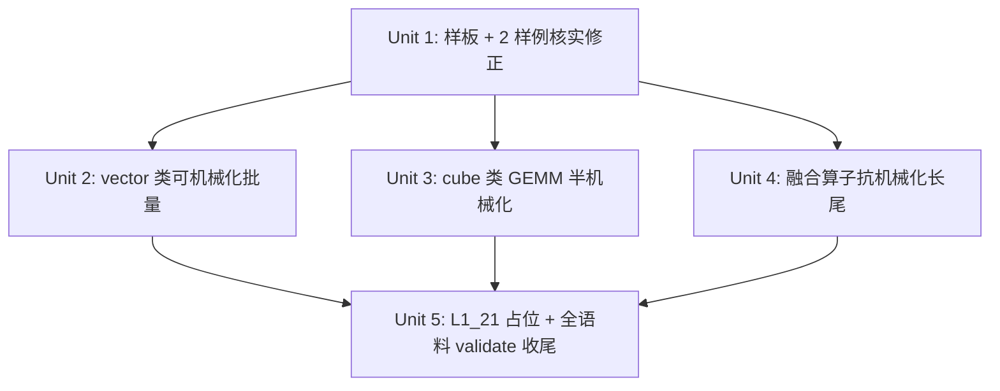

# feat: cost_model 公式逐题填充

## Overview

给 triton-ascend-bench 全部 100 个 non-canary task 的 `meta.yaml` 填 `cost_model`(`flops`/`bytes` size-knob 公式 + compute-class/resource 标注),使双目标 Roofline 评分的性能目标有输入、`validate_tasks` 的 `cost_model` 维度转 green、`cost_model.status` 进 P7 发布门可 PASS。本工作是纯数据填充(`meta.yaml`),不改 `cost_model` schema 或评分代码。

## Problem Frame

W1.2 实现了 `cost_model` schema + 评分链,并把 `cost_model` 列为 `validate_tasks.REQUIRED_META_TOP_LEVEL`。但 100 题仅 2 题(`L1_01_bias`、`L1_12_rms_norm`)有 `cost_model`,98 题缺 ⇒ 全语料 `validate_tasks` red、`cost_model.status` 无法 PASS ⇒ benchmark 不可发布(P7 硬门)。Roofline 基线 `t_ref = max(max_c W_c/π_c, max_r M_r/β_r)` 的 `W_c`/`M_r` 来自 `cost_model`,缺它则双目标 Roofline 的「性能」目标悬空。详见 origin:`docs/plans/2026-05-21-cost-model-fill-approach.md`。

## Requirements Trace

- R1. 全部 100 个 non-canary task 的 `meta.yaml` 含 `cost_model`(`flops`/`bytes` + class/resource 标注)(origin §1/§8)
- R2. `validate_tasks` 的 `cost_model` 维度对 100 题转 green(`parse_cost_model` + `validate_formulas` 通过)(origin §8)
- R3. 每题 `cost_model` 公式经 §3.4 符号语义审计 —— 公式符号对应 `kernel.py`/`oracle_pytorch.py` 真实 tensor 维度/loop extent,非仅 validator-passing(origin §3.4)
- R4. mixed-dtype task 的 `bytes` 按 origin §3.2 规则(primary family 用 `dtype_size`、non-primary 用字面量字节宽、数齐 auxiliary/index 张量)(origin §3.2)
- R5. 现有 2 样例 `L1_01`/`L1_12` 的 `cost_model` 忠实性核实并修正(`L1_12` 已知误用不存在的 `L` 维)(origin §3.4)
- R6. `L1_21_gumbel_sample` 填常量型占位 `cost_model`、显式标注为占位(origin §7)
- R7. 不破坏现有 pytest 套件;抗机械化长尾如实统计报告(origin §6/§8)

## Scope Boundaries

- **不做** `infra/peak_table_910b.toml` 的 `vector`/`interconnect` π/β 峰值回填(需 910B 实机 microbenchmark)
- **不做** W4.2 GPU cross-check 实跑(需 GPU 机)
- **不改** `cost_model` schema、`cost_model.py`、评分代码(W1.2 既定)
- canary task(`tasks/_canary/`)豁免,不填

## Context & Research

### Relevant Code and Patterns

- `triton_ascend_bench/cost_model.py` — `parse_cost_model` / `validate_formulas` / `VALID_FLOPS_CLASSES`(`fp16_cube`/`bf16_cube`/`int8`/`vector`)/ `VALID_BYTES_RESOURCES`(`hbm`/`interconnect`)/ `DERIVED_SYMBOL_DEFAULTS`(`dtype_size`)
- `scripts/validate_tasks.py::_validate_cost_model` — `cost_model` required 校验 + 公式 parse/eval-ability
- `specs/task_api_contract.md §5.1` — `cost_model` schema(三键、scalar/map 两形式、scalar↔map 归一化)
- 现有样例:`tasks/level1/L1_01_bias/meta.yaml`(scalar 形式)、`tasks/level1/L1_12_rms_norm/meta.yaml`(map 形式 — 但误用 `L` 维,见 R5)
- `triton_ascend_bench/eval.py` — representative `dtype_size` 取第一个 declared tensor input 的字节宽
- WB.1(Task #20)逐题 reconcile 的工作形态可直接复用 —— cost_model 填充与 `param_constraints` reconcile 同型

### Institutional Learnings

- 「自洽 ≠ 忠实」(Task #20 WB.1):`validate_tasks` green 只证公式 parse/eval-able,不证语义忠实 — 故 R3 强制 semantic audit
- 抗机械化长尾交付原则:方法论 + 批量机械化子集 + 诚实报告长尾,不 fake 全量

## Key Technical Decisions

- **逐题对照 kernel.py + oracle 填充,而非套模板**:`cost_model` 公式必须反映算子真实计算/访存量;套模板会重蹈 WB.1「自洽不忠实」覆辙(L1_12 误用 `L` 即模板化恶果)。
- **按 compute-class 倾向分三档批量化**:vector 类(可机械化)/ cube 类(半机械化)/ 多类融合(抗机械化),分 Unit 推进,既批量又不失忠实。
- **L1_21 占位而非真填**:其 `shapes.yaml` 无 `size_knobs`,无符号写真实 shape-依赖公式;用常量型占位(同 WA.5 手法)使 validate green,显式标注、因 non-score-eligible 不影响评分。
- **不引入填充辅助工具/新代码**:工作是纯 `meta.yaml` 数据填充;`validate_tasks` 已是现成校验闸,无需新工具。

## Open Questions

### Resolved During Planning

- 是否需要 score-eligible 之外的题也填?— 是,`validate_tasks` 对所有 non-canary task 要求 `cost_model`(origin R1-1 已定)
- `L1_21` 怎么处理?— 常量型占位 cost_model(origin §7 已定)

### Deferred to Implementation

- 各融合算子(attention/SSM/MoE)的精确 FLOPs 分段(cube QK·PV vs vector softmax 的常数系数)— 依赖逐题读 `kernel.py` 循环结构,执行时定
- 个别 task 的 representative `dtype_size` 与 primary tensor family 判定边界 — 逐题对照 `shapes.yaml.inputs` 声明顺序定

## Implementation Units

### Task → Unit 覆盖表(100 题,无重无漏)

归属按算子**真实 compute-shape 初判**,**非 `meta.category`**(如 `L2_10` category=`moe` 但实为 int8 GEMM ⇒ 归 Unit 3;`L1_05`/`L1_35`/`L1_36` category=`moe` 但实为索引计算 ⇒ 归 Unit 2)。冲突优先级:**compute-shape 优先于 category**。实现时若某题实际 compute 形态与初判不符,按实际形态跨 Unit 调整 —— 不影响全覆盖;Unit 5 收尾按本表 100 题清单逐一闭环确认无遗漏。

| Unit | 题数 | task id |
|---|---|---|
| Unit 1(范式样板) | 5 | `L1_01_bias`、`L1_12_rms_norm`、`L1_16_silu_and_mul`(vector 样板)、`L2_13_bmm`(cube 样板)、`L3_04_fwd`(融合样板) |
| Unit 2(可机械化 — vector/index/memory 单一 compute) | 55 | L1:`L1_02`–`L1_11`、`L1_13`–`L1_15`、`L1_17`–`L1_20`、`L1_22`–`L1_40`(除 `L1_21`);L2:`L2_15`–`L2_18`、`L2_20`–`L2_21`、`L2_25`–`L2_28`、`L2_31`–`L2_32`、`L2_34`–`L2_38`;L3:`L3_22`、`L3_23` |
| Unit 3(cube — GEMM/matmul/LoRA-GEMM) | 11 | `L2_01`、`L2_04`–`L2_12`、`L2_14` |
| Unit 4(融合 — 多 compute class) | 28 | L2:`L2_02`–`L2_03`、`L2_19`、`L2_22`–`L2_24`、`L2_29`–`L2_30`、`L2_33`;L3:`L3_01`–`L3_03`、`L3_05`–`L3_07`、`L3_09`–`L3_21` |
| Unit 5(占位) | 1 | `L1_21_gumbel_sample` |

合计 5 + 55 + 11 + 28 + 1 = 100。各 Unit 的 **Files** 即本表对应 task id 清单的 `tasks/level*/<task_id>/meta.yaml`。

- [ ] **Unit 1: 填充范式样板 + 现有 2 样例忠实性核实修正**

**Goal:** 确立逐题填充范式 —— 端到端跑通覆盖表 Unit 1 的 5 题(vector/cube/融合三种 compute 形态各有样板),并核实修正现有 `L1_01`/`L1_12` 的 `cost_model`。

**Requirements:** R3, R5

**Dependencies:** None

**Files:**
- Modify(覆盖表 Unit 1 的 5 题 `meta.yaml`):`tasks/level1/L1_01_bias/meta.yaml`、`tasks/level1/L1_12_rms_norm/meta.yaml`、`tasks/level1/L1_16_silu_and_mul/meta.yaml`、`tasks/level2/L2_13_bmm/meta.yaml`、`tasks/level3/L3_04_fwd/meta.yaml`

**Approach:**
- 对照 `kernel.py`/`oracle_pytorch.py`/`shapes.yaml` 按 origin §3 方法论填 `flops`/`bytes`。
- `L1_12`:其张量 `[B,D]`、oracle `reshape(-1,D)` 逐行 — 现 `cost_model` 误用 `L`,修正为真实维度(`B`/`D`);`L1_01`:核实 `B*N` / `2*B*N*dtype_size` 是否忠实(`L1_01` 有 int64 index 表,核 mixed-dtype 规则 R4)。
- 每题做 §3.4 符号语义审计 — 公式每个符号映射到 kernel/oracle 真实维度。

**Patterns to follow:** `specs/task_api_contract.md §5.1` 的 scalar/map 样例;WB.1 逐题 reconcile 工作形态。

**Test scenarios:**
- Happy path:`L1_01`/`L1_12`/`L1_16`(vector 样板)/`L2_13`(cube 样板)/`L3_04`(融合样板)全 5 题填充后 `validate_tasks --task <id>` 的 `cost_model` 维度均 green
- Edge case:`L1_12` 修正后公式不再含 `L`、仅含其真实维度符号
- Edge case:融合样板 `L3_04_fwd` 用 map 形式,`flops` 含 cube(QK·PV)+ vector(softmax)两段
- Integration:`L1_01` 的 int64 index 表字节按 R4 mixed-dtype 规则(字面量 `*8`)计入 `bytes`

**Verification:** 全 **5 题**(含融合样板 `L3_04_fwd`)`cost_model` validate green;每题公式符号经逐题语义审计、全部对应 kernel/oracle 真实维度;vector/cube/融合三种范式均有可复用样板,分别供 Unit 2/3/4。

- [ ] **Unit 2: vector 类可机械化子集批量填充**

**Goal:** 给覆盖表 Unit 2 的 **55 题**(elementwise / reduce / normalization / 激活 / quantization / index-gather / cumsum 等 vector/index/memory 单一 compute 类)批量填 `cost_model`。

**Requirements:** R1, R2, R3, R4

**Dependencies:** Unit 1

**Files:**
- Modify:覆盖表 **Unit 2 的 55 题** 各 `tasks/level*/<task_id>/meta.yaml`

**Approach:**
- `flops`:vector 类 `常数 * 元素数` 基型,常数由 oracle 逐元素运算数定;`flops_class: vector`。
- `bytes`:读写张量字节和,primary family 用 `dtype_size`、non-primary(index/scale)用字面量字节宽(R4);`bytes_resource: hbm`。
- 单 class 单 resource ⇒ scalar 形式。逐题对照 `kernel.py`/`oracle` 做 §3.4 语义审计 — 批量不等于套模板。

**Patterns to follow:** Unit 1 的 vector 样板;`L1_12_rms_norm`(修正后)。

**Test scenarios:**
- Happy path:该批每题 `validate_tasks` 的 `cost_model` 维度 green
- Edge case:含 index/scale 等 non-primary dtype 张量的题,`bytes` 用字面量字节宽而非全 `dtype_size`
- Error path:公式引用 `shapes.yaml` 未声明的 knob ⇒ `validate_formulas` 报错(应在审计阶段先行排除)

**Verification:** Unit 2 的 55 题**全部** `cost_model` validate green;**逐题**符号语义审计完成 —— 每题记录公式符号 → `kernel.py`/`oracle` 真实维度/loop extent 的映射(`meta.yaml` 的 `cost_model` 段注释或实施报告),收尾按 55 题清单逐题确认、**非抽样**;未引入 pytest 回归。

- [ ] **Unit 3: cube 类 GEMM/matmul/LoRA 半机械化填充**

**Goal:** 给覆盖表 Unit 3 的 **11 题**(GEMM / matmul / LoRA grouped-GEMM / int8 量化 GEMM,cube 类)填 `cost_model`。

**Requirements:** R1, R2, R3

**Dependencies:** Unit 1

**Files:**
- Modify:覆盖表 **Unit 3 的 11 题** 各 `tasks/level2/<task_id>/meta.yaml`

**Approach:**
- `flops`:cube 类 `2*M*N*K` 基型(2 = 乘+加),逐题对 `M/N/K` 与 epilogue。
- compute class 按操作数 dtype 选:`float16`⇒`fp16_cube`、`bfloat16`⇒`bf16_cube`、`int8` 量化 GEMM⇒`int8`(origin §3.1 决策表)。
- 含 epilogue(bias/激活)的用 map 形式分 `cube`+`vector` 段。`bytes` 计 A/B/C 矩阵 + scale,mixed-dtype 按 R4。

**Patterns to follow:** Unit 1 的 cube 样板;origin §3.1 cube 子类决策表。

**Test scenarios:**
- Happy path:GEMM 类每题 `validate_tasks` 的 `cost_model` 维度 green
- Edge case:`int8` 量化 GEMM 用 `int8` flops_class、scale 张量(float32)字节按字面量 `*4`
- Integration:带 epilogue 的题用 map 形式,`flops` 含 `fp16_cube` + `vector` 两 key

**Verification:** Unit 3 的 11 题**全部** `cost_model` validate green;`int8` GEMM 的 class 标注正确;**逐题**符号语义审计完成(每题记录符号映射,收尾按 11 题清单逐题确认、非抽样)。

- [ ] **Unit 4: 融合算子抗机械化长尾填充**

**Goal:** 给覆盖表 Unit 4 的 **28 题**(attention / SSM-chunk / recurrent / MoE 融合算子,多 compute class)逐题填 `cost_model`。

**Requirements:** R1, R2, R3, R4, R7

**Dependencies:** Unit 1

**Files:**
- Modify:覆盖表 **Unit 4 的 28 题** 各 `tasks/level*/<task_id>/meta.yaml`

**Approach:**
- 多 compute class ⇒ map 形式:attention 的 `QK^T`·`PV`(cube)+ softmax(vector)分 key;MoE 的 routing(vector)+ expert GEMM(cube)分 key。
- 逐题对照 `kernel.py` 的循环/分块结构(`tl.constexpr` tile、chunk 维度)与 `oracle` 数学推 FLOPs 分段。
- `bytes_resource`:本 benchmark 题均单 kernel / 单设备语义,用 `hbm`;`interconnect` 仅留给真正跨 rank 通信 kernel —— `L2_25`–`L2_28` 等 EP/DeepEP gather/scatter/reorder 题是**本地 tensor 重排**,用 `hbm`、**不**用 `interconnect`。
- 抗机械化指公式推导**费时**(逐题对照 kernel 循环结构),**非「推不出」**——融合算子的 analytic FLOPs/bytes 总可推出(精度由范围外的 W4.2 GPU cross-check 兜底)。`TODO` 仅作 Unit 进行中的临时状态、**非交付态**:交付态是 28 题全部真实公式。若某题确遇阻塞(kernel 结构无法理解),走**升级处理**(标注阻塞原因、提请人工/GPU 机核),不接受未完成 / 不瞎填。

**Execution note:** 抗机械化长尾 — 逐题人工对照 kernel 循环结构;交付态为 28 题全部真实公式,`TODO` 仅进行中临时态,阻塞题走升级处理而非留未完成。

**Patterns to follow:** origin §3.1 混合 map 例;`L1_12`(修正后)的 map 形式。

**Test scenarios:**
- Happy path:融合算子每题 `validate_tasks` 的 `cost_model` 维度 green
- Edge case:attention 题 `flops` 含 `fp16_cube`(QK·PV)+ `vector`(softmax)两段
- Edge case:MoE 融合题(routing vector + expert GEMM cube)用 map 形式分 key
- Integration:map 形式每个 compute-class key 是 `VALID_FLOPS_CLASSES` 合法值,经 scalar↔map 归一化可被峰值表 scoring

**Verification:** Unit 4 的 28 题**全部** `cost_model` validate green(交付态无 `TODO` 残留);map 形式 class/resource key 合法;**逐题**符号语义审计完成(每题记录符号映射,收尾按 28 题清单逐题确认、非抽样);如有阻塞题,以升级处理记录在案、不计作完成。

- [ ] **Unit 5: L1_21 占位 + 全语料 validate 收尾**

**Goal:** `L1_21_gumbel_sample` 填常量型占位 `cost_model`;全 100 题 `cost_model` 维度 validate green 收尾验证。

**Requirements:** R1, R2, R6, R7

**Dependencies:** Unit 2, Unit 3, Unit 4

**Files:**
- Modify: `tasks/level1/L1_21_gumbel_sample/meta.yaml`

**Approach:**
- `L1_21`:填常量型占位 `cost_model`(常量 `flops`/`bytes` 公式 + 合法 `flops_class`/`bytes_resource`),`validate_formulas` 对常量公式在空 knob 集可通过。`meta.yaml` 注释显式标注「占位、非真实 FLOPs/bytes、待补 oracle + executable shapes.yaml 后填真实公式」。
- 全语料跑 `validate_tasks`,确认 `cost_model` 维度 100 题全 green;跑 pytest 全套确认无回归。

**Test scenarios:**
- Happy path:`L1_21` 占位 `cost_model` 经 `validate_tasks` green
- Integration:全 100 题 `validate_tasks` 的 `cost_model` 维度无 red
- Edge case:`L1_21` 占位带显式注释标注,不被误当真实公式

**Verification:** 按覆盖表 100 题清单逐一闭环确认(Unit 1-5 全覆盖、无遗漏、无重复);`validate_tasks` 全语料 `cost_model` 维度 0 red;pytest 套件无回归;`L1_21` 占位有显式标注。

## System-Wide Impact

- **Interaction graph:** `cost_model` 被 `dataset.load_task`(`TaskDef.cost_model`)、`validate_tasks._validate_cost_model`、W4.2 GPU cross-check(future)消费。本工作只填数据,不改这些消费方。
- **State lifecycle risks:** 无 — 纯 `meta.yaml` 静态数据填充,无运行时状态。
- **API surface parity:** 无 — 不改 schema/接口。
- **Unchanged invariants:** `cost_model` schema、`cost_model.py`、评分代码、scalar↔map 归一化逻辑均不变;本工作只新增/修正 `meta.yaml.cost_model` 字段内容。
- **Integration coverage:** `validate_tasks` 全语料跑是跨「数据 ↔ 校验器」的集成验证。

## Risks & Dependencies

| Risk | Mitigation |
|------|------------|
| 公式自洽但语义不忠实(validator green 但符号错,如 L1_12 用 `L`) | R3 强制 §3.4 符号语义审计,每题对照 kernel/oracle 真实维度 |
| 融合算子 FLOPs 分段难精确(cube/vector 系数) | 逐题人工对照 kernel 循环结构推 analytic 公式;`TODO` 仅 Unit 进行中临时态,交付态 28 题全真实公式、**无 delivery-state `TODO`**;确遇阻塞的题走升级处理(标注阻塞原因、提请人工/GPU 机核),不计作完成 |
| mixed-dtype task 字节误算(全 `*dtype_size`) | R4 mixed-dtype 规则:non-primary dtype 用字面量字节宽 |
| analytic 公式与实测偏差 | 承认 W4.2 GPU cross-check(GPU 机、范围外)是最终裁判;本工作力求 analytic 准确 |
| peak_table `vector`/`interconnect` π/β=0,填了也算不出 Roofline 分 | 范围边界明确:peak_table 回填是 NPU 机另一工作项;本工作使公式就绪、为回填后即可评分铺路 |

## Sources & References

- **Origin document:** `docs/plans/2026-05-21-cost-model-fill-approach.md`(codex 3 轮 review ALL PASS)
- Related code:`triton_ascend_bench/cost_model.py`、`scripts/validate_tasks.py::_validate_cost_model`、`specs/task_api_contract.md §5.1`、`infra/peak_table_910b.toml`
- 样例:`tasks/level1/L1_01_bias/meta.yaml`、`tasks/level1/L1_12_rms_norm/meta.yaml`
