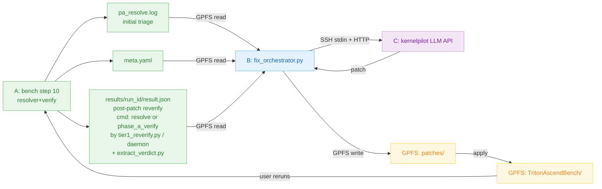

# triton-ascend-bench 三机自动化 orchestrator 设计

## 0. 背景

### 0.1 当前痛点

bench `run_all.sh` 在 GPU 机跑通后,step 10 resolver 暴露绝大多数 task 处于三类 BLOCKED:

- `shapes-incomplete` — entrypoint 能 resolve,但 `shapes.yaml` 没枚举某个无默认值的必填参数,by-name 适配器拒绝静默 skip+shift(`scripts/_pa_subproc_runner.py:345-353`)
- `oracle-mismatch` — task `oracle_pytorch.py` 数值与上游 kernel 不一致,resolver 的 oracle-consistency anchor 拒收(wrong-operator 信号)
- `upstream-not-invocable-here` — wrapper 在 vendored snapshot 上 import 不起来(missing optional deps / relative-import / runtime-context assertion),isolated subprocess 跑不了

真实分布见 `docs/plans/phase_a_prime_status.md`(101 task / 78 + 17 + 2 + 4 UNRUN(needs-gpu) / 0 PASS)。每个 task 都要 task-specific 修复(改 metadata / 改 oracle / 把 task 改成 defer-to-upstream 路径)。人工逐 task triage 不现实 — 这是抗机械化长尾。

### 0.2 既定方针

bench 团队既定方针:**交付基础设施 + 批量子集 + 诚实报告,不 fake 全量完成**。本方案不试图"100 题全 PASS",而是把可自动化的部分自动化、剩下诚实标 backlog。

### 0.3 目标

搭建一套三机自动化 orchestrator,把 task triage 的 inner loop(诊断 BLOCKED → 生成修复 → 重跑验证)交给 LLM 自动迭代;人工只做策略决策(scope / 优先级)和复盘(LLM 改不了的真硬骨头)。

自动化的最终形态:每个 GPU-only bench 阶段(step 10 resolver / step 20 cost_model_xcheck / step 30 golden_capture)都接同款 agentic loop。本方案先聚焦 step 10 的 task triage,并把 step 30 golden capture 作为 defer-to-golden / defer-to-upstream-oracle 两条诚实退路的承接点。

## 1. 环境拓扑

| 角色 | 机器 | 职责 |
|---|---|---|
| **A** | GPU 机(NVIDIA,有 CUDA + ncu) | 实际跑 bench 各 step |
| **B** | CPU 机 | 跑 fix_orchestrator(主控、LLM 调用、patch 生成) |
| **C** | LLM 服务机 | 跑 `kernelpilot.generator.server`(HTTP API) |

通信链路:

```
A <-- GPFS 共享存储 --> B <-- SSH --> C
                       |
                       (可选) SSH --> A
                       (可选) HTTP --> C(若 B 能直连 C 的 LLM 端口)
```

- **A 与 B**:GPFS 挂载(同一份 bench repo / log / meta / patch / queue 都在 GPFS 上,A 和 B 看到的是同一份文件)
- **B 到 C**:SSH 隧道 + LLM HTTP API(payload 经 stdin 传输,见 §3.3);如果 B 能直连 C 的服务端口,则用 `requests.post` 直发
- **B 到 A**:SSH 可选 — 决定 Tier 1 vs Tier 2 部署形态;不必须

## 2. 整体架构

### 2.1 数据流(Tier 1 半自动)



**两类 artifact 的角色分工**(关键不变量):

- **初始分诊 artifact** `pa_resolve.log`:由 `scripts/resolve_upstream_entrypoints.py` 写出(见 `scripts/gpu_pipeline/10_phase_a_prime.sh:58-77` 调用),orchestrator 第一轮从这里识别三类 BLOCKED 入队。**resolver 不读** `meta.phase_a_prime.skip_invocation`(`scripts/resolve_upstream_entrypoints.py:1435-1518` 的 resolve_task 是按 candidates 逐一尝试 oracle_consistency + S2-smoke,无 meta skip 探查),所以对已经 patch 过的 defer-to-golden task 仍会按上游不可达再次给出 `BLOCKED(no-verified-upstream-entrypoint: upstream-not-invocable-here)`,**永远不会**输出 `SKIPPED_BY_DESIGN`。
- **post-patch reverify artifact** = `results/<run_id>/result.json`(`cmd ∈ {resolve, phase_a_verify}`,详见 §3.4 "result.json contract"):由 `scripts/automation/tier1_reverify.py`(Tier 1)/ `bench_evaluator_daemon.sh`(Tier 2)调 `scripts/automation/extract_verdict.py` 物化(唯一 producer);**三类 reverify task 都走同一 schema**,orchestrator 按 `result.json.cmd` 字段判语义(`resolve` 子模式服务 shapes-incomplete / oracle-mismatch path 1/2;`phase_a_verify` 子模式服务 defer-to-golden / oracle-mismatch path 3 等 skip_invocation task)。`scripts/phase_a_prime.py --verify <task>` 自身**不**直接写 result.json —— 它只输出 stdout 的 `S2Result` 文本 + 更新 `meta.yaml.phase_a_prime.{status, reason}`,由 wrapper / daemon 之后调 `extract_verdict.py` 读取这两路信息(优先 `meta.yaml.phase_a_prime.status` 权威,fallback 解析 stdout)写入 `result.json`。`phase_a_prime.py --verify` 在 `s2_verify_task`(`scripts/phase_a_prime.py:1551-1664`)+ `_build_per_task`(`scripts/phase_a_prime.py:2500-2765`)**两层** `skip_invocation` 抢断逻辑(§4.4.3 (1)(6))支持下,把 S2Result 的 `status / reason` 字段以及刷新后的 `meta.phase_a_prime.status` 落到 meta;`cmd == phase_a_verify` 子模式因此才能产 `SKIPPED_BY_DESIGN` verdict。defer-to-golden / oracle-mismatch path 3 / 任何 LLM patch 改了 `meta.phase_a_prime.skip_invocation` 的 task,reverify **必须**走 `cmd == phase_a_verify` 这一支,不能再依赖 `pa_resolve.log` 作 verdict 源。

### 2.2 控制流

**Tier 1(半自动)**:用户手动触发 A 上 bench 跑;B 上 orchestrator 在每轮 bench 跑完后处理 BLOCKED。

```
[人工]  A: bash run_all.sh --from 10                    # 第一轮 = 初始分诊
   |
[A]    resolver 跑出 pa_resolve.log,写 GPFS            # 入口 artifact
   |
[人工]  B: python3 fix_orchestrator.py --resolve-log <log>
   |
[B]    自动: parse -> LLM -> patch -> 写 GPFS
   |
[人工]  A: 按 task 类型选择 reverify 命令(两条都走同一个 wrapper,仅 --cmd 不同;
           wrapper 统一产 `result.json` + `DONE` 到 out-dir,与 Tier 2 daemon 产物同 schema):
           shapes-incomplete patch      -> python3 scripts/automation/tier1_reverify.py \
                                              --cmd resolve --task <TASK> \
                                              --out-dir /gpfs/.../results/<run_id>
                                           (wrapper 内部调 `resolve_upstream_entrypoints.py --task <TASK> --apply`
                                            + 解析对应 task 段的 pa_resolve.log,正常进 PASS / 仍 BLOCKED)
           oracle-mismatch path 1/2     -> python3 scripts/automation/tier1_reverify.py \
                                              --cmd resolve --task <TASK> \
                                              --out-dir /gpfs/.../results/<run_id>
                                           (同上;path 2 改了 oracle,resolver 内部
                                            会再做 oracle-consistency anchor)
           defer-to-golden (skip_invocation=true) ->
           oracle-mismatch path 3 (skip_invocation=true) ->
                                          python3 scripts/automation/tier1_reverify.py \
                                              --cmd phase_a_verify --task <TASK> \
                                              --out-dir /gpfs/.../results/<run_id>
                                          (wrapper 内部调 `phase_a_prime.py --verify <TASK>` —
                                           走 _build_per_task / s2_verify_task 的 skip_invocation
                                           抢断;**不**重跑 resolver,因为 resolver 不读
                                           skip_invocation,仍会给 BLOCKED(upstream-not-invocable-here))
   |
[B]    第二轮 orchestrator 统一从 `results/<run_id>/result.json` 读 verdict
       (Tier 1 / Tier 2 共用 result.json contract,§3.4;按 run_id 防 stale,
        按 cmd 字段区分 resolve vs phase_a_verify 产物语义)
   |
   ... 循环 3-5 轮收敛
```

**为什么必须区分两条 reverify 路径**:resolver(`scripts/resolve_upstream_entrypoints.py:1435-1518`)的 verdict 集合是 `{PASS | UNRUN(needs-gpu) | BLOCKED(shapes-incomplete) | BLOCKED(oracle-mismatch) | BLOCKED(upstream-not-invocable-here) | BLOCKED(no-host-wrapper) | BLOCKED(smoke-fail)}`,**没有** `SKIPPED_BY_DESIGN`,也不读 `meta.phase_a_prime.skip_invocation`。defer-to-golden / path 3 的 task 在第二轮如果仍走 resolver 重跑,会**永远**拿不到 `SKIPPED_BY_DESIGN` 入 §5 状态机的 `[VERDICT_SKIPPED_BY_DESIGN]` 步骤,loop 不收敛。必须由 `phase_a_prime --verify` 走 `s2_verify_task` / `_build_per_task` 的 skip_invocation 抢断(§4.4.3 (1)(6))才能产 SKIPPED_BY_DESIGN verdict。

**Tier 2(全闭环 daemon)**:A 上跑 evaluator daemon poll GPFS queue,B 上 orchestrator 完整闭环。

## 3. 组件设计

### 3.1 B 上 fix_orchestrator.py

**位置**:`scripts/automation/fix_orchestrator.py`(bench repo 内)

**职责**:
1. 读 bench 跑出的 verdict artifact(**初始分诊**走 `pa_resolve.log`,**post-patch reverify** 走 `results/<run_id>/result.json`(`cmd ∈ {resolve, phase_a_verify}`,详见 §3.4 "result.json contract";三类 task 共用同一 schema,orchestrator 按 `cmd` 字段判语义);parse 出 `task_id, verdict_class, evidence`)
2. 按 verdict_class 分组 + 按修复成本排序
3. 逐 task 调 LLM 生成修复 patch
4. 验证 patch(安全约束)+ apply 到 GPFS
5. (Tier 2)按 task 当前 `meta.phase_a_prime.skip_invocation` 选择 enqueue 哪类 cmd(下方"reverify 触发策略"):skip_invocation 为 true ⇒ `phase_a_verify`,否则 `resolve`
6. (Tier 2)读 A 跑出的新 verdict(对应 cmd 的产物),迭代或收敛
7. 持久化 patch + prompt + LLM response(可审计)
8. 输出 batch summary + backlog 文档

**CLI**:

```
python3 scripts/automation/fix_orchestrator.py \
    --resolve-log results/gpu_pipeline/pa_resolve.log \
    --reverify-results /gpfs/tab_automation/results/        # 第二轮统一结果根目录(三类 task 共用)
    --verdict-class shapes-incomplete \
    --max-tasks 30 \
    --max-attempts 3 \
    --llm-endpoint <C host:port> \
    [--dry-run] [--apply] [--tier {1|2}] \
    [--accept-deferral <task_id>] [--mark-unfixable <task_id>]
```

**flags**:
- `--resolve-log`:初始分诊 artifact(resolver 输出),识别 BLOCKED 三类入队
- `--reverify-results`:**第二轮统一结果根目录**,所有 post-patch reverify task(三类:shapes-incomplete / oracle-mismatch path 1-2 / defer-to-golden + path 3)**都从这里**读 `result.json + DONE`,**与 `--cmd` 无关**;路径形如 `/gpfs/.../tab_automation/results/<run_id>/result.json`,producer 是 `tier1_reverify.py`(Tier 1)/ daemon(Tier 2)+ `extract_verdict.py`(schema 见 §3.4 "result.json contract")。orchestrator 在第二轮及之后按 `run_id` 匹配 task + 按 `result.json.cmd` 字段判 verdict 子模式语义,**取代** resolver log 作为所有 post-patch task 的 verdict 源。**读屏障**:orchestrator 扫 `results/<run_id>/DONE` 才读对应 `result.json`(不是 queue `<run_id>/DONE` —— queue 侧 DONE 是 daemon 自己 GC 用的 marker,**不是**读端 barrier;两个 DONE 分别承担不同语义,见 §3.4)
- `--verdict-class`:只处理某一类 verdict(分批处理便于观察)
- `--max-tasks`:上限,防止单次 LLM 调用爆炸
- `--max-attempts`:单 task LLM 重试上限
- `--dry-run`:不写文件、只生成 patch 到 `patches/` 供审计
- `--tier`:1 = 半自动(写完 patch 就返回);2 = 闭环(enqueue + 等结果)
- `--accept-deferral <task_id>`:接受 `[HUMAN_REVIEW_PENDING]` **或** `[HUMAN_REVIEW_EXPIRED]` 的 patch,把 task 切到 `[DEFERRAL_ACCEPTED]`,apply `patches/<task>/round-<N>/patch.diff` 并 enqueue `phase_a_verify`(path 3 主入口,以及 path 4.4 retry-exhausted 在人工 supply 新 patch 后的入口)
- `--mark-unfixable <task_id>`:把 `[HUMAN_REVIEW_PENDING]` **或** `[HUMAN_REVIEW_EXPIRED]` 的 task 显式落到 `[MANUAL_BACKLOG]` 终态(`triage_state.json` 持久化 + meta.yaml 写 `release_scope.excluded: true`,见 §4.4.3 (7)),**不**触发 reverify,**不**进 release predicate;仅 path 4.4 retry-exhausted 的人审出口之一(case (b))。**`[MANUAL_BACKLOG]` 不接受 timeout 兜底自动入** —— timeout 后切到 `[HUMAN_REVIEW_EXPIRED]` 中间态(§8),仍等人工显式跑 `--mark-unfixable`,保留 manual-backlog 指标的审计语义

**reverify 触发策略**(orchestrator 在 patch apply 后选择 enqueue 哪类 cmd,由 task 的 patch 类型 + 当前 meta 决定):

| Patch 类型 | meta 状态(patch apply 后) | reverify cmd | 期望 verdict |
|---|---|---|---|
| shapes-incomplete 修 shapes.yaml | `phase_a_prime.skip_invocation` 不存在 | `resolve`(Tier 1 走 `scripts/automation/tier1_reverify.py --cmd resolve`,wrapper 内部调 `resolve_upstream_entrypoints.py --task <T> --apply` + `extract_verdict.py` 解析 `pa_resolve.log` 中本 task 段,按 §3.4 schema 产物落 `results/<run_id>/result.json` + `results/<run_id>/DONE`;Tier 2 daemon enqueue `cmd=resolve`)| `PASS` / 仍 `BLOCKED(shapes-incomplete)` |
| oracle-mismatch path 1 / 2 改 tolerance / oracle | `phase_a_prime.skip_invocation` 不存在 | `resolve`(同上)| `PASS` / 仍 `BLOCKED(oracle-mismatch)` |
| oracle-mismatch path 3 defer-to-upstream-oracle | `phase_a_prime.skip_invocation == true` + `phase_a_prime.status == SKIPPED_BY_DESIGN` + `oracle_simplified == upstream_oracle_required` + `phase_b_capture_required == true`(§4.3.2)| `phase_a_verify`(Tier 1 走 `scripts/automation/tier1_reverify.py --cmd phase_a_verify`,wrapper 内部调 `phase_a_prime.py --verify` + `extract_verdict.py`,按 §3.4 schema 产物落 `results/<run_id>/result.json` + `results/<run_id>/DONE`;Tier 2 daemon enqueue `cmd=phase_a_verify` 走 §3.2 同款流程)| `SKIPPED_BY_DESIGN` |
| defer-to-golden(upstream-not-invocable-here),patch 通过 validation | 同 path 3(§4.4.2)| `phase_a_verify`(同上)| `SKIPPED_BY_DESIGN` |
| **path 4.4 retry-exhausted (a)** — 人工 supply 新 patch + `--accept-deferral` | 同 path 3(`skip_invocation == true` ...) | `phase_a_verify`(同上;走 path 3 出口逻辑) | `SKIPPED_BY_DESIGN` |
| **path 4.4 retry-exhausted (b)** — `--mark-unfixable` | meta **未** apply patch(GPFS task 目录保持 baseline)| **不 enqueue**(orchestrator 把 task 切到 `[MANUAL_BACKLOG]` 终态,§5)| 不适用(无 reverify) |

规则:**只要 LLM patch 后 task 的 `meta.phase_a_prime.skip_invocation == true`,reverify 一律走 `phase_a_verify`(Tier 1 通过 `tier1_reverify.py --cmd phase_a_verify` 包装,Tier 2 通过 daemon `cmd=phase_a_verify` 分支);否则走 `resolve`(Tier 1 通过 `tier1_reverify.py --cmd resolve` 包装,Tier 2 通过 daemon `cmd=resolve` 分支)**。**`[MANUAL_BACKLOG]` 终态既不走 `phase_a_verify` 也不走 `resolve`,不进 reverify 循环**。Tier 2 的选择在 orchestrator 端通过 enqueue task.json 的 `cmd` 字段表达,由 A daemon 路由到 §3.2 的不同分支;Tier 1 由人工跑同一个 wrapper(用 `--cmd` 区分两条 reverify 路径),wrapper 内部按 cmd 路由到 resolver / phase_a_prime --verify 的对应执行路径,产物 schema 与 Tier 2 完全一致(`result.json` + `DONE`,按 §3.4 result.json contract)以便 orchestrator 第二轮统一读取 —— Tier 1 / Tier 2 两层 reverify 数据流的 schema 是单一闭集,M3 跨 Tier 指标统计才能口径一致。

**Tier 1 reverify wrapper — `scripts/automation/tier1_reverify.py`**(bench repo 内,无 daemon;一个脚本两个 cmd 子模式,与 Tier 2 daemon 的两条 cmd 分支一一对应):
Tier 1 第二轮要求 orchestrator 从 `results/<run_id>/result.json` 统一读 verdict(GPFS),但 Tier 1 无 daemon、原生入口(`resolve_upstream_entrypoints.py` / `phase_a_prime.py --verify`)自身都不直接写 `result.json` —— 前者只 append `pa_resolve.log`、后者只刷 meta + 打 stdout。wrapper 桥接这一层,两种 cmd 共用相同的"调子命令 → extract_verdict → 原子写 result.json + touch DONE"骨架:

```bash
# Tier 1 reverify wrapper(人工在 A 上执行,一次一个 task;run_id 由 orchestrator 入队时生成)
# --cmd 取值 ∈ {resolve, phase_a_verify},由 §3.1 reverify 触发策略表选择
python3 scripts/automation/tier1_reverify.py \
    --cmd {resolve | phase_a_verify} \
    --task <TASK_ID> \
    --out-dir /gpfs/.../tab_automation/results/<run_id>
```

wrapper 内部 3 步骨架(两 cmd 共享步骤 2/3,步骤 1 按 `--cmd` 分支;与 §3.2 daemon 走的产物等价,同一 `result.json` schema,见 §3.4 "result.json contract"):

1. **执行 reverify 子命令**(按 `--cmd` 路由):
   - `--cmd phase_a_verify` → `python3 scripts/phase_a_prime.py --verify <TASK_ID>` 同步跑,stdout/stderr 落 `<out-dir>/log.txt`(走 `s2_verify_task` 的 skip_invocation 早返,§4.4.3 (1));**phase_a_prime --verify 自身不写 result.json**,只刷 `meta.yaml.phase_a_prime.{status, reason}` + 打 stdout
   - `--cmd resolve` → `python3 scripts/resolve_upstream_entrypoints.py --task <TASK_ID> --apply` 同步跑(单 task 模式,**不**重跑整批 `run_all.sh --from 10`),stdout/stderr 落 `<out-dir>/log.txt`,resolver 同时 append 本 task 段到 GPFS 上的 `pa_resolve.log`;**resolver 自身不写 `result.json`**,只产 `pa_resolve.log` 段 + meta 改写
2. `python3 scripts/automation/extract_verdict.py <TASK_ID> --cmd {resolve | phase_a_verify} --run-id <run_id> --log <out-dir>/log.txt --producer tier1_reverify` 按 cmd 选 verdict 源:
   - `--cmd phase_a_verify` → 读 `meta.yaml.phase_a_prime.status`(权威)+ fallback parse stdout S2Result
   - `--cmd resolve` → grep `pa_resolve.log` 中本 task 段(或回退读 step-1 stdout `log.txt`,二者内容一致),映射 resolver 结果到 `verdict` 枚举 `{PASS | BLOCKED}`(`SKIPPED_BY_DESIGN` 是 `--cmd phase_a_verify` 子模式的合法值,resolver 不读 `skip_invocation` 故 `resolve` 子模式产不出;**`UNRUN` 不是 result.json 合法 verdict** —— 若 A 侧 environment readiness 不满足导致 resolver 本地输出 `UNRUN(needs-gpu)`,视为 **operator/preflight failure**:wrapper **不产** 有效 `result.json`(也不 `touch DONE`),错误信息打 stderr 退出非零,operator 看到非零退出码再修复环境再重跑,见 §3.2 environment readiness 段)
   两路最终都按 §3.4 schema 写入 `<out-dir>/result.json.tmp`(包含 `cmd` 字段标识本次产物语义,orchestrator 据此区分两类 reverify 数据流;两子模式 `verdict` 合法子集分开 —— `cmd == resolve` ⇒ `verdict ∈ {PASS, BLOCKED}`,`cmd == phase_a_verify` ⇒ `verdict ∈ {PASS, BLOCKED, SKIPPED_BY_DESIGN}`)

> 关于 `UNRUN`:**`UNRUN` 不进 reverify `result.json` 合法 verdict 枚举**;它只在三个上下文中出现 —— (i) `pa_resolve.log` 首轮分诊(resolver 输出 `UNRUN(needs-gpu)` 表示本 task 需要 GPU 但 A 侧 environment 未就绪);(ii) `phase_a_prime.py` 直接输出的 `S2Result.status`(老路径 / debug 通道);(iii) daemon 启动前的 environment readiness probe(daemon probe 失败直接拒接 task,见 §3.2)。这三处都**不**通过 reverify wrapper 落 `result.json`。
3. 原子 `mv result.json.tmp result.json` + `touch results/<run_id>/DONE`(读端 barrier,必须**在** result.json rename **之后**再 touch)

orchestrator 第二轮按 `--reverify-results <root>` 扫 `results/<run_id>/DONE`,有就读对应 `result.json`,完全复用 Tier 2 的 result 读路径(§3.4 "result.json contract")—— Tier 1 / Tier 2 的差别只在产 result 的执行通道(`producer` 字段不同),不在 result schema;两个 `cmd` 子模式的差别仅在 `verdict` 取值合法集(`phase_a_verify` 允许 `SKIPPED_BY_DESIGN`,`resolve` 不允许)和 `verdict` 来源字段,schema 形状仍单一闭集。orchestrator 按 `run_id` 字段防 stale(§3.4 不变量)。**注意**:`results/<run_id>/DONE` 与 `queue/<run_id>/DONE` 是**两个独立 marker**,前者是 orchestrator 读端 barrier,后者(仅 Tier 2)是 daemon 自己的 queue GC marker;Tier 1 wrapper 只写前者,Tier 2 daemon 两个都写。

**`[HUMAN_REVIEW_PENDING]` 状态下 reverify 不触发(path 3 与 path 4.4 retry-exhausted 共用入口,**出口拆开**)**:两条 path 都会进 `[HUMAN_REVIEW_PENDING]`,但在人审阶段的**语义不同**,人审后出口必须分两条:

- **path 3 defer-to-upstream-oracle**:LLM 给出**有效 patch**(rewrite-primitives 已通过 validation),patch 落到 `patches/<task>/round-<N>/needs-human-review.flag` + `patch.diff`(§4.3.2 (4)),作为受限策略 / 改分母 task 强制走人审。人审决定是否接受 oracle 改造 —— `patch.diff` 可直接 apply。
- **path 4.4 defer-to-golden 的 case B(rewrite-primitives)retry 用尽**:LLM **没给出有效 patch**(连续 `max_attempts` 次 patch validation 第三层 gate 命中 stub-like signature 或 LLM 始终给不出合法 low-level 展开,§4.4.4 步骤 3 / 步骤 5),orchestrator **自动**落 `needs-human-review.flag`,**但 `patch.diff` 不存在或非法**,人审阶段需要人工介入决定如何处置(没有可 apply 的 patch)。

**人审出口拆成两条**(共用入口、不共用出口;§5 状态机权威定义):

| Path | 人审动作 | 出口状态 | 后续 |
|---|---|---|---|
| **path 3** | `--accept-deferral <task_id>` 接受 patch | `[DEFERRAL_ACCEPTED]` | apply patch → `[PATCH_APPLIED]` → `[BENCH_RUNNING]`(cmd: `phase_a_verify`)→ `VERDICT_SKIPPED_BY_DESIGN` |
| **path 4.4 retry-exhausted (a)** | 人工 supply 新 patch(放入 `patches/<task>/round-<N>/patch.diff` 覆盖)+ `--accept-deferral <task_id>` | `[DEFERRAL_ACCEPTED]` | 同 path 3(apply → phase_a_verify) |
| **path 4.4 retry-exhausted (b)** | `--mark-unfixable <task_id>` 显式 backlog | `[MANUAL_BACKLOG]`(终态)| **不**进 `phase_a_verify`,**不**重入 bench reverify;由人工后续处理或正式从 release 范围移除 |

两条 path 进入 `[HUMAN_REVIEW_PENDING]` 时的共用约束(orchestrator 不写 GPFS 上 task 目录,§5 状态机):
- reverify **不 enqueue**(GPFS task 目录 meta / oracle 没改,跑 reverify 等于跑 baseline,纯浪费 GPU 时间)
- 必须等人审动作之一(`--accept-deferral` / `--mark-unfixable`)显式触发

**关键不变量 — path 4.4 retry-exhausted 不可走 path 3 出口逻辑**:`--accept-deferral` 的语义是"接受 patches/<task>/round-<N>/patch.diff 这个具体 patch + apply",path 4.4 retry-exhausted 在 case (b)下 patch 不存在或非法,无 patch 可 apply,**不能**走 `[DEFERRAL_ACCEPTED] → PATCH_APPLIED` 这条路;只有人工 supply 新 patch(case (a))才能切到 `[DEFERRAL_ACCEPTED]`,否则必须走 `--mark-unfixable` 落 `[MANUAL_BACKLOG]`。

**CLI 加 `--mark-unfixable <task_id>`**:把指定 task 从 `[HUMAN_REVIEW_PENDING]` 切到 `[MANUAL_BACKLOG]`,在 `triage_state.json` 持久化,**不**触发 reverify,**不**进 release predicate(MANUAL_BACKLOG 是 orchestrator/backlog 跟踪标签,与 `BACKLOG_PENDING_GOLDEN` 同样独立于 `VERDICT_*` 分支)。

`--accept-deferral` / `--mark-unfixable` 长期未执行 → §8 失败表的 `human-review-timeout` 分支处理(path 3 / path 4.4 各自一行)。

#### 3.1.1 状态文件与并发协议

`tab_automation/state/triage_state.json` 是 orchestrator 的全局状态(已处理 task 集、attempt 计数、final verdicts)。**单纯原子写不足**:多个 orchestrator 实例(用户在 B 上误开两次,或 ssh session leak)同时跑会互相覆盖。协议:

1. **全局锁 + heartbeat**:orchestrator 启动先用 `O_CREAT|O_EXCL` 在 GPFS 上创建 `state/.lock`,content 写:

   ```json
   {
     "owner_uuid": "<random uuid>",
     "host": "<hostname>",
     "pid": <pid>,
     "started_at": "<iso8601>",
     "last_heartbeat_at": "<iso8601>",
     "lease_until": "<iso8601, default = now + 15min>"
   }
   ```

   失败说明已有 owner → 打印 owner + 退出。
   `owner_uuid` 是每次启动重新生成的随机值,用于 owner 自检(见步骤 4)。
2. **Heartbeat 续租**:owner 后台开一个 heartbeat thread,**每 5 分钟**(默认)原子刷写 lock 文件的 `last_heartbeat_at` + `lease_until` 字段(写 `.lock.tmp` 再 rename;rename 前先读现有 lock 文件确认 `owner_uuid` 仍是自己,否则说明已被 steal 走,立即停止 heartbeat 并报错退出)。lease 默认 15min(>2× heartbeat 周期,容忍单次 GPFS 抖动)。**长任务超过单 lease 不再是问题**:LLM 调用慢 / patch apply 慢的真实 run 通过持续 heartbeat 自动续 lease。
3. **后来者 steal 协议(三段式)**:
   - **阶段 a — lease 检查**:发现 lock 文件存在 → 读 content;`lease_until` 未过期 → 直接退出报告 owner。
   - **阶段 b — liveness 校验(lease 过期后才能进)**:不能直接 rename 抢锁。同 host 时 `os.kill(owner_pid, 0)` 看进程在不在(`ProcessLookupError` = 死);跨 host 时观察 `last_heartbeat_at` 是否连续错过 **N=2 个 heartbeat 周期**(默认 10min)还无更新 —— 通过读 lock 文件多次确认(等一个 heartbeat 周期再读一次,字段未变才视为死)。
   - **阶段 c — 原子 steal**:liveness 确认 owner 死 → `os.rename(state/.lock, state/.lock.dead.<own_uuid>.<ts>)` 把旧 lock 改名(原子 ownership 转移),再 `O_CREAT|O_EXCL` 新建 `state/.lock` 写自己的 content。如果中间任何一步竞争失败(另一个后来者先动)→ 放弃,退出报错。
4. **被 steal 的旧 owner 自检**:heartbeat thread 每次刷写前**先**读 `state/.lock` 确认 `owner_uuid == own_uuid`;若不等(被 steal 走了),立即:
   - 停止所有写操作(标志位让主线程的 patch apply / state 写入路径全部 abort)
   - 报错退出 + 落 `state/.steal_evicted.<host>.<pid>.<ts>` 标记给人工审计
   - **禁止**僵尸 owner 继续 race 写 state / patch
5. **per-task 锁**:对 `task_id` 加 `state/.lock.<task_id>` 同款 lease + heartbeat 协议(per-task 锁也续租;粗粒度的全局锁不能替代它,因为 Tier 2 长跑里多个 task 可能并发)。
6. **state 写入**:`triage_state.json.tmp` 写完整内容后 `os.rename` 原子替换;持有全局锁的 orchestrator(`owner_uuid` 自检通过)才允许写。
7. **优雅退出**:`atexit` 删除自己持有的 lock 文件(content `owner_uuid` 对得上才删,防止误删 steal 走的新 owner);崩溃时旧 owner 不再 heartbeat → lease 超时 + liveness 死 → 后来者按上面协议 steal。

**关键不变量**:**absolute time 不足以决定能不能抢锁**。lease 过期只是必要条件,liveness check 是充分条件;两条都过了才 steal。否则一个 stuck 但活着的 owner(LLM 长 timeout / GPFS 卡)会被错杀,留下脏 state。

#### 3.1.2 Patch 基线快照与回滚

"回滚最近一个 patch" 在多轮 patch 串联后不可靠 — 单个 `patch.diff` 是相对上一轮的状态,不是相对原始仓库;只回滚最后一个 patch.diff 会留下中间轮的脏修改。协议:

1. **基线快照**:每次 apply patch 前,orchestrator 将 task 当前目录(`tasks/<level>/<task_id>/`)用 `tar czf` 打包到 `patches/<task_id>/round-<N>/baseline.tar.gz`,同时记录:
   - `baseline_sha256`(整个 tar 的 sha256)
   - round-N 之前应用过的所有 patch 列表
   - **`file_list`**:baseline 时刻 task 目录的完整文件清单(`find tasks/<level>/<task_id>/ -type f | sort` 的输出,相对 task dir 的路径)。回滚后用来校验文件集合还原。
2. **回滚 = rsync --delete 真还原**:**不**能依赖 `tar xzf` 直接覆盖到 task 目录 —— tar 解压只 restore 快照里的文件,**不删除**快照之后新增的文件(apply 工具产生的 `.orig` / `.rej` backup、LLM patch 引入的临时新文件、`oracle_pytorch.py.bak` 之类副产物)。回滚步骤:
   ```bash
   tmp_baseline_dir=$(mktemp -d -t tab_baseline_round_${N}_XXXXX)
   tar xzf "patches/${task_id}/round-${N}/baseline.tar.gz" -C "$tmp_baseline_dir"
   rsync -a --delete "$tmp_baseline_dir/" "tasks/${level}/${task_id}/"
   #                                ^-- 注意尾斜杠;rsync semantics 关键
   rm -rf "$tmp_baseline_dir"
   ```
   `rsync -a --delete` 保证 task 目录与 baseline **完全一致**:新增文件被删,改动文件被覆盖,文件 mode / mtime 还原。回滚结束再用 manifest 里的 `file_list` 做一遍 set 校验(`find tasks/<level>/<task_id>/ -type f` 输出 == file_list);不等则回滚失败、报警退出。决不允许"看起来回滚了但 task 目录里还多 / 少文件"的状态。
3. **`git apply -R` 路径排除**:`git apply -R patch.diff` diff 顺序敏感、对中间轮失败 / 多轮串联不安全,本方案明示**不**走这条路。
4. **可选 git 集成**:在每个 task 子目录维护一个独立的 `.tab_patches.git`(local-only),每 round commit 一次 patch,回滚 = `git reset --hard <baseline_sha>` + `git clean -fdx`(对应 rsync --delete 的真还原语义)。Tier 2 才接入,Tier 1 用 rsync 即可。
5. **审计 trail**:`patches/<task_id>/manifest.json` 记录每轮 round 的 baseline_sha256 / patch_sha256 / apply_status / verdict_after / **file_list**(回滚校验依据),供事后追溯。

### 3.2 A 上 evaluator daemon(仅 Tier 2)

**位置**:`scripts/automation/bench_evaluator_daemon.sh`

**职责**:简单 poll loop,监 GPFS queue 目录,有任务就跑对应 bench 命令。**两条 cmd 分支不可合并**:
- `resolve` → 跑 `scripts/resolve_upstream_entrypoints.py --task <T> --apply`,产物是更新的 `pa_resolve.log` 段 + meta 改写;**不会**输出 SKIPPED_BY_DESIGN(resolver 不读 `skip_invocation`,见 `scripts/resolve_upstream_entrypoints.py:1435-1518`)
- `phase_a_verify` → 跑 `scripts/phase_a_prime.py --verify <T>`,经 `s2_verify_task`(line 1551-1664)的早返抢断,产物是 `meta.phase_a_prime.{status,reason}` 刷新 + stdout S2Result;**这是唯一能产 SKIPPED_BY_DESIGN 的 cmd**

orchestrator 按 §3.1 "reverify 触发策略" 决定 enqueue 哪一类 cmd。

**核心逻辑**(注意 — queue lease/claim 协议见 §3.4):

```bash
HOST=$(hostname)
while true; do
    for marker in /gpfs/tab_automation/queue/*/READY; do
        run_dir="$(dirname "$marker")"
        run_id=$(basename "$run_dir")
        claim_marker="${run_dir}/CLAIMED.${HOST}.$$.$(date +%s)"
        # GPFS rename 是原子的:同时只能有一个 daemon 抢成功
        if ! mv "$marker" "$claim_marker" 2>/dev/null; then
            continue   # 别人抢到了,跳过
        fi

        task_json="${run_dir}/task.json"
        cmd=$(jq -r .cmd "$task_json")
        task_id=$(jq -r .task_id "$task_json")
        result_dir="/gpfs/tab_automation/results/${run_id}"
        mkdir -p "$result_dir"

        case "$cmd" in
            resolve)
                python3 scripts/resolve_upstream_entrypoints.py --task "$task_id" --apply \
                    > "${result_dir}/log.txt" 2>&1
                ;;
            phase_a_verify)
                # 注意:phase_a_prime.py 的 CLI 是 `--verify <TASK>`,不是 subcommand
                python3 scripts/phase_a_prime.py --verify "$task_id" \
                    > "${result_dir}/log.txt" 2>&1
                ;;
            # 后续扩展: cost_model_xcheck / golden_capture
        esac

        # 注:实际 daemon 实现里此处不是纯 shell —— 是 Python worker。
        # Python worker 抢到 claim 后立即:
        #   1. spawn 一个 heartbeat thread:每 5min `touch CLAIMED.<h>.<p>.heartbeat`
        #      (§3.4 reaper liveness 信号);
        #   2. 主 thread 跑 bench 命令;
        #   3. 主 thread 完成时,先 `os.stat(claim_marker)` 校验 claim 仍属自己
        #      —— 不存在(被 reaper 偷)→ 丢弃 result + 留 STOLEN_BY_REAPER 审计标记 + 退出;
        #   4. 校验通过 → rename `CLAIMED.* → DONE` + atomic delete heartbeat marker;
        #   5. heartbeat thread 在 4 之前停。
        # 下面伪 shell 把这套逻辑抽象成命令序列。

        # case "$cmd" in resolve | phase_a_verify) 两条分支跑完后,
        # 由 extract_verdict.py 物化 result.json(daemon 是 Tier 2 唯一 producer;
        # Tier 1 同款产物由 tier1_reverify.py wrapper 走相同 extract 路径生成;
        # phase_a_prime --verify / resolver 自身**都不**直接写 result.json):
        #   phase_a_prime --verify 跑完:
        #     (a) 把 verdict 写入 meta.yaml 的 phase_a_prime 块(status / reason)
        #     (b) stdout 打印 S2Result(status, reason)
        #     -> extract_verdict.py 优先读 meta.yaml.phase_a_prime.status(权威),
        #        fallback 解析 stdout(老路径 / debug)
        #   resolve(resolver --apply)跑完:
        #     (a) 更新 pa_resolve.log 段 + meta 改写
        #     -> extract_verdict.py 从 pa_resolve.log 段 + meta 提 verdict
        # 输出 schema 见 §3.4 "result.json contract"(含 schema_version / run_id /
        # task_id / cmd / verdict / verdict_class / reason / produced_at / producer)。
        # 原子写:先写 .tmp 再 rename(§3.4 result.json contract 原子写协议)。
        python3 scripts/automation/extract_verdict.py "$task_id" \
            --cmd "$cmd" \
            --run-id "$run_id" \
            --log "${result_dir}/log.txt" \
            --producer daemon \
            > "${result_dir}/result.json.tmp"

        # Worker rename 双向校验(§3.4 规则 4):claim marker 仍属自己才 commit。
        if [ ! -e "$claim_marker" ]; then
            # claim 被 reaper 偷走;丢弃 result + 留审计标记
            rm -f "${result_dir}/result.json.tmp"
            touch "${run_dir}/STOLEN_BY_REAPER.${HOST}.$$.$(date +%s)"
            continue
        fi
        mv "${result_dir}/result.json.tmp" "${result_dir}/result.json"
        # 读端 barrier(orchestrator 第二轮扫的就是这个 marker):必须**在**
        # result.json rename 落盘**之后**再 touch,保证读端见到 DONE 时 result.json
        # 已经原子可读;与 queue 侧 DONE 是两个 marker,分别承担不同语义(queue DONE
        # 是 daemon 自己 GC 用,results DONE 是 orchestrator 读屏障)。
        touch "${result_dir}/DONE"
        mv "$claim_marker" "${run_dir}/DONE"
        rm -f "${run_dir}/CLAIMED.${HOST}.$$.heartbeat"
    done
    sleep 5
done
```

**部署**:`nohup ... &` 启动。**不是无状态**:claim 协议靠 GPFS atomic rename 保证幂等性,daemon 启动时还需扫描 `CLAIMED.<own_host>.*` 残留(自己上次崩溃留下的),按 §3.4 reaper 规则回收。

**启动前置检查(environment readiness)**:daemon 启动时先做一次 environment readiness probe(`nvidia-smi` / CUDA toolkit / ncu / GPFS mount / repo path),全部 OK 才进入 poll loop;否则直接退出报错,**不**接收任何 task。这层 probe 解决"GPU 不可达"的环境前置问题 —— `UNRUN(needs-gpu)` 是 resolver 在 A 上跑时识别"本 task 需要 GPU 但环境没 GPU"的本地信号,**在 daemon 模式下不会出现**(daemon 总是在 GPU 机上跑,且启动 probe 通过才接 task);因此**`UNRUN(needs-gpu)` 不进 result.json `verdict` 枚举**(枚举闭集为 `PASS / BLOCKED / SKIPPED_BY_DESIGN`,§3.4),它是 daemon 启动前置失败信号,与 result.json 数据流解耦。Tier 1 同理 —— 人工在 A 上跑 `run_all.sh` 自然要求 GPU 可达,否则 resolver 本地会先输出 UNRUN 而不进 reverify 通道。

### 3.3 C 上 LLM API

复用现有 `kernelpilot.generator.server`。

**接口约定**(假设 OpenAI-compatible,实际待 fill):

```
POST C:<port>/v1/chat/completions
{
  "model": "<model_name>",
  "messages": [
    {"role": "system", "content": "<verdict-specific system prompt>"},
    {"role": "user", "content": "<context: task files + verdict + repair hint>"}
  ],
  "response_format": {"type": "json_object"},
  "temperature": 0.1
}
```

**B 上调用 — payload 经 stdin 传输**(避免 shell escaping):

```python
import subprocess, json

def call_llm_via_ssh(messages, ssh_host, port=8000):
    """大 prompt + JSON 直接拼到 shell 命令行会被 shell 切碎(引号/换行/$/反斜杠
    全是地雷),且参数总长度受 ARG_MAX 限制。改成 curl 的 --data-binary @- 从
    stdin 读,ssh 把 B 的 stdin pipe 到远端 curl 的 stdin。"""
    payload = json.dumps({
        "model": "<model_name>",
        "messages": messages,
        "response_format": {"type": "json_object"},
        "temperature": 0.1,
    })
    cmd = [
        "ssh", ssh_host,
        f"curl -sS -X POST http://localhost:{port}/v1/chat/completions "
        f"-H 'Content-Type: application/json' --data-binary @-",
    ]
    result = subprocess.run(
        cmd, input=payload,
        capture_output=True, text=True, check=True,
    )
    body = json.loads(result.stdout)
    return json.loads(body["choices"][0]["message"]["content"])


def call_llm_direct(messages, llm_url):
    """如果 B 能直连 C 的 LLM 端口(同网段 / 无 SSH 跳板),走 HTTP 直发。
    最干净的路径 — 没有 ssh 隧道开销 + 没有 shell 转义风险。"""
    import requests
    resp = requests.post(
        llm_url,
        json={"model": "<model_name>", "messages": messages,
              "response_format": {"type": "json_object"}, "temperature": 0.1},
        timeout=120,
    )
    resp.raise_for_status()
    return json.loads(resp.json()["choices"][0]["message"]["content"])
```

orchestrator 启动时探测一次直连可达性,优先 `call_llm_direct`;否则降级到 `call_llm_via_ssh`。

### 3.4 GPFS 上的协议

**目录结构**:

```
/gpfs/.../TritonAscendBench/         # bench repo,A 和 B 都看
/gpfs/.../tab_automation/             # 自动化基建专用
├── queue/                            # B 写,A 读(仅 Tier 2)
│   └── <run_id>/                     # run_id = uuid 或 时间戳
│       ├── task.json                 # {"cmd": "resolve"|"phase_a_verify", "task_id": "L1_01"}
│       #                             #   resolve         -> resolver 路径(shapes-incomplete / oracle path 1/2 reverify)
│       #                             #   phase_a_verify  -> phase_a_prime --verify(skip_invocation task 的唯一 reverify)
│       #                             #   cmd 字段只在 Tier 2 daemon 模式的 task.json 中出现 —— Tier 1 不入 queue,
│       #                             #   人工按 §3.1 reverify 触发策略表跑同一个 wrapper
│       #                             #   `scripts/automation/tier1_reverify.py --cmd {resolve|phase_a_verify}`,
│       #                             #   产物同样落到下方 `results/<run_id>/` 目录,schema 与 daemon 一致
│       ├── READY                     # 初始 marker(orchestrator 写入)
│       ├── CLAIMED.<host>.<pid>.<ts> # daemon 抢到后 rename 而来
│       ├── CLAIMED.<host>.<pid>.heartbeat  # daemon worker heartbeat,§3.4 reaper liveness 信号
│       ├── STOLEN_BY_REAPER.<host>.<pid>.<ts>  # worker rename 失败时审计标记
│       └── DONE                      # **queue 侧** DONE(仅 Tier 2);daemon 自己的 GC marker,**不是**读端 barrier;rename 自 CLAIMED.*
├── results/                          # A 写,B 读
│   └── <run_id>/
│       ├── log.txt                   # bench 跑的 stdout/stderr
│       ├── result.json               # 唯一权威 producer:tier1_reverify.py(Tier 1)/ daemon(Tier 2)+ extract_verdict.py;schema 见下方"result.json contract"
│       └── DONE                      # **读端 barrier**(orchestrator 第二轮扫此 marker 才读 result.json);Tier 1 wrapper 与 Tier 2 daemon 都在 `mv result.json.tmp → result.json` 之**后** `touch` 此 marker;与 queue 侧 DONE 是**两个独立 marker**
├── patches/                          # LLM 生成的 patch(持久化审计)
│   └── <task_id>/
│       ├── manifest.json             # 全部 round 的索引(见 §3.1.2)
│       └── round-<N>/
│           ├── baseline.tar.gz       # patch 应用前的 task dir 快照
│           ├── baseline.sha256
│           ├── prompt.txt
│           ├── llm_response.json
│           ├── patch.diff
│           └── verdict_after.txt
├── state/                            # orchestrator 状态(crash recovery)
│   ├── triage_state.json             # 持锁者才能写
│   ├── triage_state.json.tmp         # 写入暂存
│   ├── .lock                         # orchestrator 全局锁(见 §3.1.1,含 owner_uuid + heartbeat 字段)
│   ├── .lock.tmp                     # heartbeat 续租暂存(rename 替换原 .lock)
│   ├── .lock.dead.<own_uuid>.<ts>    # steal 协议把旧 lock 改名留档
│   ├── .lock.<task_id>               # per-task 锁(同款 heartbeat 协议)
│   └── .steal_evicted.<host>.<pid>.<ts>  # 被 steal 走的旧 owner 自检退出留下的审计标记
└── logs/
    ├── orchestrator.log
    └── daemon.log
```

#### result.json contract(唯一权威定义点)

`results/<run_id>/result.json` 是 orchestrator 第二轮读取 verdict 的唯一 artifact;**全文其它章节引用,均以此处定义为准**。

**唯一 producer**:`tier1_reverify.py`(Tier 1)/ `bench_evaluator_daemon.sh`(Tier 2)调用 `scripts/automation/extract_verdict.py` 物化。`scripts/phase_a_prime.py --verify` **自身不产 result.json** —— 它只输出 stdout 的 `S2Result` 文本 + 更新 `meta.yaml.phase_a_prime.{status, reason}`;`extract_verdict.py` 优先读 `meta.yaml.phase_a_prime.status`(权威),fallback 解析 stdout(老路径 / debug)。

**Schema**(v1.0,所有字段必填,缺失视为 broken result):

```json
{
  "schema_version": "1.0",
  "run_id": "<与 queue/<run_id> 一致的 uuid 或时间戳>",
  "task_id": "<task_id,例 L1_06_reshape_and_cache_kernel_flash>",
  "cmd": "resolve | phase_a_verify",
  "verdict": "PASS | BLOCKED | SKIPPED_BY_DESIGN",
  "verdict_class": "shapes-incomplete | oracle-mismatch | upstream-not-invocable-here | no-host-wrapper | smoke-fail | unexpected-blocked | null",
  "reason": "<free-form 简述,与 meta.phase_a_prime.reason 或 resolver verdict 同源>",
  "produced_at": "<ISO-8601 timestamp>",
  "producer": "tier1_reverify | daemon"
}
```

**字段语义**:

- `schema_version`:本 contract 版本号,后续 schema 变更必须 bump
- `run_id`:**防 stale 关键字段**。每次 orchestrator enqueue 都新生成,orchestrator 第二轮按 `run_id` 匹配 task,**不**做"看到 DONE 就跳过"的判断(DONE 可能是上一次 stale run);与 §8 失败表里 "Queue marker 被重做" 行的 run_id 匹配机制同源
- `cmd`:本次 reverify 走的命令分支,与 queue `task.json.cmd` 字段同值;取值闭枚举 `{"resolve", "phase_a_verify"}`,**禁止**其它取值
- `verdict`:**verdict 枚举闭集**为 `{"PASS", "BLOCKED", "SKIPPED_BY_DESIGN"}`。两子模式的合法子集明确分开 —— `cmd == "phase_a_verify"` ⇒ `verdict ∈ {PASS, BLOCKED, SKIPPED_BY_DESIGN}`(`SKIPPED_BY_DESIGN` 走 `s2_verify_task` skip_invocation 早返产出,§4.4.3 (1));`cmd == "resolve"` ⇒ `verdict ∈ {PASS, BLOCKED}`(resolver 不读 skip_invocation 故产不出 `SKIPPED_BY_DESIGN`,见 §3.2 / §4.4.3 (6))。**`UNRUN` 不是 result.json 合法 verdict** —— 它只在三个上下文中出现:(i) `pa_resolve.log` 首轮分诊(resolver 输出 `UNRUN(needs-gpu)`);(ii) `scripts/phase_a_prime.py` 直接输出的 `S2Result.status`(老路径 / debug);(iii) daemon 启动前的 environment readiness probe(probe 失败 daemon 拒接 task,§3.2)。reverify wrapper 遇到 `UNRUN` 视为 operator/preflight failure,**不产**有效 `result.json` / 也不 `touch DONE`,以非零退出码报错
- `verdict_class`:**闭枚举** —— 仅 `verdict == "BLOCKED"` 时非空,取值为 `{shapes-incomplete, oracle-mismatch, upstream-not-invocable-here, no-host-wrapper, smoke-fail, unexpected-blocked}`(权威集来自 `scripts/resolve_upstream_entrypoints.py:1378-1508` 的所有 `cat = ...` 赋值点;参 §0.1 主要 3 类 + resolver 还能产 `no-host-wrapper` / `smoke-fail` 两类);`PASS / SKIPPED_BY_DESIGN` 时为 `null`。`unexpected-blocked` 是**兜底类**:resolver 出 BLOCKED 但 verdict_class 不在已知 5 类内时,`extract_verdict.py` 落此值,由 orchestrator 路由到 backlog(下方 §4.1 步骤 7 `unexpected-blocked` 分支),**不**触发 LLM patch;`triage_state.json` 记 `unexpected_verdict_class_raw: <原始字符串>` 字段供事后追溯
- `producer`:本次 result.json 的物化通道,Tier 1 wrapper 写 `tier1_reverify`、Tier 2 daemon 写 `daemon`;orchestrator 不依赖 producer 区分行为,仅作审计

**原子写**(producer 必须严格按这 3 步序):
1. 写 `results/<run_id>/result.json.tmp`(整个 JSON 落盘)
2. `os.rename(result.json.tmp, result.json)` 原子替换
3. `touch results/<run_id>/DONE` —— **读端 barrier**;orchestrator 第二轮扫的就是 `results/<run_id>/DONE`

Tier 2 daemon 在步骤 3 之后还要做 queue 侧动作 `mv queue/<run_id>/CLAIMED.* → queue/<run_id>/DONE`(daemon 自己的 queue GC marker,**不是**读端 barrier);Tier 1 wrapper 无 queue,只做 1-3 三步。**两个 DONE marker 不可混用**:orchestrator 必须扫 `results/<run_id>/DONE`,扫 `queue/<run_id>/DONE` 会要么卡死(Tier 1 wrapper 不写 queue DONE)要么读半成品(早期 Tier 2 实现的 race window)。读端见 `results/<run_id>/DONE` 才读 `results/<run_id>/result.json`,防止读到半生成内容。

**`run_id` 防 stale 不变量**:orchestrator enqueue → 等 `DONE` → 读 `result.json` → 校验 `result.json.run_id == enqueue 时的 run_id`,不等即视为 stale,丢弃 + 重新 enqueue(新 run_id)。Tier 1 / Tier 2 此协议一致。

#### Queue 状态机(lease/claim 协议)

文件名状态机:`READY → CLAIMED.<host>.<pid>.<ts> → DONE`(或 `READY` 经超时回收)。原子操作只用 `rename`(GPFS POSIX 保证)。

```
                   atomic rename       atomic rename
READY  ─────────────────────────────►  CLAIMED.<h>.<p>.<ts>  ──────────────►  DONE
   ▲                                        │   + CLAIMED.<h>.<p>.heartbeat
   │            reaper(双关 liveness)         │   (worker 每 5min touch)
   │   age > 30min                            │
   │   AND heartbeat 落后 > 10min             │  worker rename 前再校验 claim
   │   AND (kill -0 死 OR 跨 host 多周期错过) │  marker 仍存(没被偷)
   └────────────────────────────────────────┘
```

**规则**:
1. **claim 唯一性**:daemon 只 poll `READY`,用 `mv READY CLAIMED.<host>.<pid>.<ts>`(GPFS 原子)抢任务;失败说明别人先抢,跳过。
2. **Worker heartbeat**:daemon 抢到 task 后,在主任务 thread 之外**额外**开一个轻量 heartbeat thread,每 N 分钟(默认 5min)`touch CLAIMED.<host>.<pid>.heartbeat`(同 run_dir 下,与 `CLAIMED.<host>.<pid>.<ts>` 共存)。主任务完成时,worker **同时** atomic delete heartbeat marker + rename `CLAIMED.* → DONE`(下面步骤 4 的双向校验保证一致性)。这是 reaper 与 worker 之间的 liveness 信号通道。
3. **结果写入原子性**:`result.json` 先写 `.tmp` 再 rename。
4. **Worker 完成 rename 双向校验**:worker 把 `CLAIMED.<host>.<pid>.<ts> → DONE` 之前必须:
   - `os.stat(claim_marker)` 确认源文件还存在(被 reaper 改名走了的话 `FileNotFoundError`)
   - rename 失败(`OSError: No such file or directory`)→ 说明 reaper 已经偷走 claim → worker **丢弃 result.json**(`.tmp` 删除,不 rename)+ 报错退出 + 留下 `${run_dir}/STOLEN_BY_REAPER.<host>.<pid>.<ts>` 审计标记。
   - 决不允许 worker 在 claim 被 reaper 偷走后仍然写 result(双跑竞态防护)。
5. **超时回收(reaper)— 必须做 liveness check**:专门的 reaper 进程(或 daemon 启动时 + 定期)扫 `CLAIMED.*`,age-only TTL **不够**(合法 long-running task 会被错杀)。回收协议:
   - 见到 `CLAIMED.<host>.<pid>.<ts>` 且 `ts` 已超 `WORKER_TIMEOUT_SECONDS`(默认 30min)→ 进入 liveness check
   - **liveness 第一关 — heartbeat 检查**:看 `CLAIMED.<host>.<pid>.heartbeat` 是否存在 + `mtime` 在 `2 × HEARTBEAT_INTERVAL`(默认 10min)内有更新。有 → worker 还活着,不动它(只是慢)。
   - **liveness 第二关 — pid 检查**(同 host 时):reaper 与 worker 同 host(从 `<host>` 字段判)→ `os.kill(<pid>, 0)`,`ProcessLookupError` = 死。
   - **liveness 第二关 — 跨 host fallback**(跨 host 时):reaper 拿不到 owner host 的 pid table → 完全依赖 heartbeat marker。要求 owner 连续错过 2 个 heartbeat 周期(`mtime` 落后 ≥ 10min)才视为死。
   - 两个条件 **(heartbeat 落后) AND (kill -0 死 OR 跨 host 多个周期错过)** 都满足 → reaper 才能 `mv CLAIMED.* READY`(原子 rename 回原状态)+ 同时 atomic delete heartbeat marker;否则放过这个 claim,下个 poll 再来。
   - 回收前 grep `result.json` / `log.txt` 是否已半生成,半生成的产物用 `.crashed.<ts>` 后缀保留以审计。
6. **同 host 自愈**:daemon 启动时扫 `CLAIMED.<own_host>.*` — 这是自己上次崩溃留下的;若对应 pid 已死(`kill -0` 失败),立即回收成 `READY`,不必等 lease 超时(同 host 拿得到准确 pid 信息)。
7. **幂等性**:同一 task 被重做也只是 verify 两次(verify 本身无副作用,只读 meta + 跑子进程);**禁止** result 写入端做"我看到 DONE 就跳过 enqueue"判断,因为 DONE 可能是上一次 stale run。orchestrator 用 `run_id`(每次入队都新生成)区分。

**关键不变量**:claim 与 worker liveness 是**双向**耦合 —— 纯 age-only TTL 会错杀慢任务,纯 heartbeat 会漏报死任务,二者必须都过。Worker 端的 rename 双向校验是兜底:即使 reaper 误判 + 偷走 claim,worker 也不会写 result,绝不出现 `result.json` 双写。

**GPFS 一致性假设**:依赖 GPFS POSIX `rename(2)` 原子语义;A 和 B 必须 mount 同一 GPFS volume(`stat` 看到的 inode 号必须一致)。

## 4. 三类 verdict 的修复 pipeline

### 4.1 通用流程

```
for each (task_id, verdict_class) in BLOCKED_list:
    1. 读上下文:
       - meta.yaml
       - shapes.yaml
       - kernel.py(placeholder 或 promoted)
       - oracle_pytorch.py
       - tasks/_vendored/<task>_<sha>.py  <- 上游源
       - resolver verdict 详情 + evidence
    2. 选 prompt 模板(按 verdict_class)
    3. 调 LLM -> JSON {"decision", "patch", "rationale"}
    4. 验证 patch:
       - unified diff 格式正确
       - 只 touch 允许文件(白名单)
       - 不引入 import vllm/sglang 这类 leak
    5. 拍 baseline 快照(§3.1.2)+ apply patch 到 GPFS
    6. (Tier 2)按 patch 后 meta 的 `phase_a_prime.skip_invocation` 字段选 reverify cmd
       (§3.1 reverify 触发策略表)并 enqueue 到 A:
         - skip_invocation == true  -> cmd: phase_a_verify
         - 其它                      -> cmd: resolve
       等对应 cmd 写出的 result.json
    7. 读新 verdict(按 cmd 读不同 artifact):
       PASS                          -> 记录 fixed
       SKIPPED_BY_DESIGN             -> 记录 deferred(走 step 30 golden capture)
       BLOCKED_same_class            -> retry(attempt < MAX)
       BLOCKED_different_class       -> 细分两子分支:
         (a) 切换到已知 5 类之间 (e.g. shapes-incomplete -> oracle-mismatch / no-host-wrapper /
             smoke-fail / upstream-not-invocable-here): 切到新 class 的 pipeline (避免死循环)
         (b) verdict_class == "unexpected-blocked" 兜底类: **不**重 prompt,直接进 backlog
             (orchestrator 记 triage_state.json 的 unexpected_verdict_class_raw 字段供人工
             分析,待人工补 prompt 模板或加分类支持后才能重启)
       attempt == MAX                -> 标 unfixable-by-llm,记 backlog
```

### 4.2 shapes-incomplete 修复(高成功率)

**verdict 的真实触发点**:`scripts/_pa_subproc_runner.py:345-353` 的 `_map_inputs_by_name` 在 entrypoint 签名里发现某个无默认值参数(可能是 tensor / scalar / scalar_seq)在 `build_inputs` 输出里没有,抛 `ShapesIncompleteError`。也就是说**这不是单纯的 "shape 维度知识缺失",而是更广义的 "inputs 契约不完整"**:可能缺 size_knob、可能缺整个 tensor 输入声明、可能缺 scalar、可能缺 derived 表达式。

**verdict_class 重命名**:沿用 resolver 输出的 `shapes-incomplete` 字符串(对外契约不变),但内部 prompt 模板按 "inputs contract incomplete" 处理。

**输入上下文**(prompt 必须 cover):
- entrypoint 的 Python 签名(`inspect.signature`)+ 每个无默认值参数的 annotation(`triton_ascend_bench/inputs.py` 的 `_DTYPES` 表是闭枚举,见该文件 line 48-55)
- resolver 报错里指出的具体 missing param 名(`ShapesIncompleteError` 消息已自带,见 `_pa_subproc_runner.py:345-352`)
- 当前 `shapes.yaml`(看现有 `size_knobs` / `public_shapes` / `hidden_shapes` / `inputs` 块结构)
- 上游 vendored snapshot 里 entrypoint 的 caller 上下文(同文件里调它的地方传了什么)
- `triton_ascend_bench/inputs.py:1-35` 的 schema doc(直接 inline 进 system prompt,LLM 必须按这个 schema 生成)

**System prompt 模板要点**:
- schema 必教:`size_knobs` / `public_shapes` / `hidden_shapes` / `inputs.<name>`(`dims+dtype+dist` / `scalar` / `derive` / `scalar_seq`,枚举 `DIST_KINDS`)
- 约束 size_knobs 名称必须能映射到 wrapper 签名里的 shape 参数(B/N/H/D/L/K 等)
- 约束默认值是"运行得起来"的最小 size(避免占满显存)
- public_shapes 至少 3 个、覆盖 small/medium/large
- 缺 tensor 输入时,必须根据 vendored snapshot 的 caller 推 dtype + dims(不能瞎猜 fp32),不确定就标 `dist: randn` + 最小 dims
- 缺 scalar 时,优先 `derive` 公式(从其它 knob 推)而非 hardcoded

**输出格式**:`JSON {"decision": "patch-shapes-yaml", "patch": "<unified diff>", "missing_params": ["A", "quant_k_cache", ...], "rationale": "..."}`

**预期**:LLM 从 entrypoint 签名 + caller 上下文 + 强 schema 教程能直接看出 inputs 契约,成功率高。

### 4.3 oracle-mismatch 修复(中成功率)

**输入上下文**:当前 `oracle_pytorch.py` + 上游 kernel(vendored snapshot)+ `meta.yaml.tolerance_class` + resolver 的数值/结构差距(`_pa_oracle_check_runner.py:147-156` 跑出来的 cand vs oracle 输出 diff)。

**System prompt 决策树**(默认顺序):
1. 差距 ≤ 1e-3 relative + dtype 是 fp16/bf16 → 升 `tolerance_class`(elementwise → reduction 等)
2. 差距 < 1e-1 但 > 1e-3 → 重写 oracle_pytorch.py 跟上游对齐(展开成低层 primitives)
3. 差距 > 1e-1 或 oracle 本就是简化模型,且 task 可接受"无 PyTorch oracle、只有上游真值"的代价 → 标 `meta.yaml.oracle_simplified = upstream_oracle_required`(让 step 30 golden capture 直接用上游产真值)— **受限策略**,见下方。

**约束**:
- 不能引入 `import vllm/sglang` 到 oracle
- 不能改 meta.yaml 的 task_id/level/idx/upstream block
- 路径 3 不再"优先",变受限策略(下面 4.3.2 详述)

**输出**:`JSON {"decision": "tolerance-bump|rewrite-oracle|defer-to-upstream-oracle", "patch": "...", "rationale": "..."}`

#### 4.3.1 路径 2(rewrite-oracle)的完整契约 — 必须 cover 三件事

LLM 选 rewrite-oracle 时,patch 必须满足:
- **oracle 主体**:`oracle_pytorch.py` 改成数值对齐上游(展开 high-level torch op 到低层 primitives)。`scripts/validate_tasks.py:531-538` 会在 `oracle_simplified == upstream_oracle_required` 的 task 上禁掉 high-level torch op(`torch.nn.functional.*` / `torch.matmul` 等的 canonical 全名)—— 但 path 2 的 task **不**是 upstream_oracle_required,因此 high-level op 仍允许,LLM 不需要降级到 primitives,只需要数值对齐即可。
- **export**:`oracle_pytorch.py` 必须 export `run`(`scripts/validate_tasks.py:517-519`)
- **golden 路径不变**:path 2 的 task 还是 PyTorch-oracle task,golden 在 eval 时 live 生成,不需要采集 `golden/<shape_id>.safetensors`

#### 4.3.2 路径 3(defer-to-upstream-oracle)的完整契约 — 受限策略

把 task 标 `meta.yaml.oracle_simplified = upstream_oracle_required` 不是"改一行 metadata",它**改变这个 task 的 score-eligibility 分类**:

- `triton_ascend_bench/eligibility.py:86-103`:该 task 被纳入 `upstream_oracle_required` 集合
- `triton_ascend_bench/eval.py:791-798`:`self-reported` 模式下该 task 变 `unsupported`,直接从 scored denominator 移除
- `verified` 模式下该 task 强依赖 `golden/<shape_id>.safetensors`(`triton_ascend_bench/eval.py:806-825`、`triton_ascend_bench/eligibility.py:203-218`),没有就 `task_status = "blocked"`
- `scripts/validate_tasks.py:531-538`:`oracle_pytorch.py` 不能再调高层 torch op(变 spec L195 违规)
- `scripts/validate_tasks.py:591-682`:score-eligible 的 upstream_oracle_required task 必须 ship 完整 `golden/<shape_id>.safetensors`

**因此 path 3 必须 cover**:
1. **oracle 降级 / 重写**:把 `oracle_pytorch.py` 改成不含 high-level torch op,**只允许走 rewrite-primitives 一条路** —— 把高层 op 展开成 low-level math primitives(`torch.exp / log / sqrt / sum / einsum / *` 等)。**禁止**用 `raise NotImplementedError` / 返回 `torch.empty_like(...)` 这类 placeholder / stub 形式。
   论据对齐:
   - **现有 `is_score_eligible` 不识别 `torch.empty_like` / 函数体仅 `pass`**:`triton_ascend_bench/eligibility.py:41-57` 当前**只**认 `"raise NotImplementedError" in oracle_pytorch.py.read_text()` 或 `"PHASE-C-MANUAL" in shapes.yaml`,**不**做函数体 AST 解析,不会因为 oracle 返回 `torch.empty_like(...)` 或函数体仅 `pass` 而自动判 stub。
   - **本方案在 orchestrator patch validation 阶段加签名黑名单(新增 gate)**:为防止 LLM 静默引入 stub-like signature(`torch.empty_like` / `pass` 等)绕过现有 eligibility 的弱检查,orchestrator 在 §4.5 安全约束的 patch validation 阶段(实现细节见 §4.4.4 步骤 5 第三层 gate)对 path 3 patch 的 `oracle_pytorch.py` hunk 强制 reject 任何 placeholder/stub 签名(grep `raise NotImplementedError` / `torch.empty_like` / `^\s*pass\s*$` 作为函数体唯一语句等);命中即丢弃 + attempt+1。**`raise NotImplementedError` 这一条与现有 eligibility 重叠**(eligibility 已能识别,这里是早一步在 patch 入口拦截);其它两条(`torch.empty_like` / `pass`)是**本方案新增**的 gate,现有 eligibility 不识别。
   理由:若 LLM 选用 `raise NotImplementedError` stub,`is_score_eligible` 判 False(命中现有规则),task 经 `scripts/phase_b_golden_capture.py:352-412` 的 `_select_tasks` 排除,step 30 不收 → task 永远卡 PENDING,与 §10 M3 / §12 "step 30 工作量 5× 放大"承诺自相矛盾;若 LLM 选用 `torch.empty_like` / `pass` 等 stub-like signature,现有 eligibility 放行但语义同样错(oracle 实际无效),仍会让 step 30 capture 出空 / 错值,因此必须在 patch validation 阶段额外拦截。极少数无法低层重写的 task(如上游算法本质依赖 hardware 行为,展开成数学等价 primitives 会改语义)走 path 3 的人审 gate(下方 4. 的 `needs-human-review.flag`),由人工裁定要么强行 rewrite 要么手动从 score 集合移除。LLM 不允许在主路径上静默选 placeholder。
2. **golden 采集计划**:在 `meta.yaml` 加一个待办字段(下文 4.4.2 同款 `phase_b_capture_required: true`),声明该 task 在 step 30 golden_capture 待办清单上。
3. **中间状态**:patch apply 后该 task 在 golden 没采到之前会在两个层面冒出来,**两个层面规则不同**,必须分清:
   - **静态 schema 校验层(`scripts/validate_tasks.py:591-682` 的 `_validate_golden`)**:这是 schema-mode warning,不是 release predicate。本方案在此放宽 — `meta.yaml.phase_b_capture_required: true` 且 `phase_b_capture.status == PENDING` 时,score-eligible upstream_oracle_required task 的 golden 缺失**降级**为 backlog warning(不报 schema fail),orchestrator 把这类 task 在自身 state 标记为 `BACKLOG_PENDING_GOLDEN`(纯 orchestrator/backlog 状态,**不**进 release predicate;命名见 §5 状态机)。
   - **release gate 层(`triton_ascend_bench/eligibility.py:242-253` 的 `release_status_pass`)**:**不**放宽。论据对齐:**现有** `release_status_pass`(eligibility.py line 242-253)**完全不看 capture** —— 当前代码就两个合取项 `pap_status == "PASS" and cm_status == "PASS"`,既没 `SKIPPED_BY_DESIGN` 分支,也没读 `phase_b_capture.status`。"本方案 patched 后"才把 capture 闸口加进去(§4.4.3 (2) 是本方案 implementation,不是描述"旧版条件分支");patched 之后,以 `meta.phase_b_capture_required` 为统一开关,无论 phase_a_prime 是 PASS 还是 SKIPPED_BY_DESIGN,只要 task 声明 `phase_b_capture_required == true` 就必须 `phase_b_capture.status == DONE` 才能 release-pass(覆盖 path 3 defer-to-upstream-oracle、path 4.4 defer-to-golden、未来引入 capture 要求的任何 path,见 §4.4.3 (2)):
       ```
       release_status_pass(task) ⟺
           ( phase_a_prime.status == PASS
             ∨ (phase_a_prime.status == SKIPPED_BY_DESIGN ∧ phase_b_capture.status == DONE) )
           ∧ ( NOT phase_b_capture_required ∨ phase_b_capture.status == DONE )
           ∧ ( cost_model.status == PASS )
       ```
       `PENDING` 期间该 task 在 release gate 上仍**红**,直到 step 30 golden capture 完成把 `phase_b_capture.status` 翻成 `DONE`。
   - **`BACKLOG_PENDING_GOLDEN` 的语义**(命名与 §5 状态机一致;旧名 `BLOCKED_PENDING_GOLDEN` 易与 bench `VERDICT_BLOCKED_*` 混淆,本方案统一改名):是 orchestrator/backlog 跟踪用的中间标签,告诉人工 "LLM 这步做完了,等 step 30 GPU 跑";它**不是** bench / phase_a_verify 产的 verdict,**不**是 release predicate 的输入,**不**让 release 染绿。
4. **审计 flag(关键)— 状态机映射**:path 3 的 patch **不直接 apply**,而是按 §5 状态机分两段切换:
   - patch 通过 patch validation 后,**先**落到 `patches/<task>/round-<N>/needs-human-review.flag` + `patch.diff`,orchestrator 把 task 切到 `[HUMAN_REVIEW_PENDING]`(orchestrator local 状态,**不写 GPFS 上 task 目录**;§5 状态机)。这一档下 reverify 不触发(见 §3.1 reverify 触发策略 "path 3 的额外抢断")。
   - 人工 review 后用 `--accept-deferral <task_id>` 显式接受,orchestrator 才把 task 切到 `[DEFERRAL_ACCEPTED]`、apply patch 到 task 目录、进入主流程的 `BASELINE_SNAPSHOTTED → PATCH_APPLIED → BENCH_RUNNING`(cmd: `phase_a_verify`)。
   - `--accept-deferral` 长期未执行 → §8 失败表的 `human-review-timeout` 分支。
   理由:这步改变了 scoring 分母,必须有人为审计。

#### 4.3.3 路径优先级

默认顺序改成 1 (tolerance-bump) → 2 (rewrite-oracle) → 3 (defer-to-upstream-oracle)。仅当 LLM 在 prompt 里能给出"该 task 无法维护可信 provider oracle"的 evidence(差距数量级 + 上游算法本身依赖 hardware 行为如 FP16 reduction order)时,才允许 path 3,并走 4.3.2 的人工审计。

### 4.4 upstream-not-invocable-here 修复(主要走 defer-to-golden)

**verdict 的真实触发点**:resolver / `s2_verify_task` 在 isolated subprocess 里 `import` vendored kernel.py 失败(missing optional dep / relative-import packaging / runtime-context assertion)。

**真实分布**(`docs/plans/phase_a_prime_status.md:23`):78 / 101 task — 这是绝对大头。其中 61 个是 missing optional dep(`cbor2 / zmq / pybase64 / msgspec / flashinfer`),12 个是 relative-import packaging,5 个是 assertion / triton API drift / TypeError。LLM 没办法靠改 task 内文件让上游 vendored snapshot 能在 dep-poor 环境跑起来 — 这些 dep 是**故意不装**的(装了就 mask 掉真实环境状态)。

**唯一处理路径**:defer-to-golden — 任务在 isolated invocation 这条路上不可达,直接跳过 Phase A' isolated invoke,信上游 kernel 作为真值,step 30 golden capture 在完整 GPU + dep 环境 spawn 上游 kernel 产 `golden/<shape_id>.safetensors`。**之前讨论过的 "isolated_invocation_shim.py" 路径已经放弃**:resolver / Phase A' / golden capture 实现里**没任何 hook 加载这类 shim**(`scripts/resolve_upstream_entrypoints.py:1245-1292, 1317-1516`,`scripts/phase_b_golden_capture.py:289-323, 415-484`),引入 shim 需要全栈改造 + 在 isolated subprocess 里再做 mock 注入,远比 defer-to-golden 复杂,且 mock 出来的"调用成功"不可信。

#### 4.4.1 状态:Phase A' 新增 SKIPPED_BY_DESIGN

`phase_a_prime.status` 现有取值为 `PASS / BLOCKED(...) / UNRUN(needs-gpu)`(`scripts/phase_a_prime.py:1551-1664`)。本方案新增第四类:

`phase_a_prime.status: SKIPPED_BY_DESIGN`(诚实状态,**不是 PASS**)

含义:该 task 在 isolated invocation 这条路上不可达(`upstream-not-invocable-here`),设计上选择跳过 isolated invoke,golden 由 step 30 golden capture 在完整环境 spawn 上游产出。`reason` 字段填触发的具体子类(`missing-dep:zmq` 等),供事后追溯。

#### 4.4.2 meta.yaml 新增字段

```yaml
# (1) 必须把 oracle_simplified 翻成 upstream_oracle_required。
# 这是关键 hook —— 现有所有下游消费者全部只看这个字段(see below),
# SKIPPED_BY_DESIGN 自身不进任何 eligibility 谓词。两个标志是组合关系
# 不是独立替代:upstream_oracle_required 让 task 自动接入 step 30 capture /
# self-reported 分母剔除 / verified offline-golden 路径,SKIPPED_BY_DESIGN
# 让 phase_a_prime --verify 自己跳过 isolated invoke。
oracle_simplified: upstream_oracle_required   # 原值(formula_exact_manual 等)被覆盖

phase_a_prime:
  status: SKIPPED_BY_DESIGN
  reason: "upstream-not-invocable-here(missing-dep:zmq) -- this dev env intentionally lacks zmq; the upstream-kernel real call only makes sense in the full GPU+deps environment, so isolated-invocation is skipped by design and step-30 golden_capture is the authoritative source of truth"
  skip_invocation: true       # 信号给 phase_a_prime --verify 跳过自身

phase_b_capture_required: true   # 给 golden_capture / validate_tasks 的信号:本 task 需要 step 30 采 golden
phase_b_capture:
  # capture child 在 Path B 模型下导入的权威 callable(见 §4.4.3 (3) Path B 设计)。
  # patch 生成器在 defer-to-golden patch 里**同时**写两个子字段,来源**不一样**:
  #   function:从 resolver evidence(Resolution.tried / reject_notes;
  #            scripts/resolve_upstream_entrypoints.py:1430-1458, 1494-1516,
  #            以及 checkpoint JSON 1564-1567)提取。upstream-not-invocable-here
  #            的 task 走的是 reject 路径,set_gpu_triton 从未调过
  #            (line 1467-1470 只在 UNRUN/PASS 才写回),所以
  #            meta.oracle.gpu_triton 仍是 `kernel.py::placeholder`,
  #            **不能**作为权威来源。
  #   module:从 vendored kernel.py 顶部 `Source path:` 头(由 phase_a_freeze 写入,
  #          scripts/phase_a_freeze.py:226)或 meta.upstream.path 转 canonical
  #          dotted path(剥反引号 + 去 .py + `/`→`.`)。**不**用不存在的
  #          "Phase A' standalone reference_path" 头(那是 phase_a_prime promote
  #          过的 task 才有,scripts/phase_a_prime.py:1012;skip 的 task 没经
  #          promote,kernel.py 里没那行)。
  upstream_callable:
    module: "vllm.model_executor.layers.layernorm"   # canonical dotted path,不是目录字符串
    function: "rms_norm"                              # 从 resolver reject_notes / tried 提取
  status: PENDING                # PENDING / DONE / FAILED
  # 采完 step 30 会刷新 status: DONE
```

**eligibility / scoring 接入审计**:meta 写入 `oracle_simplified: upstream_oracle_required` 后,以下现有代码自动覆盖该 task,**不需要再改一行**:

| 消费点 | 文件 / 行号 | 行为 |
|---|---|---|
| `is_upstream_oracle_required` | `triton_ascend_bench/eligibility.py:86-91` | True(谓词通过) |
| `compute_upstream_oracle_required` | `triton_ascend_bench/eligibility.py:94-103` | 进集合 |
| `compute_verified_blocked` | `triton_ascend_bench/eligibility.py:203-218` | 没 golden 之前 verified-mode blocked |
| `_resolve_golden` 自报 / 上游路由 | `triton_ascend_bench/eval.py:756, 759-803` | self-reported → unsupported;verified → offline golden |
| `phase_b_golden_capture._select_tasks` | `scripts/phase_b_golden_capture.py:352-412` | `--all` 自动纳入 capture 名单 |
| `cli.py analyze` 分母 | `triton_ascend_bench/cli.py:868`(`compute_upstream_oracle_required`) | self-reported 分母自动剔除 |

**重要 — 三字段各管各的(不要混读)**:`SKIPPED_BY_DESIGN` 本身**不进**任何 eligibility 谓词。defer-to-golden patch 必须**同时设**三个字段,三个字段分别承接三层语义,**不**靠 `oracle_simplified` 一条谓词承接所有对外语义(早先表述过满,这里收窄):

| 字段 | 承接的语义层 | 消费点 |
|---|---|---|
| `oracle_simplified == upstream_oracle_required` | **eligibility 谓词层**:`is_upstream_oracle_required`(`triton_ascend_bench/eligibility.py:86-91`)、`compute_upstream_oracle_required` 与下游 self-reported 分母剔除 / verified offline-golden 路由(`eval.py:756, 759-803`)、`phase_b_golden_capture._select_tasks` 自动接入 capture 名单(`scripts/phase_b_golden_capture.py:352-412`) | 见上表"eligibility / scoring 接入审计" |
| `phase_b_capture_required == true` | **release gate 层**(本方案新增):`release_status_pass` 的 `(NOT phase_b_capture_required ∨ phase_b_capture.status == DONE)` 合取项,任何声明 capture 必要性的 task 都必须等 capture DONE 才能 release-pass(§4.4.3 (2) implementation) | `eligibility.release_status_pass`(`triton_ascend_bench/eligibility.py:242-253`) |
| `phase_a_prime.skip_invocation == true` / `phase_a_prime.status == SKIPPED_BY_DESIGN` | **phase_a_prime 路径选择层**:`s2_verify_task` 早返、`_build_per_task` 前置规则抢断分类、§3.1 reverify routing 走 `phase_a_verify` 而非 `resolve` | `scripts/phase_a_prime.py:1551-1664`(`s2_verify_task` §4.4.3 (1))、`scripts/phase_a_prime.py:2524-2755`(`_build_per_task` §4.4.3 (6))、本方案 §3.1 reverify 触发策略表 |

明示:`SKIPPED_BY_DESIGN` 这个枚举值**只**是 phase_a_prime 路径选择层的信号,**不**进 eligibility 谓词;release gate 走 `phase_b_capture_required`,**不**走 `oracle_simplified`;reverify routing 走 `phase_a_prime.skip_invocation`,**也不**走 `oracle_simplified`。三个字段缺一不可,任何一处漏写都会导致对应层语义错配(如 release gate 染绿但 capture 未跑、reverify 走错 cmd、analyze 分母没剔除)。

#### 4.4.3 连带 design 改动(本方案 implementation 的一部分,**不是单纯加字段**)

下面四处是 implementation 期间必须改的代码,方案明示这是 design scope 的一部分:

(1) **`scripts/phase_a_prime.py` 的 `s2_verify_task`**(line 1551-1664):入口先看 `meta.phase_a_prime.skip_invocation`,True 时**早返** `S2Result(status="SKIPPED_BY_DESIGN", reason=<from phase_a_prime block>)`,跳过 `build_staged_candidate` / S2-smoke / S2-gpu-authoritative 全流程。访问 phase_a_prime 子字段(`skip_invocation` / `status` / `reason`)的伪码统一成 `meta.get("phase_a_prime") or {}` 模式 —— `reason` 字段位于 `meta.phase_a_prime.reason`,**不是** `meta.reason`(顶层 meta 没有这个 key):

```python
# In s2_verify_task(td: Path) entry, BEFORE build_staged_candidate (line 1594).
meta = yaml.safe_load((td / "meta.yaml").read_text())
pa_block = (meta.get("phase_a_prime") or {}) if isinstance(meta, dict) else {}
if pa_block.get("skip_invocation") is True or pa_block.get("status") == "SKIPPED_BY_DESIGN":
    return S2Result(
        task_id=td.name,
        status="SKIPPED_BY_DESIGN",
        reason=pa_block.get("reason", "phase_a_prime.skip_invocation=true"),
    )
```

S2Result 已有 `task_id / status / reason` 字段(`scripts/phase_a_prime.py:1109-1115`),`status` 的取值文档串补 `SKIPPED_BY_DESIGN`(原文档串只列 `PASS | BLOCKED | UNRUN`)。本段早返与 (6) `_build_per_task` 的前置规则**两层都需要** —— `_build_per_task` 抢断的是分类阶段(resolver verdict 路径),`s2_verify_task` 早返抢断的是 verify 命令直接调用路径(`cmd_verify` 走的就是 `s2_verify_task`,不经 `_build_per_task`)。

(2) **`triton_ascend_bench/eligibility.py:242-253` 的 `release_status_pass`** 改成**以 `phase_b_capture_required` 为统一开关**的复合谓词。**论据对齐基线**:**现有** `release_status_pass`(eligibility.py:242-253)**完全不看 capture** —— 当前 13 行函数体就是 `pap_status == "PASS" and cm_status == "PASS"`,既无 `SKIPPED_BY_DESIGN` 分支,也未读 `phase_b_capture.status`(eligibility.py:250-253 字段访问只覆盖 `phase_a_prime.status` 与 `cost_model.status`)。因此本节描述的 capture 闸口**是本方案新增的**(implementation scope 即本节 §4.4.3 (2) 列出的 `release_status_pass` patched 形态),**不是**对"旧版条件分支"的扩展。理由:不加这条闸口,任何声明 `phase_b_capture_required == true` 的 task(本方案下 path 3 defer-to-upstream-oracle 与 path 4.4 defer-to-golden 都走这一档,patch 都会写 `skip_invocation=true` 让 `phase_a_prime.status` 落到 `SKIPPED_BY_DESIGN`,见 §4.3.2 (4) + §4.4.2),只要 `cost_model.status == PASS` 一到位就直接放绿,golden 还没采到就 release-pass —— 这是当前 release predicate 的真实漏洞。`scripts/validate_tasks.py:1048-1130` 的 `--release-gate` 调 `eligibility.compute_release_blocking` → `release_status_pass`,**不**经 `_validate_golden`(`scripts/validate_tasks.py:591-682`,那是 schema-mode warning),所以 release predicate 本身必须覆盖 capture-required 这条。patched 后形态:

```python
def release_status_pass(meta: dict | None) -> bool:
    m = meta or {}
    pap_status = (m.get("phase_a_prime") or {}).get("status")
    cm_status = (m.get("cost_model") or {}).get("status")
    capture_required = bool(m.get("phase_b_capture_required"))
    capture_done = (m.get("phase_b_capture") or {}).get("status") == "DONE"
    pap_ok = pap_status == "PASS" or (
        pap_status == "SKIPPED_BY_DESIGN" and capture_done
    )
    capture_ok = (not capture_required) or capture_done
    return pap_ok and capture_ok and cm_status == "PASS"
```

形式化为:

```
release_status_pass(task) ⟺
    ( phase_a_prime.status == PASS
      ∨ (phase_a_prime.status == SKIPPED_BY_DESIGN ∧ phase_b_capture.status == DONE) )
    ∧ ( NOT phase_b_capture_required ∨ phase_b_capture.status == DONE )
    ∧ ( cost_model.status == PASS )
```

即:**凡是任何 task `meta.phase_b_capture_required == true`(无论 phase_a_prime.status 落 PASS 还是 SKIPPED_BY_DESIGN),都必须 `phase_b_capture.status == DONE` 才能 release-pass**。本方案下 path 3 (defer-to-upstream-oracle) 与 path 4.4 (defer-to-golden) 的 patch 都会同时写 `skip_invocation=true` + `phase_a_prime.status: SKIPPED_BY_DESIGN` + `phase_b_capture_required: true`,因此两条 path 的 task 都走 `SKIPPED_BY_DESIGN ∧ capture DONE` 这一支,由 step 30 capture 提供真值;`phase_b_capture_required` 是统一闸口,**未来**若引入 phase_a_prime 走 PASS 而仍声明 capture-required 的 path(目前不存在),也会被同一谓词覆盖。cost_model 仍要单独 PASS。这是核心 release gate 谓词的语义变更。

(3) **`scripts/phase_b_golden_capture.py:266-323` 的 `_check_promote_precondition`** + `_CAPTURE_CHILD`(line 125-212)+ `_run_capture_child`(line 415-484):precondition 从"必须 `phase_a_prime.status == PASS` 且 kernel.py 暴露 promoted `run`"扩展为:

- 路径 A(原):`phase_a_prime.status == PASS` + kernel.py 顶层 `run` → child 跑 promoted kernel
- 路径 B(新):`phase_a_prime.status == SKIPPED_BY_DESIGN` + `phase_b_capture_required: true` + `meta.phase_b_capture.upstream_callable` 完整 → child 跑 **上游真实 callable**(完整 dep 环境只在 step 30 这台机器上有)产生 `golden/<shape_id>.safetensors`

**Path B 的权威 callable 来源 — 选定方案**:

`phase_b_golden_capture.py` 自身**不**反查 resolver cache。`defer-to-golden` patch 必须把权威 callable 一起持久化到 `meta.phase_b_capture.upstream_callable`(§4.4.2 已新增此字段),capture child 只读 meta;两个子字段的权威来源**不一样**,必须分清:

- `meta.phase_b_capture.upstream_callable.function` 的权威来源:**resolver evidence**(reject_notes / Resolution),**不**是 `meta.oracle.gpu_triton`。理由:`scripts/resolve_upstream_entrypoints.py:1467-1470` 的 `set_gpu_triton(meta_path, c.name)` **只在** S2-smoke 返回 `UNRUN/PASS` 时才写回 `meta.oracle.gpu_triton`;对 `upstream-not-invocable-here` 子集(§0.1 真实分布 78 / 101 task)而言,resolver 走的是 line 1456-1458 的 reject_notes 路径,`set_gpu_triton` **从未被调过**,所以这些 task 的 `meta.oracle.gpu_triton` **仍是 `kernel.py::placeholder`**(已在 `tasks/level1/L1_06_reshape_and_cache_kernel_flash/meta.yaml:29`、`tasks/level1/L1_17_gelu_and_mul/meta.yaml:29` 上 grep 验证 — 这两个就是典型 upstream-not-invocable-here task)。callable 名要从 resolver 持久化下来的 evidence 中提:
  - resolver `Resolution.tried`(line 1477, 1514;每次 resolve_task 入参 `tried=[c.name for c in ordered]`,所有尝试过的候选名都在内)
  - resolver `Resolution.reason` 的 reject_notes 嵌入(line 1458 `reject_notes.append(f"{c.name}: {kind} [{oc_why}]")`),候选名是第一个 `:` 前的 token
  - 检查点 JSON(`scripts/resolve_upstream_entrypoints.py:1564-1567`,`checkpoint_dir / f"{td.name}.json"`),resolver 持久化的 Resolution 字段
  orchestrator 在 §4.4.4 patch 生成的 prompt context 里要把上述 evidence(`tried` 列表 + 第一条 `upstream-not-invocable-here` reject_note)作为 LLM 输入;LLM 从 evidence extract 出 callable 名(典型 case 就是 `tried[0]`,与 vendored kernel.py 的 `Kernel function: <name>` 头一致,见 `scripts/phase_a_freeze.py:225`),写进 `meta.phase_b_capture.upstream_callable.function`。**不**依赖 `meta.oracle.gpu_triton`。

- `meta.phase_b_capture.upstream_callable.module` 的权威来源:**vendored kernel.py 顶部的 `Source path:` 头**(由 `scripts/phase_a_freeze.py:226` 的 `_provenance_header` 写入,每个 freeze 过的 task 都有,如 `tasks/level1/L1_17_gelu_and_mul/kernel.py` 头部 `Source path: \`sglang/srt/layers/elementwise.py\``)或 `meta.upstream.path`(同 task 也有,例 `tasks/level1/L1_06_reshape_and_cache_kernel_flash/meta.yaml` 的 `upstream.path: '\`vllm/v1/attention/ops/triton_reshape_and_cache_flash.py\`'`)。两个值在已 freeze 过的 task 上等价,后者带 markdown 反引号需要剥掉。**不**依赖不存在的 "Phase A' standalone reference_path" 头 —— `scripts/phase_a_prime.py:1012` 的 `Phase A' standalone:` 头**只有**已被 `atomic_write_kernel`(line 1029-1036)promote 过(`phase_a_prime.status == PASS`)的 task 才有;upstream-not-invocable-here 这批正是 phase_a_prime 没 promote 过的 task,kernel.py 头里**只有** `Source path:` 一行,没有 `reference_path`。orchestrator(或 LLM)从 `Source path:` 字符串到 canonical dotted path 的转换 = 剥反引号 + 去 `.py` 后缀 + `/` 替换为 `.`(例:``sglang/srt/layers/elementwise.py`` → `sglang.srt.layers.elementwise`;``vllm/v1/attention/ops/triton_reshape_and_cache_flash.py`` → `vllm.v1.attention.ops.triton_reshape_and_cache_flash`)。**SGLang 历史形态偏移注意点**见 `scripts/phase_a_freeze.py:5-17, 141-157` 的 canonicalization 注释,转换前 LLM 必须读过那段;转换后必须能在 `infer/vllm` 或 `infer/sglang/python` 下 import 到。

orchestrator 在 patch validation 阶段(§4.5 安全约束)对 `module` 字段做**静态**校验:必须形如 `^[a-z_][a-z0-9_]*(\.[a-z_][a-z0-9_]*)*$`(canonical dotted path)、`function` 形如 `^[A-Za-z_][A-Za-z0-9_]*$`,且 patch 不含禁用导入(`vllm` / `sglang` 的 leaf import 不能被引入 oracle 这条早期已查过);任一不符 patch 丢弃 + attempt+1。

**注意 — import probe 不在 B 上跑**:orchestrator 跑在 B(无 GPU、无 vllm/sglang dep 安装),B 上不做 `importlib.import_module(module)` + `getattr(mod, function)` 这类运行时探测(故意没装的 dep 在 B 一定 fail,没有信号价值)。runtime probe 推到两个真实有完整 dep 环境的位置:

- **Tier 2 daemon reverify 阶段(线上路径)**:daemon 在 A 上跑 `phase_a_verify`(`s2_verify_task` skip_invocation 早返,自身不 import 上游 callable),真正的 import 检验落到 step 30 capture child 启动时 —— `phase_b_golden_capture._run_capture_child` 走 Path B 时跑 `importlib.import_module(args["upstream_module"])` + `getattr(mod, args["upstream_function"])`(本节上方 capture child 改造段),`ImportError / AttributeError` 自然让 `phase_b_capture.status` 落到 `FAILED`,orchestrator 读 capture result.json 看到 FAILED 触发 retry(attempt+1 重新让 LLM 提 evidence)
- **Tier 1 人工 preflight(可选,batch 入口处一次性跑)**:用户提交大 batch 前可手工跑 `scripts/automation/preflight_import_check.py`(在 A 上 ssh 进去跑,或 B→A 跑;需要 A 上完整 dep 环境),对待入队的 `meta.phase_b_capture.upstream_callable` 全集做一遍 import probe,把会 import 失败的 task 提前标 unfixable / 排除入队,免得占满 step 30 GPU 时间。**不是必需步骤** —— Tier 2 daemon 的 capture child 路径会兜底拦截,只是早一步反馈更快。

orchestrator 自身只跑静态校验:这一层保证 evidence 提取格式合法,真正的 runtime 验证由 step 30 capture child 在 A 上完成,与 daemon 拓扑(B→A 无 SSH 依赖)一致。

**capture child 改造**:`_CAPTURE_CHILD`(line 125-212)新增 `entrypoint_source` 参数(`"promoted-kernel" | "upstream-callable"`),`_run_capture_child` 的 args dict 同步:

- `entrypoint_source == "promoted-kernel"`(path A,现状):走 `importlib.util.spec_from_file_location("_pb_kernel", args["kernel_path"])`,即现有 line 151-154 代码不变
- `entrypoint_source == "upstream-callable"`(path B):走 `importlib.import_module(args["upstream_module"])`,再 `getattr(mod, args["upstream_function"])`;child 启动前在父进程把 `infer/vllm` 与 **`infer/sglang/python`** 加入 child 的 `PYTHONPATH`(权威来源 `scripts/_pa_oracle_check_runner.py:4-6` 的 docstring,与 `scripts/resolve_upstream_entrypoints.py:167-168` 的 `SGLANG_PYTHON_ROOT` 一致 —— SGLang root 是 `infer/sglang/python` 而非 `infer/sglang`,后者是 repo 顶层目录,不是可 import 的 package root)。这样 vendored 上游模块的 `from vllm.xxx import` / `from sglang.srt.xxx import` 才能走真实 infer/ 树。

两条路径共用现有 `build_inputs` 逻辑(line 174)+ tensor `_to_device` + safetensors 写入(line 200)+ flat dict / non-tensor 校验(line 183-199),只 swap callable 来源,**不**新增 path-A 不走的代码分支。

(4) **`scripts/validate_tasks.py:506-682`**:
- `_validate_oracle_and_contract`(line 506-539):defer-to-golden patch 覆盖 `meta.oracle_simplified` 为 `upstream_oracle_required` 后,`SKIPPED_BY_DESIGN` 的 task 自动落入 `upstream_oracle_required` 集合,line 531-538 的 high-level torch op 禁令自然生效,无须为 `SKIPPED_BY_DESIGN` 单独写规则。
- `_validate_kernel_export`(line 542-588):`SKIPPED_BY_DESIGN` 的 task,`meta.oracle.gpu_triton` 允许保留为 placeholder 或 resolver 已选定的上游 callable 名(因为 kernel 不需要 promote 出顶层 `run`),但仍要求格式合法。
- `_validate_golden`(line 591-682):**这是静态 schema 校验,不是 release predicate**(两层分别由 `validate_tasks.py` 和 `eligibility.release_status_pass` 拥有,见 §4.3.2 (3))。`SKIPPED_BY_DESIGN` + `phase_b_capture.status == PENDING` 的 task,golden 缺失在 schema-mode**降级**为 backlog warning(不报 schema fail),让 orchestrator 期间 validate_tasks 不持续刷红;但 release gate(`release_status_pass`)**仍** blocked 在 PENDING — 该谓词只看 `phase_a_prime.status` 与 `phase_b_capture.status == DONE`,不读 `_validate_golden` 的放行结果。`phase_b_capture.status == DONE` 时与现规则相同,要求完整 `golden/<shape_id>.safetensors` 集合。

(5) **`scripts/phase_a_prime.py` 自身的状态报告与文案**(`phase_a_prime` 是 `SKIPPED_BY_DESIGN` 的唯一写入端,自身的报告 / 文案不更新会失真):

- **`_render_status_md`**(`scripts/phase_a_prime.py:2790-3020`):
  - 函数签名新增 `n_skipped_by_design: int = 0` 参数
  - 在现有 `n_no_ep / n_not_invocable / n_shapes_inc / n_oracle_mismatch / n_smoke_fail / n_resolver_error / n_unrun / n_hard_blocked` reconciliation(line 3005-3011)里加入 `n_skipped_by_design`,等式重平衡为 9 路加法
  - 紧挨 `**UNRUN(needs-gpu): {n_unrun}**`(line 3002)前后新增条目:
    ```
    - **SKIPPED_BY_DESIGN: {n_skipped_by_design}** (该 task 在 isolated invocation 不可达,
      设计上跳过 phase_a_prime --verify 自身,golden 由 step 30 capture 用上游 callable 产出。
      release 不变红 iff phase_b_capture.status == DONE。诚实状态,**不是** PASS。)
    ```
  - 上方的 "BENCHMARK TRUTH" 段(line 2874-2913)叙述里把 `n_not_invocable` 拆开两路:一路是已迁移到 `SKIPPED_BY_DESIGN` 的(`n_skipped_by_design`),一路是尚未迁移的(剩余 `n_not_invocable`);两个数都报,**不**合并成一个"软 PASS"误读
  - "S6 release verdict" 段(line 2934-2960)的 release predicate 行(line 2942-2948)叙述更新为新的复合谓词(与 §4.4.3 (2) 的代码段同源):

    > `release_status == PASS  ⟺  (phase_a_prime.status == PASS  ∨  (phase_a_prime.status == SKIPPED_BY_DESIGN  ∧  phase_b_capture.status == DONE))  AND  (NOT phase_b_capture_required  ∨  phase_b_capture.status == DONE)  AND  cost_model.status == PASS`

    并解释:`SKIPPED_BY_DESIGN` 不等于 PASS,只有当 step 30 golden_capture 完成把 `phase_b_capture.status` 翻成 DONE 后,该 task 这一档才被视为 phase_a_prime 通过(非 PASS path 的等价物);本方案下 path 3(oracle-mismatch defer-to-upstream-oracle)与 path 4.4(defer-to-golden)的 task 都落 `SKIPPED_BY_DESIGN` 这一支,经 §4.3.2 (4) / §4.4 patch 写 `skip_invocation=true`,reverify 走 `phase_a_verify`(§3.1)产出 `SKIPPED_BY_DESIGN` verdict,再由 `phase_b_capture.status == DONE` 闸口决定 release-pass;`phase_b_capture_required` 是统一闸口,任何声明它的 task 都必须等 capture 完成才能 release-pass;cost_model 仍要单独 PASS。

- **`_release_blocker_count`**(line 3023-3048):无需改本函数(它只调 `eligibility.compute_release_blocking`),但语义已由 (2) `release_status_pass` 的谓词扩展承接。

- **`cmd_run`**(line 3051-3081):统计 `per_task` 里 `status == "SKIPPED_BY_DESIGN"` 的数量,传给 `_render_status_md` 的新参数。

- **`cmd_verify`**(line 1714 附近)与 CLI `--help`:在 verdict 文案中加 `SKIPPED_BY_DESIGN` 释义("the task is by design skipped from isolated invoke; the upstream callable is invoked offline in step 30 golden capture instead"),`--help` 末尾枚举 status 取值列表时同步加入。

- **`docs/plans/phase_a_prime_status.md`**(`STATUS_MD` 常量指向此文件,`phase_a_prime --run` 自动覆写):上述 `_render_status_md` 改动会让生成内容自动包含 `SKIPPED_BY_DESIGN` 一档,docs 不需要手改 —— 由 generator 输出,但 generator 行为是 design scope 的一部分,需要在实现 milestone 里明确产出。

(6) **`scripts/phase_a_prime.py` 的 `_build_per_task`(line 2524-2755)前置规则 — 关键, 否则 (1) 的 s2_verify_task 早返**根本走不到**:

光改 `s2_verify_task`(本节 (1))**不够**。`_build_per_task` 在分类逻辑里有 fast path:对"entrypoint 不能 resolve"的 task(`_resolve_upstream_entrypoint(td)` 返回 `resolvable=False`,line 2541-2545),**先**按 resolver verdict(`rvf(td)` → `_honest_category`)走分类,line 2609-2623 直接把 `cat == "upstream-not-invocable-here"` 的 task 写成 `BLOCKED(upstream-not-invocable-here(...))` per_task entry 并 `continue`,从此**不再调** `s2_verify_task`。也就是说,如果不动 `_build_per_task`,defer-to-golden patch 改完 meta(`skip_invocation: true` / `phase_a_prime.status == SKIPPED_BY_DESIGN`),`_build_per_task` 仍把它分类成 `BLOCKED(upstream-not-invocable-here)`,SKIPPED_BY_DESIGN 那一档**永远不会出现**。

修法:在 `_build_per_task` 的 `for r in sorted(results, ...)` 循环最开头(line 2536-2537 进入循环、line 2538 处理 `r.blocked` 之后、line 2540 加载 task_dir 之前),加**前置规则**:

```python
# Defer-to-golden patch 标记的 task: meta 已声明 skip_invocation,
# 走 SKIPPED_BY_DESIGN 一档,不再继续 resolver verdict 分类。
# 必须在 line 2541-2545 的 _resolve_upstream_entrypoint 之前抢断,
# 否则 line 2609-2623 的旧路径会把它强制分类成
# BLOCKED(upstream-not-invocable-here)。
td_pre = task_dirs_by_id.get(r.task_id)
if td_pre is not None:
    try:
        meta_pre = yaml.safe_load((td_pre / "meta.yaml").read_text())
    except (OSError, yaml.YAMLError):
        meta_pre = {}
    pap_pre = (meta_pre.get("phase_a_prime") or {}) if isinstance(meta_pre, dict) else {}
    if pap_pre.get("skip_invocation") is True or pap_pre.get("status") == "SKIPPED_BY_DESIGN":
        per_task.append((
            r.task_id, r.tier, "SKIPPED_BY_DESIGN",
            f"SKIPPED_BY_DESIGN: {pap_pre.get('reason', 'phase_a_prime.skip_invocation=true')}",
        ))
        continue
```

同时把 "BENCHMARK TRUTH" 段(line 2874-2913)对 `not_invocable` 的叙述拆成两路 — 与 (5) `_render_status_md` 的修改保持一致:
- **被动 BLOCKED**(未打 skip_invocation 标的剩余 task):仍归 `BLOCKED(upstream-not-invocable-here)`(`n_not_invocable`),叙述"resolver 找到 candidate 但环境不可达,task 尚未走 defer-to-golden patch"
- **主动 defer**(已打 `skip_invocation: true` + `phase_a_prime.status == SKIPPED_BY_DESIGN` 的 task):归 `SKIPPED_BY_DESIGN`(`n_skipped_by_design`),叙述"task 已经 defer 到 step 30 golden capture,等 phase_b_capture.status 翻 DONE"
两个数都独立报,**不**合并;`n_not_invocable + n_skipped_by_design` 的总和等于"原 upstream-not-invocable-here 这一类的总量",reconciliation 等式相应更新。

为什么这条规则非加不可:`_build_per_task` 在 line 2609-2623 的 "BLOCKED(upstream-not-invocable-here)" 分支是早于 `s2_verify_task` 调用之前的分类逻辑(`s2_verify_task` 只对 `resolvable == True` 的 task 跑,line 2658-2754),所以 (1) 的 `s2_verify_task` 早返单独不够 —— 必须在 `_build_per_task` 入口先抢断。

(7) **`meta.yaml` 新增 `release_scope` 字段 + `eligibility.is_score_eligible` / `release_status_pass` 加 exclusion 早出 / 合取项**(MANUAL_BACKLOG 的 repo-visible exclusion hook):

`--mark-unfixable` 把 task 切到 `[MANUAL_BACKLOG]` 终态,**不**进 release predicate 是 §5 的核心不变量。但是 `[MANUAL_BACKLOG]` 是 orchestrator local 状态(`triage_state.json`),**release gate 不读** —— 现有 `eligibility.compute_release_blocking` 仅读 `meta.yaml`(eligibility.py:271 调 `release_status_pass(getattr(t, "meta", None))`),所以 case (b) 在不做 patch 的前提下,task 的 baseline meta 仍会被 release gate 当成 candidate 计算 release_status,baseline meta 既没 `phase_a_prime.status == PASS` 也没 `cost_model.status == PASS`(它们是 BLOCKED 才进到 case (b))→ task 会被算成 release-blocking,**与 §5 "MANUAL_BACKLOG 不进 release predicate" 矛盾**。

**修法 — 选项 A(repo-visible per-task exclusion 字段)**:`meta.yaml` 新增 `release_scope` 段,`--mark-unfixable` 把它落到 task 目录(走 patch 渠道 + commit log + audit trail);eligibility 双 gate 配合读它:

```yaml
# tasks/<level>/<task_id>/meta.yaml(case (b) `--mark-unfixable` 后)
release_scope:
  excluded: true                  # 闸口字段;true 表示该 task 已正式从 release scope 移除
  reason: "<free-form>"            # e.g. "path 4.4 case (b) — LLM 三轮均未给出合法 rewrite-primitives;
                                    #       该 task 上游 algorithm 依赖 hardware reduction order,
                                    #       无法低层重写。运维 <name> 2026-05-23 显式从 release 范围移除"
  excluded_at: "<ISO-8601>"        # 显式记录时间戳,审计 trail
  excluded_by: "manual-backlog"   # 取值 `manual-backlog`(本方案唯一来源);未来若引入其它 exclusion
                                   # 来源(如 hardware-known-broken)再扩 enum
```

**`triton_ascend_bench/eligibility.py` 配套改动(本方案 implementation scope)**:

- **`is_score_eligible(task)`**(eligibility.py:41-57)入口加 `release_scope.excluded` 早出:
  ```python
  def is_score_eligible(task: _TaskLike) -> bool:
      m = getattr(task, "meta", None) or {}
      if (m.get("release_scope") or {}).get("excluded") is True:
          return False        # MANUAL_BACKLOG 显式 exclusion:从 scored denominator 移除
      try:
          osrc = (task.task_dir / "oracle_pytorch.py").read_text()
          shp = (task.task_dir / "shapes.yaml").read_text()
      except OSError:
          return False
      if "raise NotImplementedError" in osrc or "PHASE-C-MANUAL" in shp:
          return False
      return True
  ```

- **`release_status_pass(meta)`**(eligibility.py:242-253,本节 (2) 已 patch 成复合谓词)的合取链上加 `release_scope.excluded` 闸口 —— **excluded == True 的 task release_status_pass 返回 False**(release predicate 红 + `compute_release_blocking` 自动跳过这条),配合 `is_score_eligible` 把 task 整个从 scored denominator 移除,正确等价于 "正式从 release scope 移除":
  ```python
  def release_status_pass(meta: dict | None) -> bool:
      m = meta or {}
      if (m.get("release_scope") or {}).get("excluded") is True:
          return False   # MANUAL_BACKLOG 显式 exclusion:不进 release predicate
      pap_status = (m.get("phase_a_prime") or {}).get("status")
      cm_status = (m.get("cost_model") or {}).get("status")
      capture_required = bool(m.get("phase_b_capture_required"))
      capture_done = (m.get("phase_b_capture") or {}).get("status") == "DONE"
      pap_ok = pap_status == "PASS" or (
          pap_status == "SKIPPED_BY_DESIGN" and capture_done
      )
      capture_ok = (not capture_required) or capture_done
      return pap_ok and capture_ok and cm_status == "PASS"
  ```

  **注意**:`is_score_eligible == False` 的 task 在 `compute_release_blocking`(eligibility.py:267-273)的 `t.task_id in eligible_ids` 谓词上**就**被过滤掉了,不会进 blocking 集;但 `release_status_pass` 自身仍要加这条合取项,因为该函数还被 `validate_tasks.py --release-gate` / `cli.py analyze` 的 release_blocking / `phase_a_prime.py` S6 verdict 三处独立消费(eligibility.py:236-240 已注释三个 authority),不依赖 score-eligibility 早 filter。两条早出独立加,谁先生效都对。

**`scripts/validate_tasks.py`** 同步:`_validate_oracle_and_contract`(line 506-539)等 schema 校验对 `release_scope.excluded == true` 的 task 应该**跳过** schema-mode 强校验(等价于"已正式 exclusion,不再 enforce 完整 oracle / golden / cost_model 契约"),具体豁免范围由 implementation 决定(至少 `_validate_golden` PENDING 放行同款语义 + high-level op 禁令豁免)。

**`scripts/automation/fix_orchestrator.py` 实现** `--mark-unfixable <task_id>`:

1. 校验 task 当前在 `[HUMAN_REVIEW_PENDING]` 或 `[HUMAN_REVIEW_EXPIRED]`(其它状态拒绝)
2. 生成 `meta.yaml` patch(只动 `release_scope` 段,走与其它 patch 同款 baseline 快照 + apply 协议)
3. apply patch 到 GPFS task 目录(走 §3.1.2 baseline snapshot + rsync --delete 路径,可回滚)
4. orchestrator state 标 `[MANUAL_BACKLOG]`(`triage_state.json` 持久化,§5)
5. `needs-human-review.flag` 保留,append `mark_unfixable_at` + `reason` 审计字段
6. **不** enqueue reverify

**eligibility 不需要写新 helper**:`compute_release_blocking` 已经按 `eligible_ids` 集合过滤(eligibility.py:270 `if t.task_id in eligible_ids`);`release_scope.excluded == true` 的 task 经 `is_score_eligible` 早出已不在 `eligible_ids` 内,自然不进 release predicate;`validate_tasks.py --release-gate`(scripts/validate_tasks.py:1048-1130)同样调 `compute_release_blocking`,直接受益。

#### 4.4.4 LLM 在 path 4.4 的职责

LLM 在 upstream-not-invocable 这条路上**不**需要修 vendored snapshot(也修不了 — 那些 dep 故意不装)。LLM 唯一的任务是:

1. 读 verdict reason,确认子类(`missing-dep:*` / `relative-import-packaging` / `assertion/precondition` / etc)是否在"环境不可达"白名单内 —— 白名单见 `phase_a_prime_status.md` 已枚举的 9 个子类。**LLM prompt context 必须包含 resolver evidence**:具体而言,orchestrator 从 resolver checkpoint JSON(`scripts/resolve_upstream_entrypoints.py:1564-1567` 持久化的 `Resolution` 字段)读出本 task 的 `Resolution.tried`(尝试过的所有候选 callable 名)+ `Resolution.reason`(嵌入 reject_notes 的 verdict 字符串)+ vendored `kernel.py` 顶部 docstring(`Source path:` + `Kernel function:` 头,由 `scripts/phase_a_freeze.py:225-226` 写入)+ `meta.upstream.path` 原始字符串,一并塞进 user message,让 LLM 有完整 evidence 抽 module / function 两个字段
2. **扫现有 `oracle_pytorch.py` 是否含 high-level torch op**(强制前置步骤,**不可省略**):一旦把 `oracle_simplified` 翻成 `upstream_oracle_required`,`scripts/validate_tasks.py:531-538`(`_validate_oracle_and_contract` 调 `_high_level_oracle_ops`)的 high-level op 禁令立刻对该 task 生效;现有 upstream-not-invocable 集合里多个 task 的 `oracle_pytorch.py` 已经在用 high-level op,例:
   - `tasks/level1/L1_17_gelu_and_mul/oracle_pytorch.py` 调 `F.gelu`(`torch.nn.functional.gelu`,canonical 命中 `_HIGH_LEVEL_OP_NAMES` 的 `gelu`)
   - `tasks/level2/L2_20_causal_conv1d_update/oracle_pytorch.py` 调 `F.silu`(canonical 命中 `silu`)
   黑名单完整枚举见 `scripts/validate_tasks.py:147-167`(`_HIGH_LEVEL_OP_NAMES` ∪ `_HIGH_LEVEL_NN_CLASS_NAMES`,含 `silu / gelu / softmax / log_softmax / sigmoid / relu / layer_norm / rms_norm / scaled_dot_product_attention / linear / embedding / cross_entropy / softplus / glu / ...` 及其 nn.Module 对应类)。LLM prompt 必须给出该黑名单(摘自上面行号),对当前 `oracle_pytorch.py` 做一次 scan;若 hit 任何 leaf op,patch 必须**同步**改 `oracle_pytorch.py`。
3. 生成 patch — **可能跨两个文件**,根据步骤 2 扫描结果分两种情况:
   - **情况 A(现有 oracle 不含 high-level op)**:patch 仅改 `meta.yaml`,字段如步骤 4 列;`oracle_action == "unchanged"`。
   - **情况 B(现有 oracle 含 high-level op)**:patch 必须**同时**改 `meta.yaml` 与 `oracle_pytorch.py`,且 `oracle_action == "rewrite-primitives"` —— 把 oracle 改成 low-level primitive 展开,如 `F.gelu(x, approximate="tanh")` 改成手算 `0.5 * x * (1 + tanh(sqrt(2/π) * (x + 0.044715 * x**3)))`、`F.silu(y)` 改成 `y * torch.sigmoid(y)`、`F.softmax(x, dim=-1)` 改成 `e = (x - x.max(dim=-1, keepdim=True).values).exp(); e / e.sum(dim=-1, keepdim=True)`。展开后**仍** export `run`(`scripts/validate_tasks.py:517-519`),保证 schema 通过,且数值与原 oracle 等价。**禁止** `placeholder` / `stub` 形态 —— 两类被分别拦截:`raise NotImplementedError` 命中 `triton_ascend_bench/eligibility.py:41-57` 的 `is_score_eligible` 现有规则(`"raise NotImplementedError" in oracle_pytorch.py.read_text()`),task 立刻被 `scripts/phase_b_golden_capture.py:352-412` 的 `_select_tasks` 排除;`torch.empty_like(...)` / 函数体仅 `pass` 这类 stub-like signature **现有 eligibility 不识别**,由本方案的 patch validation 第三层 gate(步骤 5)拦截。两条路径若任何一种 stub 通过,都会让 step 30 不收 / 收到空值 → defer-to-golden 完全失效(78 题永远卡 PENDING),与 §10 M3 / §12 承诺自相矛盾。patch 丢弃 + attempt+1(步骤 5 第三层 gate 落实)。

   **retry 用尽后的 fallback — 走人审 gate(入口共用、出口拆开)**:同一 task 在 case B `oracle_action == "rewrite-primitives"` 上连续 `max_attempts`(默认 3)次 patch validation 失败(第三层 gate 被命中、或 LLM 始终给不出合法 low-level 展开),orchestrator **自动**把 task 切到 `[HUMAN_REVIEW_PENDING]`(§5 状态机)+ 落 `patches/<task>/round-<N>/needs-human-review.flag`(注意:`patch.diff` 不存在或非法 —— 因为 LLM 始终没给出有效 patch,这与 path 3 的"patch 已 validated 等人审接受"形态本质不同)。

   人审阶段二选一,出口分两条(不与 path 3 共用 `--accept-deferral` apply 路径):
   - **(a) 人工 supply 新 patch + `--accept-deferral`**:人工手写合法 rewrite-primitives,放入 `patches/<task>/round-<N>/patch.diff` 覆盖,再跑 `--accept-deferral <task_id>`;orchestrator 把 task 切到 `[DEFERRAL_ACCEPTED]`,apply 后续同 path 3 主流程(`PATCH_APPLIED → BENCH_RUNNING(cmd=phase_a_verify) → VERDICT_SKIPPED_BY_DESIGN`)
   - **(b) `--mark-unfixable <task_id>`**:人工判定该 task 无法低层重写(上游算法本质依赖 hardware 行为),orchestrator 把 task 切到 `[MANUAL_BACKLOG]`(§5 终态,不进 phase_a_verify、不进 release predicate),后续由人工正式从 score 集合移除或单独处理。

   LLM **不允许**在主路径上静默选 placeholder。**case (a) 与 (b) 不能笼统说"共享 path 3 人审 gate"** —— path 3 的 patch 在 `[HUMAN_REVIEW_PENDING]` 时已 validated,case B retry-exhausted 没有可 apply 的 patch,如果不分流直接走 `--accept-deferral` 会 fail(无 patch.diff 可 apply)。CLI 的 `--mark-unfixable` 是 case (b) 的专属出口(§3.1)。

   §4.3.2(1) 已要求过的"oracle 降级 / 重写"在这里**LLM prompt 模板和 patch validation 复用同一块逻辑**(path 3 / 4.4 共用 rewrite-primitives prompt 模板 + 第三层 gate);但 **`[HUMAN_REVIEW_PENDING]` 出口拆两条**:path 3 出口走 `--accept-deferral` 一条线(patch 已存在),path 4.4 retry-exhausted 出口走二选一(`--accept-deferral` 要先 supply 新 patch、或 `--mark-unfixable` 落 `[MANUAL_BACKLOG]`)。详见 §5 状态机。
4. patch 必须写入的 `meta.yaml` 字段(完整集):
   - `oracle_simplified: upstream_oracle_required`(关键:覆盖原值 `formula_exact_manual` 等,让 task 接入所有现有 `upstream_oracle_required` 谓词)
   - `phase_a_prime.status: SKIPPED_BY_DESIGN`
   - `phase_a_prime.skip_invocation: true`
   - `phase_a_prime.reason: <子类 + 证据抄录>`
   - `phase_b_capture_required: true`
   - `phase_b_capture.status: PENDING`
   - `phase_b_capture.upstream_callable.module: <canonical dotted path>`(LLM 从 vendored kernel.py 头部 `Source path:` 字符串或 `meta.upstream.path` 推导,详见 §4.4.3 (3) Path B 权威 callable 来源)
   - `phase_b_capture.upstream_callable.function: <name>`(LLM 从 resolver evidence —— Resolution.tried / reject_notes / checkpoint JSON —— 提取;**不**读 `meta.oracle.gpu_triton`,该字段对 upstream-not-invocable-here task 仍是 `placeholder`,详见 §4.4.3 (3) Path B 权威 callable 来源)
5. 输出 `JSON {"decision": "defer-to-golden", "oracle_action": "unchanged|rewrite-primitives", "patch": "<unified diff covering meta.yaml AND, in case B, oracle_pytorch.py>", "rationale": "..."}`。**`oracle_action` 枚举只允许这两值,不再接受 `placeholder` / `stub` —— 主路径无人审 gate,LLM 不允许在主路径上静默选 stub oracle 改 scoring 分母**(stub 让 task 失 score-eligibility → step 30 不收 → defer-to-golden 失效,与 §10 / §12 承诺冲突)。orchestrator 在 patch validation 阶段(§4.5 安全约束)对 patch 做**三层 reject**:
   - **第一层(白名单 file targets)**:patch 的 file targets 必须 ⊂ §4.5 白名单(`tasks/<level>/<task_id>/{meta.yaml, shapes.yaml, oracle_pytorch.py}`);越界直接 reject + attempt+1。
   - **第二层(`oracle_action` 枚举)**:`oracle_action` 字段必须 ∈ `{"unchanged", "rewrite-primitives"}`,任何其它取值(`placeholder` / `stub` / 自由文本)直接 reject + attempt+1。
   - **第三层(oracle 函数体签名黑名单)— 本方案新增**:如果 `oracle_action == "rewrite-primitives"`,patch 必须真的含 `oracle_pytorch.py` 的 hunk 且改写后**不含** placeholder / stub 签名(grep `raise NotImplementedError` / `torch.empty_like` / `^\s*pass\s*$` 作为函数体唯一语句等),否则丢弃 + attempt+1。
   **第三层是本方案新增的 gate**,**不**依赖现有 eligibility 的 stub 识别能力 —— `triton_ascend_bench/eligibility.py:41-57` 当前**只**认 `"raise NotImplementedError" in oracle_pytorch.py.read_text()` 与 `"PHASE-C-MANUAL" in shapes.yaml` 这两个文本子串,**不**识别 `torch.empty_like(...)` 返回、函数体仅 `pass`、其它 stub-like signature(无 AST 解析);若仅靠现有 eligibility,LLM 用 `torch.empty_like` 写的 stub oracle 会**通过** `is_score_eligible`、被 `scripts/phase_b_golden_capture.py:352-412` 的 `_select_tasks` 纳入 capture 名单、但 capture 出空 / 错值,造成"语义错而分母看着没动"的严重失败模式。因此 patch validation 第三层必须独立于 eligibility 自己 grep 这三类签名才能补齐。该 gate 与 §4.3.2 (1) 描述的 path 3 patch validation 黑名单**同源**(同一段 orchestrator 代码,path 3 / 4.4 共用)。

预期:78 / 101 task 全部走这条路且全部保持 score-eligible —— LLM 主要工作量是 reason 字段的 evidence 抄录 + 子类分类 + oracle 改写(情况 B 才发生,且只走 rewrite-primitives)。**这条路总体 high success rate**,但情况 B 的 oracle 改写引入了真实数学风险 —— 由 `_validate_oracle_and_contract` 静态拦截(防 high-level op leak)+ step 30 golden capture 作为 ground truth 兜底数值正确。极少数确定无法低层重写的 task 走 §4.3.2 (4) 的人审 gate(`needs-human-review.flag`),由人工显式决定是否手动从 score 集合移除;**不允许**通过"被接受的 placeholder 数"这类弹性条款在主路径上悄悄改分母。代价转嫁到 step 30 — 见 §12 风险表。

### 4.5 安全 / 约束

**Patch 白名单**(orchestrator 强制 enforce):

允许 touch:
- `tasks/<level>/<task_id>/meta.yaml`
- `tasks/<level>/<task_id>/shapes.yaml`
- `tasks/<level>/<task_id>/oracle_pytorch.py`

禁止 touch:
- `tasks/<level>/<task_id>/kernel.py`(promoted by phase_a_prime,不该手改)
- `tasks/_vendored/`(上游 snapshot,只读)
- 任何 `scripts/` / `triton_ascend_bench/` / `infra/` / `docs/`
- 其它 task

orchestrator 在 apply 前 verify patch 的 file targets,违反则丢弃 patch + 标 unfixable。注意:本方案放弃 `isolated_invocation_shim.py` 路径(§4.4 已说明 — 没任何 hook 加载),所以**不**把它加进白名单。

**LLM 输出 sanity 检查**:
- patch 必须是合法 unified diff(`diffstat -p1 -` 验证)
- diff 不能引入新文件
- diff 不能有 `import vllm` / `import sglang` 进入 oracle(severed-side import leak)

## 5. 状态机

task 生命周期(三段语义分清:**LLM 阶段** → **人审 gate**(path 3 与 path 4.4 retry-exhausted 共用入口、**出口拆开**) → **apply + reverify** → **verdict 与下游标签**):

```
[NEW] (从 resolver verdict 看到)
   |
[QUEUED] (orchestrator 选中处理)
   |
[PROMPTING] -> [LLM_ERROR] -> retry / abandon
   |
[PATCH_GENERATED]
   |
[PATCH_VALIDATING] -> [INVALID] -> retry / abandon
   |
   +-- (两条 path 落 patches/<task>/round-<N>/needs-human-review.flag,**不**写进 task 目录:
   |     a) path 3 defer-to-upstream-oracle:LLM 给出**有效 patch**(已 validated),
   |        patch.diff 存在,直接落档,见 §4.3.2 (4)
   |     b) path 4.4 defer-to-golden case B rewrite-primitives retry 用尽:LLM **没给出
   |        有效 patch**(max_attempts 次 validation 第三层 gate 失败),patch.diff 不存在或非法,
   |        自动落档,见 §4.4.4 步骤 3)
   |     |
   |     v
   |  [HUMAN_REVIEW_PENDING] (orchestrator local 状态;**未 apply 到 GPFS**;
   |     |                    path 3 / 4.4 retry-exhausted **共用入口**)
   |     |
   |     +-- 超时分支(default 7 天 `human-review-retention-days`,见 §8):
   |     |   --timeout--> [HUMAN_REVIEW_EXPIRED] (独立中间态;**不**自动入 MANUAL_BACKLOG;
   |     |                  triage_state.json 持久化 + expired_at 时间戳;needs-human-review.flag
   |     |                  保留;仍等人工显式动作 `--accept-deferral` 或 `--mark-unfixable`)
   |     |
   |     +-- 出口拆两条(从 [HUMAN_REVIEW_PENDING] **或** [HUMAN_REVIEW_EXPIRED] 都可走):
   |     |
   |     +-- path 3 出口(单一)
   |     |   `--accept-deferral <task_id>`(patch.diff 已存在)
   |     |       --> [DEFERRAL_ACCEPTED] --> 主流程 apply + reverify(下方)
   |     |
   |     +-- path 4.4 retry-exhausted 出口(二选一,人工裁定)
   |         (a) 人工 supply 新 patch(覆盖 patches/<task>/round-<N>/patch.diff)
   |             + `--accept-deferral <task_id>`
   |               --> [DEFERRAL_ACCEPTED] --> 主流程 apply + reverify(下方;后续同 path 3)
   |         (b) `--mark-unfixable <task_id>`(人工判定无法低层重写)
   |               --> [MANUAL_BACKLOG] (终态;不重入 bench reverify;由人工后续处理
   |                                       或正式从 release 范围移除)
   |
   +--> [DEFERRAL_ACCEPTED] (patch 从 review pending 区转出,进入主流程)
   |     |
   |     v
   +--> [BASELINE_SNAPSHOTTED] -> [PATCH_APPLIED]
           |
           v
        [BENCH_RUNNING] (cmd 取决于 patch 类型 — §3.1 reverify 触发策略:
                         shapes-incomplete / oracle path 1/2 -> cmd: resolve;
                         defer-to-golden / oracle path 3(skip_invocation==true)-> cmd: phase_a_verify;
                         Tier 2 enqueue;Tier 1 等用户手动按对应表跑)
           |
           v
        bench / reverify verdict(只有以下几种;**没有** "BLOCKED_PENDING_GOLDEN"
        这一档 — 旧名易与 bench `VERDICT_BLOCKED_*` 混淆,新版命名 `BACKLOG_PENDING_GOLDEN`
        是 orchestrator local 标签,见下方"关键语义边界"):
           |
           +-- [VERDICT_PASS]                -> DONE(release predicate PASS;
           |                                     仅 shapes-incomplete / oracle path 1/2 走此分支,
           |                                     这些 path 不声明 phase_b_capture_required,
           |                                     无 capture 闸口约束;path 3 / path 4.4 不会经过
           |                                     此分支,见 §4.4.3 (2))
           |
           +-- [VERDICT_SKIPPED_BY_DESIGN]   -> 仅 cmd: phase_a_verify 路径产生
           |     |                              (resolver 永远不出此值);**path 3 与 path 4.4
           |     |                              retry-exhausted case (a)(人工 supply 新 patch
           |     |                              + --accept-deferral 后)从此分支出口;path 4.4
           |     |                              retry-exhausted case (b)(--mark-unfixable)
           |     |                              **不**经过此分支,直接落 [MANUAL_BACKLOG];
           |     |                              orchestrator 视为 deferred-DONE,但 release
           |     |                              predicate 仍 blocked,直到 step 30 把
           |     |                              phase_b_capture.status 翻 DONE
           |     |
           |     +-- 同时 `meta.phase_b_capture.status == PENDING`
           |     |       --> orchestrator **本地推断** [BACKLOG_PENDING_GOLDEN]
           |     |           (纯 orchestrator local 标签,不写入 task 目录,不进任何 verdict
           |     |           或 release predicate;只是 backlog 跟踪用,告诉人工"等 step 30")
           |     |
           |     +-- step 30 golden_capture 跑完把 phase_b_capture.status 翻 DONE
           |             --> 离开 [BACKLOG_PENDING_GOLDEN],release predicate 转 PASS,DONE
           |
           +-- [VERDICT_BLOCKED_SAME]        -> retry(attempt < MAX) / unfixable
           +-- [VERDICT_BLOCKED_DIFFERENT]   -> 细分两子分支:
           |     (a) verdict_class 切换到已知 5 类之间(shapes-incomplete /
           |         oracle-mismatch / upstream-not-invocable-here /
           |         no-host-wrapper / smoke-fail): re-queue with new class
           |     (b) verdict_class == "unexpected-blocked"(兜底类): **不**重 prompt,
           |         直接进 backlog;triage_state.json 记 unexpected_verdict_class_raw
           |         供人工分析(LLM 不重试,因为没有匹配 prompt 模板)
           +-- [VERDICT_REGRESSION]          -> rsync --delete 回滚到 baseline(§3.1.2),报警

[MANUAL_BACKLOG] (终态;path 4.4 retry-exhausted case (b) 出口)
   - 不重入 [BENCH_RUNNING];不 enqueue phase_a_verify 也不 enqueue resolve
   - 不进 release predicate(MANUAL_BACKLOG 是 orchestrator/backlog 跟踪标签,
     与 [BACKLOG_PENDING_GOLDEN] 同样独立于所有 VERDICT_* 分支)
   - triage_state.json 持久化 + needs-human-review.flag 保留作为审计 trail
   - 后续处理由人工决定:要么手写 rewrite-primitives 后重新入 queue、
     要么正式从 release 范围移除 task
```

**关键语义边界**(三段不能混):

- `[HUMAN_REVIEW_PENDING]`:**path 3 + path 4.4 retry-exhausted 共用入口,出口拆开**:
  - path 3 defer-to-upstream-oracle 的 patch 通过 validation 后**直接**落档,`patch.diff` 已 validated 等接受(§4.3.2 (4))
  - path 4.4 defer-to-golden case B(rewrite-primitives)retry 用尽:`max_attempts` 次 validation 第三层 gate 失败后自动落档,`patch.diff` 不存在或非法(§4.4.4 步骤 3 / 步骤 5)
  两条 path 落档形态共用一处:**未 apply 到 GPFS 上的 task 目录**;orchestrator 内部状态(写在 `triage_state.json` 与 `patches/<task>/round-<N>/needs-human-review.flag`)。该状态下 reverify **不触发**(见 §3.1 reverify 触发策略表注)。
- `[DEFERRAL_ACCEPTED]`:`--accept-deferral` 执行后,patch 从 review pending 转出,**才**进 `BASELINE_SNAPSHOTTED → PATCH_APPLIED → BENCH_RUNNING` 主流程;**path 3 经过此状态**;**path 4.4 retry-exhausted 只在 case (a)(人工 supply 新 patch)下经过此状态**,case (b)(`--mark-unfixable`)**不**经过、直接落 `[MANUAL_BACKLOG]`;path 1 / 2 / path 4.4 主路径(retry 没用尽就成功)不经过这两个状态。
- `[HUMAN_REVIEW_EXPIRED]`(**独立中间态**,本方案新增):`[HUMAN_REVIEW_PENDING]` 经 `human-review-retention-days`(default 7 天)仍无人审动作 → 自动切到此态(§8)。**不**自动入 `[MANUAL_BACKLOG]`,**仍**等人工显式动作之一 —— path 3 走 `--accept-deferral`,path 4.4 retry-exhausted case (a) supply 新 patch + `--accept-deferral`、case (b) `--mark-unfixable`。`triage_state.json` 持久化 + `expired_at` 时间戳记录 + `needs-human-review.flag` 保留作为审计 trail。**与 `[HUMAN_REVIEW_PENDING]` 的区别**:语义上 EXPIRED 是给运维一个"卡多久"的可见 metric,便于 escalate;出口与 PENDING 共用。**与 `[MANUAL_BACKLOG]` 的关键区别**:EXPIRED 仍**可恢复**(人工后续表态),MANUAL_BACKLOG 是**终态**(从 release scope 显式移除)。
- `[MANUAL_BACKLOG]`(**新增终态**):**path 4.4 retry-exhausted 出口 case (b) 专用**(通过 `--mark-unfixable <task_id>` CLI 显式触发,§3.1)。**禁止**任何 timeout 兜底自动入 —— `[HUMAN_REVIEW_EXPIRED]` 是上一段独立中间态,**不**自动转 `[MANUAL_BACKLOG]`,人工必须显式表态。`triage_state.json` 持久化,**不**重入任何 bench reverify(既不 enqueue `phase_a_verify` 也不 enqueue `resolve`),**不**进 release predicate(orchestrator/backlog 跟踪标签,独立于 `VERDICT_*` 分支)。**不允许**走 `[DEFERRAL_ACCEPTED] → PATCH_APPLIED` —— path 4.4 retry-exhausted 在 case (b) 下没有合法 patch 可 apply。后续处理由人工决定:要么手写合法 rewrite-primitives 后重新入 queue,要么正式从 release 范围移除 task。**与 `[BACKLOG_PENDING_GOLDEN]` 的关键区别**:`[BACKLOG_PENDING_GOLDEN]` 是"已成功 SKIPPED_BY_DESIGN,等 step 30 capture";`[MANUAL_BACKLOG]` 是"LLM 没修通 + 没合法 patch,等人工正式处理"。
- `[BACKLOG_PENDING_GOLDEN]`:**不是** bench / phase_a_verify 产的 verdict,是 orchestrator 在看到 `VERDICT_SKIPPED_BY_DESIGN + meta.phase_b_capture.status == PENDING` 时**本地推断**的 backlog 标签,独立于所有 `VERDICT_*` 分支,只跟踪"等 step 30 capture"这一档,不影响 release predicate。step 30 把 `phase_b_capture.status` 翻 DONE 后离开。

**状态持久化**:`tab_automation/state/triage_state.json`,持锁者(§3.1.1)才能写。orchestrator crash 后 resume from state — **不论同 host 还是跨 host**,新启动的 orchestrator 都必须按 §3.1.1 的三段式 steal 协议(lease 检查 → liveness 校验 → 原子 rename)拿锁;不存在"同 host 自动认领、直接接手"的快路径。理由:崩溃 owner 的 lease 仍可能未过期、heartbeat thread 是否真死也要 liveness 确认,任何绕过都违反 §3.1.1 的不变量(absolute time 不足以决定能不能抢锁)。

**死循环防护**:
- 每 task 最多 `MAX_ATTEMPTS=3` 次 LLM 调用
- 同一 task 在 same verdict_class 上失败超 2 次 → 强制切到 "defer-to-upstream-oracle" 或 "defer-to-golden" 路径(取决于 verdict_class)
- 全局 budget:单次 orchestrator run 最多 N task / M LLM 调用(防 LLM cost 爆炸)

## 6. Tier 1 vs Tier 2

| 维度 | Tier 1(MVP) | Tier 2(全闭环) |
|---|---|---|
| **预期搭建时间** | 0.5 天 | 2-3 天(Tier 1 之上) |
| **A 上需要** | 无 daemon,人工按 §3.1 reverify 触发策略表跑同一个 wrapper `scripts/automation/tier1_reverify.py --cmd {resolve \| phase_a_verify}`(两个 cmd 子模式共用 wrapper:resolve 子模式内部调 `resolve_upstream_entrypoints.py --task <T> --apply` + `extract_verdict.py` parse `pa_resolve.log` 本 task 段;phase_a_verify 子模式内部调 `phase_a_prime.py --verify` + `extract_verdict.py` 读 meta.status;两路最终都产 `result.json` + `DONE`) | `bench_evaluator_daemon.sh` + reaper,daemon 按 task.json.cmd ∈ {resolve, phase_a_verify} 分支路由 |
| **B 上需要** | `fix_orchestrator.py` + 锁协议 + baseline 快照 + 统一从 `results/<run_id>/result.json` 读 verdict(`cmd` 字段区分 resolve / phase_a_verify 两类产物语义;初始分诊仍读 GPFS 上首轮 `pa_resolve.log`,从第二轮起统一读 result.json) | 同上 + 闭环 wait/poll 逻辑,按 patch 后 meta.skip_invocation 选 enqueue cmd |
| **人工介入** | 每轮跑完 LLM 触发 1-2 次 A 命令(同一 wrapper,按 task 类型传不同 `--cmd`;skip_invocation task 用 `--cmd phase_a_verify`,其它用 `--cmd resolve`) | 0(全自动) |
| **B 到 A SSH** | 不需要 | 不需要(GPFS queue + A daemon poll) |
| **失败/重启恢复** | 简单(重跑 orchestrator,按 §3.1.1 三段式 steal 协议:lease 过期 → liveness 校验 → 原子 rename) | 复杂(reaper + lease 超时回收) |

**推荐路径**:Tier 1 先跑,1-2 轮拿到 LLM 实际成功率数据,如果 verdict pass-rate 高(>50%)再升 Tier 2;如果低,先优化 prompt,Tier 2 没必要。

## 7. Observability 与审计

**每次 LLM 调用持久化**:
- baseline 快照 → `patches/<task>/round-<N>/baseline.tar.gz`(+ sha256 + file_list)
- prompt 全文 → `patches/<task>/round-<N>/prompt.txt`
- LLM response 全文 → `llm_response.json`
- 生成的 patch → `patch.diff`
- 应用后 bench verdict → `verdict_after.txt`
- round manifest → `patches/<task>/manifest.json`(全部 round 索引)

**每轮 orchestrator summary 示例**:

```
=== fix_orchestrator run 2026-05-23-r3 ===
Total BLOCKED before: 99 (78 upstream-not-invocable / 17 shapes-incomplete / 2 oracle-mismatch / + 2 misc)
LLM attempted: 30 (max-tasks limit)
LLM patches generated: 28
Patches applied: 27 (1 invalid path)
Patches deferred for human review (path-3 gate; patch.diff validated): 0
Patches blocked at path-4.4 retry-exhausted (case B max_attempts hit; awaits human supply or --mark-unfixable): 0
  of which moved to MANUAL_BACKLOG via --mark-unfixable: 0
Bench reverify (Tier 1: deferred to user):
  expected PASS:                          ~5  (shapes-incomplete fixes that resolve cleanly)
  expected SKIPPED_BY_DESIGN:             ~22 (defer-to-golden, awaits step 30)
  expected still BLOCKED:                 ~3  (will retry next round)
  MANUAL_BACKLOG (terminal, excluded from release scope): 0
LLM cost: $X.XX
```

**Backlog 文档自动生成**(unfixable-by-llm 的 task 清单):
`docs/triage_backlog/2026-05-23-<run>.md` — 每 task 一行,verdict_class、LLM 尝试次数、人工修复估算。

## 8. 失败处理与回滚

| 失败模式 | 处理 |
|---|---|
| LLM 调用 timeout/5xx | exponential backoff,3 次失败 → 跳过 task |
| LLM 输出非 JSON / 非合法 patch | 标记 patch 无效,attempt+1 重试(prompt 加错误反馈) |
| Patch apply 失败(冲突/路径越界) | 丢弃 patch,attempt+1;同一 task 连失 2 次 → 切 fallback decision |
| `human-review-timeout` — path 3 分支(`[HUMAN_REVIEW_PENDING]` 长期未 `--accept-deferral`)| orchestrator **不** apply patch 到 task 目录(GPFS task 目录保持 baseline);保留期满后切到**独立中间状态** `[HUMAN_REVIEW_EXPIRED]`(`triage_state.json` 持久化 + `expired_at` ISO 时间戳;`patches/<task>/round-<N>/needs-human-review.flag` + `patch.diff` 保留作为审计 trail);**不**清理 flag、**不**退回 NEW、**不**自动 apply、**不**自动 fallback。出口与 PENDING 共用 —— 唯一恢复方式是人工显式 `--accept-deferral`(接受 `patch.diff` → `[DEFERRAL_ACCEPTED]` → apply → `phase_a_verify` → `VERDICT_SKIPPED_BY_DESIGN`);path 3 不存在 `--mark-unfixable` 出口(那是 path 4.4 case (b) 专用)。`human-review-retention-days` 默认 7 天,可配。**关键不变量**:path 3 与 path 4.4 timeout 都进 `[HUMAN_REVIEW_EXPIRED]` 同一中间态,区别仅在退出动作(本行 path 3 用 `--accept-deferral`,下一行 path 4.4 用 `--accept-deferral` supply 新 patch 或 `--mark-unfixable`);**禁止** timeout 兜底自动退回 NEW / 自动入 MANUAL_BACKLOG,以保留 EXPIRED 作为"卡在等人审" escalate 信号的语义 |
| `human-review-timeout` — path 4.4 retry-exhausted 分支(`[HUMAN_REVIEW_PENDING]` 长期既未 supply 新 patch + `--accept-deferral` 也未 `--mark-unfixable`)| orchestrator **不**自动 supply patch、**不**自动落 `[DEFERRAL_ACCEPTED]`(因为 case (b) `patch.diff` 不存在或非法,直接 `--accept-deferral` 会 fail apply);**也不自动落 `[MANUAL_BACKLOG]`** —— 保留期满后切到**独立中间状态** `[HUMAN_REVIEW_EXPIRED]`(`triage_state.json` 持久化、`needs-human-review.flag` 保留作为审计 trail、`expired_at` ISO 时间戳记录),**仍**等人工显式动作之一(`--accept-deferral`(case a,人工 supply 新 patch 后)或 `--mark-unfixable`(case b))才能退出。`human-review-retention-days` 默认 7 天,可配。**关键不变量**:`[MANUAL_BACKLOG]` 必须**只**由 `--mark-unfixable` 显式触发,**禁止** timeout 兜底自动入,以保留 manual-backlog 指标的审计语义(显式人工裁定 vs 系统兜底超时);区分两者既能让 §10 manual-backlog 数等于"被人工显式从 release 范围移除"的真实意图,又能让 `[HUMAN_REVIEW_EXPIRED]` 独立体现"卡在等人审的 task"压力。理由:path 4.4 retry-exhausted 没有可恢复的"等下一轮重试"路径(LLM 已经用完 max_attempts),与 path 3 共用 `[HUMAN_REVIEW_EXPIRED]` 中间态但**多一个 `--mark-unfixable` 出口**(path 3 无此出口,因为 path 3 的 `patch.diff` 是 validated 的,语义上没有"判定 unfixable"的需要);是否最终落 `[MANUAL_BACKLOG]` 是 release scope 决定,必须人工显式表态 |
| Resolver 重跑还是 BLOCKED | 切到 fallback(defer-to-golden / defer-to-upstream-oracle) |
| Resolver 退化(本来 PASS 现 BLOCKED) | rsync --delete 真还原 baseline(§3.1.2)+ file_list 校验,报警退出 |
| orchestrator crash | 重启后等 lease 过期 + liveness check 通过再按 §3.1.1 三段式 steal 协议拿锁(不存在"同 host 立即认领"快路径);state 从 `triage_state.json` resume |
| 另一台 orchestrator 抢走 lock | 启动时探测 + 退出(不并发跑;lease 超时另算) |
| A daemon crash(Tier 2) | reaper 扫到 `CLAIMED.*` 超 lease → 回收成 `READY`;daemon 自身重启时回收同 host 残留 |
| Queue marker 被重做(Tier 2,`run_id` mismatch) | `run_id` 每次入队新生成,`result.json.run_id`(§3.4 result.json contract 必填字段)与 enqueue run_id 一对一匹配 —— **schema 中的 `run_id` 字段是防 stale 关键**;orchestrator 校验 `result.json.run_id == enqueue run_id`,不等即丢弃 + 重新 enqueue(Tier 1 / Tier 2 协议一致) |
| `results/<run_id>/DONE` barrier 缺失(result.json 已存在或半生成)| orchestrator 第二轮扫的是 `results/<run_id>/DONE`,**不**直接判断 `result.json` 存在;`DONE` 未出现 → 视为本轮未完成,继续 wait/poll(到 `phase_a_verify` 超时则按 `result.json 未生成` 行处理)。**绝不**因为看到 `result.json` 就读 —— 那是半生成 race(producer 先写 `.tmp`、rename、再 touch DONE,中间任一步崩溃都留下"有 result.json 但无 DONE"的状态)|

## 9. 未来扩展

本方案的 task triage loop 抽象后,可推广到 bench 的其它 GPU-only 阶段:

| 阶段 | 修法方向 |
|---|---|
| step 20 cost_model_xcheck FAIL | LLM 看 ncu 实测 bytes vs analytic 公式,改 cost_model.bytes 公式 → 重跑 xcheck |
| step 30 golden_capture FAIL | LLM 看 capture 报错 + 上游 kernel,调 input 生成或 invocation args |
| 候选 kernel 评测(已在 kernelpilot) | 同款 loop,只是 LLM 任务从 metadata fix 变成 kernel implementation |

**抽象层**:`scripts/automation/agentic_loop/` 提取 prompt 框架 / patch 验证 / GPFS 协议 / state machine / lease 锁为通用库,各 use case 注入 verdict-classifier 和 prompt 模板。

## 10. 实施 milestones

各 M 的预期产出基于 `docs/plans/phase_a_prime_status.md` 的真实 verdict 分布(78 upstream-not-invocable / 17 shapes-incomplete / 2 oracle-mismatch / 4 UNRUN(needs-gpu) / 0 PASS)。

| M | 范围 | 估时 | 产出 |
|---|---|---|---|
| **M1** | Tier 1 fix_orchestrator skeleton + lease 锁 + baseline 快照 + **统一 result.json 读取**(初始分诊读首轮 `pa_resolve.log`,post-patch reverify 从第二轮起读 `results/<run_id>/result.json`;按 §3.1 "reverify 触发策略"表选 cmd)+ shapes-incomplete pipeline + **`scripts/automation/tier1_reverify.py` wrapper(支持 `--cmd resolve` 与 `--cmd phase_a_verify` 两个子模式)**:resolve 子模式调 `resolve_upstream_entrypoints.py --task <T> --apply` + `extract_verdict.py` parse `pa_resolve.log` 本 task 段 → 写 `result.json` + `DONE`;phase_a_verify 子模式调 `phase_a_prime.py --verify` + `extract_verdict.py` 读 meta.status → 写 `result.json` + `DONE`;两个子模式产物 schema 与 Tier 2 daemon 完全一致,补齐 Tier 1 两条 reverify 路径的统一 artifact 通道 | 1 天 | 能跑通一个 shapes-incomplete task 转 PASS |
| **M2** | + 4.3 oracle-mismatch 三路径(含 path 3 人工审计 gate)+ 4.4 defer-to-golden 完整连带改动:① `meta.oracle_simplified: upstream_oracle_required` 覆盖让 task 自动接入现有 eligibility/分母/capture 谓词,② `phase_a_prime.status: SKIPPED_BY_DESIGN` + `skip_invocation` 在 `s2_verify_task` 早返,③ `release_status_pass` 复合谓词扩展(§4.4.3 (2)),④ `phase_b_golden_capture` 新增 path B + `_CAPTURE_CHILD` 加 `entrypoint_source` + 读 `meta.phase_b_capture.upstream_callable`,⑤ `validate_tasks.py` 对 PENDING 的 golden 缺失在 schema-mode 放行(release predicate 仍 blocked),⑥ `phase_a_prime.py` 自身的 `_render_status_md` / S6 summary / `--help` 加 `SKIPPED_BY_DESIGN` 一档(§4.4.3 (5)),⑦ `_build_per_task` 加 `skip_invocation` 前置规则(§4.4.3 (6),抢在 `BLOCKED(upstream-not-invocable-here)` 分类之前),⑧ `meta.yaml.release_scope` 字段 + `eligibility.is_score_eligible` 早出 + `release_status_pass` exclusion 合取项 + `--mark-unfixable` 走 meta patch 渠道(§4.4.3 (7)) | 2 天 | 三类 verdict 都有 fallback,跑一轮全语料 |
| **M3** | 跑通 + 实际 LLM 成功率数据 + backlog 文档 | 1 天 | 四档指标(见下;含 MANUAL_BACKLOG 独立计数)|
| **M4(可选)** | Tier 2 全闭环 daemon + reaper + claim 协议 + **capture child 的 upstream-callable runtime import probe**(`_run_capture_child` Path B 跑 `importlib.import_module` + `getattr`,ImportError/AttributeError 让 `phase_b_capture.status=FAILED` 触发 orchestrator retry,§4.4.3 (3));另可选交付 `scripts/automation/preflight_import_check.py` 作为 Tier 1 大 batch 入口的一次性手工探测 | 2-3 天 | 全自动 loop |
| **M5(可选)** | step 20/30 同款 loop 扩展 | 2-3 天 | 自动化覆盖到 cost_model + golden capture |

**M3 四档预期指标**(分别报告,不混成一个数;**MANUAL_BACKLOG 独立计**):

- **reverify-nonblocked**(LLM 跑完 + orchestrator **混合读** `resolve` + `phase_a_verify` 两类 result.json,verdict 不是 BLOCKED 的 task 集):约 78(defer-to-golden,几乎全部 upstream-not-invocable,**走 `phase_a_verify` artifact**,verdict = `SKIPPED_BY_DESIGN`)+ 15-19(shapes-incomplete 主体 + oracle-mismatch path 1/2 修通,**走 `resolve` artifact**,verdict = `PASS`)= **~93-97**。读哪个 artifact 由 task patch 后的 `meta.phase_a_prime.skip_invocation` 决定(§3.1 reverify 触发策略表):skip_invocation == true 的 task 读 `phase_a_verify` 的 result.json;否则读 `resolve` 的 result.json。**Tier 一致性**:两个 cmd 的 result.json 在 Tier 1(由 `tier1_reverify.py --cmd {resolve|phase_a_verify}` 产)与 Tier 2(由 daemon `cmd=resolve` / `cmd=phase_a_verify` 分支产)走相同 schema(§3.4 result.json contract),M3 统计跨 Tier 口径一致。**resolver 自身视角下**这 78 个 defer-to-golden task 仍报 `BLOCKED(upstream-not-invocable-here)`(resolver 不读 `skip_invocation`,§3.2 / §4.4.3 (6)),所以本指标**不能**按"resolver 视角"计算 —— 必须按 orchestrator 混合读两类 result.json 的视角计算,这就是本指标改名为 `reverify-nonblocked` 的原因(旧名 `resolver-unblocked` 在协议下不可计)。注意:这里 "nonblocked" 包含 `SKIPPED_BY_DESIGN`,**不**等于"PASS",**也不**等于"全部进入 release 候选"(被人工 `--mark-unfixable` 落到 MANUAL_BACKLOG 的 task 不在此集合)。
- **Phase A' promoted**(`phase_a_prime.status == PASS`,真的走完 isolated invoke):仅 **~15-19**(只有 shapes-incomplete + oracle-mismatch 修对的那部分;**只算 `resolve` 或 `phase_a_verify` 出 `PASS`,不算 `SKIPPED_BY_DESIGN`**)。78 个 defer-to-golden 的 task 标 `SKIPPED_BY_DESIGN`,**不算** PASS。这是诚实报告的核心数据。
- **offline-golden ready**(`golden/<shape_id>.safetensors` 完整,score-eligible upstream_oracle_required 全集):**只算 `phase_b_capture.status == DONE` 的 task**;78(原 upstream-not-invocable 全转 defer-to-golden)+ 路径-3 接受的若干 oracle-mismatch defer + 原本就是 upstream_oracle_required 的 ~18 task ≈ **~97 task 需要 step 30 跑**。这是 GPU 时间和存储成本爆炸点(见 §12 风险表)。
- **manual-backlog**(path 4.4 retry-exhausted 落 `[MANUAL_BACKLOG]` 终态、人工 `--mark-unfixable` 显式确认的 task 集):**独立计数**,**不**进 reverify-nonblocked / Phase A' promoted / offline-golden ready 任何一档;`max_attempts=3` 硬上限下 worst case 等于 case B 中 LLM 始终给不出合法 low-level 展开的 task 数(实测应是极少数,0-数个量级)。每个 MANUAL_BACKLOG 决定都附 audit log;后续由人工决定要么补手写 patch 重新入 queue,要么正式从 release 范围移除。这一档**只**由 case (b) 显式落(由 §3.1 `--mark-unfixable` CLI 触发),**与 reverify result.json 无关 —— manual-backlog 不在 reverify 数据流上,独立从 `triage_state.json` 统计**。**timeout 不污染本指标** —— `[HUMAN_REVIEW_PENDING]` 超时切到独立中间态 `[HUMAN_REVIEW_EXPIRED]`(§5 / §8),仍等人工显式 `--mark-unfixable` 才能进 manual-backlog;`[HUMAN_REVIEW_EXPIRED]` 单独作为运维 escalate 信号,**不计入** manual-backlog。这一档**是 release scope 显式收窄的诚实记账**,不掩盖、不混报。

**各档数据源对照表**(明示读哪个 artifact / 状态,杜绝误算):

| 指标 | 数据源 | 计入条件 |
|---|---|---|
| `reverify-nonblocked` | `results/<run_id>/result.json`(`resolve` + `phase_a_verify` 混合读)| `verdict` ∈ {`PASS`, `SKIPPED_BY_DESIGN`}(只接受 `phase_a_verify` 的 SKIPPED_BY_DESIGN)|
| `Phase A' promoted` | 同上 | `verdict == PASS`(不算 SKIPPED_BY_DESIGN)|
| `offline-golden ready` | `meta.phase_b_capture.status` | `== DONE` |
| `manual-backlog` | `tab_automation/state/triage_state.json` + `meta.yaml.release_scope.excluded`(§4.4.3 (7))| task 状态机终态 `[MANUAL_BACKLOG]` ∧ `meta.release_scope.excluded == true`(由 `--mark-unfixable` 显式落,走 meta patch 渠道 + commit log)|

## 11. 开放问题(实施前 fill)

- **GPFS 挂载点**:A / B 上 `TritonAscendBench` 的绝对路径(从用户 log 看 A 是 `/inspire/hdd/project/qianghuaxuexi/liuliming-liuliming/kernel/TritonAscendBench`)
- **C 上 LLM 具体接口**:OpenAI-compatible? endpoint?model name?是否需要 token?
- **B 到 A SSH 通否**:决定 Tier 1 起步还是直接 Tier 2
- **B 到 C 是否能 HTTP 直连**:决定 §3.3 走 stdin-via-ssh 还是 `requests.post`(影响延迟和 escaping)
- **新增 meta schema 字段**(`oracle_simplified` 覆盖 + `phase_a_prime.skip_invocation` + `phase_b_capture_required` + `phase_b_capture.{status, upstream_callable}` + `release_scope.{excluded, reason, excluded_at, excluded_by}`):需要 `phase_a_prime.py`(自身 status report + `s2_verify_task` 早返 + `_render_status_md` 加桶 + `--help` 文案)、`eligibility.py`(`is_score_eligible` 加 `release_scope.excluded` 早出 + `release_status_pass` 加合取项 + 复合谓词扩展,§4.4.3 (2) (7))、`phase_b_golden_capture.py`(`_check_promote_precondition` + `_CAPTURE_CHILD` + `_run_capture_child` 加 path B)、`validate_tasks.py`(`_validate_golden` PENDING 放行 + 对 `release_scope.excluded == true` 跳过 schema-mode 强校验)同步改动(本方案第 4.4.3 节)
- **LLM cost / quota**:单轮 budget 上限策略,防止 cost 失控
- **step 30 GPU 时间预算**:97 个 task × N 个 shape × upstream-kernel 跑一次的成本,需要预估磁盘空间(safetensors 大小)和墙钟时间
- **Tier 1 `tier1_reverify.py --cmd resolve` 与 Tier 2 daemon `cmd=resolve` 分支产物等价性**:M1 wrapper 与 §3.2 daemon resolve 分支均调 `resolve_upstream_entrypoints.py --task <T> --apply` 单 task 路径,但 wrapper 是同步阻塞 + 自己 parse `pa_resolve.log` 本 task 段、daemon 是异步 + 自己写 `result.json`,M1 落地后需用同一 shapes-incomplete task 在两条路径各跑一次,逐字段 diff `result.json`(允许 `producer` / 时间戳字段不等),其余 `verdict` / `evidence` / `cmd` / `run_id_format` 必须严格相等 —— 若 wrapper 内 resolver 单 task 模式行为与 daemon 整批 invoke 行为不一致(例如 resolver `--task` 单 task 模式是否能复用整批 oracle-consistency anchor),需要在 M1 收尾前补对齐,否则跨 Tier M3 指标统计仍有口径漂移风险

## 12. 风险与诚实预期

| 风险 | 缓解 |
|---|---|
| LLM 改 oracle 引入新数学错(看起来 PASS 但语义错) | 优先 path 1/2(tolerance-bump / rewrite-oracle);path 3 受限策略 + 人工审计 gate;step 30 golden capture 是 ground truth 保险 |
| LLM 改的 patch 在 task A PASS 但 break 了别的 task | 每 task 独立处理 + resolver 重跑是 task-local 的;但定期跑全语料 sanity check |
| `SKIPPED_BY_DESIGN` 被误读成"软 PASS" | `phase_a_prime.status` 严格枚举 `PASS / SKIPPED_BY_DESIGN / BLOCKED / UNRUN`;release_status_pass 把 `phase_b_capture_required == true` 当统一闸口,**任何**声明 capture 的 task(无论 phase_a_prime 落 PASS 还是 SKIPPED_BY_DESIGN)都必须 `phase_b_capture.status == DONE` 才能放过 —— 本方案下 path 3 / path 4.4 主路径都落 `SKIPPED_BY_DESIGN ∧ capture DONE` 这一支(§4.3.2 (4) / §4.4 patch 同时写 `skip_invocation=true`),共用 capture-required 统一闸口(§4.4.3 (2));**path 4.4 retry-exhausted 不一定经过 SKIPPED_BY_DESIGN** —— case (a)(人工 supply 新 patch)经过(等价于 path 3 主流程),case (b)(`--mark-unfixable`)直接落 `[MANUAL_BACKLOG]` 终态(§5),既不进 `VERDICT_SKIPPED_BY_DESIGN`、也不进 release predicate,独立计数;诚实报告里独立列出四档指标(§10,含 manual-backlog) |
| 路径 3 / 路径 4.4 retry-exhausted 改 scoring 分母 | 两条 path 共用人审 gate 入口(`needs-human-review.flag`),**出口拆开**:path 3 单出口走 `--accept-deferral` apply;path 4.4 retry-exhausted 二选一 —— case (a) 人工 supply 新 patch + `--accept-deferral`(走 path 3 出口逻辑),case (b) `--mark-unfixable` 落 `[MANUAL_BACKLOG]` 终态(§4.4.4 步骤 3 / §5)。不允许 LLM 静默 apply;每接受一个 deferral 都记 audit log;每个 `--mark-unfixable` 决定都记 audit log + 写 `meta.yaml.release_scope.excluded: true`(repo-visible exclusion,§4.4.3 (7)),`eligibility.is_score_eligible` 与 `release_status_pass` 两处加早出 / 合取项把该 task 从 scored denominator 与 release predicate 同步移除(MANUAL_BACKLOG 等价于"显式从 release 范围移除候选",且 release gate 真的 enforce)。4.4 retry-exhausted 的数量受 `max_attempts`(默认 3)硬上限,worst case 数量 = case B 中 LLM 始终给不出合法 low-level 展开的 task 数(从实测看应是极少数,绝大部分 case B 的常见 high-level op —— gelu / silu / softmax / layer_norm —— 都有标准展开公式)。**MANUAL_BACKLOG 独立量化上限**(§10 / §12):default `max_attempts=3` 下 worst case 等于 case B task 总数(本批 0-数个),实际人审 case (b) 占比由人工裁定;§10 M3 四档指标里 manual-backlog 是独立一档(独立于 reverify-nonblocked / Phase A' promoted / offline-golden ready)。**timeout 不进 manual-backlog** —— `[HUMAN_REVIEW_PENDING]` 超时切到独立中间态 `[HUMAN_REVIEW_EXPIRED]`(§5 / §8),仍等人工 `--mark-unfixable` 才能落 MANUAL_BACKLOG;EXPIRED 单独体现"卡在等人审"压力,manual-backlog 永远只等于"被人工显式 `--mark-unfixable`"的真实意图 |
| **defer-to-golden 让 step 30 工作量从 ~18 题扩到 ~97 题(78 + ~18 + 数个 path-3 defer)** | 这是设计 trade-off — 把 isolated invoke 不可达的成本转给 GPU 上的 golden capture;§11 已列预算预估为开放问题;step 30 跑时间 / 存储成本相应放大约 5×;按需可分批跑(W4.3 Phase 4 已有 `--task` 单任务模式) |
| LLM 在 shapes-incomplete 上漏推 tensor 输入(只补 size_knobs) | prompt 强制要求 schema 完整覆盖 inputs 契约;orchestrator 在 patch apply 后立即跑一次 dry-run resolver 看 missing param 是否清零,否则 attempt+1 |
| GPFS 多 orchestrator 抢锁竞态 | `O_CREAT|O_EXCL` 原子创建 + lease TTL + 启动时探测同 host 残留;比单纯原子写更鲁棒 |
| 大 prompt 通过 ssh 命令行被切碎 | §3.3 用 `--data-binary @-` + ssh stdin pipe,不走 shell 拼接 |
| Tier 2 全闭环引入复杂状态机 bug | 先 Tier 1 跑通拿数据,再判断要不要升 |

**诚实预期**:本方案不能让 100 题全部 PASS。最终交付:

- ~15-19 题真正通过 LLM 修达 Phase A' PASS(shapes-incomplete + oracle-mismatch path 1/2)
- ~78 题走 defer-to-golden,标 `SKIPPED_BY_DESIGN`,release_status 待 step 30 golden capture DONE 后转 PASS
- path 3(oracle-mismatch defer-to-upstream-oracle)被人审 gate 接受的若干 task,经 `--accept-deferral` 出口走主流程(`patch.diff` 已 validated 等接受)
- path 4.4 case B retry 用尽落到 `[HUMAN_REVIEW_PENDING]` 的 task,**人审出口拆两条**(不与 path 3 共用 apply 路径):case (a) 人工 supply 新 patch + `--accept-deferral` → 进主流程同 path 3;case (b) `--mark-unfixable` → `[MANUAL_BACKLOG]` 终态。两条 case 的数量受 `max_attempts`(默认 3)硬上限,worst case 总数等于 case B 中 LLM 始终给不出合法 low-level 展开的 task 数(实测应是极少数),人工 triage(每题 30 分钟到几小时)
- 其余 backlog(LLM 三轮都没修通 + 不走 defer-to-* / `--accept-deferral` / `--mark-unfixable` 退路的 path 1 / 2 / 4.4 case A 失败)
- 最终 bench 以"N 题诚实 v0.1 release(其中 P 题 Phase A' PASS + Q 题 defer-to-golden 经 step 30 转 PASS) + R 题 MANUAL_BACKLOG(`--mark-unfixable` 显式从 release 范围移除) + 剩余 backlog"的形态交付,符合既定方针
