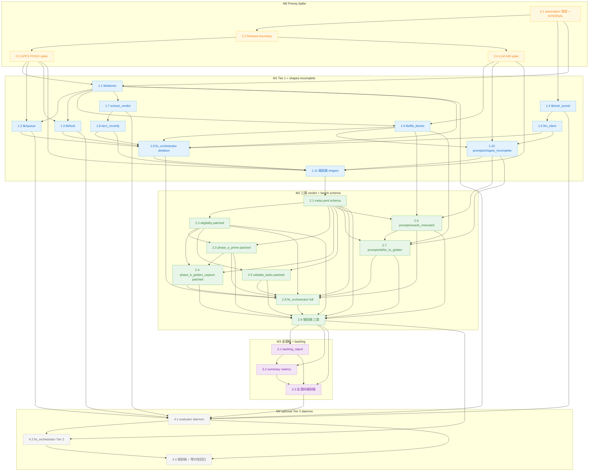

# Implement TAB three-machine automation orchestrator

## Overview

基于经过深度迭代 review 已收敛 ALL PASS 的 design doc(`docs/plans/2026-05-23-001-feat-tab-three-machine-automation-plan.md`,1322 行),实施 triton-ascend-bench 三机自动化 task triage orchestrator 的 implementation plan。

> **任务总数口径(全 plan 单一权威)**:`tasks/` 目录下共 **101 total tasks(100 benchmark task + 1 canary)**;`tasks/_canary/` 是固定的 canary task,不属于 100 个 benchmark task 但参与全语料 sweep / validate / release-gate。下文凡涉及 "all task" / "全语料" / "M3 全跑" 一律按 101 计;凡仅指 100 个 benchmark task(不含 canary)的场景显式写 "100 benchmark task"。本注是全 plan task 总数引用的唯一来源,任何章节出现 "100 题 / 100 task / 全 100 ..." 均按此口径修正为 101 total tasks 或 100 benchmark task。

实施按 phased delivery:**M0**(prereq + spike)立 release boundary 围栏 + 实测关键未知 → **M1**(Tier 1 + shapes-incomplete pipeline)跑通最简单一类 verdict 的端到端闭环 → **M2**(三类 verdict 全覆盖 + bench schema 改动)bench core 改动 + 三类 prompt + 状态机 → **M3**(全语料 + backlog 文档)在 GPU 机协同跑全语料、出四档诚实指标 → **M4**(可选 Tier 2 daemon)全闭环,M3 复盘后决定是否实施。

## Problem Frame

bench `run_all.sh` step 10 resolver 暴露绝大多数 task 处于三类 BLOCKED(78 upstream-not-invocable-here / 17 shapes-incomplete / 2 oracle-mismatch / 4 UNRUN(needs-gpu) / 0 PASS;统计基于 100 benchmark task,不含 `tasks/_canary/`),101 total tasks(100 benchmark task + 1 canary)每个都要 task-specific 修复(改 metadata / 改 oracle / 走 defer-to-golden)或显式跳过。人工逐 task triage 不现实 — 这是抗机械化长尾。

bench 团队既定方针:**交付基础设施 + 批量子集 + 诚实报告,不 fake 全量完成**。本 plan 不试图"101 total tasks 全 PASS",而是把可自动化的部分自动化、剩下诚实标 backlog,符合 `bench-team-internal-memory.project_tab_pertask_tail` 与 `feedback_baseline_no_subset_escape` 既定方针。

## Requirements Trace

- **R1** bench task triage inner loop 自动化(诊断 BLOCKED → LLM 生成修复 → 重跑验证 → 收敛或人审兜底)
- **R2** 三类 verdict 全覆盖:`shapes-incomplete` / `oracle-mismatch` / `upstream-not-invocable-here`(含 resolver 兜底类 `no-host-wrapper` / `smoke-fail` / `unexpected-blocked`)
- **R3** bench core 与 orchestrator **单向解耦** — orchestrator 不进 release;bench core 不依赖 orchestrator 也能独立工作
- **R4** 诚实交付 — M3 四档独立指标(`reverify_nonblocked` / `phase_a_promoted` / `golden_ready` / `manual_backlog`,4 档**独立衡量、允许重叠**,**禁止**互斥剔除、**禁止**"4 档总和 ≤ total tasks" 不变量),禁止合并成单一 "PASS rate"
- **R5** 并发 / 容错 / 审计 trail — lease + heartbeat + 三段式 steal、5-case mv 状态判定矩阵、`QUARANTINED.*` 终态、baseline 快照 + rsync `--delete` 真还原
- **R6** 跨 Tier 一致 — Tier 1 wrapper(`tier1_reverify.py --cmd {resolve | phase_a_verify}`)与 Tier 2 daemon(`bench_evaluator_daemon.py`)产生**同 result.json schema**;等价性 spike(D2)**仅在 M4 实施时作为 M4 acceptance gate**(M4 是 optional,M1-M3 不依赖 D2)

## Scope Boundaries

### 进 release(bench core 改动 + bench schema 字段)

- `triton_ascend_bench/eligibility.py` 改动 — `is_score_eligible` 加 `release_scope.excluded` 早出 + `release_status_pass` 加 `phase_b_capture_required` / `SKIPPED_BY_DESIGN` / `release_scope.excluded` 三项合取链
- `scripts/phase_a_prime.py` 改动 — `s2_verify_task` 加 `skip_invocation` 早返 + `_build_per_task` 前置规则 + status report SKIPPED_BY_DESIGN bucket + S6 release verdict 新文字
- `scripts/phase_b_golden_capture.py` 改动 — `_check_promote_precondition` 双路径 A/B + `_CAPTURE_CHILD` `entrypoint_source` 参数 + `_select_tasks` 接入 SKIPPED_BY_DESIGN
- `scripts/validate_tasks.py` 改动 — `_validate_golden` 对 `SKIPPED_BY_DESIGN + phase_b_capture.status == PENDING` 网开(schema warning 但不报 fail);**`validate_task` 总入口不加 `release_scope.excluded` 短路**(`release_scope.excluded` 仅作 release-gate / eligibility 闸口语义,不豁免 schema validator 责任 — `--strict` 对 excluded task 仍跑 meta schema / 5-file 完整 / kernel.py SHA-256 / contract.md 一致性全套 check)
- `meta.yaml` schema 新字段(`specs/task_api_contract.md` 同步扩展):
  - `phase_a_prime.{skip_invocation: bool, status: "SKIPPED_BY_DESIGN" 也是合法值, reason: str}`
  - `phase_b_capture.{status: "PENDING|DONE|FAILED", upstream_callable.{module, function}, reason, captured_at}`
  - `phase_b_capture_required: bool`
  - `release_scope.{excluded: bool, reason, excluded_at, excluded_by}`

### 不进 release(bench-team internal dev infra)

- `scripts/automation/` 整目录(orchestrator / wrapper / daemon / prompts / lib / tests 全部)
- `tab_automation/` GPFS 运行时目录(本就不在 repo)
- 两份内部 plan 文档:`docs/plans/2026-05-23-001-...-plan.md`(design) + `docs/plans/2026-05-23-002-...-plan.md`(本 plan)
- orchestrator 相关的 unit tests(`tests/unit_tests/test_{fix_orchestrator,tier1_reverify,extract_verdict,llm_client,file_blocks,queue_lib,gpfs_lock,ssh_tunnel}*.py`)

### 不在本 plan 范围

- M5+:`step 20 cost_model_xcheck` / `step 30 golden_capture` 同款 agentic loop 扩展 — future,M3 跑通后再启
- bench 题库扩展 / 新增 task — 既定方针不动
- KernelPilot(或任何外部项目)的 import 依赖 — bench 仓 **release artifact** 上的 grep 应**0 命中**(代码 / 文档 / 注释 / frontmatter);**internal artifact**(`docs/plans/` / `docs/release/` 内的 internal 文档,以及 `scripts/automation/` 自身)允许出现 negation 规则上下文的这些关键字。grep 检测的实际边界由 Unit 0.2 CI step 的 `--exclude-dir` 清单定义(KTD-10)

## Context & Research

### Relevant Code and Patterns(local TAB 既有 pattern)

- **CLI argparse 模式**(`scripts/phase_b_golden_capture.py:659-715` 含 mutex `--all`/`--task` + `--dry-run` + `--force`)= `fix_orchestrator.py` CLI 模板;`scripts/resolve_upstream_entrypoints.py:1545-1586`(`run_resolver` 含 `--checkpoint-dir` / `--resume`)= 可恢复 sweep 模板
- **Atomic meta.yaml writer**(`scripts/phase_a_prime.py:1071-1073`):`tmp = mp.with_suffix(".yaml.tmp"); tmp.write_text(yaml.safe_dump(meta, sort_keys=False, allow_unicode=True)); tmp.replace(mp)` = **唯一 meta.yaml writer 模式**,orchestrator patch-apply 必须遵循
- **release_status_pass 单一 SoT**(`triton_ascend_bench/eligibility.py:242-253`)= 改一处,3 个下游 consumer(`scripts/validate_tasks.py:1048-1130` `run_release_gate` / `triton_ascend_bench/cli.py:986-1000` analyze / `scripts/phase_a_prime.py:3023-3049` `_release_blocker_count`)自动 pick up
- **subprocess child + JSON-via-CLI + status_json 文件回传**(`scripts/phase_b_golden_capture.py:_CAPTURE_CHILD` L125-212 + `_run_capture_child` L415-484)= `bench_evaluator_daemon.py` 调 `phase_a_prime --verify` 子进程的模板
- **resolver verdict 集合**(`scripts/resolve_upstream_entrypoints.py:1378-1508` 所有 `cat = ...` 赋值点)= `result.json.verdict_class` 闭枚举 ground truth(`shapes-incomplete | oracle-mismatch | upstream-not-invocable-here | no-host-wrapper | smoke-fail | unexpected-blocked | null`)
- **stdlib logging**(`scripts/phase_b_golden_capture.py:91` `logger = logging.getLogger("phase_b_golden_capture")`)+ `print(..., flush=True)` 进度 = bench-local convention;**不**使用 `loguru`(parent monorepo CLAUDE.md `loguru` 规则不适用 TAB,TAB 无 loguru 依赖)
- **importlib 加载 scripts/**(`scripts/phase_a_prime.py:1789-1803, 3607-3617`):`spec_from_file_location` + **`sys.modules[name] = mod` MUST 在 `exec_module` 之前**(防 @dataclass `__module__` 解析失败)
- **REQUIRED_META_TOP_LEVEL precedent**(`scripts/validate_tasks.py:68-90`):`phase_a_prime` 已是 optional-at-validator(不进 REQUIRED);`phase_b_capture` / `release_scope` 也不进 REQUIRED
- **`_RESOLVER_CACHE_MEM` memo hazard**(`scripts/phase_a_prime.py:1786` 进程级 memo):`tier1_reverify.py --cmd resolve` 必须用 **subprocess invoke**(避 in-process memo 污染),与 daemon Tier 2 路径同源
- **resolver cache `_provenance` audit 模板**(`results/resolve_all.json:_provenance`):`{code_fingerprint, infer_state.{vllm,sglang}, tool_version, generated_at, code_files, note}` = orchestrator sidecar `_provenance.json` 的字段命名借鉴(result.json 严格 9 字段不嵌入 provenance,详 §3.4 / Unit 1.7)
- **CI 自动 inclusion**(`.github/workflows/ci.yml:30,41`):ruff 覆盖 `scripts/` 整个目录、pytest 覆盖 `tests/unit_tests/`,`scripts/automation/` 下新代码自动 lint + 测试;**CI install step 须改成 `pip install -e ".[dev,automation]"`(Unit 0.2 与 `pyproject.toml [project.optional-dependencies].automation` 同 commit 落地,详 Unit 0.1 / 0.2)**,automation runtime dep(`requests` 等)在 CI 必须就位,否则 orchestrator unit test 跑不起来
- **scripts/automation/ 是 Python package + CLI 入口直跑 + sys.path bootstrap 头**(KTD-11):
  - **既有 bench 脚本**(`scripts/phase_a_prime.py` / `scripts/resolve_upstream_entrypoints.py` / `scripts/phase_b_golden_capture.py` 等)**不是 package**(`scripts/__init__.py` 不存在),orchestrator / wrapper / daemon 内部调它们仍走 `importlib.util.spec_from_file_location`(`scripts/phase_a_prime.py:1789-1803, 3607-3617` pattern,**不变**)
  - **`scripts/automation/` 是 package**(有 `__init__.py` + `lib/__init__.py`),lib 内部互调可 `from automation.lib import queue` / `from automation.lib import lock` 等;**前提是** 已经把 `<repo_root>/scripts/` 加进 `sys.path`
  - **CLI 入口直跑模型**:每个 orchestrator entry point 文件(`fix_orchestrator.py` / `tier1_reverify.py` / `extract_verdict.py` / `bench_evaluator_daemon.py` / 所有 lib unit + spike 脚本)统一在 **module docstring 之后、其它 import 之前** 加 sys.path bootstrap 头部:
    ```python
    import sys
    from pathlib import Path
    _REPO_ROOT = Path(__file__).resolve().parents[2]
    if str(_REPO_ROOT / "scripts") not in sys.path:
        sys.path.insert(0, str(_REPO_ROOT / "scripts"))
    ```
    `Path(__file__).resolve().parents[2]` 取自 `<repo_root>/scripts/automation/<entry>.py` → `parents[0]=scripts/automation/` → `parents[1]=scripts/` → `parents[2]=<repo_root>`;`scripts/automation/spike/*.py` 因为多一层目录需用 `parents[3]`(在该 unit Approach 里显式标出);lib 内部互调(`from automation.lib import ...`)**仅在 bootstrap 之后才能用**,因此 import 顺序必须严格遵循"docstring → sys.path bootstrap 头 → 其它 import"
  - **Unit-level 落点**:Unit 0.1 / 1.1 / 1.2 / 1.3 / 1.4 / 1.5 / 1.7 / 1.8 / 1.9 / 4.1 全部 entry-point file 在 Approach 段显式标 "顶部加 bootstrap 头部"
  - **测试入口同款机制**:`tests/unit_tests/conftest.py` 已有 sys.path 注入(bench tests 既有,详 `conftest.py:101-134`),orchestrator 新 test 文件**不需要**单独写 bootstrap;测试运行环境下 `from automation.lib import queue` 自然解析

### Institutional Learnings(团队过往多机 agentic work 沉淀的 pattern)

下表是团队过往三机 work 累积的成熟 pattern,本 plan 借鉴 **design 形态**(代码层面 bench 完全独立,不依赖任何外部项目;实施时把 pattern 复制 + 改写为 bench 自有代码):

| Pattern | 应用 unit | 关键规则 |
|---|---|---|
| **Directory-rename atomic queue + PID+starttime 防 reuse + 5-case mv 状态判定矩阵 + `QUARANTINED.*` 终态** | Unit 1.2 lib/queue.py | 5 case:A `mv_rc=0 + src 消失 + dst 存在 → 我赢`;B `src 消失 → 并发 loser`;C `src 还在 + dst 不存在 → 真错误`;D `src 还在 + dst 也存在 → quarantine`;E `mv 命令本身错 → fail loud`;**绝不仅看 mv_rc 判定** |
| **GPFS mkdir-based atomic lock + symlink-owner + crash-between-mkdir-and-symlink 60s grace** | Unit 1.3 lib/lock.py | `os.mkdir(lock_dir)` 比 `O_CREAT\|O_EXCL` 在 GPFS 部分 client 实现下错误回报更准;`os.symlink(owner_uuid, lock_dir / "owner")` 比 file content 少一步竞态(`os.readlink` 单步 atomic) |
| **Stale recovery 是 rename-then-mkdir-then-symlink**(不是直接 rmtree) | Unit 1.3 lib/lock.py | 旧 lock 先 `os.rename` 成 `.lock.stale.<uuid>`(原子 ownership 转移)再 rmtree + mkdir new + symlink owner;旧 stale 保留作 forensics |
| **Lease + heartbeat thread + 三段式 steal**(lease 15min,heartbeat 5min 续租 `lease_until`) | Unit 1.3 lib/lock.py + 4.1 daemon | steal 前 (a) lease 过期 (b) liveness check(同 host `kill -0`、跨 host 连续 2 个 heartbeat 周期 mtime 落后)(c) atomic rename;被 steal 旧 owner 检测到 `owner_uuid` 变化立即停写 + 落 `.steal_evicted.*` 审计 |
| **Worker rename 双向校验**(完成 `CLAIMED → DONE` 前 `os.stat(claim_marker)` 校验仍属自己) | Unit 1.2 lib/queue.py | 失败丢 result + 留 `STOLEN_BY_REAPER.*` 标记 |
| **trap 协议** | Unit 4.1 daemon (Python `atexit` + signal handlers 等价实现) | `trap cleanup EXIT` + `trap 'cleanup; exit 0' INT TERM`**不**能合并写(合并后 TERM 不退出);Python 用 `atexit.register` + `signal.signal(SIGTERM, handler)` 各自独立 |
| **SSH local-port-forward + 本地 HTTP + tunnel supervisor** | Unit 1.4 lib/ssh_tunnel.py + 1.5 llm_client.py | `ssh -L 18001:127.0.0.1:8001 -o ControlMaster=no ...`;`-o ControlMaster=no` 防 multiplex 复用旧 socket 认证态泄露;30s curl `/health` 端到端探测(只看 `ss` listener 不够,multiplex socket 残留也显示 listener 但不通) |
| **setsid 后台 detach + 30s 早期错检测**(daemon 启动) | Unit 4.1 daemon | Python `subprocess.Popen(..., start_new_session=True)` 等价 `setsid`;`_check_dispatcher_early_fail` window grep 早期错;否则可能 90+ 分钟才发现死 |
| **`mv -Tf` 是真原子**(vs `ln -sfn` 的 unlink+recreate window) | Unit 1.2 lib/queue.py | Python `os.rename` 跨 host 行为依赖 GPFS client 一致性(dst 存在直接覆盖);用 `os.link` + `os.unlink` 组合或 `os.rename` 后再 stat 确认 |
| **唯一名 + sweep**(`.symlink.tmp.<ts>.<pid>` 唯一名,投递前 sweep 死亡 push) | Unit 1.1 lib/atomic.py + 1.2 lib/queue.py | 防卡死后续 |
| **rsync `--delete` 必须 scoped 在 subdir 内** | Unit 1.1 lib/atomic.py(baseline rollback) | 不能在 GPFS 顶层用(防误删);只在 `tasks/<level>/<task_id>/` 内 |
| **schema 防御 — 嵌套字段读** `_safe_dict(m.get("...") or {})` | Unit 1.7 extract_verdict.py + 1.9 fix_orchestrator.py | 任何 meta / status / response 嵌套字段读必须 `.get(...) or {}` 兜底,绝不 `[...]` |
| **LLM full-file `### FILE: <path>\n<content>\n### END\n` blocks**(L4 prior art 实测:full-file 比 unified diff 失败率低**一个数量级**对 ≤200 行 YAML / Python 文件) | Unit 1.6 lib/file_blocks.py + 1.5 llm_client.py | LLM 输出格式 = file-blocks;parser 严格校验路径(白名单 + 无 `..` / 绝对路径)+ 路径必须在 patch 允许集合;blocks 顺序无关 |
| **LLM transient 5xx/timeout exponential backoff**(默认 3 次上限) | Unit 1.5 llm_client.py | 503 / 502 / 429 / timeout 等 retry;404 / 400 fail loud(不 retry) |
| **"自洽 ≠ 忠实"** — resolver PASS / validate_tasks green 只证 parse/eval-able,**不证语义忠实** | M1/M2 acceptance + Unit 1.11/2.9 端到端 | shapes-incomplete 修后 dry-run resolver / oracle-mismatch path 2 修后跑上游真值对比 / path 3 走 phase_b_capture 兜底 |
| **强耦合链断点不可分** — bench schema 字段 → 5+ 消费点 ripple 必须**全套同 PR ship** | M2 acceptance | M2 Unit 2.1-2.5 必须**同 commit 落地**或至少同 PR;分散提交会 break release-gate |
| **"path: 同上" 类历史遗留**(L7 GPFS POSIX caveats 之外) | Out of scope | 已在 commit `ebe366e` 修复,不再发生 |

### External References

- **POSIX rename(2) 原子语义** — 适用于 GPFS / NFS 多客户端但需实测 client 一致性。Linux `os.rename` Python 等价 `rename(2)`,跨 mount point 失败、dst 存在直接覆盖(无 dst-must-not-exist 保证) — 这跟 GNU `mv -Tn` 不同。
- **GNU coreutils `mv -Tf` 8.x+** — `-T` (treat dst as file) 9.4+ 实测 5-case 矩阵稳定;BSD / macOS 不支持(M0 spike 须确认目标机器是 GNU coreutils,**不是** BusyBox)。
- **`pytest --strict-markers`** — `pyproject.toml:80-90` 既定;orchestrator 新 test 文件**不加** `@pytest.mark.unit`(保持与现有 55 test 文件一致 unmarked)
- **任意 OpenAI / Anthropic compatible LLM HTTP server** — bench 不假设具体实现;`--llm-endpoint <url>` flag,运行时配。**bench 仓 0 引用具体项目**。

## Key Technical Decisions

| # | 决策 | 选择 | Rationale | 影响 unit |
|---|---|---|---|---|
| **KTD-1** | LLM 输出格式 | **Full-file blocks** `### FILE: <path>\n<content>\n### END\n` | 团队过往 4 月生产实测:unified diff 在 LLM 出口失败率比 full-file 高一个数量级;对 ≤200 行的 YAML/Python 文件,full-file 简单可靠 | 1.5 / 1.6 / 1.10 / 2.6 / 2.7 |
| **KTD-2** | Tier 2 evaluator daemon 语言 | **Python**(`bench_evaluator_daemon.py`) | heartbeat thread 在 Python 安全可控;bash 后台子进程 `&` 难保证 reap / 信号传递;Python 跨平台 | 4.1 |
| **KTD-3** | LLM 调用通道(默认 / fallback) | **SSH local-port-forward + 本地 HTTP**(`-L 18001:127.0.0.1:8001`)+ tunnel supervisor;`call_llm_via_ssh_stdin`(`ssh ... 'curl --data-binary @-'`)作 SSH 防火墙不允许端口转发时的降级路径;`call_llm_direct`(直连 HTTP)作 B 直通 C 端口时的最优路径 | 团队过往 4 月稳定;`-o ControlMaster=no` 防 multiplex 认证态泄露;大 prompt 无 shell escaping 风险 | 1.4 / 1.5 |
| **KTD-4** | Queue 协议形态 | **Marker 文件**(`<run_id>/READY` → `<run_id>/CLAIMED.<host>.<pid>.<starttime>.<ts>` → `<run_id>/DONE`)+ **5-case mv 状态判定矩阵** + `QUARANTINED.<reason>.<ts>` 终态 | TAB 量级小,marker 保留每个 run 所有 marker 便于 forensics;directory-rename 同样原子但目录扁平不适合 audit;QUARANTINED 防 task.json 永久损坏 reaper 死循环 | 1.2 / 1.9 / 4.1 |
| **KTD-5** | `tier1_reverify.py --cmd resolve` invoke 方式 | **subprocess invoke** `scripts/resolve_upstream_entrypoints.py --task <T> --apply` | 避开 `scripts/phase_a_prime.py:1786 _RESOLVER_CACHE_MEM` 进程级 memo 污染;与 daemon Tier 2 路径同源 | 1.8 / 4.1 |
| **KTD-6** | LLM client API style | **OpenAI-compatible** `POST <endpoint>/v1/chat/completions`(主),Anthropic style 作 fallback;`--llm-api {openai\|anthropic\|custom}` flag | bench 仓 0 引用具体 LLM 服务实现;deployment 侧任意指向 OpenAI-compatible server | 1.5 |
| **KTD-7** | bench core 与 orchestrator 解耦机制 | **同 repo + `.gitattributes export-ignore` + `.dockerignore` + CI 单向依赖 grep 检查** | 同 repo 简单;release tarball / Docker image / wheel 都不带 `scripts/automation/`;bench core 任意文件 `grep -ri 'automation\.fix_orchestrator'` 应 0 命中 | 0.1 / 0.2 |
| **KTD-8** | LLM client lib choice | **`requests`** thin wrapper,bench 仓**新增** runtime dep,加进 `[project.optional-dependencies].automation` extras 而非 core deps | bench core 保持 pure-compute 无网络 dep;automation extras 隔离;`requests` 比 `httpx` 简单且无 async 复杂度 | 1.5 |
| **KTD-9** | M0 spike — GPFS POSIX 行为实测必跑 | M0 必跑 spike checklist,结果持久化到 `docs/release/internal-gpfs-spike-results.md`(internal,`export-ignore`) | A / B 必跑实测;`os.rename` / `os.mkdir` / `os.symlink` 实际行为依赖目标 GPFS 部署;heartbeat mtime 跨 host 抖动 N=100 统计 P50/P95/P99 决定 reaper 阈值参数 | 0.3 |
| **KTD-10** | release artifact 0 引用 KP / 任何具体外部项目 | **release artifact**(release tarball + Docker image + wheel + 外部 / 非 internal 文档)中**代码 / 注释 / 文档 / frontmatter** 全部不出现 "kernelpilot" / "KernelPilot" / "kp_" 等关键字;**internal artifact**(`scripts/automation/` / `tab_automation/` / `docs/plans/` / `docs/release/` / `docs/triage_backlog/`)允许出现这些关键字作为 negation 规则的讨论上下文(本 plan 描述 KTD-10 / Risks 表 / Scope Boundaries 都会引用)| 用户明确边界:抄代码 ≠ 复用项目;CI grep step 在 release scope(`triton_ascend_bench/` + `scripts/` 非 automation + `tests/` 非 internal + `specs/` + `infra/` + `docs/` 非 internal)上 0 命中(详 Unit 0.2 Approach CI grep step `--exclude-dir`);全树 grep 不可行(本 plan 自身就含 KP / kp_ 字符串作为 negation 规则,CI 自杀)| 0.2 / 全部 unit 自检 |
| **KTD-11** | scripts/automation/ Python lib 用 package 形态 + 每个 CLI 入口加 sys.path bootstrap 头 | `scripts/automation/__init__.py` + `scripts/automation/lib/__init__.py` 让 lib 内部互调可 `from automation.lib import queue`;**配合 CLI 入口直跑模型**:每个 orchestrator entry point(`fix_orchestrator.py` / `tier1_reverify.py` / `extract_verdict.py` / `bench_evaluator_daemon.py` 等)文件顶部加固定 sys.path bootstrap 头(`Path(__file__).resolve().parents[2] / "scripts"` 插入 `sys.path`),bootstrap 之后才能 `from automation.lib import ...`;bench 既有 `scripts/*.py` **不是 package**,orchestrator 内部调它们仍用 `importlib.util.spec_from_file_location`(`scripts/phase_a_prime.py:1789-1803` pattern 不变)| 比让 user 手设 `PYTHONPATH` 更可靠;CLI 直跑(`python3 scripts/automation/fix_orchestrator.py ...`)与测试入口(`tests/unit_tests/conftest.py` 注入)行为统一;详 Context & Research "scripts/automation/ 是 Python package + CLI 入口直跑 + sys.path bootstrap 头" 段 | 0.1 / 1.1 / 1.2 / 1.3 / 1.4 / 1.5 / 1.7 / 1.8 / 1.9 / 4.1 全部 lib + entry-point unit |

## Open Questions

### Resolved During Planning

- **Q1:bench 仓与 KP / 外部 LLM 实现的依赖关系?** → bench 仓 **0 引用 KP / 任何具体实现项目**;通过通用 OpenAI-compatible HTTP 接口连接;deployment-side 决定 LLM 服务来源(KTD-6 / KTD-7 / KTD-10)
- **Q2:fix_orchestrator state machine 怎么编码?** → 由 Unit 1.9 Approach 段顶部 canonical state enum 表定义 17 个 canonical state(`NEW / QUEUED / PROMPTING / LLM_TRANSIENT_ERROR / PATCH_VALIDATING / BASELINE_SNAPSHOTTED / PATCH_APPLIED / BENCH_RUNNING / ATTEMPTING_NEXT_ROUND / HUMAN_REVIEW_PENDING / HUMAN_REVIEW_EXPIRED / DEFERRAL_ACCEPTED / BACKLOG_PENDING_GOLDEN / BACKLOG_UNEXPECTED / UNFIXABLE_BY_LLM / MANUAL_BACKLOG / DONE`)+ 各 state 的 allowed transitions / required fields,plan 为 implementation 权威,design doc §5 状态机叙述按此表对齐;path 3 / 4.4 retry-exhausted 走 `[HUMAN_REVIEW_PENDING] ⇄ [HUMAN_REVIEW_EXPIRED] → [DEFERRAL_ACCEPTED] / [MANUAL_BACKLOG]`;alias(`PATCH_GENERATED` / `UNFIXABLE` / `LLM_ERROR` / `MANUAL_BACKLOG_QUEUED` / `PENDING_GOLDEN` / `EXPIRED` / `UNEXPECTED` / `VERDICT_*`)统一翻译到 canonical
- **Q3:meta.yaml 新字段 schema validator 行为?** → 字段不进 `REQUIRED_META_TOP_LEVEL`(precedent: `phase_a_prime` 已 optional);各字段类型 / 取值约束 / 默认值 schema spec 写进 `specs/task_api_contract.md` 同款追加 section(Unit 2.1)
- **Q4:Tier 1 vs Tier 2 result.json schema 一致?** → 设计为完全相同 9 字段 schema(design doc §3.4 既定),producer 字段区分(`tier1_reverify` / `daemon`);**跨 producer 逐字段 diff(D2)仅在 M4 实施时作为 M4 acceptance gate**(M1-M3 不依赖)

### Deferred to Implementation

- **D1:LLM cost / quota budget 默认值** — M1 落地后跑 5-10 真实 shapes-incomplete task 拿到 `(prompt tokens, response tokens, $/task)` 中位数 / P95,据此决定 `--max-tasks` / `--max-attempts` 默认。**Deferred to M1 实施末尾的实测决策**
- **D2:`tier1_reverify.py --cmd resolve` vs daemon `cmd=resolve` 等价性** — **仅当 M4 daemon 实施时**作为 M4 acceptance gate(Unit 4.3 D2 spike 必跑):同 shapes-incomplete task 在两条路径各跑一次,逐字段 diff `result.json`(允许 `producer` / 时间戳 / `_provenance.pid` 不等;其它字段必须等);若 wrapper 单 task 模式与 daemon 整批 invoke 行为不一致(例如单 task 模式是否复用整批 oracle-consistency anchor),M4 收尾前补齐。**M4 是 optional;M1-M3 不依赖 D2**(M1-M3 在 Tier 1 单产品形态运行,无跨 Tier 等价性需求)。**Deferred to M4 acceptance(条件门:M4 实施时必跑;M3 复盘决定不进 M4 时,D2 永久 deferred)**
- **D3:M0 LLM 输出格式 A/B 实测结果** — KTD-1 已定 file-blocks(基于 prior art 实测);M0 spike 跑一次 A/B 5 task,如 unified diff 失败率 ≤ file-blocks **保留** KTD-1 file-blocks;如有反证 escalate to user。**Deferred to M0 spike**
- **D4:heartbeat mtime 跨 host 抖动阈值** — M0 GPFS spike 实测 N=100 后决定 `HEARTBEAT_INTERVAL`(默认 5min)/ reaper 连错 N 次(默认 2)。**Deferred to M0 spike**
- **D5:M4 Tier 2 daemon 实施时机** — M3 跑通 + 实际 LLM 成功率统计决定;success rate > 60% 再升 Tier 2 全闭环,低则先优化 prompt。**Deferred to M3 复盘**
- **D6:M2 关于 `_render_status_md` / `_format_status_md` / `_release_blocker_count` 等 line ranges** — plan 引用的 line 数(来自 design doc §4.4.3)与当前代码可能 drift;**M2 implementer 必须 `grep -n '<symbol>' <file>` 全部 anchor 后再编辑**。**Deferred to M2 实施**
- **D7:M0 spike GPFS POSIX 实测具体阈值结果** — `os.rename` 跨 host 原子性 / `os.symlink` 跨 host 一致性 / `os.mkdir` race window — M0 spike checklist 跑完落到 `docs/release/internal-gpfs-spike-results.md`,据此调 lib/lock.py / lib/queue.py 默认参数。**Deferred to M0 spike**

## High-Level Technical Design

> *本节给出 phased delivery 依赖图,直观看 M0-M4 unit 间顺序约束。Mermaid 用于 review;不替代逐 unit 的 Files / Approach / Test scenarios 字段。*



## Implementation Units

下面按 M0 → M4 phased 列出全部 implementation units。每个 unit 给 Goal / Requirements / Dependencies / Files / Approach / Patterns to follow / Test scenarios / Verification。

### M0 — Prereq + Spike(估时 0.5-1 天)

- [ ] **Unit 0.1: `scripts/automation/` 目录骨架 + INTERNAL marker**

**Goal:** 创建 `scripts/automation/` 目录骨架(`__init__.py` + `lib/` + `prompts/` + `tests/` 占位),`__init__.py` 顶部写明 INTERNAL — not part of bench release;build 出来不打包进 wheel(`pyproject.toml [tool.setuptools.packages.find]` 已排除 `scripts*`,确认 `scripts/automation/` 自动剔除)。

**Requirements:** R3

**Dependencies:** 无

**Files:**
- Create: `scripts/automation/__init__.py`(顶部 INTERNAL docstring)
- Create: `scripts/automation/lib/__init__.py`(空,标记 lib 为 package)
- Create: `scripts/automation/prompts/__init__.py`(空)
- Create: `scripts/automation/README.md`(简短说明 — INTERNAL bench-team automation,bench core 0 引用,不进 release)
- Modify: `pyproject.toml` — 加 `[project.optional-dependencies].automation = ["requests>=2.31"]` extras(orchestrator runtime,前置到 M0,Unit 0.2 CI install 与 Unit 1.4 / 1.5 都需要在此 commit 落地后才可用;**注意:此字段后续 Unit 1.5 不再重复改动**)
- Test: `tests/unit_tests/test_automation_skeleton.py`(import smoke + 检查 `__init__.py` 含 INTERNAL marker)

**Approach:**
- `__init__.py` docstring 明示 "INTERNAL bench-team automation — NOT part of bench release. This directory is export-ignored from release tarballs and Docker images. bench core code MUST NOT import from this module."
- README 只描述目录用途(orchestrator / wrappers / daemon / prompts / lib),不点任何外部项目名
- 确认 `pip install -e .` 后 `import triton_ascend_bench` 不会无意拉到 automation(应不会,因为 `packages.find` 限定 `triton_ascend_bench*`)
- `pyproject.toml` 改动:`[project.optional-dependencies]` section 下追加 `automation = ["requests>=2.31"]`(仅 `requests`,**不**追加 `responses` 等 mock HTTP lib;测试用 stdlib `unittest.mock`)。`core` deps 不动,`dev` extras 不动。本字段在 M0 提前就位,目的是让 Unit 0.2 CI install step `pip install -e ".[dev,automation]"` 在 CI 一加进去就能跑过、Unit 1.4 ssh_tunnel.py(用 `requests`)与 Unit 1.5 llm_client.py 不再需要重复修改 `pyproject.toml`
- **sys.path bootstrap 头**(KTD-11):Unit 0.1 仅创建 `__init__.py`(无 main 函数,无 CLI)+ `README.md` + 测试文件,不涉及 CLI entry-point;`scripts/automation/__init__.py` 本身**不**写 bootstrap(`__init__.py` 是被 import 的、不是被直跑的);bootstrap 头规则适用于后续 unit 的 CLI entry-point 文件(`fix_orchestrator.py` / `tier1_reverify.py` / `extract_verdict.py` / `bench_evaluator_daemon.py` 等),详 Context & Research 段

**Patterns to follow:**
- bench-local convention:scripts 不是 package(`scripts/__init__.py` 不存在),但 `scripts/automation/` 是 package(便于内部 lib 互调,见 KTD-11)

**Test scenarios:**
- Happy path:`import automation` 成功(`tests/unit_tests/conftest.py` 自动配置 `sys.path`);`automation.__doc__` 含字符串 "INTERNAL"
- Edge case:`pip install -e .` 后 `python3 -c "import triton_ascend_bench"` 不报错且 wheel 内容不含 `automation/`(用 `python3 -m wheel unpack` 或 `pip show -f` 验证)

**Verification:**
- `scripts/automation/` 目录可见,4 个文件存在(2 `__init__.py` + 1 `prompts/__init__.py` + README)
- `python3 -c "from automation import __doc__; assert 'INTERNAL' in __doc__"` 通过
- `pytest tests/unit_tests/test_automation_skeleton.py` 通过

---

- [ ] **Unit 0.2: Release boundary 配置 + 单向依赖防御**

**Goal:** 配置 git / Docker / CI 三层 release 排除,确保 `scripts/automation/` + 两份内部 plan + automation tests 都不进 release tarball / Docker image / wheel;CI 步骤静态检测 bench core 不引用 orchestrator。

**Requirements:** R3 / KTD-7 / KTD-10

**Dependencies:** Unit 0.1

**Files:**
- Modify: `.gitattributes`(加 `export-ignore` 规则)
- Modify: `.dockerignore`(加 automation 与 internal plan 排除)
- Modify: `.github/workflows/ci.yml`(新增两个 step:release tarball smoke check + bench core 单向依赖 grep)
- Create: `docs/release/internal-release-process.md`(internal,描述 release tarball 生成步骤 + CI 校验语义;文件名前缀 `internal-` 直接命中 `.gitattributes` / `.dockerignore` 既有 `docs/release/internal-*.md` 通配规则 + CI release-boundary grep 同款 pattern,不需为单文件加额外规则)
- Test: `tests/unit_tests/test_release_boundary.py`(单元测试:模拟 `git archive` 后验证不含 automation;模拟 grep bench core 验证不引用 automation)

**Approach:**

`.gitattributes` 加(使用**通配规则**,避免每新增一个 automation test 文件都要手抄一条;通配清单包含所有 internal artifact 路径模式):

```
scripts/automation/                              export-ignore
tab_automation/                                  export-ignore
docs/plans/2026-05-23-001-*.md                   export-ignore
docs/plans/2026-05-23-002-*.md                   export-ignore
docs/release/internal-*.md                       export-ignore
docs/triage_backlog/                             export-ignore
tests/unit_tests/test_lib_*.py                   export-ignore
tests/unit_tests/test_*automation*.py            export-ignore
tests/unit_tests/test_fix_orchestrator*.py       export-ignore
tests/unit_tests/test_tier1_reverify*.py         export-ignore
tests/unit_tests/test_extract_verdict*.py        export-ignore
tests/unit_tests/test_llm_client*.py             export-ignore
tests/unit_tests/test_file_blocks*.py            export-ignore
tests/unit_tests/test_queue_lib*.py              export-ignore
tests/unit_tests/test_gpfs_lock*.py              export-ignore
tests/unit_tests/test_ssh_tunnel*.py             export-ignore
tests/unit_tests/test_release_boundary.py        export-ignore
tests/unit_tests/test_prompt_*.py                export-ignore
tests/unit_tests/test_e2e_*.py                   export-ignore
tests/unit_tests/test_backlog_report.py          export-ignore
tests/unit_tests/test_summary_metrics.py         export-ignore
tests/unit_tests/test_bench_evaluator_daemon.py  export-ignore
tests/unit_tests/test_fix_orchestrator_tier2.py  export-ignore
tests/unit_tests/test_fix_orchestrator_m2.py     export-ignore
```

通配清单覆盖几类 internal artifact:
- `scripts/automation/` / `tab_automation/`:orchestrator 主体 + GPFS runtime dir(后者本就不在 repo,仅防误进)
- `docs/plans/2026-05-23-00[12]-*.md`:本 plan + design doc 两份 internal plan
- `docs/release/internal-*.md`:spike / acceptance / m1-m4 报告等所有 internal 报告(`internal-` 前缀是约定)
- `docs/triage_backlog/`:Unit 3.1 backlog_report 产出
- `tests/unit_tests/test_*` 通配:`test_lib_*.py`(lib unit test)/ `test_*automation*.py`(skeleton 等)/ `test_prompt_*.py`(prompt 测试)/ `test_e2e_*.py`(端到端测试)等;再加几条具体文件兜底(`test_backlog_report.py` / `test_summary_metrics.py` 等不匹配上述通配的)

`.dockerignore` 同款规则(逐条复制 — Docker build context 不读 git index 元数据,需独立配 ignore 清单);Docker build context 排除 automation 与 internal plan;CI grep step(本 Unit Approach 第 3 个 step,详 KTD-10 MF4)也按同款 `--exclude-dir` 排除路径。

`.github/workflows/ci.yml` 既有 `Install dependencies (CPU-only)` step 改为同时安装 `dev` 与 `automation` extras(orchestrator runtime 进 CI 才能跑 orchestrator unit test):

```
- name: Install dependencies (CPU-only)
  run: |
    pip install --upgrade pip
    pip install -e ".[dev,automation]"
```

`.github/workflows/ci.yml` 在 `unit-tests` job 追加三个 step:

```
- name: Verify release boundary
  run: |
    git archive HEAD | tar t | grep -E '(scripts/automation|tab_automation|docs/plans/2026-05-23-00[12])' && exit 1 || true
- name: Verify bench core does not import orchestrator
  run: |
    set -e
    paths='triton_ascend_bench/ scripts/validate_tasks.py scripts/phase_a_prime.py scripts/phase_b_golden_capture.py scripts/resolve_upstream_entrypoints.py scripts/phase_a_cost_xcheck.py scripts/verify_version_matrix.py scripts/phase_a_freeze.py scripts/phase_b_oracle.py'
    if grep -rn 'from automation\b\|import automation\b\|scripts\.automation\|tab_automation\b' $paths 2>/dev/null; then
      echo 'bench core MUST NOT reference orchestrator'
      exit 1
    fi
- name: Verify bench repo does not reference external project names
  run: |
    # Scope = release artifact 之外的 codebase + 外部文档;internal artifact 允许讨论"不引用 X"约束
    # 排除 docs/plans/(含两份 internal plan,内部讨论 KTD-10 规则会出现 kernelpilot/kp_ 关键字)
    # 排除 docs/release/(含 spike 报告 + acceptance 报告等 internal 文档)
    # 排除 docs/triage_backlog/(Unit 3.1 backlog_report 产物,internal)
    # 排除 scripts/automation/ + tab_automation/(orchestrator 本身,internal,不进 release)
    if grep -rin 'kernelpilot\|KernelPilot\|kp_' \
        --include='*.py' --include='*.md' --include='*.toml' --include='*.yaml' --include='*.yml' \
        --exclude-dir=scripts/automation \
        --exclude-dir=tab_automation \
        --exclude-dir=docs/plans \
        --exclude-dir=docs/release \
        --exclude-dir=docs/triage_backlog \
        triton_ascend_bench/ scripts/ docs/ tests/ infra/ specs/ 2>/dev/null; then
      echo 'bench repo MUST NOT reference external project names (outside of internal plan docs)'
      exit 1
    fi
```

CI grep scope 注解:
- 检测目标 = release artifact(release tarball / Docker image / wheel)+ 非 internal 文档 + 外部文档(`triton_ascend_bench/` 包 + `scripts/` 中非 automation 部分 + `tests/` 非 internal 部分 + `specs/` + `infra/` + `docs/` 中非 internal 部分),要求 0 命中
- internal artifact(`scripts/automation/` / `tab_automation/` / `docs/plans/` / `docs/release/` / `docs/triage_backlog/`)显式排除 — 这些目录里**允许**出现 "kernelpilot" / "kp_" 字符串(例如本 plan 描述 KTD-10 规则、Risks 表、Scope Boundaries 都会引用这些关键字),否则 CI 自杀
- `--include` 限制扫描类型为 `.py` / `.md` / `.toml` / `.yaml` / `.yml`,避免扫到 binary / 第三方文件

**Patterns to follow:**
- 已有 `.gitignore` 模式(`.gitignore:37-50`)— `.gitattributes` 平行
- CI ruff / pytest step(`ci.yml:30,41`)— 平行加新 step

**Test scenarios:**
- Happy path:`git archive HEAD --format=tar | tar tv | grep automation` 0 命中
- Happy path:`grep -rn 'from automation\|import automation' triton_ascend_bench/` 0 命中
- Edge case:故意在 `triton_ascend_bench/eligibility.py` 加 `from automation.fix_orchestrator import X`(临时),CI step 应 fail 非零;然后还原,CI 应 PASS
- Edge case:故意在 release scope 内的 `.md`(例如 `specs/` 或 `triton_ascend_bench/` 内的 docstring)写 "KernelPilot",CI step 应 fail 非零;在 internal plan(`docs/plans/2026-05-23-002-*.md`)写则不应触发 fail(由 `--exclude-dir=docs/plans` 保护);然后还原
- Error path:CI 在 `.gitattributes` 缺失某条 export-ignore 时(故意删一行),`git archive | tar t | grep` 命中 → fail
- Integration:`pip install -e .` 后 `python3 -m wheel unpack` 验证 wheel 内容不含 `automation/`(已经由 `[tool.setuptools.packages.find]` 限定,但此 unit 加 CI 验证)

**Verification:**
- 3 个新 CI step 在 unit-tests job 内通过
- `git archive HEAD --format=tar.gz -o /tmp/release.tar.gz && tar tzf /tmp/release.tar.gz | grep automation` 0 命中
- 测试 `tests/unit_tests/test_release_boundary.py` 5 个 scenario 全通过

---

- [ ] **Unit 0.3: M0 spike — GPFS POSIX 行为实测**

**Goal:** A 机 + B 机协同跑 spike,实测 GPFS 上 `os.rename` / `os.mkdir` / `os.symlink` 的实际原子性 + heartbeat mtime 跨 host 抖动延迟 + tmp 文件多机 trample 概率,结果持久化到 `docs/release/internal-gpfs-spike-results.md`(internal,`export-ignore`),作为 Unit 1.2 lib/queue.py + Unit 1.3 lib/lock.py 的默认参数依据。

**Requirements:** R5 / KTD-9 / D4 / D7

**Dependencies:** Unit 0.2(避免 spike 代码误进 release)

**Files:**
- Create: `scripts/automation/spike/gpfs_posix_spike.py`(Python spike script)
- Create: `docs/release/internal-gpfs-spike-results.md`(internal,记录实测数据)
- Test:无(spike 本身是一次性脚本,跑完产数据)

**Approach:**

**sys.path bootstrap 头**(KTD-11;**CLI entry-point 必加**;spike 在 `scripts/automation/spike/` 子目录,比一般 lib / orchestrator 多一层目录,需用 `parents[3]`):`scripts/automation/spike/gpfs_posix_spike.py` 文件顶部 docstring 之后、其它 import 之前加固定 bootstrap 头部:

```python
import sys
from pathlib import Path
_REPO_ROOT = Path(__file__).resolve().parents[3]  # spike/ 在 scripts/automation/spike/ 下,parents[3] = repo root
if str(_REPO_ROOT / "scripts") not in sys.path:
    sys.path.insert(0, str(_REPO_ROOT / "scripts"))
# 之后可: from automation.lib import ...(本 spike 不依赖 lib,仍统一 bootstrap 头便于一致性 / 未来扩展)
```

`parents[3]` 推导:`<repo_root>/scripts/automation/spike/<file>.py` → `parents[0]=scripts/automation/spike/` → `parents[1]=scripts/automation/` → `parents[2]=scripts/` → `parents[3]=<repo_root>`(比一般 lib / orchestrator 多一层目录)。

spike 必跑 6 项实测,**两机都跑 + 跨机交叉跑**(A 写 B 读 / B 写 A 读):

1. **GPFS inode 一致性** — A 与 B 在同 path `stat -c '%d %i %m'`,断言 device + inode + mount point 三项全一致
2. **`os.rename` 跨 host 原子性** — A 上 `tmp.rename(dst)` 同时 B 上轮询 `dst` 出现的时刻 / `tmp` 消失的时刻,统计两个时刻是否一致(POSIX 要求一致,实测可能有 GPFS client cache 延迟)
3. **`os.mkdir` 跨 host race** — A 上 100 次 `os.mkdir(same_path)` 中 race,断言只有一次成功 + 99 次 `FileExistsError`;再 B 上跑同款,跨机交叉用 multiprocessing barrier 同步起跑
4. **`os.symlink` 跨 host 一致性** — A 上 `os.symlink(target, link)`,B 上 `os.readlink(link)` 立刻读,统计延迟 P50/P95/P99
5. **heartbeat mtime 抖动** — A 上 N=100 次 `touch <path>.heartbeat`(每次 5min 间隔),B 上 `stat -c %Y <path>.heartbeat` 读,统计 (A `time.time()` 写完时刻) vs (B `os.stat().st_mtime`)的延迟分布
6. **多机 tmp 文件 trample** — A 与 B 同时各自 `<file>.tmp.<host>.<pid>.<uuid8>` 写,合并到统一 dst 时是否会 trample;断言文件名前缀防御足够

每项产 statistic block:`{name, N, p50_ms, p95_ms, p99_ms, max_ms, anomaly_count, decision_threshold}`,写到 `docs/release/internal-gpfs-spike-results.md`。

**Patterns to follow:**
- spike script 的轻量风格 — argparse `--N <count>` / `--peer-host <host>` / `--out <md_path>`;不写成 test,因为依赖跨机协同
- 输出 markdown 表格 + 关键 caveat 用 callout

**Test scenarios:**
- Spike 不是单元测试,而是 acceptance gate;实施时:
  - 每项实测**手工 review** statistic 是否在合理范围(`os.rename` 跨 host delay P95 < 100ms;`os.mkdir` race 100% 只有一次成功;heartbeat mtime 延迟 P95 < 30s 等)
  - 任何项 anomaly_count > 0 必须诊断后才能进 M1
- Edge case:GPFS client cache 异常(实测 P99 延迟超 10s)→ 调高 reaper 默认 `HEARTBEAT_GRACE_S` = max(60s, P99 × 3)
- Error path:跨机 `os.rename` 出现"原子性破坏"(同时 src 还在 + dst 也存在 ≥ 100ms)→ Unit 1.2 lib/queue.py 不能依赖 `os.rename` atomic 单步,必须用 `os.link` + `os.unlink` 两步组合

**Verification:**
- `docs/release/internal-gpfs-spike-results.md` 6 项实测数据完整(含 statistic block + decision threshold)
- Unit 1.2 / 1.3 默认参数引用此 spike 结果(`HEARTBEAT_INTERVAL` / `LEASE_TTL` / `HEARTBEAT_GRACE_S` / reaper miss count `N` 均有 spike 数据作支撑)
- spike script 留在 `scripts/automation/spike/` 下供后续 GPFS volume 变更时复跑

---

- [ ] **Unit 0.4: M0 spike — LLM 输出格式 A/B 实测**

**Goal:** 选 5-10 个真实 shapes-incomplete task,让 LLM(用 mock prompt 接近 Unit 1.10 模板)各跑一次 file-blocks 输出 vs unified diff 输出,统计 parse 成功率 / apply 成功率 / 语义正确率,验证 KTD-1(file-blocks)选择是否成立。如果 unified diff 失败率 ≤ file-blocks → escalate 用户讨论是否切回 unified diff。

**Requirements:** R1 / KTD-1 / D3

**Dependencies:** Unit 0.2

**Files:**
- Create: `scripts/automation/spike/llm_format_spike.py`
- Create: `docs/release/internal-llm-format-spike-results.md`(internal)
- Test:无(spike)

**Approach:**

**sys.path bootstrap 头**(KTD-11;**CLI entry-point 必加**;spike 在 `scripts/automation/spike/` 子目录,需用 `parents[3]`):`scripts/automation/spike/llm_format_spike.py` 文件顶部 docstring 之后、其它 import 之前加固定 bootstrap 头部:

```python
import sys
from pathlib import Path
_REPO_ROOT = Path(__file__).resolve().parents[3]  # spike/ 在 scripts/automation/spike/ 下,parents[3] = repo root
if str(_REPO_ROOT / "scripts") not in sys.path:
    sys.path.insert(0, str(_REPO_ROOT / "scripts"))
# 之后可: from automation.lib import ...(本 spike 直连 LLM endpoint、不依赖 lib,仍统一 bootstrap 头)
```

`parents[3]` 推导:`<repo_root>/scripts/automation/spike/<file>.py` → `parents[0]=scripts/automation/spike/` → `parents[1]=scripts/automation/` → `parents[2]=scripts/` → `parents[3]=<repo_root>`(比一般 lib / orchestrator 多一层目录)。

实测 protocol:

- 5-10 task 候选:从 resolver log shapes-incomplete 17 题中选 5 题(覆盖 L1 / L2 / L3 各 1-2 题,wrapper 复杂度差异化)
- 每 task 跑 2 次 prompt:
  - Prompt-A 要求 file-blocks 输出:`### FILE: tasks/<level>/<task>/shapes.yaml\n<content>\n### END\n`
  - Prompt-B 要求 unified diff 输出:`### PATCH\n<unified diff>\n### END\n`
- 同 task 同 LLM 同 temperature(0.1)同 max_tokens
- 各 3 次重跑取最优(LLM 有随机性)
- 评估 3 个指标:
  - **Parse success rate** — LLM 输出能否合法 parse(file-blocks 看 `### FILE:` regex;unified diff 看 `diffstat -p1` 或 Python `unidiff` lib)
  - **Apply success rate** — parse 成功后 apply 到 task 目录是否成功(file-blocks 直接 `open(path, 'w').write(content)`;unified diff `git apply --check` then `git apply`)
  - **Semantic correctness rate** — apply 后跑 resolver `--task <T>` 是否 PASS(这是 ultimate gate;但 spike 阶段仅在 dev 机 dry-run,不真跑 GPU)
- N=5 task × 2 format × 3 重跑 = 30 次 LLM 调用;预估 $1-5 cost(GPT-4o tier)

实测结果决策:
- 如 file-blocks 在 3 指标全 ≥ unified diff(且 LLM cost 相近)→ KTD-1 保留;实测数据落到 `docs/release/internal-llm-format-spike-results.md`
- 如 unified diff 明显 ≥ file-blocks(尤其 semantic correctness)→ escalate 用户;否则保持 KTD-1
- 如 file-blocks 与 unified diff 都 < 50% 成功率 → prompt 模板需重做(M0 不能 ship,先返工 prompt)

**Patterns to follow:**
- spike script 同 Unit 0.3 风格 — argparse + statistic block + 决策记录
- LLM 调用:这一步用现成的 OpenAI SDK / `requests` 直连 LLM endpoint(spike,**不是** Unit 1.5 的正式 llm_client.py)

**Test scenarios:**
- Happy path:5 task × 2 format × 3 重跑都跑完,统计 3 指标
- Edge case:LLM 返回不带 `### FILE:` 直接给 yaml 内容 → parse fail,记 anomaly
- Edge case:LLM 返回 unified diff 但路径错(`tasks/<level>/<task>/shape.yaml` 多了个 `s`)→ apply fail,记 anomaly
- Error path:LLM 5xx → exponential backoff 3 次后真 fail,该 task 跳过(不污染 stat)

**Verification:**
- `docs/release/internal-llm-format-spike-results.md` 含 30 次跑的逐次结果 + 3 指标聚合 + 决策记录
- KTD-1 选择(file-blocks 主)有实测数据支撑;如有反证,plan 显式更新 KTD-1 + escalate 用户

### M1 — Tier 1 fix_orchestrator + shapes-incomplete pipeline(估时 1-1.5 天)

- [ ] **Unit 1.1: `scripts/automation/lib/atomic.py` — atomic 写 + baseline 快照 + rsync 真还原**

**Goal:** 提供 task 目录原子写 / baseline `tar czf` 快照 / `rsync -a --delete` 真还原 / file_list manifest 校验四个 helper。

**Requirements:** R5

**Dependencies:** Unit 0.1 / 0.3(GPFS 实测决定参数)

**Files:**
- Create: `scripts/automation/lib/atomic.py`
- Test: `tests/unit_tests/test_lib_atomic.py`

**Approach:**

**sys.path bootstrap 头**(KTD-11;`scripts/automation/lib/atomic.py` 内部仅作 module 被 import,**不**作 CLI 直跑,因此本 unit 文件**不**写 bootstrap 头;但本 unit 自带的 test scaffolding script(若需独立调试)与下游 entry-point unit 一致依赖 bootstrap;test 走 `tests/unit_tests/conftest.py` 既有 sys.path 注入,无需单独 bootstrap)

- `atomic_write_yaml(path, data)` — `tmp = path.with_suffix(path.suffix + ".tmp.<host>.<pid>.<uuid_hex8>")`;`tmp.write_text(yaml.safe_dump(data, sort_keys=False, allow_unicode=True))`;`os.replace(tmp, path)`(`path` 已存在直接覆盖,POSIX 原子)
- `atomic_write_json(path, obj)` 同款,`json.dumps(obj, indent=2, sort_keys=True)`
- `snapshot_task_baseline(task_dir, dest_tar_gz, manifest_json)`:
  - `tar -czf <dest_tar_gz> -C <task_dir.parent> <task_dir.name>`
  - `manifest = {baseline_sha256, file_list: sorted(find -type f), task_id, snapshot_at}`
  - `atomic_write_json(manifest_json, manifest)`
- `rollback_task(task_dir, baseline_tar_gz, manifest_json)`:
  - `tmp_baseline = mkdtemp()`;`tar -xzf <baseline_tar_gz> -C <tmp_baseline>`
  - `rsync -a --delete "<tmp_baseline>/<task_dir.name>/" "<task_dir>/"`
  - 读 manifest 校验 file_list == `find <task_dir> -type f`
  - `rmtree(tmp_baseline)`

**Patterns to follow:**
- `scripts/phase_a_prime.py:1071-1073` atomic yaml writer(必须 `sort_keys=False, allow_unicode=True`)
- `scripts/phase_a_prime.py:2279-2283` json writer

**Test scenarios:**
- Happy path:`atomic_write_yaml` 写后读回字典等价
- Happy path:`snapshot + rollback` 后 `find <task_dir>` 与 baseline file_list 完全相等
- Edge case:rollback 前在 task_dir 故意产生 `.orig` / `.rej` / `<file>.bak`,rollback 后这些**应被 `--delete` 清掉**
- Edge case:rollback 前在 task_dir 删一个 baseline 里有的文件,rollback 后**应恢复**
- Edge case:`atomic_write_yaml` 写过程中(模拟 `os.replace` 之前)中断,task_dir 看到的仍是旧文件(原子保证)
- Error path:baseline tar 损坏 → rollback 报 `tarfile.ReadError`;不动 task_dir
- Error path:rollback 后 file_list 校验失败(diff 不为空)→ raise + 不删 tmp_baseline 留 forensics

**Verification:**
- `pytest tests/unit_tests/test_lib_atomic.py` 7 scenarios PASS

---

- [ ] **Unit 1.2: `scripts/automation/lib/queue.py` — Python directory-rename queue**

**Goal:** 实现 `<run_id>/READY → <run_id>/CLAIMED.<host>.<pid>.<starttime>.<ts> → <run_id>/DONE` marker 状态机 + 5-case mv 状态判定矩阵 + `QUARANTINED.<reason>.<ts>` 终态 + reaper 周期回收 + worker rename 双向校验。

**Requirements:** R5 / KTD-4

**Dependencies:** Unit 0.3 / 1.1

**Files:**
- Create: `scripts/automation/lib/queue.py`
- Test: `tests/unit_tests/test_queue_lib.py`

**Approach:**

**sys.path bootstrap 头**(KTD-11):`scripts/automation/lib/queue.py` 是 lib module(被 import),本身不作 CLI 直跑,**不**写 bootstrap 头;lib 内部互调(`from automation.lib import atomic`)在被 import 时已经由 caller(CLI entry-point)bootstrap 过 `<repo_root>/scripts/`,直接 `from automation.lib import atomic` 即可

- `enqueue(queue_root, run_id, task_json) -> Path`:写 `task.json.tmp.*` → `os.replace` → `touch <run_id>/READY`
- `claim(queue_root, host, pid, starttime) -> Optional[Path]`:扫 `glob(<root>/*/READY)`,对每个 ready marker `os.rename(ready, claimed)` 做 5-case 判断:
  - case A:rename rc=0 + `ready.exists()==False` + `claimed.exists()==True` → 我赢,返回 `claimed`
  - case B:rename `FileNotFoundError` 或 `ready.exists()==False` → 并发 loser,跳下个
  - case C:rename 其它 OSError + `ready.exists()==True` + `claimed.exists()==False` → 真错误,raise
  - case D:`ready.exists()==True` + `claimed.exists()==True` → quarantine 这个 run_id(touch `QUARANTINED.race.<ts>`),raise
  - case E:其它 异常 → fail loud
- `complete(claim_marker) -> Path`:
  - `os.stat(claim_marker)` 校验 marker 仍属自己(`fstat.st_ctime` + filename 中 `<host>.<pid>.<starttime>` 与 caller 一致)
  - 不属于 → 写 `STOLEN_BY_REAPER.<host>.<pid>.<ts>` 审计 + 丢 result + raise
  - 属于 → `os.replace(claim_marker, claim_marker.parent / "DONE")`
- `reaper(queue_root, heartbeat_grace_s, lease_ttl_s) -> List[Path]`:扫所有 `CLAIMED.<h>.<p>.<starttime>.<ts>`,检查 `<run_id>/CLAIMED.<h>.<p>.<starttime>.<ts>.heartbeat` mtime 是否落后超 `heartbeat_grace_s × 2`;**外加** `kill -0 <pid>`(同 host)/ heartbeat mtime 跨 host 连错 N 次;两个条件都满足才 `os.rename(claimed, ready)` 回收
- `worker_heartbeat_thread(claim_marker, interval_s)`:Python `threading.Timer` 周期 `touch <claim_marker>.heartbeat`;`atexit` + `signal` 注册清理
- `quarantine(queue_root, run_id, reason)`:write `<run_id>/QUARANTINED.<reason>.<ts>`;后续 enqueue 同 run_id 见此 marker 必须 fail loud(防 silent skip)

**Patterns to follow:**
- 团队过往 directory-rename queue 5-case mv 矩阵
- `<host>.<pid>.<starttime>` 防 PID reuse(Linux PID 32k 上限)
- `scripts/phase_b_golden_capture.py:_run_capture_child` JSON-via-CLI subprocess 模式(用于 worker 子进程)

**Test scenarios:**
- Happy path:enqueue → claim → complete 完整闭环
- Concurrency:2 worker 同时 claim 同一 ready,只 1 个成功(其它 `case B`)— `multiprocessing.Pool` 模拟
- Edge case:worker 在 claim 后立即 segfault → 60s grace + reaper 回收 → 第二个 worker 再 claim 成功
- Edge case:worker 走慢但 heartbeat 正常 → reaper 不抢
- Edge case:worker heartbeat thread 失败 / 进程死但 marker 还在 → reaper 跨 host 连错 N 次后回收
- Edge case:同 run_id 二次回收 → quarantine(case D)
- Error path:`task.json` 不存在但 `READY` 存在 → claim 时 `FileNotFoundError`,quarantine
- Integration:enqueue 一个 task,worker 跑 → complete → 另一个 worker 看不到这个 run_id(已 DONE)
- Edge case:reaper 与 worker complete 几乎同时(`os.rename(claimed, READY)` vs `os.rename(claimed, DONE)`),5-case D 兜底 quarantine

**Verification:**
- `pytest tests/unit_tests/test_queue_lib.py` 全部 scenarios PASS
- spike 验:5 case 在真实 GPFS 上各触发一次,行为符合 expected

---

- [ ] **Unit 1.3: `scripts/automation/lib/lock.py` — 全局锁 + per-task 锁 + heartbeat 续租 + 三段式 steal**

**Goal:** orchestrator 全局锁(`state/.lock`)+ per-task 锁(`state/.lock.<task_id>`),mkdir-based atomic lock + symlink-owner + lease + heartbeat 续租 + 三段式 steal 协议(lease 过期 → liveness check → atomic rename)。

**Requirements:** R5

**Dependencies:** Unit 0.3 / 1.1

**Files:**
- Create: `scripts/automation/lib/lock.py`
- Test: `tests/unit_tests/test_gpfs_lock.py`

**Approach:**

**sys.path bootstrap 头**(KTD-11):`scripts/automation/lib/lock.py` 是 lib module,**不**写 bootstrap 头(同 Unit 1.2);依赖 caller 已 bootstrap

- `acquire_lock(lock_path, owner_uuid, host, pid, lease_s=900, heartbeat_s=300) -> LockHandle`:
  - `os.mkdir(lock_path)`(atomic);`FileExistsError` 进 steal 流程
  - mkdir 成功 → `os.symlink(owner_uuid, lock_path / "owner")`;写 `lock_path / "meta.json"`(`{host, pid, starttime, owner_uuid, acquired_at, lease_until, last_heartbeat_at}`);启动 heartbeat thread
- `steal_lock(lock_path, my_uuid, my_host, my_pid) -> Optional[LockHandle]`:
  - 读 `lock_path / "meta.json"`,判断 `lease_until` 过期
  - liveness check:同 host `os.kill(old_pid, 0)`(`ProcessLookupError` 视为死);跨 host 看 `last_heartbeat_at` 落后超 `heartbeat_s × N`(N=2)
  - 两条件都满足 → `os.rename(lock_path, lock_path.parent / f".lock.stale.{old_uuid}")`(atomic ownership 转移)→ rmtree + mkdir new + symlink + meta.json
- `heartbeat_thread(lock_path, owner_uuid, interval_s)`:`threading.Timer` 周期更新 meta.json 的 `last_heartbeat_at` + `lease_until = now + lease_s`;并 `os.readlink(owner)` 校验 owner 没被偷,偷过则立即停写 + raise + 落 `.steal_evicted.<owner_uuid>` 审计
- `release_lock(handle)`:cancel heartbeat thread;`os.rename(lock_path, lock_path.parent / f".lock.released.{owner_uuid}.{ts}")`;rmtree(保留 release marker 短期 audit)
- `LockHandle` 是个 contextmanager:`with acquire_lock(...) as h:` 自动 release

**两层锁使用约定**(Unit 1.9 SoT 写盘协议引用,本段是权威):
- **全局锁 `state/.lock`**:任何**写 `triage_state.json`** 的操作必须持有(主 loop / sweep / `--mark-unfixable` / `--accept-deferral` / `--init-empty-state` / `--sweep-only` 全覆盖);跨 orchestrator 实例 / 跨 CLI 入口互斥,保证 SoT 单文件串行写
- **per-task 锁 `state/.lock.<task_id>`**:仅在 task 元数据 / patches/<task>/round-<N>/ / file blocks 写盘时持有;隔离同 task 内并发,**不**替代全局锁
- **嵌套顺序**:`with acquire_lock(state/.lock) as global_lock: with acquire_lock(state/.lock.<task_id>) as per_task_lock: ...`(全局先,per-task 后);释放反向(per-task 先,全局后)— `contextmanager.__exit__` 自然 LIFO 反序,无需手工管理
- **deadlock 防御**:禁止反向 acquire(先 per-task 再 global)— 若两 orchestrator 实例 A 持 global 等 per-task、B 持 per-task 等 global,会死锁;本约定通过统一 global → per-task 顺序消除此可能性
- **lib API 不强制嵌套**:`acquire_lock` 本身不在签名层强制传父锁;由 caller(orchestrator / backlog_report / `--mark-unfixable` 等)按本约定显式嵌套调用;lib 单 race test 验证单层 acquire 行为,Unit 1.9 / 2.8 Test scenarios 验证嵌套调用正确性

**Patterns to follow:**
- 团队过往 mkdir-lock + symlink-owner + stale-recovery 60s grace
- `atexit.register(release_lock)` + `signal.signal(SIGTERM, ...)` 双独立 handler(不能合并)

**Test scenarios:**
- Happy path:`with acquire_lock(...) as h:` 正常进出
- Concurrency:同 host 2 进程同时 acquire 同 path,只 1 个成功
- Edge case:lease 过期(模拟时钟跳到 `lease_until + 1s`),第二个 owner 走 steal 流程成功
- Edge case:owner 进程 SIGKILL(没机会 cleanup),60s grace 后 stale_recovery 成功
- Edge case:owner 进程 alive 但 lease 过期(模拟时钟漂移)— liveness check `kill -0` 通过 → **不 steal**,留 owner 续租
- Edge case:跨 host heartbeat 连错 1 次但 `kill -0` 不可用(跨 host 无法直接 kill)→ N=2 后才 steal
- Edge case:owner 被 steal 后还活着,heartbeat thread 检测 `owner_uuid` 变化 → 立即停写 + 落 `.steal_evicted.*`
- Error path:`os.mkdir` 因 permission 失败 → raise(不静默)
- Integration(两层嵌套约定):同 host 同进程按 `with acquire_lock(state/.lock) as gh: with acquire_lock(state/.lock.<task_id>) as th: ...` 顺序嵌套 → 两层都成功获取;`__exit__` 自然反序释放,无 deadlock;另一进程在外层未释放期间 `acquire_lock(state/.lock)` 会等(或 fail-fast 取决于 `timeout_s`),per-task lock 不受影响

**Verification:**
- `pytest tests/unit_tests/test_gpfs_lock.py` 全 scenarios PASS
- spike 在真实 GPFS 上验:mkdir race + symlink owner cross-host visibility

---

- [ ] **Unit 1.4: `scripts/automation/lib/ssh_tunnel.py` — SSH local-port-forward + supervisor**

**Goal:** 提供 SSH local-port-forward(`-L <local>:127.0.0.1:<remote>` + `-o ControlMaster=no`)+ tunnel supervisor(30s 周期 curl `/health` 端到端探测,死则重建)。

**Requirements:** R1 / KTD-3

**Dependencies:** Unit 0.1

**Files:**
- Create: `scripts/automation/lib/ssh_tunnel.py`
- Test: `tests/unit_tests/test_ssh_tunnel.py`

**Approach:**

**sys.path bootstrap 头**(KTD-11):`scripts/automation/lib/ssh_tunnel.py` 是 lib module(被 import),不作 CLI 直跑,**不**写 bootstrap 头;`requests` 由 Unit 0.1 提前落地的 `automation` extras 提供,本 unit 仅 `import requests` 不再修改 `pyproject.toml`

- `class SSHTunnel(local_port, remote_host, remote_port, ssh_user, ssh_key_path=None, health_path="/health", probe_interval_s=30)`:
  - `start()`:`subprocess.Popen(['ssh', '-N', '-L', f'{local_port}:127.0.0.1:{remote_port}', '-o', 'ControlMaster=no', '-o', 'ServerAliveInterval=30', f'{ssh_user}@{remote_host}'], stdout/stderr=DEVNULL, start_new_session=True)`
  - 启动 supervisor thread 周期 `requests.get(f'http://localhost:{local_port}{health_path}', timeout=5)`,5xx / timeout / connection error 累计 3 次 → kill 旧 ssh 子进程 + 重建
  - `stop()`:cancel supervisor + `proc.terminate()` + `proc.wait()`
  - contextmanager 形态:`with SSHTunnel(...) as t:` 自动 stop
- `is_listening(local_port) -> bool`:`socket.create_connection(('127.0.0.1', local_port), timeout=2)` 简单探测(initialization 用);**主探测靠 supervisor 的 curl /health**,不靠 listener

**Patterns to follow:**
- `subprocess.Popen` `start_new_session=True` 等价 `setsid`(防 parent crash 带子进程)
- 团队过往 30s curl /health 端到端探测模式
- `-o ControlMaster=no` 防 multiplex 复用旧 socket

**Test scenarios:**
- Happy path:启动后 `is_listening(port)` 返回 True;supervisor 探测 /health 通过
- Edge case:ssh 子进程被 SIGKILL → supervisor 30s 内检测到 connection error → 重建,新 ssh 进程出现
- Edge case:remote_host 拒绝 listener path('/health' 不存在 404)— 不算挂(`requests.get` rc=200/404 都算 alive,只 timeout/5xx/connection refused 算挂)
- Error path:ssh 启动直接失败(host 不可达)→ `start()` 30s 内抛 `RuntimeError`(连续 3 次探测 fail)
- Integration:context manager 退出后,`is_listening(port)` 返回 False(ssh 进程已退)

**Verification:**
- `pytest tests/unit_tests/test_ssh_tunnel.py` 全 scenarios PASS(用 mock subprocess / mock requests)
- M1 端到端在真实 SSH 场景(可达 C 机)验通

---

- [ ] **Unit 1.5: `scripts/automation/llm_client.py` — OpenAI-compatible thin client**

**Goal:** LLM HTTP client thin wrapper,默认 OpenAI-compatible `POST <endpoint>/v1/chat/completions`,支持 Anthropic style fallback;exponential backoff retry(5xx / timeout / 429,3 次上限);budget tracking(累计 prompt + response tokens)。

**Requirements:** R1 / KTD-6 / KTD-8

**Dependencies:** Unit 1.4

**Files:**
- Create: `scripts/automation/llm_client.py`
- (`pyproject.toml` 已在 Unit 0.1 落地 `[project.optional-dependencies].automation = ["requests>=2.31"]`,本 unit **不再**重复修改 pyproject;`requests` runtime 已就位)
- Test: `tests/unit_tests/test_llm_client.py`(用 `unittest.mock.patch("requests.post", ...)` 替代 `responses` lib mock HTTP;测试用 stdlib `unittest.mock` 不依赖外部 HTTP mock 库)

**Approach:**

**sys.path bootstrap 头**(KTD-11):`scripts/automation/llm_client.py` 是 module(被 orchestrator import),不作 CLI 直跑,**不**写 bootstrap 头;`requests` runtime 由 Unit 0.1 落地的 `automation` extras 提供

- `class LLMClient(endpoint, api_style="openai", api_key=None, model="default", timeout_s=60, max_retries=3)`:
  - `chat(messages, temperature=0.1, max_tokens=4096, tools=None) -> ChatResponse`:
    - `api_style="openai"` → `POST /v1/chat/completions` with `{"model","messages","temperature","max_tokens","tools"}`;response `choices[0].message.content`
    - `api_style="anthropic"` → `POST /v1/messages` with `{"model","messages","max_tokens","temperature"}`;response `content[0].text`
    - `api_style="custom"` → caller 提供 `request_builder` / `response_parser` 函数(扩展用)
  - retry:`@retry(stop=stop_after_attempt(3), wait=wait_exponential(multiplier=1, min=2, max=30), retry=retry_if_exception_type(...))`(用 `tenacity` 或手写);**retry on**:`requests.Timeout` / `requests.ConnectionError` / response status 在 {429, 500, 502, 503, 504};**NOT retry on**:400 / 401 / 403 / 404
  - budget track:累计 `prompt_tokens` / `completion_tokens`(从 response.usage 读)到 `LLMClient.budget_used`;`max_budget_usd` 超限抛 `BudgetExceededError`
- `ChatResponse(content: str, model: str, usage: dict, stop_reason: str)` dataclass

**Patterns to follow:**
- 团队过往 LLM transient error retry exponential backoff 5xx/timeout/429
- `schema 防御 — 嵌套字段读` `_safe_dict(r.get("...") or {})`

**Test scenarios:**
- Happy path(openai):mock 200 response → parse content 正确
- Happy path(anthropic):mock 200 response with `content[0].text` → parse 正确
- Edge case:response 200 but `choices[0].message.content` 为 `null` → raise `LLMEmptyResponseError`
- Edge case:`usage` 字段缺失 → budget tracking 仍能继续(用估算或 0)
- Error path:连续 3 次 503 → 第 3 次 raise `LLMRetryExhaustedError`
- Error path:400 invalid request → 立即 raise(no retry)
- Error path:budget exceeded → raise `BudgetExceededError`,不发请求
- Integration:`requests.adapters.HTTPAdapter` mount → 真实 timeout 触发 retry

**Verification:**
- `pytest tests/unit_tests/test_llm_client.py` 全 scenarios PASS(stdlib `unittest.mock.patch("requests.post", ...)` 模拟 HTTP;不依赖外部 mock 库)
- 复用 Unit 0.1 已落地的 `pyproject.toml [project.optional-dependencies].automation = ["requests>=2.31"]` extras,本 unit 不重复改 pyproject;`pip install -e ".[automation]"` 后 `python3 -c "import requests"` 成功

---

- [ ] **Unit 1.6: `scripts/automation/lib/file_blocks.py` — META + FILE 统一协议 parser + 白名单校验**

**Goal:** parse LLM 输出的 `### META\n{json}\n### END\n` 控制块 + `### FILE: <path>\n<content>\n### END\n` 文件块**统一协议**(全局扫描 + META 与 FILE 顺序无关 + 块外允许 prose);**5 层 gate 校验**——Layer 1 路径白名单 / Layer 2 import leak / Layer 3 stub signature / Layer 4 META × FILE 一致性 / **Layer 5 按 decision 分支的内容级 validator(`validate_meta_content`)**;Layer 5 解析候选 `meta.yaml` 与 `oracle_pytorch.py` 内容,在 `defer-to-upstream-oracle` / `defer-to-golden` 分支校验必填 5 字段(`phase_b_capture_required` / `phase_b_capture.upstream_callable.{module,function}` / `phase_a_prime.{skip_invocation,status,reason}` / `oracle_simplified=upstream_oracle_required`)+ canonical dotted path 正则 + Python identifier 正则,在 `rewrite-primitives` 分支 AST 扫描候选 `oracle_pytorch.py` 不得残留 `_HIGH_LEVEL_OP_NAMES ∪ _HIGH_LEVEL_NN_CLASS_NAMES` 任一元素;**`validate_patch`(只验证不落盘,跑 Layer 1-5)+ `apply_patch`(仅落盘)拆分**,确保 caller 能在 validate PASS 之后、apply 之前插入 `snapshot_task_baseline(...)` 抓真正的"未 patched baseline"。

**Requirements:** R2 / R5 / KTD-1

**Dependencies:** Unit 0.4(spike 验证 file-blocks format 可行) / 1.1

**Files:**
- Create: `scripts/automation/lib/file_blocks.py`
- Test: `tests/unit_tests/test_file_blocks.py`

**Approach:**

**sys.path bootstrap 头**(KTD-11):`scripts/automation/lib/file_blocks.py` 是 lib module(被 import),不作 CLI 直跑,**不**写 bootstrap 头;依赖 caller bootstrap(同 Unit 1.1 / 1.2 / 1.3)

LLM 输出统一协议(Unit 1.10 / 2.6 / 2.7 prompt 模板共用):

```
### META
{json}
### END

### FILE: tasks/<level>/<task>/<name>
<full file content>
### END

### FILE: ...
<...>
### END
```

META 与 FILE 顺序无关、可有任意 prose 在块外;同一输出**有且仅有一个** META 块;FILE 块可有多个。

数据结构与函数:

- `MetaBlock(decision: str, payload: dict)` dataclass;`payload` 是 META JSON 解析后整个 dict
- `FileBlock(path: Path, content: str)` dataclass
- `parse_meta(text: str) -> MetaBlock | None`:用 `re.finditer(r"^### META\n(.*?)\n### END\n", text, re.MULTILINE | re.DOTALL)` **全局扫描**,允许 META 块前后存在任意 prose / FILE 块,**META 与 FILE 顺序无关**;命中 0 个 → return None(调用方按"LLM 协议错"处理 attempt+1);命中 1 个 → 解析 JSON 后返 MetaBlock;命中 > 1 个 → raise `MultipleMetaBlocksError`(恰好一个 META 块校验单独保留)。`re.MULTILINE` 让 `^` 在每行开头匹配,`re.DOTALL` 让 `.` 匹配换行
- `parse_blocks(text: str) -> List[FileBlock]`:用 `re.finditer(r"^### FILE: (.+?)\n(.*?)\n### END\n", text, re.MULTILINE | re.DOTALL)` **全局扫描**所有 FILE 块,顺序无关;**块外 prose 允许**(LLM 可加 rationale 解释,parser 一律忽略块外内容);返按出现顺序排好的 `List[FileBlock]`
- `validate_meta(meta_block, expected_decision_set: set[str], expected_keys: set[str]) -> List[ValidationError]`:
  - `meta_block.decision in expected_decision_set`(由 prompt 调用者传,如 shapes-incomplete 只允 `{patch-shapes}`,oracle-mismatch 允 `{tolerance-bump, rewrite-primitives, defer-to-upstream-oracle}`,defer-to-golden 允 `{defer-to-golden}`)
  - `expected_keys` 必填字段齐(如 `decision`、依 decision 而定的 `oracle_action` / `upstream_callable` / `evidence` 等);缺一报 error
  - **未知字段**只 warning 不 fail(forward-compat)
  - oracle_action 仅 `unchanged | rewrite-primitives` 二选(plan 既定);出现 `placeholder` / `stub` 关键字 → error
- `validate_blocks(blocks, task_id) -> List[ValidationError]`:
  - **Layer 1 — 路径白名单**:`path == f"tasks/<level>/{task_id}/{name}"`,name ∈ `{meta.yaml, shapes.yaml, oracle_pytorch.py}`;`..` / 绝对路径 / 其它 task 路径全拒
  - **Layer 2 — severed-side import leak**:`oracle_pytorch.py` 内容含 `import vllm` / `from vllm` / `import sglang` / `from sglang` → error
  - **Layer 3 — stub-like signature gate**:对 `oracle_pytorch.py` 内容 grep 函数体仅含以下任一形态 → error
    - `torch.empty_like(...)` 作为唯一返回(返回未初始化张量是 stub signature)
    - `^def \w+.*:\n\s+pass$`(函数体仅 pass)
    - `^def \w+.*:\n\s+raise NotImplementedError`(函数体仅 NotImplementedError;Unit 2.7 oracle_action 仅 `unchanged|rewrite-primitives`,无 NotImplementedError 出口)
    明示 "现 `eligibility.is_score_eligible`(eligibility.py:41-57)只识别 `raise NotImplementedError`/`PHASE-C-MANUAL` 在 task 顶层,**不**识别 oracle_pytorch.py 内部函数体的 stub(`torch.empty_like` / `pass` / `raise NotImplementedError`),本 gate 是 orchestrator 新增防御"
- `validate_meta_file_consistency(meta_block, file_blocks) -> List[ValidationError]`:按 `decision` 校验 FILE 集合
  - `patch-shapes` → FILE 必含 `shapes.yaml`;允许同时含 `oracle_pytorch.py`(LLM 顺手改)
  - `tolerance-bump` → FILE 必含 `meta.yaml`;**不能**含 `oracle_pytorch.py`
  - `rewrite-primitives` → FILE 必含 `oracle_pytorch.py`(必改);允许同时含 `meta.yaml`
  - `defer-to-upstream-oracle` / `defer-to-golden` → FILE 必含 `meta.yaml`;`oracle_action="rewrite-primitives"` 时必同时含 `oracle_pytorch.py`,`oracle_action="unchanged"` 时**不能**含 `oracle_pytorch.py`
- **Layer 5 — `validate_meta_content(meta_block, file_blocks, task_id, repo_root) -> List[ValidationError]`(按 `decision` 分支的内容级 validator,跑在 Layer 1-4 通过之后,负责语义级 / AST 级校验)**:
  - Layer 1-4 只校验**控制 META schema / 文件路径白名单 / import leak / stub signature**,**不解析**候选 meta.yaml / oracle_pytorch.py 的语义内容;Layer 5 补这部分
  - 入口按 `meta_block.decision` 分流:`patch-shapes` / `tolerance-bump` / `rewrite-primitives` / `defer-to-upstream-oracle` / `defer-to-golden`
  - **module-level constants**(本 unit 顶部定义,直接从 `scripts/validate_tasks.py:147-167` 拷贝完整枚举,保持与 bench-side gate 同步):
    ```python
    _HIGH_LEVEL_OP_NAMES = frozenset({
        # 完整拷自 scripts/validate_tasks.py:147-167 _HIGH_LEVEL_OP_NAMES 集合
        # 含 F.gelu / F.silu / F.softmax / F.layer_norm / F.rms_norm / F.scaled_dot_product_attention / ...
    })
    _HIGH_LEVEL_NN_CLASS_NAMES = frozenset({
        # 完整拷自 scripts/validate_tasks.py:147-167 _HIGH_LEVEL_NN_CLASS_NAMES 集合
        # 含 torch.nn.GELU / SiLU / Softmax / LayerNorm / RMSNorm / MultiheadAttention / ...
    })
    _CANONICAL_DOTTED_PATH_RE = re.compile(r"^[a-zA-Z_][a-zA-Z0-9_]*(\.[a-zA-Z_][a-zA-Z0-9_]*)*$")
    _PY_IDENTIFIER_RE = re.compile(r"^[a-zA-Z_][a-zA-Z0-9_]*$")
    ```
  - **分支处理**:
    - `decision == "patch-shapes"` / `decision == "tolerance-bump"`:Layer 5 仅在 FILE 含 `oracle_pytorch.py` 时,**复用** rewrite-primitives 分支同一个 AST 高层 op 扫描子例程(防 LLM 顺手把 high-level op 写进新 oracle);两 decision 下无其它内容级约束
    - `decision == "rewrite-primitives"`:取 file_blocks 里 `oracle_pytorch.py` 的 content → `ast.parse(...)` → 遍历 AST 节点扫 `ast.Call` / `ast.Attribute` / `ast.Name` 节点,命中 `_HIGH_LEVEL_OP_NAMES ∪ _HIGH_LEVEL_NN_CLASS_NAMES` 中的任一 → `ValidationError("rewrite-primitives 后 oracle 仍含 high-level op {name}, 必须降到 low-level math")`;Layer 3 已拦 stub signature,Layer 5 不重复(只在 AST 检测到具体 high-level op 时报错);AST 解析失败 → `ValidationError("oracle_pytorch.py syntax error: {detail}")`
    - `decision == "defer-to-upstream-oracle"` 与 `decision == "defer-to-golden"`(共享同一套必填 5 字段校验):
      - 从 file_blocks 取候选 `meta.yaml` 的 content → `yaml.safe_load(...)` → 与现有 `tasks/<level>/<task_id>/meta.yaml`(从 `repo_root` 读)**merge**(候选 patch 是 full file 内容,LLM 输出已经是 merged 后形态,这里直接用候选 content;Layer 5 仅校验候选内容,不重新合并)
      - **必填 5 字段全填 + 类型 + 取值约束**(任一缺失或不符 → `ValidationError`):
        - `phase_b_capture_required` 必为 `bool` 且 `== True`
        - `phase_b_capture` 必为 `dict`;含 `status`(str ∈ `{"PENDING", "DONE", "FAILED"}`)+ `upstream_callable`(dict)
        - `phase_b_capture.upstream_callable.module`(str)+ `phase_b_capture.upstream_callable.function`(str)
        - `phase_a_prime` 必为 `dict`;含 `skip_invocation`(bool == `True`)+ `status`(str == `"SKIPPED_BY_DESIGN"`)+ `reason`(str,非空)
        - `oracle_simplified`(str == `"upstream_oracle_required"`)
      - **`upstream_callable.module` canonical dotted path 校验**:`_CANONICAL_DOTTED_PATH_RE.fullmatch(module)` 必命中;**不允许** `..` / `/` / 数字开头 / 空 segment / 含空白 → `ValidationError("upstream_callable.module 非 canonical dotted path: {value}")`
      - **`upstream_callable.function` Python identifier 校验**:`_PY_IDENTIFIER_RE.fullmatch(function)` 必命中 → `ValidationError("upstream_callable.function 非合法 Python identifier: {value}")`
      - 候选 `meta.yaml` YAML 解析失败 → `ValidationError("候选 meta.yaml YAML 语法错: {detail}")`
      - 若 `decision == "defer-to-upstream-oracle"` 或 `decision == "defer-to-golden"` 且 `meta.oracle_action == "rewrite-primitives"`:**额外**对 file_blocks 中 `oracle_pytorch.py` 跑与 `rewrite-primitives` 分支同一个 AST 扫描子例程(防 LLM 把高层 op 留在 oracle 里)
- `validate_patch(meta_block, file_blocks, task_id, repo_root, *, expected_decision_set, expected_keys) -> List[ValidationError]`(**只验证不落盘**):依次跑 Layer 1-4(`validate_meta` + `validate_blocks` + `validate_meta_file_consistency`)**+ Layer 5(`validate_meta_content`,按 decision 分支)**,**收集并返回所有 error**(不 raise);**Layer 5 是按 decision 分支的语义 gate,不是路径 / 格式 gate**;caller 根据 `errors` 是否为空决定后续流程(空 → 可推进到 snapshot;非空 → re-prompt 或 abort)
- `apply_patch(meta_block, file_blocks, task_id, repo_root) -> None`(**仅负责落盘**):前提是 caller 已经跑过 `validate_patch` 并拿到空 errors + 已经 `snapshot_task_baseline(...)` 到 `patches/<task>/round-<N>/`;函数体只对每个 file_block 用 `lib/atomic.atomic_write_yaml`(meta.yaml / shapes.yaml)或 `atomic_write_text`(oracle_pytorch.py)原子写入;写入过程中任何 OSError → raise(caller 触发 `rollback_task(...)` 还原 baseline);本函数**不再**重跑 validation(避免与 caller 重复 + 避免 caller 误以为可以跳过 validate 直接调 apply)

**Patterns to follow:**
- 团队过往 file-blocks parser(`### FILE:` 格式)
- `scripts/validate_tasks.py:_HIGH_LEVEL_OP_NAMES ∪ _HIGH_LEVEL_NN_CLASS_NAMES`(`validate_tasks.py:147-167`)— bench-side gate;本 gate 是**额外**前置的 orchestrator-side gate

**Test scenarios:**
- Happy(META + 3 FILE):合法 META `{"decision":"patch-shapes",...}` + meta+shapes+oracle 3 FILE → parse_meta 返 MetaBlock,parse_blocks 返 3,全 validate 0 error
- Happy(META + 1 FILE):`{"decision":"tolerance-bump",...}` + 仅 meta.yaml FILE → consistency 通过
- Happy(顺序无关 — 前置 prose + META 在 FILE 后):输出形如 `"This patch fixes ...\n\n### FILE: ...\n...\n### END\n\n### META\n...\n### END\n"` → parse_meta 全局扫描仍命中 1,parse_blocks 命中 1,validate 0 error
- Happy(顺序无关 — META 在中间 + 块外有 rationale):`"### FILE A ... ### END\n\nrationale prose ...\n\n### META ... ### END\n\n### FILE B ... ### END"` → parse_meta 命中 1,parse_blocks 命中 2,块外 rationale 被忽略
- Edge:LLM 输出块外含 rationale prose(各种位置)→ parser 一律忽略,正常 parse
- Edge:0 个 META 块(只有 FILE)→ parse_meta 返 None;调用方按"LLM 协议错"处理 attempt+1
- Edge:2 个 META 块 → parse_meta raise `MultipleMetaBlocksError`(LLM 协议错)
- Edge:META decision 不在 expected_decision_set → validate_meta error
- Edge:META 含未知字段(`"future_field": "..."`)→ warning,不 fail
- Edge:`decision=patch-shapes` 但 FILE 集合无 `shapes.yaml` → consistency error
- Edge:`decision=tolerance-bump` 但 FILE 含 `oracle_pytorch.py` → consistency error
- Edge:`oracle_action=unchanged` 但 FILE 含 `oracle_pytorch.py` → consistency error
- Edge:FILE 路径含 `..` → Layer 1 error
- Edge:`oracle_pytorch.py` 含 `torch.empty_like(x)` 返回 → Layer 3 error
- Edge:`oracle_pytorch.py` 函数体 `def run(x):\n    pass` → Layer 3 error
- Edge:`oracle_pytorch.py` 含 `from vllm import X` → Layer 2 error
- Edge:META `oracle_action="placeholder"` → validate_meta error
- Error path:LLM 输出无 META 也无 FILE → 调用方视为 LLM 失败,attempt+1
- **Edge(Layer 5 — defer-to-golden 缺 phase_b_capture_required)**:候选 meta 含 `phase_a_prime.skip_invocation=true` / `phase_a_prime.status=SKIPPED_BY_DESIGN` / `oracle_simplified=upstream_oracle_required` / `phase_b_capture.{status,upstream_callable}` 但**缺** `phase_b_capture_required` → `validate_meta_content` 返 ValidationError "缺 phase_b_capture_required"
- **Edge(Layer 5 — defer-to-upstream-oracle 缺 oracle_simplified)**:候选 meta 含其它 4 字段但 `oracle_simplified` 缺或值不等于 `"upstream_oracle_required"` → Layer 5 ValidationError
- **Edge(Layer 5 — upstream_callable.module 含 `..`)**:候选 meta 含 `upstream_callable.module="vllm..layernorm"` → Layer 5 ValidationError "非 canonical dotted path"
- **Edge(Layer 5 — upstream_callable.module 含 `/`)**:候选 meta 含 `upstream_callable.module="vllm/layernorm"` → Layer 5 ValidationError "非 canonical dotted path"
- **Edge(Layer 5 — upstream_callable.module 数字开头)**:`upstream_callable.module="3vllm.layernorm"` → Layer 5 ValidationError
- **Edge(Layer 5 — upstream_callable.module 空 segment)**:`upstream_callable.module="vllm..layernorm"` 或 `".vllm.layernorm"` → Layer 5 ValidationError
- **Edge(Layer 5 — upstream_callable.function 非合法 identifier)**:`upstream_callable.function="rms-norm"`(含 `-`)或 `"3norm"`(数字开头)→ Layer 5 ValidationError "非合法 Python identifier"
- **Edge(Layer 5 — phase_a_prime.skip_invocation != true)**:候选 meta `phase_a_prime.skip_invocation=false` → Layer 5 ValidationError
- **Edge(Layer 5 — phase_b_capture.status 不在合法集)**:候选 meta `phase_b_capture.status="UNKNOWN"` → Layer 5 ValidationError "phase_b_capture.status 必为 PENDING/DONE/FAILED"
- **Edge(Layer 5 — rewrite-primitives 后 oracle 仍含 F.gelu)**:`decision=rewrite-primitives` + 候选 oracle_pytorch.py 含 `torch.nn.functional.gelu(x)` 或 `F.gelu(x)` → AST 扫描命中 → Layer 5 ValidationError "rewrite-primitives 后 oracle 仍含 high-level op F.gelu"
- **Edge(Layer 5 — rewrite-primitives 后 oracle 仍含 torch.nn.SiLU 类实例化调用)**:`decision=rewrite-primitives` + 候选 oracle 含 `torch.nn.SiLU()(x)` → AST 扫描命中 `_HIGH_LEVEL_NN_CLASS_NAMES` 中 `SiLU` → Layer 5 ValidationError
- **Edge(Layer 5 — rewrite-primitives 后 oracle 含 F.softmax)**:`decision=rewrite-primitives` + 候选 oracle 含 `torch.nn.functional.softmax(x, dim=-1)` → Layer 5 ValidationError
- **Edge(Layer 5 — defer-to-golden + oracle_action=rewrite-primitives + oracle 残留高层 op)**:候选 meta 5 字段全填合法 + `meta.oracle_action="rewrite-primitives"` + 候选 oracle_pytorch.py 含 `F.layer_norm(x, ...)` → Layer 5 ValidationError(本分支额外跑 AST 扫描)
- **Edge(Layer 5 — 候选 oracle_pytorch.py 语法错)**:候选 oracle content 是 `def run(:\n    return x` → AST 解析失败 → Layer 5 ValidationError "oracle_pytorch.py syntax error"
- **Edge(Layer 5 — 候选 meta.yaml YAML 语法错)**:候选 meta content 是 `phase_b_capture: [\n` → YAML 解析失败 → Layer 5 ValidationError "候选 meta.yaml YAML 语法错"
- **Happy(Layer 5 — defer-to-golden 5 字段全填合法 + module 合法 dotted path)**:候选 meta 含 `phase_b_capture_required=true` / `phase_b_capture.status="PENDING"` / `phase_b_capture.upstream_callable.module="vllm.model_executor.layers.layernorm"` / `phase_b_capture.upstream_callable.function="rms_norm"` / `phase_a_prime.skip_invocation=true` / `phase_a_prime.status="SKIPPED_BY_DESIGN"` / `phase_a_prime.reason="..."` / `oracle_simplified="upstream_oracle_required"` → Layer 5 PASS(0 error)
- **Happy(Layer 5 — defer-to-upstream-oracle 5 字段全填 + oracle_action=unchanged)**:`decision="defer-to-upstream-oracle"`,候选 meta 5 字段合法 + `oracle_action="unchanged"`,FILE 集仅 `meta.yaml` → Layer 5 PASS
- **Happy(Layer 5 — rewrite-primitives 后 oracle 全 low-level math)**:`decision="rewrite-primitives"`,候选 oracle 仅含 `x * torch.sigmoid(x)` / `torch.exp(...) / torch.sum(...)` 等基础数学,无任何 `_HIGH_LEVEL_OP_NAMES` 或 `_HIGH_LEVEL_NN_CLASS_NAMES` 元素 → Layer 5 PASS
- **Edge(validate fail → 不 snapshot 不 apply)**:mock 一组 `decision=patch-shapes` 但 FILE 缺 `shapes.yaml` → `validate_patch` 返非空 errors;caller(test 显式调 validate_patch 后判断)**未**调 `snapshot_task_baseline` + **未**调 `apply_patch`,task_dir 字节完全未动(`find task_dir -type f` 与调用前 sha256 完全一致)
- **Edge(validate PASS + apply 失败 → caller 触发 rollback + state transition 链)**:mock validate PASS;调用 apply_patch 前先手动 snapshot;mock `atomic_write_yaml` 在第二个 FILE 写时抛 OSError → apply_patch raise;caller 显式调 `rollback_task` → 还原后 `find` 文件列表 + 内容与 snapshot 前 byte-equal;同时断言 caller 按 Unit 1.9 状态机契约走 `BASELINE_SNAPSHOTTED → ATTEMPTING_NEXT_ROUND`(attempt+1 < max)或 `BASELINE_SNAPSHOTTED → UNFIXABLE_BY_LLM`(attempt+1 已达 max)两条 canonical 分支之一 + history 追加 `kind=rollback` event(本 unit 仅校验 file_blocks lib 行为 + caller 协议;state file 真正写盘断言在 Unit 1.9 Test scenarios 对应 case 覆盖)
- **Integration(三段流程)**:test 用例显式按 `validate_patch → snapshot_task_baseline → apply_patch` 三段调,全程无 error → 3 文件被 atomic 写、baseline tar 含 patch 前文件、apply 后能用 `rollback_task` 完美还原(双向 round-trip)

**Verification:**
- `pytest tests/unit_tests/test_file_blocks.py` 全 scenarios PASS
- Layer 3 stub gate 在 oracle stub 上 100% 拦截
- Layer 4 META + FILE 一致性 gate 100% 拦截 decision/FILE 不匹配组合
- Layer 5 内容级 validator 在 defer-to-golden / defer-to-upstream-oracle 缺字段 / module 非 canonical / rewrite-primitives 残留高层 op 各 case 上 100% 拦截

---

- [ ] **Unit 1.7: `scripts/automation/extract_verdict.py` — verdict 提取 + result.json schema**

**Goal:** 给定 task_id + cmd ∈ {`resolve`, `phase_a_verify`} + run_id,从 `pa_resolve.log`(`resolve` 子模式)或 `meta.yaml.phase_a_prime.{status,reason}`(`phase_a_verify` 子模式)+ stdout fallback 提 verdict,产出符合 §3.4 9 字段 schema 的 result.json + DONE marker(原子写)。

**Requirements:** R2 / R6 / KTD-5

**Dependencies:** Unit 1.1

**Files:**
- Create: `scripts/automation/extract_verdict.py`
- Test: `tests/unit_tests/test_extract_verdict.py`

**Approach:**

**sys.path bootstrap 头**(KTD-11;**CLI entry-point 必加**):`scripts/automation/extract_verdict.py` 是 CLI 直跑入口(`python3 scripts/automation/extract_verdict.py ...`),文件顶部 docstring 之后、其它 import 之前加固定 bootstrap 头:
```python
import sys
from pathlib import Path
_REPO_ROOT = Path(__file__).resolve().parents[2]
if str(_REPO_ROOT / "scripts") not in sys.path:
    sys.path.insert(0, str(_REPO_ROOT / "scripts"))
```
之后才能 `from automation.lib import atomic` 调 Unit 1.1 的 helper

CLI:`python3 scripts/automation/extract_verdict.py --task <TASK_ID> --cmd {resolve|phase_a_verify} --run-id <RUN_ID> --producer {tier1_reverify|daemon} --out-dir <RESULTS_DIR> [--resolve-log <PATH>] [--stdout-log <PATH>]`

result.json **严格 9 字段** schema(权威定义见 design doc §3.4,不含其它任何字段):
```
{
  "schema_version": "1.0",
  "run_id": "<uuid 或 timestamp>",
  "task_id": "<TASK_ID>",
  "cmd": "resolve" | "phase_a_verify",
  "verdict": "PASS" | "BLOCKED" | "SKIPPED_BY_DESIGN",
  "verdict_class": "shapes-incomplete" | "oracle-mismatch" | "upstream-not-invocable-here"
                  | "no-host-wrapper" | "smoke-fail" | "unexpected-blocked" | null,
  "reason": "<free-form>",
  "produced_at": "<ISO-8601 UTC>",
  "producer": "tier1_reverify" | "daemon"
}
```

关键约束:
- `producer` 枚举严格 `{tier1_reverify, daemon}` 二选;`cmd` 字段已区分 `resolve` / `phase_a_verify`,`producer` 不再细分子模式
- result.json **不含** `_provenance` 等任何附加字段(严格 9 字段 contract);schema_version 升级时由 design doc 同步更新

`_provenance` 作为 **sidecar 文件** 独立写入(审计用,不影响 result.json contract):

路径:`<RESULTS_DIR>/<RUN_ID>/_provenance.json`

内容:
```
{
    "code_fingerprint": <sha256(extract_verdict.py + 调用的 bench script)>,
    "host": <hostname>,
    "pid": <pid>,
    "started_at": "...",
    "finished_at": "...",
    "raw_verdict_class": "<resolver 原始 subclass 字符串,若兜底进 unexpected-blocked 则记录原值>",
    "extra": { ... }
}
```

写入顺序:`_provenance.json.tmp.<...>` → `os.replace` → `result.json.tmp.<...>` → `os.replace` → `touch DONE`;`DONE` marker 是读端 barrier(`DONE` 出现意味着 result.json + _provenance.json 都已落盘)。

verdict 提取规则:
- `cmd=resolve`:从 `pa_resolve.log` grep `^\[<TASK_ID>\]` 行,解析 verdict(`RESOLVED ... :: PASS` → PASS;`BLOCKED - :: BLOCKED(no-verified-upstream-entrypoint: <subclass>)` → BLOCKED + verdict_class = subclass);若 subclass 不在已知 5 类 → verdict_class = `unexpected-blocked` 兜底,原始 subclass 字符串写入 `_provenance.raw_verdict_class`
- `cmd=phase_a_verify`:**优先**读 `tasks/<level>/<TASK_ID>/meta.yaml` `phase_a_prime.status`(权威);若 status 缺 → fallback parse stdout `S2Result(status=..., reason=...)`;verdict ∈ {PASS, BLOCKED, SKIPPED_BY_DESIGN};verdict_class 从 `phase_a_prime.reason` 或 stdout 解析(BLOCKED 时)

**Patterns to follow:**
- `lib/atomic.py` atomic write
- `results/resolve_all.json:_provenance` audit 模板(借鉴字段命名,本 unit 写到 sidecar 而非嵌入 result.json)
- `scripts/resolve_upstream_entrypoints.py:1378-1508` resolver verdict 集合

**Test scenarios:**
- Happy(resolve PASS):mock `pa_resolve.log` 含 `[L1_12_rms_norm] RESOLVED rms_norm :: PASS` → result.json 严格 9 字段 verdict=PASS, class=null, producer=tier1_reverify;sidecar `_provenance.json` 存在
- Happy(resolve BLOCKED):mock log 含 `[L1_06_*] BLOCKED ... shapes-incomplete` → verdict=BLOCKED, class="shapes-incomplete"
- Happy(phase_a_verify PASS):mock meta.yaml `phase_a_prime.status: PASS` → verdict=PASS, cmd=phase_a_verify
- Happy(phase_a_verify SKIPPED_BY_DESIGN):mock meta.yaml `phase_a_prime.status: SKIPPED_BY_DESIGN, skip_invocation: true` → verdict=SKIPPED_BY_DESIGN
- Edge:resolve log 中 task verdict 解析出未知 subclass → result.json `verdict_class="unexpected-blocked"`;sidecar `_provenance.raw_verdict_class` 记录原值
- Edge:phase_a_verify 时 meta.yaml `phase_a_prime` block 不存在 → fallback parse stdout
- Edge:phase_a_verify 时 meta + stdout 都缺 → verdict="BLOCKED", class="unexpected-blocked", reason="no verdict source"
- Edge:result.json schema 严格 9 字段断言 — 不含 `_provenance` / 不含未声明字段;含 `producer ∈ {tier1_reverify, daemon}`(其它值视为 producer 枚举错)
- Edge:sidecar `_provenance.json` 文件存在且 JSON 合法
- Error path:`out_dir` 不存在 → 自动 `mkdir -p`
- Error path:result.json schema 校验失败(必填字段缺或多)→ raise,不 touch DONE,sidecar 也不留(rollback `os.unlink`)
- Integration:run 2 次(不同 run_id 同 task)→ 2 个 `<run_id>/{result.json, _provenance.json, DONE}`,互不影响

**Verification:**
- `pytest tests/unit_tests/test_extract_verdict.py` 全 scenarios PASS
- result.json 用 jsonschema 校验通过严格 9 字段(M1 实施时定义 schema 文件;`additionalProperties: false`)
- sidecar `_provenance.json` 在每次 run 都存在,与 result.json 同目录

---

- [ ] **Unit 1.8: `scripts/automation/tier1_reverify.py` — Tier 1 wrapper(`--cmd {resolve|phase_a_verify}` 子模式)**

**Goal:** Tier 1 用户手动执行的 wrapper,内部按 `--cmd` 分支调子命令(`resolve` 走 `resolve_upstream_entrypoints.py` subprocess;`phase_a_verify` 走 `phase_a_prime.py --verify` subprocess)+ 调 `extract_verdict.py` + 原子写 `results/<run_id>/result.json + DONE`。

**Requirements:** R1 / R6 / KTD-5

**Dependencies:** Unit 1.7

**Files:**
- Create: `scripts/automation/tier1_reverify.py`
- Test: `tests/unit_tests/test_tier1_reverify.py`

**Approach:**

**sys.path bootstrap 头**(KTD-11;**CLI entry-point 必加**):`scripts/automation/tier1_reverify.py` 文件顶部加固定 bootstrap 头(同 Unit 1.7,`Path(__file__).resolve().parents[2] / "scripts"` 插入 `sys.path`);bootstrap 之后才能 `from automation.lib import ...`(本 unit 暂只调 `subprocess`,无 `from automation.lib import ...`,但 bootstrap 头依然加保留扩展能力)

CLI:`python3 scripts/automation/tier1_reverify.py --task <TASK_ID> --cmd {resolve|phase_a_verify} --out-dir <RESULTS_DIR> [--run-id <RUN_ID>] [--timeout <SECONDS>]`

骨架(伪码,非实施代码):
```
def main():
    args = parse_args()
    run_id = args.run_id or f"tier1-{ts}-{uuid8}"
    result_dir = Path(args.out_dir) / run_id
    result_dir.mkdir(parents=True, exist_ok=True)
    log_path = result_dir / "log.txt"

    if args.cmd == "resolve":
        cmd = [sys.executable, str(REPO_ROOT/"scripts"/"resolve_upstream_entrypoints.py"),
               "--task", args.task, "--apply"]
    elif args.cmd == "phase_a_verify":
        cmd = [sys.executable, str(REPO_ROOT/"scripts"/"phase_a_prime.py"),
               "--verify", args.task]

    rc = subprocess.run(cmd, stdout=open(log_path,'w'), stderr=subprocess.STDOUT,
                        timeout=args.timeout).returncode

    extract_cmd = [sys.executable, str(REPO_ROOT/"scripts"/"automation"/"extract_verdict.py"),
                   "--task", args.task, "--cmd", args.cmd, "--run-id", run_id,
                   "--producer", "tier1_reverify", "--out-dir", str(args.out_dir),
                   "--stdout-log", str(log_path)]
    if args.cmd == "resolve":
        extract_cmd += ["--resolve-log", str(REPO_ROOT/"results/gpu_pipeline/pa_resolve.log")]
    subprocess.run(extract_cmd, check=True)

    print(f"DONE: {result_dir/'result.json'}")
    return 0 if (result_dir/"DONE").exists() else 1
```

关键点:
- `subprocess.run` 调 resolver / phase_a_verify 用 **`sys.executable`**(不是裸 `python3`,防 PATH 漂移)
- 避免 in-process import(防 `_RESOLVER_CACHE_MEM` 污染,KTD-5)
- `--timeout` 默认 1800s(30 min)
- 失败时仍走 `extract_verdict.py`(verdict=BLOCKED 也是合法结果,wrapper 不掩盖)

**Patterns to follow:**
- `scripts/gpu_pipeline/10_phase_a_prime.sh` 调 subprocess phase_a_prime 的方式
- `scripts/phase_b_golden_capture.py:_run_capture_child` subprocess timeout 处理

**Test scenarios:**
- Happy(resolve):mock resolve_upstream_entrypoints.py subprocess return 0 + log,extract_verdict 产 result.json PASS
- Happy(phase_a_verify):mock phase_a_prime.py --verify subprocess + meta.yaml 更新,extract_verdict 产 result.json
- Edge:subprocess timeout(`subprocess.TimeoutExpired`)→ wrapper kill child + write `result.json verdict=BLOCKED, reason="timeout"`
- Edge:subprocess exit non-zero but stderr 有 BLOCKED reason → wrapper 仍走 extract_verdict
- Error path:`extract_verdict.py` 自身 fail → wrapper exit non-zero,不 touch DONE
- Error path:`--cmd` 未识别值 → argparse choice 拒
- Integration:end-to-end 跑(mock subprocess) → `result_dir/{result.json, DONE, log.txt}` 三文件齐

**Verification:**
- `pytest tests/unit_tests/test_tier1_reverify.py` 全 scenarios PASS
- Unit 1.8 acceptance 不含 D2 跨 producer 一致性 spike(D2 是 M4 条件门,非 M1);Tier 1 wrapper 单产品形态在 M1 acceptance 充分,跨 Tier 等价性在 Unit 4.3 验

---

- [ ] **Unit 1.9: `scripts/automation/fix_orchestrator.py` — 主控骨架(M1 阶段仅支持 shapes-incomplete)**

**Goal:** orchestrator 主控,parse `pa_resolve.log` → state machine(NEW → QUEUED → PROMPTING → PATCH_VALIDATING → BASELINE_SNAPSHOTTED → BENCH_RUNNING → {DONE | ATTEMPTING_NEXT_ROUND | BACKLOG_PENDING_GOLDEN | BACKLOG_UNEXPECTED | HUMAN_REVIEW_PENDING})→ 调 LLM + 走三段 patch 流程(`validate_patch` 只验证 → `snapshot_task_baseline` 抓真未 patched baseline → `apply_patch` 仅落盘)+ 触发 reverify(Tier 1 通过 `tier1_reverify.py`)+ 持久化 patches / state。**M1 阶段仅支持 `shapes-incomplete` verdict_class**;`oracle-mismatch` / `upstream-not-invocable-here` 留到 M2 扩展。`PATCH_APPLIED` 在 `BASELINE_SNAPSHOTTED → BENCH_RUNNING` 之间是 transient,transition 内即转 `BENCH_RUNNING`(仅在 `history` 作已穿越事件出现),**不持久化为稳态**;canonical state enum 表与后文 transient lifecycle 段是其唯一权威描述。

**Requirements:** R1 / R2 / R4 / R5

**Dependencies:** Unit 1.1 / 1.2 / 1.3 / 1.5 / 1.6 / 1.8

**Files:**
- Create: `scripts/automation/fix_orchestrator.py`
- Create: `scripts/automation/state_machine.py`(state 类 + 转移规则,辅助)
- Test: `tests/unit_tests/test_fix_orchestrator.py`(M1 部分,只 shapes pipeline)

**Approach:**

**sys.path bootstrap 头**(KTD-11;**CLI entry-point 必加**):`scripts/automation/fix_orchestrator.py` 是主 CLI 直跑入口(`python3 scripts/automation/fix_orchestrator.py ...`),文件顶部 docstring 之后、其它 import 之前加固定 bootstrap 头(同 Unit 1.7);bootstrap 之后内部统一 `from automation.lib import queue`(Unit 1.2)/ `from automation.lib import lock`(Unit 1.3)/ `from automation.lib import atomic`(Unit 1.1)/ `from automation.lib import file_blocks`(Unit 1.6);辅助文件 `scripts/automation/state_machine.py` 是 module(被 fix_orchestrator import),**不**写 bootstrap 头

**Canonical state enum**(本表为全 plan **单一权威**;Unit 1.9 / 1.11 / 2.8 / 3.1 / 3.2 任何 state 名引用必须照此表对齐;design doc §5 状态机叙述对齐至此表;**严禁使用 alias**,见本节末尾 alias 映射清单):

**Common fields**(每个 task entry 都必填,不在下表"Required state fields"列里重复;`task_id` 是 `tasks` map 的 key、不存进 entry):
- `state`(canonical state name,17 个 canonical 之一)
- `verdict_class`(`shapes-incomplete|oracle-mismatch|upstream-not-invocable-here|unexpected-blocked`)
- `attempt`(int 0..max_attempts)
- `last_updated_at`(ISO-8601 UTC)
- `history`(tagged union event list,详 history schema 段)
- `last_consumed_verdict`(audit:`"PASS"|"BLOCKED"|"SKIPPED_BY_DESIGN"|null`,首次未消费 = null;跨所有 state 持续保留,见消费规则段)
- `last_consumed_at`(audit:ISO-8601 UTC,首次未消费 = null)
- `last_consumed_run_id`(audit:与 `result.json.run_id` 一致,首次未消费 = null)

下表"Required state fields"列仅列**该 state 额外需要的 `state_data` 字段**(`+` 前缀表示在 common fields 之上追加)。

**`last_consumed_*` 跨 state 持续保留语义**:三字段是 common audit 字段,不随 state 切换被清空 — 同 task 跨 reverify 累积可去重(Unit 3.2 metric 直接读 `task.last_consumed_verdict`,不依赖 state_data),最后一次消费的 result 持久存到 task 终态(`DONE` / `MANUAL_BACKLOG` / `BACKLOG_PENDING_GOLDEN` / ...);**per-档**去重(每档语义下同一 task 最多计 1 次)始终成立,与 R4 既定的"4 档独立指标允许同 task 同时计入多档"互不冲突 — 详 Unit 3.2 metric 定义段。

| Canonical state            | Type    | Allowed transitions to ...                                                                                                       | Required state_data fields(common 之外)                    |
|----------------------------|---------|----------------------------------------------------------------------------------------------------------------------------------|-------------------------------------------------------------|
| `NEW`                      | initial | `QUEUED`                                                                                                                         | (none)                                                      |
| `QUEUED`                   | active  | `PROMPTING`                                                                                                                      | (none)                                                      |
| `PROMPTING`                | active  | `PATCH_VALIDATING`, `LLM_TRANSIENT_ERROR`                                                                                        | + `last_prompt_round_id`                                    |
| `LLM_TRANSIENT_ERROR`      | active  | `PROMPTING`(retry)/ `UNFIXABLE_BY_LLM`(retry exhausted)                                                                         | + `last_error_class`, `retry_count`                         |
| `PATCH_VALIDATING`         | active  | `BASELINE_SNAPSHOTTED`, `PROMPTING`(validate fail retry)                                                                         | + `last_validation_errors`                                  |
| `BASELINE_SNAPSHOTTED`     | active  | `PATCH_APPLIED`(apply 成功);`ATTEMPTING_NEXT_ROUND`(apply 失败 rollback + retry,attempt+1 仍 < max);`UNFIXABLE_BY_LLM`(apply 失败且 attempt+1 已达 max)| + `baseline_tar_path`, `manifest_path`                      |
| `PATCH_APPLIED`            | active (transient) | `BENCH_RUNNING`                                                                                                       | (none — 瞬时 transient,transition 内即转 `BENCH_RUNNING`)  |
| `BENCH_RUNNING`            | active  | `DONE`, `ATTEMPTING_NEXT_ROUND`, `BACKLOG_PENDING_GOLDEN`, `BACKLOG_UNEXPECTED`, `HUMAN_REVIEW_PENDING`                           | + `pending_run_id`, `pending_cmd`, `pending_result_dir`(`last_consumed_*` 三字段已升 common audit,**不**进 state_data;详 common fields 段) |
| `ATTEMPTING_NEXT_ROUND`    | active  | `PROMPTING`                                                                                                                      | (none — `attempt` 已是 common field,自然 `<= max_attempts`) |
| `HUMAN_REVIEW_PENDING`     | active  | `HUMAN_REVIEW_EXPIRED`, `DEFERRAL_ACCEPTED`, `MANUAL_BACKLOG`                                                                    | + `needs_human_review_flag_path`                            |
| `HUMAN_REVIEW_EXPIRED`     | active  | `DEFERRAL_ACCEPTED`, `MANUAL_BACKLOG`                                                                                            | + `expired_at`, `retention_days`                            |
| `DEFERRAL_ACCEPTED`        | active (transient) | `PATCH_VALIDATING`                                                                                                    | + `accepted_at`, `accepted_by`                              |
| `BACKLOG_PENDING_GOLDEN`   | active  | `DONE`(when `phase_b_capture.status==DONE`)/ `BACKLOG_UNEXPECTED`(when `phase_b_capture.status==FAILED`)                        | + `phase_b_capture_status_snapshot`                         |
| `BACKLOG_UNEXPECTED`       | semi-terminal (人工分诊后可切 `NEW` + common `verdict_class` 修正) | (人工)`NEW`                                                                            | + `raw_verdict_class`                                       |
| `UNFIXABLE_BY_LLM`         | semi-terminal (人工分诊后可经 `--mark-unfixable` 切 `MANUAL_BACKLOG`) | (人工)`MANUAL_BACKLOG`                                                                | + `attempts_used`                                           |
| `MANUAL_BACKLOG`           | terminal | (终态,不可重入;`--mark-unfixable` 幂等地重写 `release_scope` 但 state 保持)                                                       | + `meta_release_scope_excluded_at`(orchestrator audit trail,何时 mark)∧ 外部不变量 `meta.yaml.release_scope.excluded == true`(repo-visible truth)|
| `DONE`                     | terminal | (终态,不可重入)                                                                                                                  | + `final_verdict ∈ {"PASS", "SKIPPED_BY_DESIGN"}`           |

semi-terminal:不会自动转出,但人工动作可切其它状态(`BACKLOG_UNEXPECTED` 经分诊修 verdict_class 后切 `NEW`;`UNFIXABLE_BY_LLM` 经 `--mark-unfixable` 切 `MANUAL_BACKLOG`)。

**`MANUAL_BACKLOG` 双重不变量校验**(state validator 在 transition 到 `MANUAL_BACKLOG` 时必须同时检查):
1. `state_data.meta_release_scope_excluded_at` 非空(orchestrator audit trail,记录何时 mark,内部 state file 字段)
2. `meta.yaml.release_scope.excluded == true`(repo-visible truth,task 目录里的外部不变量)

任一缺失 → 拒 transition + raise `StateTransitionError` + state 保持前一态 + meta.yaml 不动。Unit 2.8 `--mark-unfixable` 流程在调专用 helper `apply_release_scope_exclusion` 后**必须两步都做**(任一失败回滚 meta 且不切 state):先写 meta(外部不变量),再写 state_data 时间戳(内部审计字段)。

**`DONE` `final_verdict` 与 release predicate 的对应**:`state_data.final_verdict` 取值与 `eligibility.release_status_pass` 谓词输出一一对应 —
- `final_verdict == "PASS"`:legacy 路径,`meta.yaml.phase_a_prime.status == PASS`(`resolve` 或 phase_a_verify 直接 PASS)
- `final_verdict == "SKIPPED_BY_DESIGN"`:defer-to-golden + capture DONE 路径,`meta.yaml.phase_a_prime.status == SKIPPED_BY_DESIGN ∧ meta.yaml.phase_b_capture.status == DONE`(刻意跳过 isolated invocation,真值来自 step 30 golden capture)

orchestrator 在消费 reverify result 把 task 切 `DONE` 时,必须按以上规则填 `state_data.final_verdict`;state validator 校验该字段属于 `{"PASS", "SKIPPED_BY_DESIGN"}` 集合,缺字段或值非法 → 拒 transition + raise。

**Alias 映射清单**(plan 早期草稿出现过的别名,**统一翻译到 canonical**;ship 前 grep 不得残留 alias):
- `PATCH_GENERATED` → **不是独立 state**,是 `PROMPTING` → `PATCH_VALIDATING` 之间的中间 artifact(LLM 响应已 parse 出 META + FILE 但未跑 `validate_patch`);表述时统一用 `PATCH_VALIDATING` state 描述
- `UNFIXABLE` → `UNFIXABLE_BY_LLM`(canonical,LLM retry exhausted 半终态)
- `LLM_ERROR` → `LLM_TRANSIENT_ERROR`(canonical,5xx / timeout retry 期间的中间态)
- `MANUAL_BACKLOG_QUEUED` → `MANUAL_BACKLOG`(canonical,**终态**)
- `PENDING_GOLDEN` → `BACKLOG_PENDING_GOLDEN`(canonical,等 step 30 golden capture)
- `EXPIRED` → `HUMAN_REVIEW_EXPIRED`(canonical,HUMAN_REVIEW_PENDING 超 `--human-review-retention-days` 后切到此)
- `UNEXPECTED` → `BACKLOG_UNEXPECTED`(canonical,resolver verdict_class 兜底)
- `VERDICT_PASS` / `VERDICT_BLOCKED` → **不是独立 state**,是 `BENCH_RUNNING` 消费 reverify result.json 时的瞬时判断,直接按表中 `BENCH_RUNNING` 的 allowed transitions 切到 `DONE` / `ATTEMPTING_NEXT_ROUND` / `BACKLOG_PENDING_GOLDEN` / `BACKLOG_UNEXPECTED` / `HUMAN_REVIEW_PENDING`(不留 `VERDICT_*` state)

design doc §5 状态机叙述以此表为准对齐(本 plan 是 implementation 权威来源)。

CLI(M1 子集):
```
python3 scripts/automation/fix_orchestrator.py \
    --resolve-log results/gpu_pipeline/pa_resolve.log \
    --verdict-class shapes-incomplete \
    --max-tasks 30 \
    --max-attempts 3 \
    --llm-endpoint <C host:port> \
    --reverify-results <GPFS-RESULTS-DIR> \
    [--dry-run] [--apply] [--init-empty-state] [--sweep-only]
```

`--init-empty-state`(默认 off)启用 `load_or_init_empty_state(allow_empty=True)` 路径,允许首次启动 + 缺 state file 时生成合法空 state file 落盘;不传则缺文件 fail-loud(`StateFileNotFoundError` + 退出非零)。
`--sweep-only`(默认 off,M2 起)启用 `BACKLOG_PENDING_GOLDEN` sweep maintenance 模式 + 跳过主 loop,跑完即退;按 SoT 写盘协议必须自身先 acquire 全局锁(详上文 sweep 规则 b 锁协议段)。

骨架:
- 启动:`with acquire_lock(state/.lock, ...) as h:` 全局锁(SoT 写盘协议要求);全局锁持锁期内才可读写 `triage_state.json`
- **state file load**:`load_or_init_empty_state(state_path, allow_empty=args.init_empty_state)`(详上文 SoT 段公开 API);默认 `allow_empty=False`,缺文件 → `raise StateFileNotFoundError` + 退出非零;字节损坏 → `raise StateFileCorruptError` + quarantine + 退出非零;**禁止**绕过 loader 直接 `json.load`
- **`BACKLOG_PENDING_GOLDEN` sweep**(M2 起;每轮 run 启动后、主 loop 之前跑;详上文 defer-to-golden 闭环规则 b):枚举 state file 中 `state == BACKLOG_PENDING_GOLDEN` 的 task → 持 `state/.lock.<task_id>` per-task lock → 重读 `meta.yaml.phase_b_capture.status` → 按规则 b 三分支落 `DONE` / 不动 / `BACKLOG_UNEXPECTED`;**不消耗 LLM budget**、**不入 queue**、不写 patches 目录;sweep 完成后释放 per-task lock
- parse `pa_resolve.log` → list of (task_id, verdict_class);过滤 `--verdict-class`,按 `--max-tasks` 截取
- `triage_state.json` **single-source-of-truth schema**(common fields + state_data 嵌套;Unit 1.9 / 2.8 / 3.1 / 3.2 一致引用此 schema):

```
triage_state.json = {
  "schema_version": "1.0",
  "tasks": {
    "<task_id>": {                              // task_id 即 map key,task entry 内不再重复存
      // common fields(所有 state 必填;脱离初始解析 state 后 class 信息也由此持有;
      // last_consumed_* 三字段是 common audit,跨 state 持续保留,首次未消费时值为 null 但 key 必在场):
      "state": "<canonical state name>",        // 17 canonical state 之一
      "verdict_class": "<shapes-incomplete|oracle-mismatch|upstream-not-invocable-here|unexpected-blocked>",
      "attempt": <int 0..max_attempts>,
      "last_updated_at": "<ISO 8601 UTC>",
      "history": [
        // tagged union:transition 与 event 共存,详 history schema 段
        {"kind": "transition", "state": "<from>", "to": "<to>", "at": "<ISO>", "reason": "..."},
        {"kind": "result_consumed", "at": "<ISO>", "run_id": "...", "cmd": "resolve|phase_a_verify",
         "verdict": "PASS|BLOCKED|SKIPPED_BY_DESIGN", "verdict_class": "<class or null>"},
        ...
      ],
      "last_consumed_verdict": "PASS|BLOCKED|SKIPPED_BY_DESIGN|null",   // common audit,跨 state 持续
      "last_consumed_at": "<ISO|null>",                                  // common audit
      "last_consumed_run_id": "<id|null>",                               // common audit,与 result.json.run_id 一致

      // state-specific fields(由 canonical state enum 表 "Required state fields" 列决定):
      "state_data": {
        // examples by state:
        // NEW:                     {}  // common fields 已含 verdict_class,无额外 state_data
        // QUEUED:                  {}
        // PROMPTING:               {"last_prompt_round_id": "<id>"}
        // LLM_TRANSIENT_ERROR:     {"last_error_class": "5xx|timeout|...", "retry_count": <int>}
        // PATCH_VALIDATING:        {"last_validation_errors": [...]}
        // BASELINE_SNAPSHOTTED:    {"baseline_tar_path": "...", "manifest_path": "..."}
        // PATCH_APPLIED:           {}  // transient,transition 内即转 BENCH_RUNNING,落盘后无独立 state_data
        // BENCH_RUNNING:           {"pending_run_id": "...", "pending_cmd": "resolve|phase_a_verify", "pending_result_dir": "..."}  // last_consumed_* 三字段已升 common audit(common fields 段),不在 state_data 持有
        // HUMAN_REVIEW_PENDING:    {"needs_human_review_flag_path": "..."}
        // HUMAN_REVIEW_EXPIRED:    {"expired_at": "<ISO>", "retention_days": 7}
        // DEFERRAL_ACCEPTED:       {"accepted_at": "<ISO>", "accepted_by": "<user>"}
        // BACKLOG_UNEXPECTED:      {"raw_verdict_class": "<原始字符串>"}
        // BACKLOG_PENDING_GOLDEN:  {"phase_b_capture_status_snapshot": "PENDING"}  // 仅 "PENDING";规则 a/b 在 capture.status == FAILED 时立即转 BACKLOG_UNEXPECTED(FAILED 由 state_data.raw_verdict_class + history 记)
        // UNFIXABLE_BY_LLM:        {"attempts_used": <int>}
        // MANUAL_BACKLOG:          {"meta_release_scope_excluded_at": "<ISO>"}
        // DONE:                    {"final_verdict": "PASS|SKIPPED_BY_DESIGN"}
      }
    }
  }
}
```

**`verdict_class` 作为 common field 的语义**:
- 在所有 17 个 canonical state 下都必填(包括 `QUEUED` / `PROMPTING` / `BENCH_RUNNING` / 终态 `DONE` / `MANUAL_BACKLOG` 等),不随 state 切换被清空 — 这保证 backlog_report / human review / `attempt+1 re-enter PROMPTING` / `--accept-deferral` 决策始终能读到当前 class
- **class-switch** 情境(`BENCH_RUNNING` 消费 reverify result.json 时 verdict_class 变化,例如 shapes → oracle-mismatch 或 → `unexpected-blocked`):**原地更新 common field `verdict_class`**(同一原子 transition 写新值),**不**通过 `state_data` 切换;若同时切到 `state=NEW`(class 切重入 pipeline)或 `state=BACKLOG_UNEXPECTED`(resolver verdict_class 兜底),按 canonical 表执行 state transition + verdict_class 字段更新,两者在一次 atomic `triage_state.json` 写入内完成
- `BACKLOG_UNEXPECTED` 的 `state_data.raw_verdict_class` 保留 resolver 原始字符串(未规范化值,例如 `unknown-foo`),common `verdict_class` 则规范化为 `unexpected-blocked`;两个字段语义不同,**不互相替代**

`state_data` 字段集**严格由 canonical state enum 表里 "Required state fields" 列决定**;orchestrator 在 state transition 时必须校验 `state_data` 字段完整性(缺必填字段 → 拒 transition + raise `StateTransitionError`,不写入 state file)。common fields 之外的字段一律放进 `state_data` 嵌套。

**`history` schema(tagged union)**:`history` 是 common field,每条 record 必含 `kind` 字段区分类型(防 schema 漂移、loader / typing / tests 统一接口);两个 loader(`load_existing_triage_state` / `load_or_init_empty_state`)的内部 corruption check **共享**同一份 history kind 校验:解析每条 record 必检 `kind` 字段在已知集合内,**不识别的 `kind` 立即 `raise StateFileCorruptError`**(与 Unit 1.9 SoT corrupt 处置同路径:quarantine + 退出非 0)。已知 `kind` 集合 = `{transition, result_consumed, capture_done_promoted, daemon_timeout, llm_call, patch_validation_failed, rollback, steal_evicted}`:

```
history: list[HistoryRecord]
  HistoryRecord = TransitionRecord | EventRecord

  TransitionRecord = {
    "kind": "transition",
    "state": "<from canonical state>",
    "to": "<to canonical state>",
    "at": "<ISO-8601 UTC>",
    "reason": "<free-form>",
  }

  EventRecord =
    | {"kind": "result_consumed", "at": "<ISO>", "run_id": "<id>",
       "cmd": "resolve|phase_a_verify",
       "verdict": "PASS|BLOCKED|SKIPPED_BY_DESIGN",
       "verdict_class": "<class or null>"}
    | {"kind": "capture_done_promoted", "at": "<ISO>",
       "capture_status_before": "PENDING",
       "capture_status_after": "DONE"}
    | {"kind": "daemon_timeout", "at": "<ISO>",
       "timeout_minutes": <int>, "run_id": "<pending_run_id>"}
    | {"kind": "llm_call", "at": "<ISO>", "round": <int>,
       "tokens_in": <int>, "tokens_out": <int>}
    | {"kind": "patch_validation_failed", "at": "<ISO>",
       "round": <int>, "errors": [<error message>, ...]}
    | {"kind": "rollback", "at": "<ISO>", "round": <int>, "reason": "<...>"}
    | {"kind": "steal_evicted", "at": "<ISO>", "by_owner_uuid": "<uuid>"}
```

- Unit 3.1 backlog_report 按 `kind` 过滤计数(已有 `capture_done_promoted` 计数;扩 `result_consumed` / `patch_validation_failed` 统计)
- Unit 3.2 audit cross-check 按 `kind=result_consumed` 反查 `reverify_nonblocked` 等于 common `last_consumed_verdict` 快照
- Unit 4.1 daemon timeout(M4)按 `kind=daemon_timeout` 累计 N 次(默认 ≥ 3 切 `ATTEMPTING_NEXT_ROUND`)

**`triage_state.json` 是 single-source-of-truth(SoT)— 损坏即严重事件**:
- 该文件承担 pending 绑定(`(run_id, cmd)` 双匹配)、人工审核轨迹(`HUMAN_REVIEW_PENDING` / `--accept-deferral`)、completion 历史(`history` 数组)所有内部不变量;它**没有**可信外部数据源能自动重建(meta.yaml 只持有 `release_scope`,`pa_resolve.log` 不含 attempt/history)
- 因此 **state file 损坏时严禁 fail-soft 自动重建** — 自动恢复会让 stale result 误绑(`pending_run_id` 丢)、patch 重复 apply(`history` 丢)、`--mark-unfixable` audit trail 丢失,造成不可追溯的数据安全风险
- 损坏定义:`json.load` 抛 `JSONDecodeError`,或顶层缺 `schema_version` / `tasks` key,或 `tasks` 值不是 dict,或单个 task entry 缺 common fields(`state` / `verdict_class` / `attempt` / `last_updated_at` / `history` / `last_consumed_verdict` / `last_consumed_at` / `last_consumed_run_id`)中任一(共 8 个 common field 必填;`last_consumed_*` 三字段首次未消费时值为 null 但 key 必在场)
- 处置流程:`raise StateFileCorruptError`(自定义异常)→ 把当前 `state/triage_state.json` 原子 `os.rename` 到 `state/.corrupt.<iso_utc_now>.bak`(quarantine,保留损坏字节供 forensics)→ **不**写新 state file → CLI 退出码非 0 → stderr 显式提示 operator:"state file corrupt; quarantined to <path>; manual intervention required: (a) hand-repair the quarantined JSON, (b) discard state and re-run from NEW on entire corpus, or (c) partial recovery — operator's call, no automatic recovery"
- crash-recovery 收紧:此前 "System-Wide Impact" 段提到的 "orchestrator crash → 本地 state file 持久化恢复" **仅指 orchestrator 进程正常退出 / SIGKILL 后**,下次启动时 `json.load` 一个合法的 state file 继续干活;**state file 字节损坏不在 crash-recovery 范围**(走上述 quarantine + 退出路径)
- **公开 API**(Unit 1.9 暴露两个 loader,严格区分缺文件语义,供 fix_orchestrator / Unit 3.1 backlog_report / 未来 reader 复用):
  - **`load_existing_triage_state(state_path: Path) -> TriageState`**:**严格只读**模式;`state_path` 不存在 → `raise StateFileNotFoundError`(新自定义异常);文件存在但字节损坏(`JSONDecodeError` / `schema_version` 缺 / `tasks` 类型错 / 任一 task entry 缺 8 个 common field / `history` 含未识别 `kind`)→ `raise StateFileCorruptError` + 原子 mv quarantine 到 `state/.corrupt.<iso_utc_now>.bak`;**无任何兜底自动重建**;返回值是合法 `TriageState` dataclass / dict。**Unit 3.1 backlog_report 用此 API**(缺文件 = 严重事件 = 拒;backlog 概念在 empty state 上无意义)。
  - **`load_or_init_empty_state(state_path: Path, *, allow_empty: bool = False) -> TriageState`**:**orchestrator 启动专用**;`allow_empty=False`(默认)+ 文件不存在 → 与 `load_existing_triage_state` 同语义 `raise StateFileNotFoundError`;`allow_empty=True` 显式 opt-in(仅在用户显式传 `--init-empty-state` flag,或运维 quarantine 后人工启用重新开始时)+ 文件不存在 → 返回空 `TriageState = {"schema_version": "1.0", "tasks": {}}`(在 caller 持全局锁内立即 atomic 写盘,落地一份合法空 state file 供后续读);文件存在 → 走与 `load_existing_triage_state` 完全一致的 corruption check(无论 allow_empty 取值,corrupt 行为不变,仍 quarantine + raise)。**fix_orchestrator 默认 `allow_empty=False`**,fail-loud;只在 `--init-empty-state` 显式启用时切 True;**严禁**默认 True(否则首次启动 + 没起 state file 会静默生成空 state 吞掉 corruption / 误删事故)
  - **新自定义异常**:`StateFileNotFoundError`(state file 不存在)与已有 `StateFileCorruptError`(字节损坏)并列;两者都由 `automation.fix_orchestrator` 顶层暴露
  - **强约束**:`fix_orchestrator` 启动 load state 走 `load_or_init_empty_state`;`backlog_report` 走 `load_existing_triage_state`;未来再加 reader(M4 daemon 等)按使用语义选择 API,**禁止**任何 caller 绕过这两个 API 直接 `json.load` `triage_state.json`
- **写盘协议:任何写 `triage_state.json` 的操作必须在全局锁 `state/.lock` 持锁期内完成**(SoT 单文件并发约束,防丢写):
  - 主 loop(消费 reverify / 推进 state / 写 final summary)在 acquire global lock 后执行;sweep 规则 b(详 defer-to-golden 段)若作为主 loop prelude 跑,共享主 loop 已持的全局锁;若作为 `--sweep-only` 独立 entry point 跑,必须先 acquire 全局锁
  - 任何 maintenance CLI(`--mark-unfixable` / `--accept-deferral`)写 state 之前也必须 acquire 全局锁,跟主 loop **互斥**
  - per-task lock `state/.lock.<task_id>` 仅在 task 元数据 / patches/<task>/round-<N>/ / file blocks 写盘时使用,**不能替代全局锁的 SoT 串行化职责**;两层锁顺序:**先 global 后 per-task**,释放反向(防 deadlock),详 Unit 1.3 两层锁使用约定段
  - 落地路径:`with lock.acquire_lock(state/.lock, ...) as gh: ... with lock.acquire_lock(state/.lock.<task_id>, ...) as th: atomic_write_json(triage_state.json, ...)`(嵌套 contextmanager;`__exit__` 自动反序释放)

**pending reverify lifecycle**(canonical;统一 "`pending_*` 立刻转 `BENCH_RUNNING`" 路径):

- `PATCH_APPLIED` 是 **transient state**(本地落盘三文件完成的瞬时标记)— orchestrator 在 transition 内立刻生成 `pending_run_id` / `pending_cmd` / `pending_result_dir` 三字段 + 把 state 推进到 `BENCH_RUNNING`;`triage_state.json` 落盘时 state 已经是 `BENCH_RUNNING`(`PATCH_APPLIED` 仅在 `history` 中作为已穿越事件出现,不作为持久态)
- **所有 pending result scan / consume / retry / timeout 都只认 `BENCH_RUNNING` state**;`state_data.pending_*` 三字段在 `BENCH_RUNNING` 下必填、其它 state 下不存在(`state_data` 里没有该键)
- 每 task,先扫**已 pending 的 reverify**(优先于新一轮 prompt):
  - 若 state == `BENCH_RUNNING` ∧ `state_data.pending_run_id` 非空:读 `<state_data.pending_result_dir>/result.json`
    - 文件不存在 → log "pending, not yet reverified" + skip(等下次)
    - **双匹配**:`result.json.run_id == state_data.pending_run_id` ∧ `result.json.cmd == state_data.pending_cmd`,任一不匹配 → log "stale result, ignored" + skip + **不**清 `state_data.pending_*`(避免吞掉真正的 result;运维上若用户跑错 cmd 由人工诊断)
    - 双匹配通过 → 消费 result(按 verdict 推进 state)+ transition 时把新 state 的 required `state_data` 字段填好(`pending_*` 由于离开 `BENCH_RUNNING` 自动从 `state_data` 中移除)
    - **消费瞬间同步写 common audit 字段 `last_consumed_*`**(为 Unit 3.2 4 档指标 per-task 去重提供 audit + 防同一 task 多轮 reverify 重复计数):同一原子 transition 内,先在 task entry 的 **common fields** 上更新 `last_consumed_verdict = <result.json.verdict>` + `last_consumed_at = iso_utc_now()` + `last_consumed_run_id = <result.json.run_id>`(三字段是 common audit,不写到任何 state_data),再推进到目标 state(`DONE` / `ATTEMPTING_NEXT_ROUND` / `BACKLOG_PENDING_GOLDEN` / `BACKLOG_UNEXPECTED` / `HUMAN_REVIEW_PENDING`);**目标 state 与原 `BENCH_RUNNING` state 的 `state_data` 均不持有 `last_consumed_*`**(三字段已升 common audit,跨 state 持续保留,见 common fields 段);若同一 task 后续因 `class-switch` 或 `ATTEMPTING_NEXT_ROUND` 重入 `BENCH_RUNNING`(新 `pending_run_id`),common `last_consumed_*` 三字段**保留上次消费值**直到下次消费覆盖(per-task 去重不变量保持:Unit 3.2 metric 读 common `last_consumed_verdict` 直接 count 1)
    - **`history` 同步追加 `result_consumed` event**(tagged union,详 history schema 段):无论 verdict 是什么、目标 state 是什么,都在同一原子 transition 内 `history.append({"kind": "result_consumed", "at": iso, "run_id": <run_id>, "cmd": <cmd>, "verdict": <verdict>, "verdict_class": <新 class 若变、否则同前>})`;此 event 是 Unit 3.2 `reverify_nonblocked` 计数的 ultimate audit trail(基于 history 反查 audit-grade 数据,跟 common `last_consumed_*` 当前快照互为冗余 + 校验)。同一 transition 内若 state / verdict_class 变化亦追加 `{"kind": "transition", ...}` record(transition 是独立 `kind`)
- 对仍处于 `NEW` / `ATTEMPTING_NEXT_ROUND` 等可推进态的 task(canonical;`BENCH_RUNNING` 消费 reverify result.json 的瞬时判断结果会推进到 `DONE` / `ATTEMPTING_NEXT_ROUND` / `BACKLOG_*` / `HUMAN_REVIEW_PENDING` 之一):
  - acquire per-task lock `state/.lock.<task_id>`
  - load state from `state/triage_state.json`(若有);state ∈ 本节顶部 canonical state enum 表所列 17 个 canonical state 集合(NEW / QUEUED / PROMPTING / LLM_TRANSIENT_ERROR / PATCH_VALIDATING / BASELINE_SNAPSHOTTED / PATCH_APPLIED / BENCH_RUNNING / ATTEMPTING_NEXT_ROUND / HUMAN_REVIEW_PENDING / HUMAN_REVIEW_EXPIRED / DEFERRAL_ACCEPTED / BACKLOG_PENDING_GOLDEN / BACKLOG_UNEXPECTED / UNFIXABLE_BY_LLM / MANUAL_BACKLOG / DONE);**严禁** 出现 alias(PATCH_GENERATED / UNFIXABLE / LLM_ERROR / MANUAL_BACKLOG_QUEUED / PENDING_GOLDEN / EXPIRED / UNEXPECTED / VERDICT_PASS / VERDICT_BLOCKED)
  - 若 `attempt >= max_attempts` → mark `UNFIXABLE_BY_LLM`(canonical;半终态,等人工 `--mark-unfixable` 切 `MANUAL_BACKLOG`),记 backlog;否则进 `PROMPTING`
  - 构建 prompt(M1 用 `prompts/shapes_incomplete.py`)→ 调 LLM(via `llm_client.chat(...)`)
  - parse LLM 输出 META + FILE 块,**严格按三段顺序推进**(对应 Unit 1.6 的 `validate_patch` / `apply_patch` 拆分):
    1. **validate-only**(state=`PATCH_VALIDATING`,`state_data={"last_validation_errors": [...]}`):`errors = validate_patch(meta_block, file_blocks, task_id, repo_root, expected_decision_set=..., expected_keys=...)`;`errors` 非空 → log errors + attempt+1 + 持久化 prompt/response 到 `patches/<task>/round-<N>/` 留审计 + re-enter PROMPTING(本轮**不**碰 task_dir 字节,也**不**写 baseline)
    2. **snapshot baseline**(state=`BASELINE_SNAPSHOTTED`,`state_data={"baseline_tar_path": ..., "manifest_path": ...}`):validate 0 error 才进此步;`snapshot_task_baseline(task_dir, dest_tar_gz=patches/<task>/round-<N>/baseline.tar.gz, manifest_json=patches/<task>/round-<N>/manifest.json)`(此时 task_dir 还是 patch 前的原状,baseline 真实反映"未 patched"状态)
    3. **apply patch + 推进到 `BENCH_RUNNING`**(`PATCH_APPLIED` 是 transient,transition 内即转):
       - `apply_patch(meta_block, file_blocks, task_id, repo_root)` 原子写 task_dir 下 3 文件;过程中 raise OSError → 立刻 `rollback_task(task_dir, baseline.tar.gz, manifest.json)` 还原;rollback 完成后按 attempt 数走 canonical 状态机分支(state 当前仍是 `BASELINE_SNAPSHOTTED`,转移目标由 canonical state enum 表 `BASELINE_SNAPSHOTTED` 行 Allowed transitions 列定义):
         - **attempt+1 仍 < max_attempts** → transition `state=ATTEMPTING_NEXT_ROUND` + `attempt=attempt+1` + `history.append({"kind": "rollback", "at": iso_utc_now(), "round": <attempt 旧值>, "reason": "apply_patch raised OSError"})`(tagged union;详 history schema 段);后续 driver loop 推进重入 `PROMPTING`(状态机 retry,详 canonical 表 `ATTEMPTING_NEXT_ROUND → PROMPTING`)
         - **attempt+1 已达 max_attempts** → transition `state=UNFIXABLE_BY_LLM` + `state_data.attempts_used=max_attempts` + 同款 `history` rollback record(LLM retry 配额耗尽,转半终态等人工 `--mark-unfixable`)
       - 两条分支都**不**生成 `pending_*`、**不**推进到 `BENCH_RUNNING`(因 apply 没成功);整段 rollback + transition 在 per-task lock 持锁期内 atomic 写 `triage_state.json` 完成
       - apply 成功后**立刻**(在同一 transition 内)生成 `pending_run_id` / `pending_cmd` / `pending_result_dir`(见下条)+ 把 state 推进到 `BENCH_RUNNING`(`state_data` 字段集 = `{pending_run_id, pending_cmd, pending_result_dir}`);`triage_state.json` 落盘时 state 已是 `BENCH_RUNNING`,`PATCH_APPLIED` 仅作为 `history` 事件记录
  - 持久化 `patches/<task>/round-<N>/{prompt.txt, llm_response.json, meta_block.json, file_blocks/, baseline.tar.gz, manifest.json}`(其中 baseline.tar.gz + manifest.json 只在步骤 2 写,步骤 1 失败时这两个产物**不存在**)
  - **生成 pending run_id 并持久化**(为 reverify 做绑定准备;**生成时机 = apply 成功瞬间,同一 transition 内随 state→`BENCH_RUNNING` 一起落盘**):
    1. `run_id = f"tier1-{ts}-{uuid8}"`
    2. `pending_cmd = "resolve"`(M1 shapes-incomplete 默认 resolve;M2 defer-to-golden 类用 `phase_a_verify`)
    3. `pending_result_dir = <reverify_results>/<run_id>`
    4. 把以上 3 字段写进 `state_data`,state=`BENCH_RUNNING`,atomic 写 `triage_state.json`
  - **输出给 user 显式命令**(stdout 醒目一行,带前导 `# user 在 GPU 机跑:`):
    ```
    # user 在 GPU 机跑: python3 scripts/automation/tier1_reverify.py --task <T> --cmd <pending_cmd> --out-dir <reverify_results> --run-id <pending_run_id>
    ```
  - Tier 1 不自动触发 reverify(design doc §2.2);orchestrator 退出后等 user 在 GPU 机跑 wrapper;wrapper 落 `<pending_result_dir>/{result.json, _provenance.json, DONE}` 后,下轮 orchestrator 启动时按本节顶部 "扫已 pending" 逻辑消费(扫的对象是 `state == BENCH_RUNNING ∧ state_data.pending_run_id 非空` 的 task)
- 消费 result 时按 verdict 更新 state(verdict_class 切换走 design doc §5 规则;`VERDICT_PASS` / `VERDICT_BLOCKED` 不是独立 state,仅为消费 result.json 时的瞬时判断结果):
  - verdict=PASS → state=DONE + `state_data.final_verdict="PASS"`
  - verdict=SKIPPED_BY_DESIGN → 走下文 **defer-to-golden 闭环规则 a**(即时判断 `phase_b_capture.status`,落 `DONE` / `BACKLOG_PENDING_GOLDEN` / `BACKLOG_UNEXPECTED` 三态之一);M1 阶段视为 deferred-to-m2 不处理
  - verdict=BLOCKED + same class → state=ATTEMPTING_NEXT_ROUND,attempt+1,后续推进 re-enter PROMPTING
  - verdict=BLOCKED + different class → state=NEW + common `verdict_class` 原地更新为新值,re-enter pipeline
  - verdict_class=`unexpected-blocked` → state=BACKLOG_UNEXPECTED,记 backlog,**不**重 prompt
- 退出:写 final summary(attempted / patched / pending_reverify / passed / blocked / unexpected / backlog 计数)

**defer-to-golden `BACKLOG_PENDING_GOLDEN → DONE` 闭环规则**(M2 起生效;Unit 2.8 消费分支 + Unit 2.9 M2 acceptance + Unit 3.1 backlog_report 一致引用):

> **规则 a — 消费 `SKIPPED_BY_DESIGN` 时即时判断 capture**:orchestrator 在 `BENCH_RUNNING` state 消费 `phase_a_verify` 的 `result.json.verdict == "SKIPPED_BY_DESIGN"` 时,**立即读 task 当前 `meta.yaml.phase_b_capture.status`**,按三态分流:
> - `meta.yaml.phase_b_capture.status == "DONE"` → 直接 transition `state=DONE` + `state_data.final_verdict="SKIPPED_BY_DESIGN"`(pending_* 自动随 state 离开移除);**不**经过 `BACKLOG_PENDING_GOLDEN` 中间态
> - `meta.yaml.phase_b_capture.status == "PENDING"` 或 `phase_b_capture` 字段缺失 → transition `state=BACKLOG_PENDING_GOLDEN` + `state_data.phase_b_capture_status_snapshot="PENDING"`;等规则 b 后续 sweep
> - `meta.yaml.phase_b_capture.status == "FAILED"` → transition `state=BACKLOG_UNEXPECTED` + `state_data.raw_verdict_class="phase_b_capture_failed"`(视为不可恢复;需 operator 介入分诊 — capture 端坏了,defer-to-golden 这条路径再走也跑不通,本 task 改走 `--mark-unfixable` 或修 capture)
>
> **规则 b — 每轮 sweep 额外扫 `BACKLOG_PENDING_GOLDEN`**:orchestrator 每轮 run 启动时,在主 loop 进入正常 pending reverify scan **之前**,**额外**扫一遍所有 `state == BACKLOG_PENDING_GOLDEN` 的 task(包括往轮残留的);对每个 task **重新读** `meta.yaml.phase_b_capture.status`(可能 step 30 capture 在本轮启动前已跑完,字段从 `PENDING` 变 `DONE`):
> - `DONE` → 直接 promote `state=DONE` + `state_data.final_verdict="SKIPPED_BY_DESIGN"`;**无须** reverify、**无** LLM 调用、**无** patch / file-block 协议;在 `history` 记 `{"kind": "capture_done_promoted", "at": <ISO>, "capture_status_before": "PENDING", "capture_status_after": "DONE"}`(tagged union;供 Unit 3.1 backlog_report 计数)
> - 仍 `PENDING` 或字段缺 → 不动(state 保持 `BACKLOG_PENDING_GOLDEN`,`state_data.phase_b_capture_status_snapshot` 不更新)
> - 变 `FAILED` → transition `state=BACKLOG_UNEXPECTED` + `state_data.raw_verdict_class="phase_b_capture_failed"`(同规则 a 第三分支)
>
> 此 sweep **不消耗 LLM budget**、**不入 queue**、**不**生成 `pending_*`、**不**触发 reverify,纯 metadata 检查 + 必要的 state transition;时间开销 O(N_pending_golden)。
>
> **锁协议**(写 `triage_state.json` 必持全局锁,见本 Unit Approach 段 `triage_state.json` SoT 单文件并发约束):
> - 若 sweep 作为**主 loop 的 prelude 步骤**跑(orchestrator 正常启动路径:`acquire global lock → sweep → main loop → release global lock`),则共享主 loop 已持有的全局锁 `state/.lock`,sweep 期间**不**重复 acquire(已持锁)
> - 若 sweep 作为**独立 entry point** 跑(如 `fix_orchestrator.py --sweep-only`,仅扫 `BACKLOG_PENDING_GOLDEN` 不进主 loop 的 maintenance 模式),sweep 启动前必须先 `acquire global lock state/.lock`,sweep 结束后释放,跟主 loop **互斥**(同时跑 sweep + 主 loop 不被允许,防 state file 并发丢写)
> - 两种入口下每个 task 处理时**都**再 acquire per-task lock `state/.lock.<task_id>` 用于隔离同 task 内并发(per-task lock 在 global lock 之内嵌套获取,详 Unit 1.3 两层锁使用约定)
> - 因此 sweep **不存在 "只持 per-task lock 不持全局" 的路径**;此前草稿这一表述已纠正

**专用 helper(M2 Unit 2.8 `--mark-unfixable` 调用,不走 file-block 协议)**:

```
apply_release_scope_exclusion(task_id, reason, excluded_by, repo_root) -> None
```

设计意图:`--mark-unfixable` **不**经 LLM 生成 patch、**不**走 META + FILE 文件块协议、**不**经过 `validate_patch` 的 Layer 1-5 gate(因为 META schema 未定义 `decision="mark-unfixable"` 类型、`expected_decision_set` 也不含它);它是 orchestrator 内部对 meta.yaml 唯一字段(`release_scope`)的人工 administrative 操作,需要的安全保证只有"原子写 + per-task lock + snapshot-and-rollback",不需要 file-block parser / Layer 5 内容级 gate。因此抽成专用 helper,跟正常 LLM patch 流程**显式分离**。

implementation(在 `scripts/automation/fix_orchestrator.py` 模块内定义,M1 unit 落地此 helper,M2 Unit 2.8 调用):

```
steps:
    1. acquire per-task lock(借 Unit 1.3 lib/lock.acquire_lock(state/.lock.<task_id>, ...))
    2. snapshot_task_baseline(task_dir, dest_tar_gz=patches/<task>/release_scope_baseline/baseline.tar.gz,
                              manifest_json=patches/<task>/release_scope_baseline/manifest.json)
       (snapshot 路径与正常 LLM patch 的 round-<N>/baseline.tar.gz 显式区分,留审计)
    3. 读 meta.yaml: meta = yaml.safe_load((task_dir / "meta.yaml").read_text())
    4. meta["release_scope"] = {
           "excluded": True,
           "reason": reason,
           "excluded_at": iso_utc_now(),
           "excluded_by": excluded_by,
       }
    5. atomic_write_yaml(task_dir / "meta.yaml", meta)  # Unit 1.1 lib/atomic
    6. release per-task lock
    error path:
        - 步骤 3 / 4 / 5 任一抛 OSError / YAMLError / KeyError → rollback_task(task_dir, baseline_tar_gz, manifest_json) 还原
        - rollback 完成后 raise(由 caller 负责状态机不转移)
        - lock 释放保证在 try/finally 内执行
```

**与正常 LLM patch 流程的区别**:正常流程是 `validate_patch(Layer 1-5)` → `snapshot_task_baseline` → `apply_patch(file blocks)`;本 helper 是 `snapshot_task_baseline` → 读 meta → 写 `release_scope` → `atomic_write_yaml`,**没有 validate 步骤**(因为 `release_scope` 字段 schema 在 Unit 2.1 既定,helper 内部直接构造合法字典,无 LLM 自由形式输入需校验)。

**Patterns to follow:**
- `scripts/phase_b_golden_capture.py:659-715` CLI 模板
- `scripts/resolve_upstream_entrypoints.py:1545-1586` resumable sweep + checkpoint
- design doc §5 状态机(权威)

**Test scenarios:**
- Happy(shapes 1 task,两轮):第 1 轮 mock LLM 返回合法 META + FILE blocks → patch 应用成功 → state=`BENCH_RUNNING`(`PATCH_APPLIED` 仅 history 事件)+ `state_data={pending_run_id, pending_cmd, pending_result_dir}` 写入 state file + stdout 含 wrapper 命令行;手工 mock 写 `<pending_result_dir>/{result.json verdict=PASS run_id=匹配 cmd=resolve, _provenance.json, DONE}`;第 2 轮 orchestrator 启动 → 扫到 `state == BENCH_RUNNING ∧ state_data.pending_run_id 非空` → 双匹配通过 → 消费 → state=DONE + `state_data={"final_verdict": "PASS"}`(`pending_*` 离开 BENCH_RUNNING 自动从 state_data 移除)
- Happy(shapes 3 task batch):3 个 shapes-incomplete task 都修复 + 3 个 `state_data.pending_run_id`(state=BENCH_RUNNING);mock 3 result.json 全 PASS → 第 2 轮全部 DONE
- Edge(stale: run_id mismatch):mock result.json `run_id=other-uuid`(与 `state_data.pending_run_id` 不等)→ 第 2 轮 log "stale result, ignored" + 不消费 + `state_data.pending_*` 保留 + state 仍 BENCH_RUNNING;再次写正确 run_id 的 result.json 后能正常消费
- Edge(stale: cmd mismatch):mock result.json `run_id=匹配 但 cmd=phase_a_verify`(`state_data.pending_cmd=resolve`)→ 同上 stale 处理
- Edge(pending 但 result 缺):state=`BENCH_RUNNING` + `state_data.pending_run_id` 非空 + `<state_data.pending_result_dir>/result.json` 不存在 → log "pending, not yet reverified" + skip 该 task + 进下个 task
- Edge(validate fail):LLM 返回 META + FILE 不一致(decision=patch-shapes 但 FILE 无 shapes.yaml)→ `validate_patch` 返非空 errors → **不 snapshot 不 apply,task_dir 字节未动** → attempt+1,重 prompt;3 次后切 `UNFIXABLE_BY_LLM`(canonical 半终态)
- Edge(validate PASS + apply fail → rollback + state transition):mock `validate_patch` 0 error → snapshot 成功 → `apply_patch` 在写第二个 FILE 时抛 OSError → orchestrator 调 `rollback_task` 还原 baseline → task_dir 与 snapshot 前 byte-equal → 走 canonical `BASELINE_SNAPSHOTTED` Allowed transitions 中 apply 失败分支:`attempt+1 < max_attempts` 时 transition `state=ATTEMPTING_NEXT_ROUND` + `attempt=attempt+1` + `history` 末尾追加 `{"kind": "rollback", "at": <ISO>, "round": <旧 attempt>, "reason": "apply_patch raised OSError"}`(tagged union)+ **不**生成 `pending_*` + **不**推进到 `BENCH_RUNNING`;断言 `triage_state.json` 落盘后 state == `ATTEMPTING_NEXT_ROUND`(not `BASELINE_SNAPSHOTTED`)
- Edge(validate PASS + apply fail + attempt+1 已达 max → UNFIXABLE_BY_LLM):mock `attempt=max_attempts-1`(即最后一轮)+ `apply_patch` raise OSError → rollback 后走 canonical `BASELINE_SNAPSHOTTED` Allowed transitions 中 retry 配额耗尽分支:transition `state=UNFIXABLE_BY_LLM` + `state_data.attempts_used=max_attempts` + history 含 `kind=rollback` event;断言 task 切到半终态、不再进 PROMPTING、不生成 pending_*
- **Edge(state transition 时 state_data 字段缺 → 拒)**:mock orchestrator 试图把 task 切到 `BENCH_RUNNING` 但只写了 `pending_run_id` 漏了 `pending_cmd` / `pending_result_dir` → `StateTransitionError` raised + transition **未**落盘 + state 保持在前一态 + log 含 missing 字段名;反向 case:试图把 task 切到 `BACKLOG_PENDING_GOLDEN` 但漏 `state_data.phase_b_capture_status_snapshot` → 同样拒
- Edge:reverify result.json 显示 verdict_class 切换(shapes → oracle-mismatch)→ state 切到 `NEW` + common `verdict_class` 原地更新为新值,等下轮 M2 pipeline(M1 时记 "deferred to M2")
- **Happy(M2 defer-to-golden 规则 a — capture DONE 时即时 DONE)**:mock task state=`BENCH_RUNNING` + `meta.yaml.phase_b_capture.status=DONE` + 写入 `<state_data.pending_result_dir>/result.json` verdict=SKIPPED_BY_DESIGN(run_id + cmd=phase_a_verify 双匹配通过)→ orchestrator 消费 result 直接 transition `state=DONE` + `state_data={"final_verdict": "SKIPPED_BY_DESIGN"}`(**不**经过 `BACKLOG_PENDING_GOLDEN`);history 含 `BENCH_RUNNING → DONE` 一条事件
- **Happy(M2 defer-to-golden 规则 b — sweep promote)**:mock 1 task state=`BACKLOG_PENDING_GOLDEN` + `state_data.phase_b_capture_status_snapshot="PENDING"` + 模拟 step 30 已跑(直接改 mock task `meta.yaml.phase_b_capture.status` 从 PENDING 变 DONE)→ 下一轮 orchestrator 启动主 loop 之前的 sweep → 直接 promote `state=DONE` + `state_data={"final_verdict": "SKIPPED_BY_DESIGN"}` + history 含 `{"kind": "capture_done_promoted", "capture_status_before": "PENDING", "capture_status_after": "DONE"}`(tagged union)+ **无** LLM mock 调用(test 断言 `llm_client.chat` 调用次数为 0) + **无** 新 patches/<task>/round-<N>/ 目录生成
- **Edge(M2 defer-to-golden capture FAILED)**:mock task `meta.yaml.phase_b_capture.status="FAILED"`;两条路径都覆盖 — (a) 消费 `SKIPPED_BY_DESIGN` 时即时分流到 `state=BACKLOG_UNEXPECTED` + `state_data.raw_verdict_class="phase_b_capture_failed"`;(b) 启动 sweep 时已有 `BACKLOG_PENDING_GOLDEN` task 的 capture 字段后期变 FAILED → sweep 也分流到 `BACKLOG_UNEXPECTED` + 同 `raw_verdict_class`
- **Edge(M2 defer-to-golden sweep 仍 PENDING 不动)**:mock 1 task `BACKLOG_PENDING_GOLDEN` + `meta.yaml.phase_b_capture.status` 保持 `PENDING` 不变 → sweep 不切 state、不写 history、`state_data.phase_b_capture_status_snapshot` 保持 `"PENDING"` 不变(避免无意义 last_updated_at 抖动)
- Edge:LLM transient 5xx 3 次后 retry exhausted → 单 task state 切 `LLM_TRANSIENT_ERROR`(canonical)→ 若 retry_count >= retry_max 转 `UNFIXABLE_BY_LLM`,跳过下一 task
- Edge:per-task lock 被另一个 orchestrator 占 → 跳过 task,log "task busy"
- **Edge(`triage_state.json` corrupt → fail-loud + quarantine)**:故意把 `state/triage_state.json` 写成非法 JSON(或 `schema_version` 缺 / `tasks` map 类型错)→ orchestrator 启动时 `load_or_init_empty_state` 立即 `raise StateFileCorruptError`、把损坏文件原子 mv 到 `state/.corrupt.<ts>.bak`(`ts` 取 `iso_utc_now`)、**不**写新 state file、CLI 退出码非 0、stderr 含 quarantine 路径 + operator 提示(含 `--init-empty-state` 指引)
- **Edge(首次启动 + 无 state file + 默认无 `--init-empty-state` → StateFileNotFoundError)**:`state/triage_state.json` 不存在 + 用户**未**传 `--init-empty-state` flag → orchestrator 启动 `load_or_init_empty_state(state_path, allow_empty=False)` `raise StateFileNotFoundError` + 退出非 0 + stderr 含 "state file not found at <path>; pass --init-empty-state to start fresh, or restore from quarantine backup" 提示;**不**静默生成空 state(防默认行为吞掉误删 / 漏拷 state file 的事故)
- **Edge(首次启动 + 加 `--init-empty-state` → 创建空 state)**:`state/triage_state.json` 不存在 + 用户**显式**传 `--init-empty-state` flag → orchestrator 调 `load_or_init_empty_state(state_path, allow_empty=True)` 返回 `{"schema_version": "1.0", "tasks": {}}` + caller 在全局锁内立刻 atomic 写盘落地空 state file → 主 loop 从空 state 开始正常运行;同次启动后再读 state file 应为合法空 state
- **Edge(quarantine 后人工诊断 + 重新 `--init-empty-state` → 重新开始)**:`triage_state.json` corrupt 触发 quarantine 后,operator 检查 `state/.corrupt.<ts>.bak` 决定丢弃旧 state(选项 b 处置流程)→ 再次启动 orchestrator 时传 `--init-empty-state` → 同上"首次启动 + flag" case → 全语料从 NEW 开始(operator 显式承担"丢失旧 attempt / history" 的决策成本)
- Error path:全局 lock 拿不到(已有 orchestrator 跑)→ 退出 + log owner
- Error path:`--dry-run` 时不写任何 GPFS(只产 patches/<task>/round-<N>/preview/ 内容供审计;**不**生成 `pending_*` / **不**推进到 `BENCH_RUNNING`,避免 dry-run 污染下次)
- Integration:1 task 走完 NEW → PROMPTING → PATCH_VALIDATING → BASELINE_SNAPSHOTTED → BENCH_RUNNING(`PATCH_APPLIED` 仅 history)→ [user 跑 wrapper]→ DONE(消费 + state_data 由 pending_* 切到 final_verdict)全状态机,state file 每步原子写 + 可被中断后恢复

**Verification:**
- `pytest tests/unit_tests/test_fix_orchestrator.py` M1 子集全 scenarios PASS
- M1 acceptance:能 dry-run 跑 5 shapes-incomplete task 出合理 patch

---

- [ ] **Unit 1.10: `scripts/automation/prompts/shapes_incomplete.py` — shapes-incomplete prompt 模板**

**Goal:** shapes-incomplete fix 的 LLM prompt 模板(`build_prompt(task_id, meta, shapes, oracle, kernel_vendored, missing_params_evidence) -> List[ChatMessage]`),要求 LLM 输出统一协议 **1 个 `### META` 块 + 1..N 个 `### FILE:` 块(两类块顺序无关 + 块外允许 rationale prose)** + 完整 inputs 契约(size_knobs + public_shapes + hidden_shapes + tensor inputs + scalar inputs)。

**Requirements:** R2 / KTD-1

**Dependencies:** Unit 0.4(spike) / 1.5 / 1.6

**Files:**
- Create: `scripts/automation/prompts/shapes_incomplete.py`
- Create: `scripts/automation/prompts/shared.py`(共享 system prompt prefix / file-blocks output 格式说明)
- Test: `tests/unit_tests/test_prompt_shapes_incomplete.py`

**Approach:**

prompt 模板要点(用 design doc §4.2 描述,这里给具体编排):

- **System message**:
  - 角色:GPU Triton kernel 测试基础设施工程师
  - 任务:补全 task 的 `shapes.yaml` 完整 inputs 契约
  - 输出格式严格规约:输出**必须包含且仅包含** 1 个 `### META\n{json}\n### END\n` 控制块 + 1..N 个 `### FILE: <path>\n<content>\n### END\n` 文件块,**两类块顺序无关**(META 可在 FILE 之前 / 之后 / 中间任意位置);块外可选 rationale prose(parser 一律忽略,LLM 可借此解释决策);**禁止**在 FILE 块内输出 unified diff / 说明性 prose(FILE 块内只放完整文件内容);**禁止**输出 0 个或 >1 个 META 块
  - 路径白名单:仅 `tasks/<level>/<task_id>/shapes.yaml`(shapes-incomplete 主要改 shapes;如果 wrapper 签名要求新的 oracle 输入也允许改 `oracle_pytorch.py`,但默认不动)
  - META 块 schema:`{"decision": "patch-shapes", "missing_params": [<param_name>, ...], "rationale": "<why this patch>", "evidence": {<resolver-cited symbol/line>}}`;`decision` 字段 shapes-incomplete prompt 下严格 `"patch-shapes"`;未知字段 forward-compatible(parser 仅 warning)
- **User message** 包含 context:
  - `task_id`
  - resolver 给的 missing-param evidence(scripts/_pa_subproc_runner.py:345-353 报错具体哪个参数没值,类型 tensor / scalar / scalar_seq)
  - wrapper Python signature(从 `triton_ascend_bench/frozen/snapshots/<task>_*.py` 提取的 entrypoint 函数签名 + dtype annotations)
  - 上游 repo 里 wrapper 的调用点(orchestrator grep `infer/{vllm,sglang}` 提取 N 个 call sites,作为 size/dtype 推断证据)
  - 当前 `shapes.yaml`(可能 scaffold 完全空)
  - `inputs.py` 的 schema 描述(`size_knobs: dict[str, int]` / `public_shapes: list[{id,name,knobs}]` / `hidden_shapes: list[...]` / `inputs.<name>.{dims+dtype+dist, scalar, derive, scalar_seq}` / `DIST_KINDS = {randn, rand, ones, zeros, randint, choice}`)
  - 约束:public_shapes 至少 3 个(small/medium/large 差异化);默认值 "运行得起来" 的最小 size(避免占满显存);tensor input dtype 从 wrapper signature + caller dtype 推,**不能瞎猜 fp32**
- 返回 `List[ChatMessage]` 兼容 OpenAI / Anthropic schema(`{"role":"system|user","content":"..."}`)

**Patterns to follow:**
- design doc §4.2 shapes-incomplete pipeline prompt 设计
- `triton_ascend_bench/inputs.py:1-35,48-55,81-89` schema(权威)

**Test scenarios:**
- Happy:1 个 shapes-incomplete task,build_prompt 出含全部 context 的 prompt;字数 < 32k token(防超 LLM context)
- Edge:wrapper signature 没有 type annotation → prompt 显式标 "type hint 缺失,LLM 须从 caller 推";`missing_params` 仍要列
- Edge:`infer/{vllm,sglang}` 找不到 caller(grep 0 命中)→ prompt 标 "caller 不可见,LLM 从 wrapper docstring 推";不阻塞
- Edge:`triton_ascend_bench/frozen/snapshots/<task>_*.py` 缺失 → prompt fail-loud(不能在没 wrapper 源码时让 LLM 瞎猜)
- Integration:prompt 喂给 LLM(mock LLM)→ LLM 返回 mock file-block → `lib/file_blocks.py` parse + validate PASS

**Verification:**
- `pytest tests/unit_tests/test_prompt_shapes_incomplete.py` 全 scenarios PASS
- M0 Unit 0.4 spike 用此 prompt 实测 5 task → 数据落 spike 文档

---

- [ ] **Unit 1.11: M1 端到端 — shapes-incomplete pipeline 闭环 1-3 task**

**Goal:** M1 acceptance gate。在 dev 机(Tier 1)+ GPU 机协同:dev 跑 fix_orchestrator(shapes-incomplete 选 1-3 真实 task)+ user 手动在 GPU 机跑 `tier1_reverify.py --cmd resolve` → 拿 result.json 回 dev → orchestrator 读 verdict 更新 state → 至少 1 task 状态机走完 NEW → DONE。

**Requirements:** R1 / R2 / R4 / R6

**Dependencies:** Unit 1.9 / 1.10 / 1.8 / 0.3(GPFS spike)/ 0.4(LLM 格式)

**Files:**
- 无新 file;依赖 Unit 1.1-1.10 全部
- Test: `tests/unit_tests/test_e2e_shapes_incomplete.py`(用 mock LLM + mock GPU bench;真实端到端在实施时手跑,不进 CI)
- 实施落地后产 `docs/release/internal-m1-acceptance-report.md`(internal,记录端到端 N task PASS 数据)

**Approach:**

实施步骤(M1 implementer 手跑):
1. 选 3 个真实 shapes-incomplete task(L1 / L2 / L3 各 1 个,wrapper 复杂度差异化)
2. dev 机跑:`python3 scripts/automation/fix_orchestrator.py --resolve-log <log> --verdict-class shapes-incomplete --max-tasks 3 --llm-endpoint <C> --reverify-results /gpfs/.../tab_automation/results --apply`
3. orchestrator 跑完,3 task 进 state=`BENCH_RUNNING`(`PATCH_APPLIED` 仅 history 事件)+ 3 个 task 的 `state_data.{pending_run_id, pending_cmd, pending_result_dir}` 写入 state file;orchestrator stdout 给出 3 行 user wrapper 命令(已含具体 run_id / cmd / out_dir)
4. GPU 机手动:**直接 copy-paste** orchestrator stdout 给出的 3 行命令到 GPU 机执行(每行形如 `python3 scripts/automation/tier1_reverify.py --task <T> --cmd resolve --out-dir /gpfs/.../tab_automation/results --run-id <pending_run_id>`;不需手动从 state file 翻 run_id)
5. 3 个 `<pending_result_dir>/{result.json, _provenance.json, DONE}` 落 GPFS
6. dev 机再跑:`python3 scripts/automation/fix_orchestrator.py --resolve-log <log> --reverify-results /gpfs/.../tab_automation/results --apply`(orchestrator 启动时扫 `state == BENCH_RUNNING ∧ state_data.pending_run_id 非空` 的 task,按 (run_id, cmd) 双匹配读 result.json,匹配通过则消费 + transition 离开 BENCH_RUNNING,state_data 自动切到目标 state 的 required fields)
7. acceptance:至少 1/3 task 状态机走完 NEW → DONE(verdict PASS);其它进 attempt+1 retry 或 backlog

M1 acceptance gate(进 M2 必过):
- 实际跑 1-3 task,**至少 1 个完整 NEW → DONE**(证明状态机闭环工作)
- D1 budget 数据落 spike 文档(`/usd/task` 中位数 / P95)
- D2 spike **不在 M1 范围**(它是 M4 acceptance gate,见 Unit 4.3);M1 不跑、不阻塞;M3 复盘若决定不进 M4,D2 永久 deferred(记 Open Questions)
- `tests/unit_tests/test_e2e_shapes_incomplete.py` 端到端 mock test 全 PASS

**Patterns to follow:**
- design doc §2.2 Tier 1 控制流(权威)
- bench 测试 mock 模式(`tests/unit_tests/conftest.py:101-134` 自动 isolate)

**Test scenarios(`test_e2e_shapes_incomplete.py` mock 测试)**:
- Happy:1 mock task,LLM 返回合法 META(`decision=patch-shapes`)+ FILE blocks → orchestrator 跑出 state=`BENCH_RUNNING`(`PATCH_APPLIED` 仅 history 事件)+ `state_data` 含 `pending_run_id` → mock tier1_reverify 产 result.json(run_id 匹配 + cmd=resolve)verdict=PASS → orchestrator 第 2 轮双匹配通过 → state=DONE + `state_data={"final_verdict": "PASS"}`(pending_* 离开 BENCH_RUNNING 自动从 state_data 移除)
- Edge:LLM 第 1 次返回 invalid blocks(Layer 1 路径越界)→ attempt+1 → LLM 第 2 次合法 → state=DONE
- Edge:reverify result.json verdict=BLOCKED 同 class → attempt+1;3 次后标 UNFIXABLE_BY_LLM
- Edge:reverify 切 verdict_class(shapes → oracle-mismatch)→ state 切 NEW + 标 deferred_to_m2(M1 阶段不处理)
- Edge:reverify result.json 的 run_id 与 `state_data.pending_run_id` 不匹配 → log "stale, ignored" + 不消费 + state 仍 BENCH_RUNNING + state_data.pending_* 保留;之后正确 run_id 的 result.json 出现可正常消费
- Integration:orchestrator 跑两次(第 1 次 apply 推进到 BENCH_RUNNING 写 state_data.pending_*,第 2 次读 reverify 消费 + transition 离开 BENCH_RUNNING)中间 state 通过 `triage_state.json` 持久化

**Verification:**
- 真实端到端实测:至少 1/3 task PASS(M1 acceptance criterion)
- `docs/release/internal-m1-acceptance-report.md` 含真实 task 数据 + budget / 时间 / LLM cost 实测
- `pytest tests/unit_tests/test_e2e_shapes_incomplete.py` mock test 全 PASS
- M1 进 M2:实测 D1 数据落地 + 端到端至少 1 PASS

### M2 — 三类 verdict 全覆盖 + bench schema 改动(估时 2-3 天)

**M2 acceptance criterion:Unit 2.1-2.5 必须同 PR ship**(强耦合链断点不可分),否则 release-gate 在中间状态会破。

- [ ] **Unit 2.1: meta.yaml schema 新字段 + `specs/task_api_contract.md` 扩展**

**Goal:** 在 `specs/task_api_contract.md` 追加 schema section 定义 4 组新字段:`phase_a_prime.{skip_invocation, status: SKIPPED_BY_DESIGN 也合法, reason}` / `phase_b_capture.{status, upstream_callable.{module, function}, reason, captured_at}` / `phase_b_capture_required: bool` / `release_scope.{excluded, reason, excluded_at, excluded_by}`。每字段类型 / 取值约束 / 默认值 / 何时由谁写入 / 何时由谁读取全描述。

**Requirements:** R2 / KTD-9 / Q3

**Dependencies:** M1 端到端通过

**Files:**
- Modify: `specs/task_api_contract.md`(追加 `## Task State Fields(bench-team-internal writes)` section)
- Test: `tests/unit_tests/test_meta_schema.py`(校验已有 task 的 meta.yaml 新字段都符合 schema;空字段允许 — optional)

**Approach:**

`specs/task_api_contract.md` 追加 section,逐字段列:

```
### phase_a_prime.skip_invocation (optional, default: false)
- 类型: bool
- 含义: 若 true,phase_a_prime 的 s2_verify_task 跳过 isolated invocation,
        视作刻意 SKIPPED_BY_DESIGN(配合 status 字段)
- 写入: orchestrator(automation/fix_orchestrator.py)在 defer-to-golden /
        oracle-mismatch path-3 patch 时写
- 读取: phase_a_prime.s2_verify_task / _build_per_task 早返判断

### phase_a_prime.status: 扩展 "SKIPPED_BY_DESIGN" 为合法值
- 既有合法值: "PASS" | "BLOCKED" | "UNRUN"
- 新增: "SKIPPED_BY_DESIGN"
- 语义: 刻意跳过 isolated invocation,真值来自 step 30 golden capture
- 写入: phase_a_prime.update_meta_phase_a_prime(已有 writer)
- 读取: eligibility.release_status_pass / validate_tasks._validate_golden

### phase_b_capture.status (optional)
- 类型: "PENDING" | "DONE" | "FAILED"
- 含义: phase_b_golden_capture 对该 task 的状态
- 写入: phase_b_golden_capture._run_capture_child / orchestrator(初始 PENDING)
- 读取: eligibility.release_status_pass

### phase_b_capture.upstream_callable.{module, function} (optional)
- 类型: {"module": str (canonical dotted path), "function": str}
- 含义: 当 phase_b_golden_capture path B(直接 import 上游)时,
        告诉 _CAPTURE_CHILD 该 import 哪个 module 调哪个 function
- 写入: orchestrator 在 defer-to-golden patch 时填(从 resolver evidence 取)
- 读取: phase_b_golden_capture._CAPTURE_CHILD path B 分支

### phase_b_capture.reason / captured_at (optional)
- 类型: str / ISO-8601
- audit trail

### phase_b_capture_required (optional, default: false)
- 类型: bool
- 含义: 该 task 的 release 是否要求 phase_b_capture.status == DONE
- 写入: orchestrator(defer-to-golden / path-3 时设 true)
- 读取: eligibility.release_status_pass(本方案新增的合取项)

### release_scope.{excluded, reason, excluded_at, excluded_by} (optional)
- 类型: {"excluded": bool, "reason": str, "excluded_at": ISO, "excluded_by": str}
- 含义: 该 task 是否被 `--mark-unfixable` 显式从 release scope 移除
- 写入: orchestrator(--mark-unfixable 执行时)
- 读取: eligibility.is_score_eligible(本方案新增早出) + release_status_pass(合取项)
```

`tests/unit_tests/test_meta_schema.py` 校验:
- 已有 101 total tasks(100 benchmark + 1 canary)的 meta.yaml 不含新字段 → OK(optional)
- 加新字段后 yaml.safe_load 仍能解析 → OK
- 字段类型校验(bool / str / nested dict)

**Patterns to follow:**
- `specs/task_api_contract.md` 既有 schema 段风格
- `scripts/validate_tasks.py:68-90` REQUIRED 不进 — optional precedent

**Test scenarios:**
- Happy:1 task meta 加 `phase_a_prime.skip_invocation: true` → 解析 OK
- Happy:1 task 加全套 4 组字段 → 解析 OK
- Edge:`release_scope.excluded` 字段类型错(写成 string "true" 不是 bool)→ test 标 fail(可选:加 jsonschema 校验)
- Edge:`phase_b_capture.upstream_callable.module` 非 canonical dotted path 格式 → 由 Unit 1.6 Layer 5 `validate_meta_content`(按 decision 分支)拒(本 unit 只定义字段 schema,语义级 / canonical path 校验在 Layer 5)

**Verification:**
- `specs/task_api_contract.md` 4 个 schema section 完整
- `pytest tests/unit_tests/test_meta_schema.py` 全 PASS
- 既有 101 total tasks 的 `validate_tasks --strict` 仍 PASS(无 regression)

---

- [ ] **Unit 2.2: `triton_ascend_bench/eligibility.py` patched**

**Goal:** `is_score_eligible` 入口加 `release_scope.excluded` 早出;`release_status_pass` 合取链改成:`(phase_a_prime.status == PASS ∨ (SKIPPED_BY_DESIGN ∧ phase_b_capture.status == DONE)) ∧ (NOT phase_b_capture_required ∨ phase_b_capture.status == DONE) ∧ (NOT release_scope.excluded) ∧ cost_model.status == PASS`。

**Requirements:** R3 / R4 / Q4

**Dependencies:** Unit 2.1

**Files:**
- Modify: `triton_ascend_bench/eligibility.py:41-57`(`is_score_eligible`)+ `:242-253`(`release_status_pass`)
- Test: `tests/unit_tests/test_eligibility_patched.py`(新建,完整 cover 新 predicate)

**Approach:**

`is_score_eligible(task_like) -> bool`(line 41-57)入口前置:

```
def is_score_eligible(task_like):
    meta = task_like.meta if hasattr(...) else task_like
    rs = (meta.get("release_scope") or {})
    if rs.get("excluded") is True:
        return False
    # ... 既有逻辑(raise NotImplementedError / PHASE-C-MANUAL 检查)保留
    ...
```

`release_status_pass(meta)`(line 242-253)重写:

```
def release_status_pass(meta):
    m = meta or {}
    pap = (m.get("phase_a_prime") or {})
    pbc = (m.get("phase_b_capture") or {})
    rs = (m.get("release_scope") or {})
    cm = (m.get("cost_model") or {})

    pap_status = pap.get("status")
    pbc_status = pbc.get("status")
    capture_required = m.get("phase_b_capture_required") is True

    pap_ok = pap_status == "PASS" or (
        pap_status == "SKIPPED_BY_DESIGN" and pbc_status == "DONE"
    )
    capture_ok = (not capture_required) or pbc_status == "DONE"
    not_excluded = rs.get("excluded") is not True
    cm_ok = cm.get("status") == "PASS"

    return pap_ok and capture_ok and not_excluded and cm_ok
```

**Patterns to follow:**
- 既有 `release_status_pass:242-253` 的 schema 防御模式(`m.get("...") or {}`)
- `is_score_eligible:41-57` 既有早出风格

**Test scenarios:**
- Happy(legacy PASS):`{phase_a_prime: {status: PASS}, cost_model: {status: PASS}}` → release_status_pass True
- Happy(SKIPPED_BY_DESIGN + DONE):`{phase_a_prime: {status: SKIPPED_BY_DESIGN}, phase_b_capture: {status: DONE}, cost_model: {status: PASS}}` → True
- Edge(SKIPPED_BY_DESIGN + PENDING):`{phase_a_prime: {status: SKIPPED_BY_DESIGN}, phase_b_capture: {status: PENDING}, cost_model: {status: PASS}}` → False
- Edge(path 3 capture-required):`{phase_a_prime: {status: PASS}, phase_b_capture_required: true, phase_b_capture: {status: PENDING}, cost_model: {status: PASS}}` → False(capture-required 卡)
- Edge(release_scope.excluded):`{phase_a_prime: {status: PASS}, cost_model: {status: PASS}, release_scope: {excluded: true}}` → False
- Edge(is_score_eligible release_scope.excluded 早出):同 meta → `is_score_eligible` 返 False
- Edge(no cost_model.status):缺字段 → False
- Edge(no phase_a_prime):缺字段 → False(`pap_status == None`)
- Integration:既有 101 total tasks 跑 `eligibility.compute_release_blocking` → 结果跟 patch 前一致(无 regression,因为新字段 default optional)

**Verification:**
- `pytest tests/unit_tests/test_eligibility_patched.py` 9 scenarios PASS
- `pytest tests/unit_tests/` 全套(既有 + 新)无 regression
- 3 个下游 consumer(`validate_tasks --release-gate` / `cli analyze` / `phase_a_prime._release_blocker_count`)自动 pick up,不需要单独改

---

- [ ] **Unit 2.3: `scripts/phase_a_prime.py` patched — skip_invocation 早返 + `_build_per_task` 前置 + status report**

**Goal:** `s2_verify_task` 入口加 `skip_invocation` 早返 → 返 `S2Result(status="SKIPPED_BY_DESIGN", reason=...)`;`_build_per_task` 在循环开头加前置规则(若 `meta.phase_a_prime.{skip_invocation,status}` 命中条件直接产 SKIPPED_BY_DESIGN entry + continue,不走 BLOCKED(upstream-not-invocable-here));`_render_status_md` / `_format_status_md` / S6 release verdict 文字 / `cmd_run` 统计 / `cmd_verify --help` 全部加 SKIPPED_BY_DESIGN bucket。

**Requirements:** R2 / R3 / D6

**Dependencies:** Unit 2.1 / 2.2

**Files:**
- Modify: `scripts/phase_a_prime.py`(多处:`s2_verify_task` / `_build_per_task` / `_render_status_md` / `_format_status_md` / `_release_blocker_count` / `cmd_run` / `cmd_verify` / `--help`)
- Test: `tests/unit_tests/test_phase_a_prime_skipped.py`

**Approach(D6:M2 implementer 必 `grep -n '<symbol>' scripts/phase_a_prime.py` 找 anchor)**:

- `s2_verify_task(...)` 入口(grep `def s2_verify_task` 锚定):
  ```
  pa_block = (meta.get("phase_a_prime") or {})
  if pa_block.get("skip_invocation") is True \
      or pa_block.get("status") == "SKIPPED_BY_DESIGN":
      return S2Result(
          status="SKIPPED_BY_DESIGN",
          reason=pa_block.get("reason", "phase_a_prime.skip_invocation=true"),
          ...
      )
  # 既有逻辑继续
  ```
- `_build_per_task(...)` 循环开头(grep `def _build_per_task` 锚定),在按 resolver verdict 走 BLOCKED 分支**之前**:
  ```
  pap_pre = (meta.get("phase_a_prime") or {})
  if pap_pre.get("skip_invocation") is True \
      or pap_pre.get("status") == "SKIPPED_BY_DESIGN":
      out.append(PerTaskRow(
          task_id=td.name, status="SKIPPED_BY_DESIGN",
          reason=pap_pre.get("reason", "..."), ...))
      continue
  # 既有 resolver verdict 分支继续
  ```
- `_render_status_md` / `_format_status_md`(grep symbol;**plan line drift 警告:design doc 写 2790-3020,实测为 2399-2522 + 2796-3022 两函数**):新增 `n_skipped_by_design` 参数 + reconciliation 9 路加法
- "BENCHMARK TRUTH" 段(grep "BENCHMARK TRUTH"):拆 `n_not_invocable` 两路(`upstream-not-invocable-here` 被动 + `SKIPPED_BY_DESIGN` 主动)
- S6 release verdict 文字(grep "release_status"):更新成新复合谓词文字 — `release_status == PASS ⟺ (phase_a_prime.status == PASS ∨ (SKIPPED_BY_DESIGN ∧ phase_b_capture.status == DONE)) ∧ (NOT phase_b_capture_required ∨ phase_b_capture.status == DONE) ∧ (NOT release_scope.excluded) ∧ cost_model.status == PASS`
- `cmd_run`(grep `def cmd_run`):统计 SKIPPED_BY_DESIGN task 数量
- `cmd_verify --help` / `--help`:加 SKIPPED_BY_DESIGN 解释

**Patterns to follow:**
- `phase_a_prime.py:1071-1073` atomic meta writer
- `phase_a_prime.py:1789-1803` importlib pattern(本 unit 不引入新 import,但维持风格)

**Test scenarios:**
- Happy(skip_invocation=true 早返):mock task meta `phase_a_prime.skip_invocation: true` → `s2_verify_task` 返 `S2Result(status="SKIPPED_BY_DESIGN", reason=...)`,不进 isolated invoke
- Happy(status=SKIPPED_BY_DESIGN 早返):mock task meta `phase_a_prime.status: SKIPPED_BY_DESIGN` → 同上
- Happy(`_build_per_task` 前置):mock 全语料 list(101 total tasks),1 task `skip_invocation=true`,100 task 不动 → 输出 1 行 SKIPPED_BY_DESIGN + 100 行原 verdict
- Edge(`skip_invocation=false`):正常走 resolver verdict 分支
- Edge:status report 含 `BENCHMARK TRUTH` 段拆 not_invocable 两路 + 总数一致
- Edge:S6 release verdict 文字 grep 新复合谓词字符串 → 命中
- Integration:既有 101 total tasks,挑 1 task 加 `skip_invocation: true` → `_render_status_md` 输出无 regression,该 task 进 SKIPPED_BY_DESIGN bucket
- Error path:meta 字段类型异常(`skip_invocation: "yes"` 字符串而非 bool)→ 视为 None / falsy,走既有逻辑(防御性,不 crash)

**Verification:**
- `pytest tests/unit_tests/test_phase_a_prime_skipped.py` 全 PASS
- `pytest tests/unit_tests/test_phase_a_prime_verify.py` 既有 test 无 regression
- 手动跑 `python3 scripts/phase_a_prime.py --status-md` 输出有 SKIPPED_BY_DESIGN bucket(若有 task 命中)
- `phase_a_prime.py --help` 输出含 SKIPPED_BY_DESIGN 解释

---

- [ ] **Unit 2.4: `scripts/phase_b_golden_capture.py` patched — path A/B 双路径**

**Goal:** `_check_promote_precondition` 扩 path A(既有:promoted kernel.py)/ path B(新:capture child 直接 import 上游 vendored 模块产真值);`_CAPTURE_CHILD` template + `_run_capture_child` 新增 `entrypoint_source: "promoted-kernel" | "upstream-callable"` 参数;path B 走 `importlib.import_module(<canonical dotted module>)` + `getattr(mod, <function>)`,PYTHONPATH 加 `infer/vllm` + `infer/sglang/python`;`_select_tasks` 接入 `oracle_simplified=upstream_oracle_required ∧ phase_a_prime.status ∈ {PASS, SKIPPED_BY_DESIGN}`。

**Requirements:** R2

**Dependencies:** Unit 2.1 / 2.2 / 2.3

**Files:**
- Modify: `scripts/phase_b_golden_capture.py`(`_check_promote_precondition` L266-323 / `_CAPTURE_CHILD` L125-212 / `_run_capture_child` L415-484 / `_select_tasks` L352-412)
- Test: `tests/unit_tests/test_phase_b_golden_capture_pathb.py`

**Approach:**

`_check_promote_precondition` 扩成双路径:
```
pap_status = (meta.get("phase_a_prime") or {}).get("status")
if pap_status == "PASS":
    return "promoted-kernel"  # path A,既有逻辑
elif pap_status == "SKIPPED_BY_DESIGN":
    upstream_callable = (meta.get("phase_b_capture") or {}).get("upstream_callable") or {}
    if upstream_callable.get("module") and upstream_callable.get("function"):
        return "upstream-callable"  # path B
    else:
        return "BLOCKED_no_callable"  # patch 没填 upstream_callable
else:
    return "BLOCKED_phase_a_prime_not_ready"
```

`_run_capture_child(...)` 新增 `entrypoint_source` 参数,传给 `_CAPTURE_CHILD`:
- path A:既有逻辑 — `importlib.spec_from_file_location("kernel", task_dir/"kernel.py")` 加载 promoted kernel
- path B:`importlib.import_module(args["upstream_module"])` + `getattr(mod, args["upstream_function"])`;child PYTHONPATH 加 `infer/vllm` + `infer/sglang/python`(SGLang root **必须**是 `infer/sglang/python` 不是 `infer/sglang`,参考 `_pa_oracle_check_runner.py:4-6`)
- path B 失败(ImportError / AttributeError) → child 写 status.json `{"shapes": {}, "fatal": "import-failed: <details>"}`,父进程读到 status="FAILED" 让 orchestrator retry

`_select_tasks(...)` patched(从上往下短路;**保留既有 `is_score_eligible()` 过滤**,`SKIPPED_BY_DESIGN` 是**新增准入条件**,不是替换):
```
def _select_tasks(...):
    for task_dir in all_tasks:
        meta = load(task_dir/"meta.yaml")
        # 保留既有过滤,不变 — 不进 sweep 的 task(如 release_scope.excluded / raise NotImplementedError stub)早出
        if not is_score_eligible(meta):
            continue
        if meta.get("oracle_simplified") != "upstream_oracle_required":
            continue
        pap_status = (meta.get("phase_a_prime") or {}).get("status")
        # SKIPPED_BY_DESIGN 是本 unit 新增准入(配合 path B 双路径);PASS 是既有准入
        if pap_status not in ("PASS", "SKIPPED_BY_DESIGN"):
            continue
        yield task_dir
```

明示:`SKIPPED_BY_DESIGN` 是**新增**的 phase_a_prime.status 准入选项,不是替换 `is_score_eligible()` 过滤;两层 gate 同时存在(eligibility 过滤掉显式 exclude / stub task,然后再按 oracle_simplified + phase_a_prime.status 选 capture 候选)。

**Patterns to follow:**
- `phase_b_golden_capture.py:_CAPTURE_CHILD` 既有 inline child template + JSON-via-CLI(L125-212)
- `_pa_oracle_check_runner.py:4-6` SGLang root canonical path

**Test scenarios:**
- Happy(path A):mock task `phase_a_prime.status=PASS, oracle_simplified=upstream_oracle_required` → child 用 promoted kernel.py 跑出真值 safetensors
- Happy(path B):mock task `phase_a_prime.status=SKIPPED_BY_DESIGN, phase_b_capture.upstream_callable={module: "vllm.model_executor.layers.layernorm", function: "rms_norm"}` → child import 上游 module + 调 function 跑出真值
- Edge(path B 缺 callable):`SKIPPED_BY_DESIGN` 但 `upstream_callable` 字段缺 → 返 `BLOCKED_no_callable`,orchestrator 看到能 fix
- Edge(path B import 失败):`upstream_module` 写错 → child status.json fatal="import-failed",父进程 verdict=FAILED
- Edge(`_select_tasks` 含 SKIPPED_BY_DESIGN):mock 全语料 101 total tasks,2 task `SKIPPED_BY_DESIGN`,5 task `PASS` 都是 `upstream_oracle_required` → `_select_tasks` 输出 7 个
- Edge(`_select_tasks` is_score_eligible 早出):mock 1 task `oracle_simplified=upstream_oracle_required` ∧ `phase_a_prime.status=SKIPPED_BY_DESIGN` ∧ `release_scope.excluded=true` → 被 `is_score_eligible` 早出过滤 → **不进** sweep(尽管满足后两条准入,但 release 已显式 exclude)
- Edge(PYTHONPATH SGLang root):mock 一个 sglang upstream module → child PYTHONPATH 必含 `infer/sglang/python` 才能 import
- Error path:path B 时上游 module 内有 `import torch_npu`(NPU-only)→ child fail with explicit error
- Integration:既有 capture 流程跑 1 task(path A)无 regression

**Verification:**
- `pytest tests/unit_tests/test_phase_b_golden_capture_pathb.py` 全 PASS
- `pytest tests/unit_tests/test_phase_b_golden_capture.py` 既有 test 无 regression
- 手动跑 path B (用 1 个 mock SKIPPED_BY_DESIGN task)真实产 safetensors

---

- [ ] **Unit 2.5: `scripts/validate_tasks.py` patched — `_validate_golden` 对 SKIPPED_BY_DESIGN+PENDING 静默 + 新字段允许;`release_scope.excluded` 不豁免 schema 责任**

**Goal:** `_validate_golden` 对 `phase_a_prime.status == SKIPPED_BY_DESIGN ∧ phase_b_capture.status == PENDING` 静默(返空 error list + stderr log_skip 提示 release gate 仍 red,**这是 schema-mode warning 降级,非顶层短路**);新字段不进 `REQUIRED_META_TOP_LEVEL`(optional)。**`validate_task` 总入口不加 `release_scope.excluded` 短路** — `release_scope.excluded` 仅作 release-gate 闸口语义(由 `eligibility.is_score_eligible` / `eligibility.release_status_pass` 兜底),**不**豁免 schema validator 责任;`--strict` 对 excluded task 仍跑 meta.yaml schema / 5-file 完整 / kernel.py SHA-256 / contract.md 一致性全套 check。

**Requirements:** R3 / R4

**Dependencies:** Unit 2.1 / 2.2

**Files:**
- Modify: `scripts/validate_tasks.py`(`_validate_golden` 局部静默,**不**改 `validate_task` 总入口;行号 implementer 实施时 grep `def _validate_golden` 锚定)
- Test: `tests/unit_tests/test_validate_tasks_skipped_by_design.py`

**Approach:**

**仅 `_validate_golden` 局部静默,不在 `validate_task` 总入口加顶层短路**:沿用既有 `list[str]` 返回类型,通过"静默 + log_skip"实现 warning 语义(不引入 `ValidationWarning` 新类型);`release_scope.excluded` 字段对 schema validator 透明,既有 meta schema / file 完整性 / kernel.py SHA-256 / contract.md 一致性 check 对 excluded task 照常跑、出错照常报 — 否则 `--strict` 对 excluded task 的缺文件 / 语法错 / hash mismatch / contract/oracle 失配会全部失明,与 validate_tasks.py schema/hash gate 职责冲突。

1. `_validate_golden(task_dir, meta)`(grep `def _validate_golden` 锚定),在函数开头加 SKIPPED_BY_DESIGN + PENDING 静默分支:

```
def _validate_golden(task_dir, meta):
    pap_status = (meta.get("phase_a_prime") or {}).get("status")
    pbc_status = (meta.get("phase_b_capture") or {}).get("status")
    if pap_status == "SKIPPED_BY_DESIGN" and pbc_status == "PENDING":
        # 静默:返空 error 等价不报 fail;release gate 仍 blocked(由 eligibility.release_status_pass 兜底)
        log_skip(
            f"{meta.get('task_id', task_dir.name)}: SKIPPED_BY_DESIGN + phase_b_capture PENDING "
            f"— release gate still red until phase_b_capture.status==DONE"
        )
        return []
    # 既有逻辑继续
    ...
```

`log_skip(msg)` 输出 stderr 一行 backlog 提示;不进 stdout(便于 CI 区分 fail 与 backlog)。

2. **`validate_task` 总入口不改**:不加 `release_scope.excluded` 顶层短路。`release_scope.excluded` 的作用域严格限定在三个 release-gate / eligibility 层 consumer 上:
   - `eligibility.is_score_eligible`:早出 → 返 False(task 不进 score-eligible 分母 — R3 既定,Unit 2.2 既定)
   - `eligibility.release_status_pass`:合取项 `not release_scope.excluded`(task 不阻塞 release-gate — R3 既定,Unit 2.2 既定)
   - `validate_tasks.run_release_gate` / `compute_release_blocking`:调 `release_status_pass` 自动 pick up(eligibility 单一 SoT,不需单独改本函数)

**`REQUIRED_META_TOP_LEVEL` 不动**(`phase_b_capture` / `release_scope` 不进 required;Unit 2.1 既定)。

**Patterns to follow:**
- `validate_tasks.py:506-682` 既有 validation 函数风格(返 `list[str]`)
- `validate_tasks.py:68-90` REQUIRED precedent
- `eligibility.py:41-57, 242-253` release-gate / eligibility 单一 SoT(Unit 2.2 改动点)

**Test scenarios:**
- Happy(PASS + golden):legacy task `phase_a_prime.status=PASS` + 有 golden/* → 既有验证通过,`validate_task` 返 []
- Happy(SKIPPED_BY_DESIGN + DONE):`phase_a_prime.status=SKIPPED_BY_DESIGN, phase_b_capture.status=DONE` + 有 golden → 既有验证通过,`validate_task` 返 []
- Edge(SKIPPED_BY_DESIGN + PENDING):`phase_a_prime.status=SKIPPED_BY_DESIGN, phase_b_capture.status=PENDING` + 无 golden → `_validate_golden` 返 [] + stderr 有 `log_skip` 提示;`validate_task` 返 [] **不 fail**;release gate 仍 blocked(由 eligibility 兜底,不在本 unit 测)
- Edge(SKIPPED_BY_DESIGN + FAILED):capture 失败 → `_validate_golden` 既有 fail 逻辑,返非空 error,release gate 也 blocked
- **Edge(excluded task 缺 kernel.py → `--strict` 仍报 error)**:mock 1 task `release_scope.excluded=true` 但 `kernel.py` 物理缺失 → `validate_task` 仍跑 5-file 完整 check + kernel.py SHA-256 + meta.yaml schema 等 → 报 non-empty errors;`release_scope.excluded` **不**豁免任何 schema 责任;test 断言 `validate_task` 返非空 error list(与 release_scope 字段是否 true 完全无关)
- **Edge(excluded task `--release-gate` 不阻塞)**:mock 1 task `release_scope.excluded=true` + 其它字段全合法 → `_release_blocker_count` / `compute_release_blocking` 通过 `eligibility.release_status_pass` 合取链 `not excluded` 自动 pick up → 该 task 不进 blocker 集合(release-gate 闸口语义,引 eligibility 层,不依赖 `validate_task` 顶层短路)
- Edge(release_scope 字段缺 / 非 dict):eligibility 层 `(meta.get("release_scope") or {})` 防御 → schema validator 对该字段无依赖 → 既有逻辑无 regression
- Integration:跑全语料 `python3 scripts/validate_tasks.py --strict` 无 regression(既有 101 total tasks);挑 1 task 设 `release_scope.excluded=true` 且 kernel.py / oracle_pytorch.py 等 5 文件齐全合法 → `--strict` PASS、`--release-gate` 该 task 不进 blocker;再挑 1 task 设 `release_scope.excluded=true` 但删除 kernel.py → `--strict` 报 error(不豁免);两条 mutually exclusive 行为同 PR 测
- Error path:meta 字段类型异常(`release_scope` 写成 string)→ schema validator 既有 type 校验照常报 error(`release_scope` 字段类型错不命中本 unit 静默分支,落到既有 schema check)

**Verification:**
- `pytest tests/unit_tests/test_validate_tasks_skipped_by_design.py` 全 PASS
- 全语料 `python3 scripts/validate_tasks.py --strict` 无 regression
- 全语料 `python3 scripts/validate_tasks.py --release-gate` 行为符合新谓词
- stderr 含 `log_skip` 提示行(grep 验证)
- grep `def validate_task` 函数体内**无** `release_scope.excluded` 顶层短路语句(防 R5 修法残留)

---

- [ ] **Unit 2.6: `scripts/automation/prompts/oracle_mismatch.py` — oracle-mismatch prompt**

**Goal:** oracle-mismatch fix prompt 模板 — 决策树 path 1 / path 2 / path 3 各自的 prompt 子模板;default 顺序 tolerance-bump → rewrite-primitives → defer-to-upstream-oracle(path 3 受限,需 `needs-human-review.flag`);path 3 patch 同时设 `oracle_simplified=upstream_oracle_required` + `phase_a_prime.skip_invocation=true` + `phase_a_prime.status=SKIPPED_BY_DESIGN` + `phase_b_capture_required=true` + `phase_b_capture.{status=PENDING, upstream_callable.{module,function}}`,oracle_pytorch.py 同步降级去 high-level torch op。

**Requirements:** R2 / KTD-1

**Dependencies:** Unit 1.6 / 1.10 / 2.1

**Files:**
- Create: `scripts/automation/prompts/oracle_mismatch.py`
- Test: `tests/unit_tests/test_prompt_oracle_mismatch.py`

**Approach:**

prompt 模板要点:
- System message:
  - 角色:GPU Triton kernel oracle 工程师
  - 任务:修复 oracle_pytorch.py 与上游 kernel 的数值不一致
  - 决策树(优先级 1→2→3):
    - **Path 1 (tolerance-bump)**:数值差距 ≤ 1e-3 relative + dtype 是 fp16/bf16 → 改 `meta.yaml.tolerance_class`(elementwise → reduction 等)
    - **Path 2 (rewrite-primitives)**:差距 < 1e-1 但 > 1e-3 → 重写 oracle_pytorch.py 跟上游对齐;**必须**去 `_HIGH_LEVEL_OP_NAMES ∪ _HIGH_LEVEL_NN_CLASS_NAMES`(F.gelu / F.silu / F.softmax / SiLU / GELU / 等)→ 低层数学(`x * sigmoid(x)` for SiLU 等);**禁止**`oracle_action=placeholder` / stub
    - **Path 3 (defer-to-upstream-oracle,受限策略)**:差距 > 1e-1 或 oracle 本就是简化模型 → patch 必须同时设全 5 字段(`oracle_simplified=upstream_oracle_required` + `phase_a_prime.{skip_invocation=true,status=SKIPPED_BY_DESIGN,reason}` + `phase_b_capture_required=true` + `phase_b_capture.{status,upstream_callable.{module,function}}`),5 字段任缺或 module 非 canonical dotted path / function 非合法 identifier 由 Unit 1.6 Layer 5 `validate_meta_content`(decision=defer-to-upstream-oracle 分支)拒;**LLM 不直接 apply** — orchestrator 写到 `patches/<task>/round-<N>/needs-human-review.flag`,人工 `--accept-deferral` 后才 apply
  - 输出格式:统一协议 **1 个 `### META\n{...}\n### END\n` 控制块 + 1..N 个 `### FILE: <path>\n<content>\n### END\n` 文件块,两类块顺序无关,块外允许 rationale prose(parser 忽略)**;META schema:`{"decision": "tolerance-bump|rewrite-primitives|defer-to-upstream-oracle", "rationale": "...", "evidence": {max_abs_diff, max_rel_diff, oracle_action}}`
  - 路径白名单:`meta.yaml` + `oracle_pytorch.py`(path 3 还含 `phase_b_capture.upstream_callable`,在 meta 内)
  - **绝对禁止**:`oracle_action=placeholder`(Unit 1.6 Layer 1 `validate_meta` 拒)/ `torch.empty_like(...)` / 函数体仅 `pass`(Unit 1.6 Layer 3 stub gate 拒)/ `raise NotImplementedError` 作为函数体出口(Layer 3 stub gate 拒)/ rewrite-primitives 分支 oracle 残留 `_HIGH_LEVEL_OP_NAMES ∪ _HIGH_LEVEL_NN_CLASS_NAMES` 任一元素(Unit 1.6 Layer 5 `validate_meta_content` AST 扫描拒)/ defer-to-upstream-oracle 缺必填 5 字段(`phase_b_capture_required` / `phase_b_capture.upstream_callable.{module,function}` / `phase_a_prime.{skip_invocation,status,reason}` / `oracle_simplified=upstream_oracle_required`)(Layer 5 拒)
- User message:
  - task_id
  - 当前 oracle_pytorch.py 全文
  - 上游 kernel(vendored snapshot `triton_ascend_bench/frozen/snapshots/<task>_*.py`)全文
  - meta.yaml.tolerance_class 既有值
  - resolver 报的数值差距(`max abs diff`, `max rel diff`)
  - high-level op 黑名单(`validate_tasks.py:147-167` `_HIGH_LEVEL_OP_NAMES ∪ _HIGH_LEVEL_NN_CLASS_NAMES` 完整枚举)
  - path 3 要求:`upstream_callable.module` 从 vendored snapshot `Source path:` 头(`phase_a_freeze.py:226` 写)或 canonical `meta.upstream.path` 推;`upstream_callable.function` 从 resolver evidence(`Resolution.tried` / `reject_notes` / checkpoint JSON)取

**Patterns to follow:**
- `validate_tasks.py:147-167` `_HIGH_LEVEL_OP_NAMES`(权威)
- design doc §4.3 oracle-mismatch 决策树(权威)

**Test scenarios:**
- Happy(path 1):mock evidence `max_rel_diff=5e-4`, dtype fp16 → LLM 倾向 tolerance-bump,只改 meta.yaml.tolerance_class
- Happy(path 2):mock evidence `max_rel_diff=5e-2` → LLM 倾向 rewrite-primitives,改 oracle_pytorch.py 去 high-level op
- Happy(path 3):mock evidence `max_rel_diff=2e-1` + oracle 是简化模型 → LLM 倾向 defer-to-upstream;patch 含全 5 字段
- Edge:LLM 输出 `oracle_action=placeholder` → Unit 1.6 `validate_meta`(Layer 1 schema)拒
- Edge:LLM path 2 重写 oracle 但仍含 `F.gelu` → Unit 1.6 Layer 5 `validate_meta_content`(decision=rewrite-primitives 分支 AST 扫描)拒
- Edge:LLM path 3 缺 `phase_b_capture.upstream_callable.module` → Unit 1.6 Layer 5 `validate_meta_content`(decision=defer-to-upstream-oracle 分支必填 5 字段校验)拒
- Edge:LLM path 3 `upstream_callable.module` 非 canonical dotted path(`vllm..layernorm`)→ Unit 1.6 Layer 5 `validate_meta_content` 拒 "非 canonical dotted path"
- Edge:LLM path 3 patch 5 字段全填但 `oracle_action="rewrite-primitives"` + oracle 仍含 `F.silu` → Unit 1.6 Layer 5 `validate_meta_content`(defer-to-upstream-oracle + oracle_action=rewrite-primitives 分支 AST 扫描)拒
- Integration:full prompt 喂 mock LLM → 各 path 都能产合法 patch

**Verification:**
- `pytest tests/unit_tests/test_prompt_oracle_mismatch.py` 全 PASS

---

- [ ] **Unit 2.7: `scripts/automation/prompts/defer_to_golden.py` — upstream-not-invocable-here defer-to-golden prompt**

**Goal:** upstream-not-invocable-here 的 LLM prompt 模板 — **唯一路径**是 defer-to-golden(shim 路径已弃用,design doc §4.4 既定);patch 必须同时设 `oracle_simplified=upstream_oracle_required` + `phase_a_prime.{skip_invocation=true,status=SKIPPED_BY_DESIGN,reason}` + `phase_b_capture_required=true` + `phase_b_capture.{status=PENDING, upstream_callable.{module,function}}`;oracle_pytorch.py 含 high-level op 时**同步改**去高层(orchestrator validation 强制要求)。

**Requirements:** R2

**Dependencies:** Unit 1.6 / 1.10 / 2.1 / 2.6(prompt 共享部分)

**Files:**
- Create: `scripts/automation/prompts/defer_to_golden.py`
- Test: `tests/unit_tests/test_prompt_defer_to_golden.py`

**Approach:**

prompt 模板要点:
- System message:
  - 角色:vLLM/SGLang 内部 runtime 专家
  - 任务:为 upstream-not-invocable-here task 生成 defer-to-golden patch
  - 唯一路径:defer-to-golden(`isolated_invocation_shim.py` 已弃用)
  - **5 步骤产 patch**:
    1. 读 resolver evidence(`Resolution.tried` / `reject_notes`)拿 `upstream_callable.function`
    2. 读 `triton_ascend_bench/frozen/snapshots/<task>_*.py` 文件头 `Source path:`(`phase_a_freeze.py:226` 写)或 canonical `meta.upstream.path` 拿 `upstream_callable.module`(canonical dotted path,e.g. `vllm.model_executor.layers.layernorm`,`sglang.srt.layers.elementwise`)
    3. 扫现有 oracle_pytorch.py 是否含 `_HIGH_LEVEL_OP_NAMES ∪ _HIGH_LEVEL_NN_CLASS_NAMES`(`validate_tasks.py:147-167`)
       - 情况 A:不含 → `oracle_action="unchanged"`,patch 只改 meta.yaml
       - 情况 B:含 → `oracle_action="rewrite-primitives"`(**唯一选项**:把高层 op 转 low-level math),patch 同时改 oracle_pytorch.py;**禁止** `raise NotImplementedError` / stub / `placeholder` 作为出口
    4. 生成 meta.yaml 改动:5 字段全填(`oracle_simplified` / `phase_a_prime.{skip_invocation,status,reason}` / `phase_b_capture_required` / `phase_b_capture.{status,upstream_callable.{module,function}}`)
    5. orchestrator validation:`oracle_action != "unchanged"` 时 patch **必须**含 oracle hunk;`oracle_action` 仅 `unchanged | rewrite-primitives` 二选(plan 既定)

  LLM 做不到 rewrite-primitives(连失 N 轮)时的退出路径**不是** NotImplementedError 出口,而是 attempt+1 重试,attempt=`--max-attempts`(默认 3)后进 `HUMAN_REVIEW_PENDING` 状态等人工 `--accept-deferral` 或 `--mark-unfixable` 处置(详 Unit 2.8)。
  - 输出格式:统一协议 **1 个 `### META\n{...}\n### END\n` 控制块 + 1..N 个 `### FILE: <path>\n<content>\n### END\n` 文件块,两类块顺序无关,块外允许 rationale prose(parser 忽略)**;META schema:`{"decision":"defer-to-golden","oracle_action":"unchanged|rewrite-primitives","upstream_callable":{module, function},"rationale":"...","evidence":{...}}`
- User message:
  - task_id, resolver subcause(`upstream-not-invocable-here(<sub>)`),wrapper 全文,oracle_pytorch.py 全文,vendored 文件头(取 `Source path:`),`meta.upstream.path`,high-level op 黑名单

**Patterns to follow:**
- `phase_a_freeze.py:226` `Source path:` 头写入位置
- `validate_tasks.py:147-167` op 黑名单
- `_pa_oracle_check_runner.py:4-6` SGLang PYTHONPATH(`infer/sglang/python`)
- design doc §4.4.3 完整 5 字段 + 5 步骤(权威)

**Test scenarios:**
- Happy(情况 A,oracle 无高层 op):mock task oracle 全是 low-level math → patch 只改 meta(`oracle_action=unchanged`)
- Happy(情况 B,oracle 含 F.gelu):patch 同时改 meta + oracle_pytorch.py(`oracle_action=rewrite-primitives`,把 F.gelu 改成 `0.5 * x * (1 + torch.tanh(...))`)
- Edge:vendored 文件头无 `Source path:` → 退到 `meta.upstream.path` canonical 转换;若都缺 → fail-loud + 标 deferred(等人工补 vendored)
- Edge:`oracle_action="rewrite-primitives"` 但 patch 实际没改 oracle_pytorch.py → Unit 1.6 Layer 4 `validate_meta_file_consistency` 拒(decision=defer-to-golden + oracle_action=rewrite-primitives 时 FILE 必含 `oracle_pytorch.py`)
- Edge:upstream_callable.module 写错(含 `..` 或 `/` 而非 `.`)→ Unit 1.6 Layer 5 `validate_meta_content`(decision=defer-to-golden 分支 canonical dotted path 正则)拒 "非 canonical dotted path"
- Edge:upstream_callable.module 数字开头(`3vllm.layernorm`)/ 空 segment(`vllm..layernorm` / `.vllm.layernorm`)→ Unit 1.6 Layer 5 `validate_meta_content` 拒
- Edge:upstream_callable.function 含非 Python identifier 字符(`rms-norm`)→ Unit 1.6 Layer 5 `validate_meta_content` 拒 "非合法 Python identifier"
- Edge:LLM 试图设 `oracle_action=placeholder` → Unit 1.6 Layer 1 `validate_meta` 拒
- Edge:LLM 输出 `oracle_pytorch.py` 含 `raise NotImplementedError` 作为函数体出口 → Unit 1.6 Layer 3 stub gate 拒(`oracle_action` 仅 `unchanged|rewrite-primitives`,无 NotImplementedError 出口)
- Edge:LLM 输出 `oracle_pytorch.py` 在 `oracle_action="rewrite-primitives"` 时仍含 `F.gelu` / `torch.nn.SiLU()(x)` / `F.softmax` → Unit 1.6 Layer 5 `validate_meta_content`(defer-to-golden + oracle_action=rewrite-primitives 分支 AST 扫描)拒
- Edge:patch 缺 `phase_b_capture_required` 字段 → Unit 1.6 Layer 5 `validate_meta_content`(decision=defer-to-golden 分支必填 5 字段)拒(release predicate 必须卡住)
- Edge:patch 缺 `phase_a_prime.skip_invocation` / `phase_a_prime.status` / `oracle_simplified` 任一 → Unit 1.6 Layer 5 拒
- Edge(3 次失败 → HUMAN_REVIEW_PENDING):情况 B 连续 3 轮 LLM 都生成不出合法 rewrite-primitives patch(每轮 stub gate 拒)→ orchestrator attempt 累计到 max_attempts=3 → 进 `HUMAN_REVIEW_PENDING` 状态,落 `patches/<task>/round-3/needs-human-review.flag` 等人工 `--accept-deferral` 或 `--mark-unfixable`(详 Unit 2.8)
- Integration:full prompt 喂 mock LLM → 输出合法 patch + Unit 1.6 全 validation gate PASS

**Verification:**
- `pytest tests/unit_tests/test_prompt_defer_to_golden.py` 全 PASS

---

- [ ] **Unit 2.8: `scripts/automation/fix_orchestrator.py` 扩展 — 三类 verdict 全覆盖 + 状态机 + CLI flags**

**Goal:** 扩展 Unit 1.9 orchestrator 骨架,支持三类 verdict + `[HUMAN_REVIEW_PENDING] ⇄ [HUMAN_REVIEW_EXPIRED] → [DEFERRAL_ACCEPTED]`/`[MANUAL_BACKLOG]` 完整状态机 + 新 CLI flags `--accept-deferral <task_id>`(走 file-block 协议 + Layer 1-5 gate)与 `--mark-unfixable <task_id>`(走 Unit 1.9 定义的专用 helper `apply_release_scope_exclusion`,**不**走 file-block 协议)+ `BACKLOG_PENDING_GOLDEN` orchestrator local 标签。

**Requirements:** R1 / R2 / R4 / R5

**Dependencies:** Unit 1.9 / 2.1-2.7

**Files:**
- Modify: `scripts/automation/fix_orchestrator.py`(扩展)
- Modify: `scripts/automation/state_machine.py`(扩展状态枚举)
- Test: `tests/unit_tests/test_fix_orchestrator_m2.py`

**Approach:**

CLI 扩展(M2 完整):
```
python3 scripts/automation/fix_orchestrator.py \
    --resolve-log <PATH> \
    --reverify-results <DIR> \
    --verdict-class {shapes-incomplete|oracle-mismatch|upstream-not-invocable-here|all} \
    --max-tasks 30 --max-attempts 3 \
    --llm-endpoint <URL> --llm-api {openai|anthropic|custom} \
    --human-review-retention-days 7 \
    [--accept-deferral <TASK_ID> [--rationale "..."]] \
    [--mark-unfixable <TASK_ID> --reason "..."] \
    [--tier {1|2}] [--dry-run] [--apply]
```

按 `--verdict-class` 分支调对应 prompt(Unit 1.10 / 2.6 / 2.7);LLM 输出统一走 Unit 1.6 三段流程(`validate_patch` 只验证 → `snapshot_task_baseline` → `apply_patch` 仅落盘);`expected_decision_set` 按 prompt 类型传入到 `validate_patch`(shapes-incomplete: `{patch-shapes}`;oracle-mismatch: `{tolerance-bump, rewrite-primitives, defer-to-upstream-oracle}`;defer-to-golden: `{defer-to-golden}`);path 3 + 4.4 fallback retry-exhausted 落 `patches/<task>/round-<N>/needs-human-review.flag`(state=`HUMAN_REVIEW_PENDING`,**不直接 apply**)。

`--accept-deferral <T>`(**走 file-block 协议**,因为它是 apply 一份既有合法 LLM patch):验证 `needs-human-review.flag` 存在 → state 从 `HUMAN_REVIEW_PENDING` / `HUMAN_REVIEW_EXPIRED` 切 `DEFERRAL_ACCEPTED`(transient 过渡 state — 落 `state_data={accepted_at, accepted_by}`)→ 立即进入 `PATCH_VALIDATING`(走三段流程,复用 `patches/<task>/round-<N>/` 已持久化的 meta + file blocks,具备合法 `decision ∈ {defer-to-upstream-oracle, defer-to-golden}`):`validate_patch` 再跑一遍 Layer 1-5 防 flag 过期或 task_dir 漂移 → `BASELINE_SNAPSHOTTED`(snapshot accept 时刻的真未 patched baseline)→ `apply_patch` 仅落盘 → 推进到 `BENCH_RUNNING`(`PATCH_APPLIED` 仅 history 事件),同一 transition 内生成新 `state_data.{pending_run_id, pending_cmd, pending_result_dir}` → 引导 user 跑 wrapper(Tier 1)或 enqueue queue(Tier 2);后续消费 reverify result 与正常 sweep 同。

`--mark-unfixable <T>`(**专用 helper 路径,不走 file-block 协议**;无 LLM patch / 无 META + FILE 文件块 / 无 `validate_patch` Layer 1-5 gate;`expected_decision_set` 不含 `mark-unfixable`,META schema 也未定义此 decision 类型):
1. 验证 task 当前 state ∈ `{HUMAN_REVIEW_PENDING, HUMAN_REVIEW_EXPIRED, UNFIXABLE_BY_LLM, MANUAL_BACKLOG}`(合法集;`UNFIXABLE_BY_LLM` 是半终态、`MANUAL_BACKLOG` 允许幂等重写);其它 state 拒并 fail-loud
2. 调 Unit 1.9 定义的专用 helper `apply_release_scope_exclusion(task_id=T, reason=<--reason 值>, excluded_by=<current_user from getpass.getuser()>, repo_root=<repo_root>)`(内部跑 per-task lock + snapshot + 读 meta + 写 `release_scope.{excluded=true,reason,excluded_at,excluded_by}` + atomic_write_yaml + 释放 lock,错误路径自动 rollback)— **第一步:写 meta(repo-visible truth,外部不变量)**
3. helper 成功返回 → **第二步:写 state(orchestrator audit trail,内部不变量)**;同一原子 transition 内推进 state 至 `MANUAL_BACKLOG`(终态,不再 reverify)+ `state_data` 切到 `{"meta_release_scope_excluded_at": iso_utc_now()}`(若旧 state 是 `BENCH_RUNNING`,`state_data.pending_*` 自动随 state 离开而移除);state validator 同时校验 (a) `state_data.meta_release_scope_excluded_at` 非空 ∧ (b) `meta.yaml.release_scope.excluded == true` 两条件(canonical 表 `MANUAL_BACKLOG` 行 Required state fields)
4. **第二步失败的回滚语义**(第一步已成功写 meta、第二步 state 落盘异常)→ 必须**回滚 meta**:重新 `apply_release_scope_exclusion_rollback(task_id=T, baseline_tar_gz=<step 2 已写的 release_scope_baseline>, manifest_json=...)`(走 Unit 1.9 `rollback_task` 路径还原 meta.yaml) → state 保持前一态 → orchestrator 记 error log + CLI 退出码非 0;**绝不允许 meta 已落但 state 未切**的中间态(否则 release predicate 会看见 `release_scope.excluded==true` 但 state validator 在 `MANUAL_BACKLOG` 校验时两条件不一致)
5. helper 自身 raise(第一步内部已 rollback)→ state **不变**;orchestrator 记 error log;CLI 退出码非 0

**两条 flag 路径明确区分**:`--accept-deferral` 是 "apply 已生成的 LLM patch"(file-block 协议 + Layer 1-5 gate);`--mark-unfixable` 是 "对一个不再尝试的 task 标 release_scope.excluded"(专用 helper,直接构造合法 `release_scope` 字段写入,无需 file-block parser / validator)。两条路径在 Unit 1.6 `validate_patch` 与 `expected_decision_set` 上**完全分离**——`expected_decision_set` 包含 `defer-to-upstream-oracle` / `defer-to-golden`(给 `--accept-deferral` 复用 LLM patch),**不**包含 `mark-unfixable`。

timeout 处理:`HUMAN_REVIEW_PENDING` 状态超 `--human-review-retention-days` 自动切 `HUMAN_REVIEW_EXPIRED`(中间态);从 `HUMAN_REVIEW_EXPIRED` 仍能 `--accept-deferral` 或 `--mark-unfixable` 退出;**不自动入 `MANUAL_BACKLOG`**。

verdict_class=`unexpected-blocked`:state=`BACKLOG_UNEXPECTED`,不重 prompt 直接进 orchestrator backlog,记 `state_data.raw_verdict_class` 保留 resolver 原始 subclass 字符串(canonical state enum 表 `BACKLOG_UNEXPECTED` 行的 Required state fields)。

`state_data.pending_run_id` / `pending_cmd` / `pending_result_dir` 字段沿用 Unit 1.9 既定 common+state_data schema 与 (run_id, cmd) 双匹配机制(三字段在 `BENCH_RUNNING` state 持有,其它 state 下不存在);`--accept-deferral` 在 apply 后**同样**推进到 `BENCH_RUNNING` + 生成新 `state_data.pending_*`,引导 user 跑 wrapper 或 enqueue Tier 2 queue;`--mark-unfixable` 终态进 `MANUAL_BACKLOG` 时由 transition 自然丢弃旧 `state_data.pending_*`(任务不再 reverify)。defer-to-golden 在状态机里的最终落点**严格按 Unit 1.9 Approach 段 "defer-to-golden 闭环规则 a / b"**:消费 `phase_a_verify` 的 `verdict=SKIPPED_BY_DESIGN` 后,**立即读** `meta.yaml.phase_b_capture.status` 决定分流 — `DONE` → 直接 `state=DONE` + `state_data.final_verdict="SKIPPED_BY_DESIGN"`(**不**经过 `BACKLOG_PENDING_GOLDEN`);`PENDING` 或字段缺 → `state=BACKLOG_PENDING_GOLDEN` + `state_data.phase_b_capture_status_snapshot="PENDING"`,等 orchestrator 下次启动 sweep(规则 b)在 `meta.yaml.phase_b_capture.status` 变 `DONE` 时 promote 到 `DONE`;`FAILED` → `state=BACKLOG_UNEXPECTED` + `state_data.raw_verdict_class="phase_b_capture_failed"`(不可恢复,operator 介入决定下一步)。**sweep 行为约束**(M2 起):每轮 orchestrator run 启动后、主 loop 之前必须先跑一次 `BACKLOG_PENDING_GOLDEN` sweep(纯 metadata,不占 LLM budget / 不入 queue / 不生成新 `pending_*`),否则规则 b 失效、`BACKLOG_PENDING_GOLDEN` task 永远停滞。

**Patterns to follow:**
- Unit 1.9 既有 state machine
- Unit 1.9 Approach 段顶部 canonical state enum 表(implementation 权威)
- design doc §5 状态机叙述按 canonical state enum 表对齐,涵盖 `HUMAN_REVIEW_PENDING` / `HUMAN_REVIEW_EXPIRED` / `DEFERRAL_ACCEPTED` / `MANUAL_BACKLOG` / `BACKLOG_PENDING_GOLDEN` 等 R5 路径
- `lib/atomic.atomic_write_yaml` 写 release_scope
- `lib/lock.acquire_lock` per-task 锁防 `--accept-deferral` 跟正常 sweep 撞

**Test scenarios:**
- Happy(三类各 1 task):shapes / oracle / defer-to-golden 各 1 mock → orchestrator 跑出 3 类 patch(2 直接 apply + 1 needs-human-review.flag)
- Happy(`--accept-deferral`,file-block 协议):mock 1 path-3 task `HUMAN_REVIEW_PENDING` + 有合法 LLM patch(`decision ∈ {defer-to-upstream-oracle, defer-to-golden}`)→ `--accept-deferral <T>` 后 history 含 `HUMAN_REVIEW_PENDING → DEFERRAL_ACCEPTED → PATCH_VALIDATING → BASELINE_SNAPSHOTTED → BENCH_RUNNING`(`PATCH_APPLIED` 仅 history 事件)+ 最终 state=`BENCH_RUNNING` + `state_data.{pending_run_id, pending_cmd, pending_result_dir}` 写入 + patch applied(走 `validate_patch` Layer 1-5 → snapshot → `apply_patch`)
- **Happy(`--mark-unfixable` 从 HUMAN_REVIEW_PENDING,专用 helper)**:mock 1 task state=HUMAN_REVIEW_PENDING → `--mark-unfixable <T> --reason "no upstream"` → 调 `apply_release_scope_exclusion(T, "no upstream", <user>, <repo_root>)` → meta.yaml `release_scope.excluded=true / reason="no upstream" / excluded_at=<ts> / excluded_by=<user>` + state=MANUAL_BACKLOG + `state_data` 切到 `{"meta_release_scope_excluded_at": "<ISO>"}` + 无 file-block 协议参与(test 断言 `validate_patch` mock **未**被调用、`expected_decision_set` 不含 `mark-unfixable`)
- **Happy(`--mark-unfixable` 从 HUMAN_REVIEW_EXPIRED)**:同上,state=`HUMAN_REVIEW_EXPIRED` → 调 helper → state=`MANUAL_BACKLOG`
- **Happy(`--mark-unfixable` 从 UNFIXABLE_BY_LLM)**:mock 1 task state=`UNFIXABLE_BY_LLM`(LLM retry exhausted 半终态)→ `--mark-unfixable <T> --reason "LLM 反复生成不出合法 patch"` → 调 helper → state=`MANUAL_BACKLOG` + meta `release_scope.excluded=true`
- **Happy(`--mark-unfixable` 从 MANUAL_BACKLOG 幂等):mock 1 task 已是 MANUAL_BACKLOG → `--mark-unfixable` 再调一次 → helper 重写 `release_scope.excluded_at`,state 保持 MANUAL_BACKLOG(幂等终态)
- Edge(timeout):mock 1 task 7+ 天 HUMAN_REVIEW_PENDING → 自动切 HUMAN_REVIEW_EXPIRED,**不**进 MANUAL_BACKLOG
- Edge(unexpected-blocked):mock resolver verdict_class=`unknown-foo` → orchestrator 把 verdict_class 改 unexpected-blocked + 进 BACKLOG_UNEXPECTED + 不重 prompt
- Edge(verdict 切 class):shapes task 第 1 轮 patch 后 reverify class 切 oracle-mismatch → state 切 NEW + class=oracle-mismatch + 重 enter pipeline
- Edge(MAX_ATTEMPTS oracle):oracle path 2 连失 3 → 自动切 path 3 fallback(`HUMAN_REVIEW_PENDING` 等人审)
- Edge(MAX_ATTEMPTS defer-to-golden):defer-to-golden patch 自身连失 3(LLM 生成不出合法 META + FILE blocks 或 `validate_patch` Layer 1-5 返非空 errors)→ 进 retry-exhausted → 共享 HUMAN_REVIEW_PENDING
- Edge(`--accept-deferral` 时没 patch):flag 文件缺 → fail-loud
- **Edge(`--mark-unfixable` 时 state 不在合法集)**:task state ∈ `{NEW, QUEUED, PROMPTING, PATCH_VALIDATING, BASELINE_SNAPSHOTTED, BENCH_RUNNING, ATTEMPTING_NEXT_ROUND, DONE, BACKLOG_PENDING_GOLDEN, BACKLOG_UNEXPECTED, LLM_TRANSIENT_ERROR, DEFERRAL_ACCEPTED}` 任一 → 拒(合法集仅 `HUMAN_REVIEW_PENDING` / `HUMAN_REVIEW_EXPIRED` / `UNFIXABLE_BY_LLM` / `MANUAL_BACKLOG`;`PATCH_APPLIED` 是 transient,transition 内即转 `BENCH_RUNNING`,不会作为持久 state 出现);CLI 退出码非 0;helper **未**被调用;meta.yaml 字节未动
- **Edge(`--mark-unfixable` 时 helper 内 atomic_write_yaml 失败)**:mock state=HUMAN_REVIEW_PENDING + mock `atomic_write_yaml` 抛 OSError("ENOSPC")→ `apply_release_scope_exclusion` 自动 rollback_task 还原 + raise → orchestrator state **不变**(仍 HUMAN_REVIEW_PENDING)+ meta.yaml 与 helper 调用前 byte-equal(`find task_dir -type f` sha256 完全一致)+ baseline tar 留在 `patches/<task>/release_scope_baseline/` 作 forensics
- **Edge(`--mark-unfixable` 时 per-task lock 被占)**:mock 另一个 orchestrator 已持有 lock → helper 内 `acquire_lock` 阻塞 / fail-loud → orchestrator log "task busy" + state 不变 + 退出码非 0
- Integration:状态机完整图 — `NEW` → ... → `DONE` / `MANUAL_BACKLOG` / `BACKLOG_UNEXPECTED` 各种走完整路径;`--mark-unfixable` 不出现 `validate_patch` / `expected_decision_set=mark-unfixable` 调用(mock assertion)

**Verification:**
- `pytest tests/unit_tests/test_fix_orchestrator_m2.py` 全 PASS
- 状态机完整 cover design doc §5 所有 transition

---

- [ ] **Unit 2.9: M2 端到端 — 三类 verdict 在 1-3 task 闭环 + M1/M4 等价性 spike(若 M4 已起)**

**Goal:** M2 acceptance gate。dev 机 + GPU 机协同:三类 verdict 各选 1-2 真实 task,fix_orchestrator full run + (Tier 1)tier1_reverify → orchestrator 读 result.json 更新 state → 至少 shapes 1 task + oracle 1 task + defer-to-golden 1 task 各自走完合理**最终稳态**:`DONE`(shapes PASS / oracle path 1-2 PASS / defer-to-golden + capture DONE)或 `BACKLOG_PENDING_GOLDEN`(defer-to-golden 等待 step 30 capture)。`DEFERRAL_ACCEPTED` 是 transient 过渡 state(canonical 表),**不**作为最终落点出现。

**Requirements:** R1 / R2 / R4 / R6(D2 仅在 M4 实施时作为 M4 acceptance gate,M2 不依赖)

**Dependencies:** Unit 2.1-2.8

**Files:**
- 无新 file
- Test: `tests/unit_tests/test_e2e_three_verdict_classes.py`(mock M2 端到端)
- 实施落地产 `docs/release/internal-m2-acceptance-report.md`(internal)

**Approach:**

M2 acceptance protocol(**按 path 类型拆 step 4-6 / 4-7**,避免 R7 修法的 "defer-to-golden 在 `--accept-deferral` 之前跑 phase_a_verify" 跑到未打补丁旧 task 的问题):

**Step 1-3(共享前缀,所有 path)**:
1. 选 task 池:shapes-incomplete 选 1-2 / oracle-mismatch 选 1-2(path 1-2 各 1)/ oracle-mismatch path 3 选 1 / upstream-not-invocable-here 选 1(从真实 resolver verdict 池抽,共 1-2 shapes + 1-2 oracle path 1-2 + 1 oracle path 3 + 1 defer-to-golden ≥ 4 task)
2. dev 机跑 `fix_orchestrator.py --verdict-class all --max-tasks 6 --apply`
3. orchestrator 跑完;shapes / oracle path 1-2 直接 apply(走三段 patch validate→snapshot→apply,state=BENCH_RUNNING + `state_data.pending_*`);oracle path 3 + defer-to-golden 落 needs-human-review.flag(state=HUMAN_REVIEW_PENDING,**不**跑 patch apply 也**不**生成 `pending_*`)

**Path A:shapes-incomplete + oracle path 1/2**(无人审 gate,patch 已 apply):
4A. dev 跑 orchestrator(step 3)即已 apply patch + state=`BENCH_RUNNING`
5A. GPU 机跑 `tier1_reverify.py --task <T> --cmd resolve`(shapes-incomplete + oracle path 1 tolerance-bump + oracle path 2 rewrite-primitives 均走 `resolve`,因 `phase_a_prime.skip_invocation` 未设;routing 自然到 `cmd=resolve`)
6A. dev 跑 orchestrator 消费 result.json(双匹配 `run_id` + `cmd=resolve`)→ verdict=PASS → state=`DONE` + `final_verdict="PASS"`(class-switch 至 oracle 时按 Unit 2.8 切 `state=NEW` + 新 class 重入 pipeline)

**Path B:oracle path 3 + defer-to-golden**(经人审 gate,patch 暂未 apply):
4B. dev 跑 orchestrator(step 3)已落 `patches/<T>/round-<N>/needs-human-review.flag`(含合法 META + FILE blocks,decision ∈ `{defer-to-upstream-oracle, defer-to-golden}`)+ state=`HUMAN_REVIEW_PENDING`;此时 task_dir 字节 **未** patched(meta.yaml 没有 `skip_invocation=true` 也没有 `phase_b_capture_required` 等字段)
5B. human review patches/round-<N>/ 内容 + 决定:approve → dev 跑 `fix_orchestrator.py --accept-deferral <T>`;reject → 跑 `--mark-unfixable <T> --reason "..."`(走 Unit 2.8 helper,**不**走 path B 后续 step)
6B. `--accept-deferral` 内部:state 短暂经过 `DEFERRAL_ACCEPTED`(transient,落 `state_data={accepted_at, accepted_by}`)→ 走 Unit 1.6 三段流程(`validate_patch` Layer 1-5 → `snapshot_task_baseline` 抓 accept 时刻真未 patched baseline → `apply_patch` 仅落盘)→ patch 落盘后 task_dir 已含 `phase_a_prime.skip_invocation=true` 等字段 → state 推进到 `BENCH_RUNNING` + 同一原子 transition 生成新 `state_data.{pending_run_id, pending_cmd="phase_a_verify", pending_result_dir}`(`pending_cmd` 严格是 `phase_a_verify`,因 patch 已设 `skip_invocation=true` → reverify routing 自然走 `phase_a_verify` 而非 `resolve`)
7B. GPU 机跑 `tier1_reverify.py --task <T> --cmd phase_a_verify`(此时 patch 已 apply,`meta.yaml.phase_a_prime.skip_invocation=true`,wrapper 内 routing 进入 phase_a_verify 路径 — 不会再走 resolve)
8B. dev 跑 orchestrator 消费 result.json(双匹配 `run_id` + `cmd=phase_a_verify`)→ verdict 必为 `SKIPPED_BY_DESIGN`(skip_invocation 已设)→ 按 Unit 1.9 defer-to-golden 闭环规则 a 即时分流:
   - `meta.yaml.phase_b_capture.status == DONE` → 直接 `state=DONE` + `final_verdict="SKIPPED_BY_DESIGN"`(规则 a)
   - `meta.yaml.phase_b_capture.status == PENDING`(默认,step 30 尚未跑)→ `state=BACKLOG_PENDING_GOLDEN` + `state_data.phase_b_capture_status_snapshot="PENDING"`(等 step 30 capture;M3 跑通后下一轮 orchestrator sweep 规则 b promote)
   - `meta.yaml.phase_b_capture.status == FAILED` → `state=BACKLOG_UNEXPECTED` + `state_data.raw_verdict_class="phase_b_capture_failed"`(规则 a fail 分支)

**acceptance(最终稳态判定;defer-to-golden 严格按 Unit 1.9 闭环规则 a/b)**:
- shapes 1 task `DONE`(NEW → DONE,common `last_consumed_verdict="PASS"` ∧ `state_data.final_verdict == "PASS"`)
- oracle 1 task `DONE`(path 1 tolerance-bump 或 path 2 rewrite-primitives,common `last_consumed_verdict="PASS"` ∧ `state_data.final_verdict == "PASS"`)
- defer-to-golden 1 task(含 oracle path 3 同分支语义)最终状态 ∈ `{DONE, BACKLOG_PENDING_GOLDEN}`:
  - step 30 已跑 + `phase_b_capture.status == DONE` → `DONE` + `state_data.final_verdict == "SKIPPED_BY_DESIGN"`(规则 a 即时分流 *或* 规则 b sweep promote 给出,两条路径等价;`history` 含 `BENCH_RUNNING → DONE` transition 或 `BACKLOG_PENDING_GOLDEN → DONE` transition + `capture_done_promoted` event(后者))
  - step 30 未跑 + `phase_b_capture.status == PENDING` → `BACKLOG_PENDING_GOLDEN` + `state_data.phase_b_capture_status_snapshot == "PENDING"`(等 step 30 capture)
  - **不允许第三种稳态**(例如 `BENCH_RUNNING` 持有 `pending_*` 但 `verdict=SKIPPED_BY_DESIGN` 一直未消费);M2 acceptance gate 要求规则 a 必定分流到三态之一
- bench 全语料 `validate_tasks --strict` 仍 PASS;`validate_tasks --release-gate` 行为符合新谓词

M1/M4 等价性 spike(若 M4 已起):同 1 个 shapes task 跑 Tier 1 wrapper + Tier 2 daemon 各一次 → 逐字段 diff result.json(允许 producer / 时间戳不等)

**Patterns to follow:**
- Unit 1.11 端到端模式
- design doc §10 M3 三档指标(M2 是 M3 的 mini 版子集)

**Test scenarios(mock):**
- Happy(三类全跑通):mock 3 task,每类 1 → 都最终 PASS / SKIPPED_BY_DESIGN
- Happy(path A — shapes / oracle path 1-2):patch 直接 apply 走 step 4A/5A/6A → reverify `--cmd resolve` → verdict=PASS → DONE
- Happy(path B — oracle path 3 / defer-to-golden):patch 落 needs-human-review.flag → `--accept-deferral` 后 patch apply 进 BENCH_RUNNING `pending_cmd=phase_a_verify` → reverify `--cmd phase_a_verify` → verdict=SKIPPED_BY_DESIGN → 按规则 a 落 DONE / BACKLOG_PENDING_GOLDEN / BACKLOG_UNEXPECTED
- Edge(human review):path 3 task LLM 选 defer-to-upstream-oracle → orchestrator 不直接 apply → `--accept-deferral` 后 apply
- **Edge(path 3 没 `--accept-deferral` 就跑 reverify)**:mock path 3 task state=`HUMAN_REVIEW_PENDING` + `patches/<T>/round-<N>/needs-human-review.flag` 存在 + task_dir **未** patched(`meta.yaml.phase_a_prime.skip_invocation` 不存在)→ user 跳过 `--accept-deferral` 直接在 GPU 机跑 `tier1_reverify.py --task <T> --cmd phase_a_verify`(或 `--cmd resolve`)→ orchestrator 拒消费 result.json:理由有二 — (a) state=`HUMAN_REVIEW_PENDING` 没有 `state_data.pending_*`(因为 patch 没 apply),双匹配 `pending_run_id` 缺失 → log "no pending reverify for HUMAN_REVIEW_PENDING task; needs-human-review.flag still active" + skip;(b) 即便 user 手工伪造 `pending_*`,orchestrator 检测到 `patches/<T>/round-<N>/needs-human-review.flag` 仍存在 → 拒推进 state(必须先 `--accept-deferral` 走三段 patch 流程让 patch 真 apply 后才允许进 BENCH_RUNNING)
- Edge(`--mark-unfixable`):upstream-not-invocable-here task 连失 3 → state 切 `HUMAN_REVIEW_PENDING` → 超 retention 后切 `HUMAN_REVIEW_EXPIRED` → `--mark-unfixable` 后进 `MANUAL_BACKLOG`
- Integration:跑完后 `validate_tasks --release-gate` 输出符合新谓词(SKIPPED_BY_DESIGN + PENDING task 仍 blocked release;只 release_scope.excluded 的不算 blocking)

**Verification:**
- 真实端到端:3 类各至少 1 task 走完合理 final state
- `docs/release/internal-m2-acceptance-report.md` 含真实数据 + LLM cost / 时间
- `pytest tests/unit_tests/test_e2e_three_verdict_classes.py` 全 PASS
- M2 进 M3:bench 全语料 validate_tasks 无 regression + Unit 2.2 (eligibility) 跑全语料 release-gate 行为符合新谓词

### M3 — 全语料跑 + backlog 文档(估时 1-1.5 天)

- [ ] **Unit 3.1: `scripts/automation/backlog_report.py` — 自动生成 backlog 文档**

**Goal:** 给定 orchestrator state file + meta.yaml 全语料 → 自动产出 backlog 文档(每 task 一行:`task_id` / `verdict_class` / `state` / `attempts` / `last_action` / `human-estimate-hours` / `rationale`),分类聚合(unfixable-by-llm / human-review-pending / human-review-expired / manual-backlog / backlog-pending-golden / backlog-unexpected)。

**Requirements:** R4

**Dependencies:** M2 完成

**Files:**
- Create: `scripts/automation/backlog_report.py`
- Test: `tests/unit_tests/test_backlog_report.py`

**Approach:**

**sys.path bootstrap 头**(KTD-11;**CLI entry-point 必加**):`scripts/automation/backlog_report.py` 是 CLI 直跑入口(`python3 scripts/automation/backlog_report.py --state ... --out ...`),文件顶部加固定 bootstrap 头(同 Unit 1.7 / 1.9);bootstrap 之后 `from automation.fix_orchestrator import load_existing_triage_state, StateFileNotFoundError, StateFileCorruptError`(复用 Unit 1.9 SoT 公开 API 中的严格只读 loader)

- CLI:`python3 scripts/automation/backlog_report.py --state <triage_state.json> --tasks <tasks/> --out docs/triage_backlog/YYYY-MM-DD-<run>.md`
- **state file 读取协议(必须用 Unit 1.9 `load_existing_triage_state` 严格只读 loader)**:
  - 调 `load_existing_triage_state(state_path) -> TriageState`(Unit 1.9 SoT 公开 API 段定义,**不带** `allow_empty` 兜底):state file 不存在 → `raise StateFileNotFoundError` + backlog_report 退出码非 0 + stderr "state file not found at <path>; backlog report refuses to operate on empty state"(backlog 概念在 empty state 上无意义,缺文件视为严重事件,**拒**而非生成空报告);state file 字节损坏 → `raise StateFileCorruptError` + 把当前文件原子 mv 到 `state/.corrupt.<iso_utc_now>.bak`(quarantine)+ 退出码非 0,**不**自动重建;backlog_report 与 fix_orchestrator 共用同一 SoT 损坏判定,确保两端一致
  - **不使用 `load_or_init_empty_state`**(那是 orchestrator 启动专用 API,`--init-empty-state` 才可生成空 state;backlog_report **无**等价 flag — 用户不应通过跑 backlog_report 间接初始化 state,语义上不对)
  - **common fields 缺失 = corrupt** 处理(Unit 1.9 既定):loader 校验每个 task entry 必含 `state` / `verdict_class` / `attempt` / `last_updated_at` / `history` / `last_consumed_verdict` / `last_consumed_at` / `last_consumed_run_id` 共 8 个 common field(`last_consumed_*` 三字段首次未消费时值为 null 但 key 必在场),任一缺失即 `StateFileCorruptError` + quarantine + 退出非 0;backlog_report **不**做 fail-soft / default 兜底,与 fix_orchestrator 保持同一份 SoT 严格语义
  - **state-specific 字段(`state_data.*`)缺失 = 防御读 + 不报错**:`state_data` 是 per-state optional 嵌套字段,backlog_report 按 canonical state enum 表 Required 列从 `state_data` 取字段时用 `state_data.get("...") or default` 兜底(`raw_verdict_class` / `phase_b_capture_status_snapshot` / `final_verdict` / `attempts_used` / `meta_release_scope_excluded_at` / `accepted_at` / `accepted_by` / `expired_at` / `retention_days` / `last_validation_errors` / `last_prompt_round_id` 等);某 state_data 字段缺缺失视为该 task 处于过渡形态(例如 `state=BENCH_RUNNING` 但 pending_run_id 缺 = orchestrator 刚 transition 未写完落盘,backlog_report 用 "n/a" 占位输出而非整份报告 fail)
- 字段读取约定(在 loader 成功 + 严格 common field 校验通过的前提下):
  - `verdict_class` / `state` / `attempt` / `history` / `last_consumed_verdict` / `last_consumed_at` / `last_consumed_run_id` 从 task entry 的 **common fields** 读(Unit 1.9 SoT schema);`task_id` 直接用 `tasks` map key
  - state-specific 字段(`raw_verdict_class` / `phase_b_capture_status_snapshot` / `final_verdict` / ...)从 `state_data` 读,按上文协议防御读 + 默认值兜底
- 输出 markdown:
  - 顶部 4 档 summary 计数
  - 分类 section,每 task 列 `task_id` / `verdict_class` / `current_state` / `attempts` / `last_reason` / `human_estimate_hours`(基于 common `verdict_class`:shapes=0.25h / oracle path 2=0.5h / oracle path 3=1h / defer-to-golden=0.5h(主要等 step 30)/ manual-backlog=2h)
  - 各 verdict_class 失败原因聚类(top-K reason)
- **defer-to-golden `capture_done_promoted` history event 计数**(Unit 1.9 闭环规则 b sweep promote 的产物;tagged union):
  - 扫所有 task `state == DONE ∧ state_data.final_verdict == "SKIPPED_BY_DESIGN"` + `history` 内含 `kind == "capture_done_promoted"` 事件 → 统计进 **DONE** 类(`SKIPPED_BY_DESIGN` 子档),**不**再纳入 `BACKLOG_PENDING_GOLDEN` 计数(task 已经从 pending-golden 离开)
  - summary 顶部额外加一行 `defer-to-golden: <X> tasks reached DONE via sweep promote (capture_done_promoted)` 显式标识两条路径产出比例(规则 a 即时 DONE vs 规则 b sweep promote);这给 D5 复盘判断 step 30 capture pipeline 平均延迟提供数据
  - `BACKLOG_PENDING_GOLDEN` 分类 section 只列 `state == BACKLOG_PENDING_GOLDEN` 的活 task(仍等 capture),已 promote 进 DONE 的不在此 section 重复
- **`patch_validation_failed` / `result_consumed` history event 统计**(tagged union):summary 附加每 task 的 `kind=patch_validation_failed` 计数(LLM 反复出错的 task 浮上来)+ `kind=result_consumed` 计数(reverify 次数,跟 attempt 字段对照检查)
- 写到 `docs/triage_backlog/YYYY-MM-DD-<run>.md`(**internal,export-ignore**;加进 `.gitattributes` Unit 0.2)

**Patterns to follow:**
- `phase_a_prime.py:_render_status_md` markdown 输出风格
- `results/resolve_all.json:_provenance` 字段命名(本 unit 引用 sidecar `_provenance.json`,不嵌入 result.json)

**Test scenarios:**
- Happy:mock state 含 11 task(3 `DONE` + 2 `BACKLOG_PENDING_GOLDEN` + 2 `MANUAL_BACKLOG` + 1 `HUMAN_REVIEW_PENDING` + 1 `HUMAN_REVIEW_EXPIRED` + 1 `BACKLOG_UNEXPECTED` + 1 `UNFIXABLE_BY_LLM`(`state_data.attempts_used == 3`))→ backlog md 含 4 档 summary + 6 个分类 section(canonical state,与 Goal 段列出的 6 类对齐:unfixable-by-llm / human-review-pending / human-review-expired / manual-backlog / backlog-pending-golden / backlog-unexpected)
- **Happy(defer-to-golden capture_done_promoted 计数,tagged union)**:mock state 含 5 个 task `state=DONE ∧ state_data.final_verdict="SKIPPED_BY_DESIGN"`,其中 3 个 `history` 含 `kind == "capture_done_promoted"` 事件(规则 b sweep promote)、2 个不含(规则 a 即时 DONE)→ backlog md summary 行 `defer-to-golden: 3 tasks reached DONE via sweep promote (capture_done_promoted)` + 5 task 全部进 DONE 类的 SKIPPED_BY_DESIGN 子档、**不**重复进 BACKLOG_PENDING_GOLDEN 分类 section
- **Edge(history 含未知 kind → StateFileCorruptError)**:mock state 含 1 个 task `history` 内含 `{"kind": "unknown_event_type", "at": "<ISO>"}` → `load_existing_triage_state` 解析时检测 `kind` 不在已知集合内 → `raise StateFileCorruptError` + 把当前 `triage_state.json` 原子 mv 到 `state/.corrupt.<ts>.bak` + backlog_report 退出码非 0 + stderr 含 quarantine 路径 + operator 提示;backlog md **不**生成(防 schema 漂移)
- **Edge(common field 缺 → StateFileCorruptError,同 Unit 1.9 protocol)**:故意把 1 个 task entry 的 8 个 common field(`verdict_class` / `state` / `attempt` / `last_updated_at` / `history` / `last_consumed_verdict` / `last_consumed_at` / `last_consumed_run_id`)任一字段删掉 → `load_existing_triage_state` 抛 `StateFileCorruptError` + 把当前 `triage_state.json` 原子 mv 到 `state/.corrupt.<ts>.bak` + backlog_report 退出码非 0 + stderr 含 quarantine 路径 + operator 提示;backlog md **不**生成
- **Edge(state_data 缺非 required 字段 → 防御读 + 不报错)**:mock task `state=BACKLOG_UNEXPECTED` 但 `state_data.raw_verdict_class` 缺 → backlog_report 输出该 task 行 `raw_verdict_class=n/a`,整份报告正常生成、退出码 0;其它字段同理(`state=DONE` 缺 `state_data.final_verdict` → 输出 `final_verdict=n/a`)
- **Edge(`triage_state.json` JSON 字节损坏 → StateFileCorruptError)**:文件本身 JSON 解析失败 → `load_existing_triage_state` 抛 `StateFileCorruptError` + quarantine + 退出非 0(同 Unit 1.9 路径)
- **Edge(顶层 `tasks` map 类型错 → StateFileCorruptError)**:`triage_state.json` 中 `"tasks": "<not a dict>"` → loader 抛 `StateFileCorruptError`
- **Edge(state file 不存在 → StateFileNotFoundError + 退出非零)**:`state/triage_state.json` 不存在(首次部署 / 误删 / 手抄路径错)→ backlog_report 调 `load_existing_triage_state` 抛 `StateFileNotFoundError` + 退出码非 0 + stderr 含 "state file not found at <path>; backlog report refuses to operate on empty state" + **不**生成 backlog md(backlog 概念在 empty state 上无意义,拒空报告);backlog_report 无 `--init-empty-state` flag,不能用它绕过
- Integration:run on 实际 M2 end-to-end 输出 → backlog md 可读

**Verification:**
- `pytest tests/unit_tests/test_backlog_report.py` 全 PASS
- M3 真实跑后 `docs/triage_backlog/<run>.md` 落地

---

- [ ] **Unit 3.2: orchestrator summary metrics + 4 档诚实指标**

**Goal:** orchestrator 每轮 run 末尾输出 summary 含 R4 四档独立指标:`reverify_nonblocked` / `phase_a_promoted` / `golden_ready` / `manual_backlog`,**独立报告不合并**;**独立语义** — 同 task 允许同时计入多档(每档对该 task 各自衡量),四档总和**可大于** total tasks;落到 `results/automation/<run-ts>-summary.json`。

**Requirements:** R4

**Dependencies:** M2 + Unit 3.1

**Files:**
- Modify: `scripts/automation/fix_orchestrator.py`(末尾 summary 输出扩展)
- Create: `scripts/automation/summary_metrics.py`(metric 计算 helper)
- Test: `tests/unit_tests/test_summary_metrics.py`

**Approach:**

metric 计算(读 state file + meta.yaml;**4 档独立**,每档自身按 per-task 去重 — 同 task 在每档语义下最多计 1 次 + **同 task 允许同时计入多档**;详 R4 既定语义):

- **reverify_nonblocked**(per-task 去重,每档独立)= `| { task_id | task.last_consumed_verdict ∈ {"PASS", "SKIPPED_BY_DESIGN"} } |`(读 common audit 字段,**不**经 state_data)
  - 来源:Unit 1.9 `BENCH_RUNNING` 消费 result.json 瞬间在 task entry 的 **common fields** 上写入 `last_consumed_verdict` + `last_consumed_at` + `last_consumed_run_id` 三字段(common audit,跨 state 持续保留);只读"当前 / 最近一次"消费值,因此同 task 多次 rerun 不重复计数(每档 per-task 去重)
  - 等价更显式表述:`= | { task_id | task 的 common audit 字段 last_consumed_verdict ∈ {PASS, SKIPPED_BY_DESIGN} } |`;由于 common audit 跨 state 持续保留,该计数对当前 state 集合不敏感(`BENCH_RUNNING`(已消费过一次)/ `DONE` / `BACKLOG_PENDING_GOLDEN` / `MANUAL_BACKLOG` / `ATTEMPTING_NEXT_ROUND` / `ATTEMPTING_NEXT_ROUND→ BENCH_RUNNING` 重入后未再消费 等任何 state 下,只要 common `last_consumed_verdict` 是 PASS / SKIPPED_BY_DESIGN 就计 1)
  - **Audit cross-check**(可选):reverify_nonblocked count 应等于 `| { task_id | history 中存在 kind=result_consumed event ∧ verdict ∈ {PASS, SKIPPED_BY_DESIGN} 的 task } |`(per-task 去重,history 多事件只算一次);两计数若不等说明 common `last_consumed_*` 未与 history 同步落盘,需查 orchestrator transition 实现
- **phase_a_promoted**(per-task 去重,每档独立)= `| { task_id | meta.yaml.phase_a_prime.status == "PASS" } |` — **不算** SKIPPED_BY_DESIGN;**不**对 `release_scope.excluded` 互斥剔除(允许同 task 既 phase_a_promoted 又 manual_backlog,独立衡量"phase_a 通过"事实)
- **golden_ready**(per-task 去重,每档独立)= `| { task_id | meta.yaml.phase_b_capture.status == "DONE" ∨ legacy golden/ 目录完整 } |` — **不**对 `release_scope.excluded` 互斥剔除(允许同 task 既 golden_ready 又 manual_backlog,独立衡量"golden 数据备齐"事实)
- **manual_backlog**(per-task 去重,每档独立)= `| { task_id | meta.yaml.release_scope.excluded == true } |`

**独立 metric 语义说明**:R4 既定"4 档独立指标(允许重叠)"— 同 task 在每档语义下各自衡量,允许同时计入多档(典型重叠:1 task 既 `phase_a_promoted=true` 又 `golden_ready=true` 同时计入 2 档;另一典型:1 task 既 `phase_a_promoted=true` 又 `manual_backlog=true`,反映"phase_a 跑过 PASS 但 release-gate 决定 excluded" 这种诚实矛盾);因此:
- **不**适用 "4 档总和 ≤ total tasks" 不变量(总和可大于 total tasks)
- **不**适用 "冲突优先级 manual_backlog > phase_a_promoted > golden_ready > reverify_nonblocked" 互斥剔除(已删除;前版引入的互斥逻辑属于错误)
- 每档只对自身做 per-task 去重(同 task 不被重复计入**同**一档),档间允许重叠

summary 输出:
```
=== fix_orchestrator run 2026-05-23-r3 summary ===
Total tasks parsed: 101  (100 benchmark + 1 canary)
LLM attempted: 24 | patches applied: 22 | patches rejected: 2

Tasks final state:
  DONE:                  3
  BACKLOG_PENDING_GOLDEN: 12  (defer-to-golden 待 step 30 capture)
  HUMAN_REVIEW_PENDING:  2  (path 3 / 4.4 retry-exhausted 等人审)
  HUMAN_REVIEW_EXPIRED:  0
  MANUAL_BACKLOG:        0  (--mark-unfixable 显式触发)
  BACKLOG_UNEXPECTED:    1  (resolver verdict_class 兜底)
  ATTEMPTING_NEXT_ROUND: 7  (未达 max_attempts)

4 档独立指标(R4;每档 per-task 去重;允许同 task 同时计入多档;总和可大于 total tasks):
  reverify_nonblocked:   15  (common last_consumed_verdict ∈ {PASS, SKIPPED_BY_DESIGN};per-task 去重)
  phase_a_promoted:       3  (phase_a_prime.status == PASS;per-task 去重;不算 SKIPPED;不剔除 excluded)
  golden_ready:           8  (phase_b_capture.status == DONE 或 legacy golden 完整;per-task 去重;不剔除 excluded)
  manual_backlog:         0  (release_scope.excluded == true;per-task 去重)

LLM cost(本轮):$X.XX | tokens: prompt=Y resp=Z
```

落 `results/automation/<run-ts>-summary.json`(orchestrator 自有产物,不进 release)。

**Patterns to follow:**
- design doc §10 M3 四档指标(权威 — 不合并)

**Test scenarios:**
- Happy:mock state + meta → 4 档计数正确(每档独立 per-task 去重 + 允许档间重叠)
- **Edge(同 task 同时计入多档 — 独立语义)**:1 task 同时 `phase_a_prime.status=PASS` ∧ `meta.yaml.phase_b_capture.status=DONE` → 同 task **同时**计入 `phase_a_promoted=1` ∧ `golden_ready=1`(独立衡量,**不**互斥剔除);两档合计 2 次该 task 出现(总和可大于 total tasks)
- **Edge(同 task phase_a PASS + 也被 release_scope.excluded → 同时计两档)**:1 task `phase_a_prime.status=PASS` ∧ `release_scope.excluded=true` → 同时计入 `phase_a_promoted=1` ∧ `manual_backlog=1`(诚实反映"phase_a 跑过 PASS 但被 release-gate 显式排除"的矛盾状态;**不**适用前版"manual_backlog 优先级最高剔除 phase_a_promoted" 互斥逻辑,已删除)
- **Edge(同 task golden_ready + 也被 release_scope.excluded → 同时计两档)**:1 task `phase_b_capture.status=DONE` ∧ `release_scope.excluded=true` → 同时计入 `golden_ready=1` ∧ `manual_backlog=1`(golden 数据备齐 + 被 release-gate 排除两件事独立衡量)
- Edge:`golden_ready` 含 legacy golden(没经 orchestrator)+ 新 phase_b_capture.status=DONE 都计入
- **Edge(每档 per-task 去重 — 同 task 多次 reverify 不重复计数)**:mock 1 task 经历两轮 BENCH_RUNNING 消费(第 1 轮 `pending_run_id=r1` 消费得 verdict=BLOCKED → state 切 ATTEMPTING_NEXT_ROUND → 再 BENCH_RUNNING `pending_run_id=r2` 消费得 verdict=PASS → DONE)→ common `last_consumed_verdict="PASS"`(common audit 跨 state 持续保留,只保留最近一次覆盖)→ `reverify_nonblocked` 计 **1**(同档下 per-task 去重,不是 2)
- **Edge(跑 verdict=BLOCKED 后未消费 — common audit 持续保留)**:mock 1 task common `last_consumed_verdict="PASS"`(上轮已消费)→ 进新一轮 BENCH_RUNNING `pending_run_id=r3` 已写但 result.json **未**到达(尚未消费)→ common `last_consumed_*` 仍是上次 PASS 值(common 跨 state 持续保留,不被 state 切换清空)+ `history` 单独不追加新 result_consumed event(只在真消费时追加)→ `reverify_nonblocked` 仍计 1(基于 common 字段),与上轮一致
- **Edge(history 与 common last_consumed_* 一致性 audit cross-check)**:mock 1 task history 含 3 个 `kind=result_consumed` event(verdict 序列 `PASS, BLOCKED, PASS`)+ common `last_consumed_verdict="PASS"` → cross-check 通过(history 存在 PASS event 且当前快照亦 PASS,计 1);若 mock 把 common 改成 `last_consumed_verdict=null` 但 history 含 PASS event → audit cross-check warn(数据不一致),但 `reverify_nonblocked` 按 common 快照口径仍 0
- **Edge(同 task 多 verdict_class 切换 — class 变化不破坏 per-task 去重)**:mock 1 task 第 1 轮 BENCH_RUNNING `verdict_class=shapes-incomplete` → verdict=BLOCKED + class 切到 oracle-mismatch → re-enter pipeline → 第 2 轮 BENCH_RUNNING `verdict_class=oracle-mismatch` → 消费 PASS → DONE → `reverify_nonblocked` 计 **1**(同档 per-task 去重,common audit 字段不区分 class)
- **Edge(独立语义 — 总和可大于 total tasks)**:mock 极端 state(101 task 全部 `phase_a_prime.status=PASS` ∧ `phase_b_capture.status=DONE`)→ `phase_a_promoted=101` ∧ `golden_ready=101`,两档**总和 = 202 > 101 total tasks**;断言这种总和 > total 是合法且符合 R4 独立语义,**不**触发任何"总和 ≤ 101" 不变量(前版该不变量已删除)
- Integration:M2 acceptance 数据跑一次 metric → 4 档输出非负;不再校验"总和 ≤ 101"(独立指标允许重叠)

**Verification:**
- `pytest tests/unit_tests/test_summary_metrics.py` 全 PASS
- M3 真实端到端 summary.json 落地

---

- [ ] **Unit 3.3: M3 acceptance — 全语料端到端跑(dev + GPU 协同)+ 收敛报告**

**Goal:** M3 acceptance gate。dev 机 + GPU 机协同,在全语料 101 task 上跑 fix_orchestrator(`--verdict-class all --max-tasks 101 --max-attempts 3`)+ 多轮 user 手动 reverify → 数据收敛 → backlog 文档 + 4 档指标产 `docs/release/internal-m3-final-report.md`(internal)。

**Requirements:** R1 / R2 / R4 / R6

**Dependencies:** M2 完成 + Unit 3.1 / 3.2

**Files:**
- 无新 file
- 产 `docs/release/internal-m3-final-report.md`(internal)
- 产 `docs/triage_backlog/2026-05-XX-final.md`(internal)
- 产 `results/automation/m3-final-summary.json`

**Approach:**

M3 protocol:
1. dev 机跑 `fix_orchestrator.py --verdict-class all --max-tasks 101 --max-attempts 3 --apply`(第 1 轮)
2. orchestrator 跑完;人工跑 `tier1_reverify.py` 对每个 patched task
3. dev 机再跑 orchestrator(读 reverify 更新 state)
4. 重复 3-5 轮直到 attempt 收敛 / 多数 task 进 final state
5. 对 HUMAN_REVIEW_PENDING task 逐个 review(代码 review),决定 `--accept-deferral` 或 `--mark-unfixable`
6. backlog_report 生成
7. M3 acceptance:
   - `reverify_nonblocked` 数 ≥ 15(shapes 17 + oracle 2 - LLM 失败 N)
   - 总跑通时间 < 6 hours wall clock
   - LLM cost < D1 上限
   - 全语料 `validate_tasks --strict` PASS
   - `validate_tasks --release-gate` 输出"非 0 但符合 backlog 残量"(M3 不要求 release-gate green,只要求 backlog 清单可信)

M3 复盘 D5:统计 LLM success rate per verdict_class:
- shapes-incomplete 成功率(预期 > 70%)
- oracle-mismatch path 1+2 成功率(预期 > 40%)
- defer-to-golden 成功率(预期 > 80%,因为本质是 metadata fill)
- 决定是否升 M4

**Patterns to follow:**
- Unit 2.9 端到端
- design doc §10 M3 / §12 风险

**Test scenarios(M3 是 acceptance gate,无 mock test;实施时手跑)**:
- 实测 verdict 分布跑前后变化(78/17/2/4 → 期望 `reverify_nonblocked` 显著增加,主要来自 defer-to-golden 那 78 题)
- 实测 LLM cost / 时间 / 收敛轮次
- 实测 backlog 残量(预估 ≤ 10 题真正硬骨头)

**Verification:**
- `docs/release/internal-m3-final-report.md` 含真实数据
- `docs/triage_backlog/<final>.md` 含人工估算
- 4 档指标符合 R4 诚实交付方针
- D5 决策:是否进 M4

### M4 — Tier 2 全闭环 daemon(optional,M3 复盘后决定)

- [ ] **Unit 4.1: `scripts/automation/bench_evaluator_daemon.py` — Python daemon(mkdir-lock + symlink-owner + heartbeat thread + reaper)**

**Goal:** A 机长驻 Python daemon,poll GPFS `queue/` 跑 `resolve` / `phase_a_verify` cmd → 用 Unit 1.7 extract_verdict 产 result.json + DONE marker。

**Requirements:** R1 / R5 / KTD-2 / KTD-4

**Dependencies:** M3 完成 + 全部 lib(1.1/1.2/1.3/1.4)+ extract_verdict.py(1.7)

**Files:**
- Create: `scripts/automation/bench_evaluator_daemon.py`
- Create: `scripts/automation/start_daemon.sh`(operator-managed `nohup setsid python3 -m ...`)
- Test: `tests/unit_tests/test_bench_evaluator_daemon.py`

**Approach:**

**sys.path bootstrap 头**(KTD-11;**CLI entry-point 必加**):`scripts/automation/bench_evaluator_daemon.py` 是 daemon CLI 直跑入口(operator `nohup setsid python3 scripts/automation/bench_evaluator_daemon.py ...`),文件顶部 docstring 之后、其它 import 之前加固定 bootstrap 头(同 Unit 1.7 / 1.9);bootstrap 之后才能 `from automation.lib import queue` / `from automation.lib import lock` / `from automation.lib import atomic`

- daemon 主循环:`acquire_lock(state/.lock.daemon)` → poll `queue/*/READY` → claim → spawn worker thread heartbeat → 跑 `subprocess.run([sys.executable, "scripts/<cmd>.py", "--task", task_id, ...])` → 调 extract_verdict → write result.json + DONE → 释放 claim
- start_daemon.sh:`nohup setsid python3 scripts/automation/bench_evaluator_daemon.py --queue-root /gpfs/.../tab_automation > /gpfs/.../tab_automation/logs/daemon-<host>-<ts>.log 2>&1 &`(operator 手起,B 不远程 spawn)
- daemon 启动 banner + early-fail 30s window(supervisor / monitor 30s 后 grep banner / heartbeat marker;若没出现 → daemon 启动失败)
- reaper 是 daemon 的一个 thread(每 60s 扫一次 `CLAIMED.*` 找过期 + liveness 失败的 → 回 READY 或 quarantine)
- daemon `atexit` + `signal.signal(SIGTERM, ...)` 双独立 handler 清理 lock / heartbeat / 子进程

**Patterns to follow:**
- Unit 1.2 lib/queue.py(claim/complete/reaper)
- Unit 1.3 lib/lock.py(daemon 全局锁)
- `scripts/phase_b_golden_capture.py:_run_capture_child` subprocess child template

**Test scenarios:**
- Happy:enqueue 1 task with cmd=resolve → daemon claim + run + result.json + DONE
- Edge:2 task 同时 enqueue → daemon serial claim(per-task lock)+ 跑完
- Edge:worker subprocess timeout → daemon kill child + write result.json verdict=BLOCKED reason=timeout
- Edge:daemon SIGKILL 后 60s grace → reaper 回收
- Edge:cross-host(M4 多 daemon)— 第二 daemon 在另一 GPU 机起 → 与第一 daemon 互不抢同一 claim(directory-rename atomic)
- Integration:daemon 长跑 1h + 多 task 入队 → 状态机正常

**Verification:**
- `pytest tests/unit_tests/test_bench_evaluator_daemon.py` 全 PASS
- 真实 GPU 机 + dev 机 协同跑 1h daemon → 4-5 task 跑通

---

- [ ] **Unit 4.2: `fix_orchestrator.py` Tier 2 模式 — `--tier 2` 全闭环**

**Goal:** orchestrator 加 `--tier 2` flag → enqueue 单 task `phase_a_verify` cmd 到 daemon queue → poll result.json + DONE → 自动闭环不需 user 手动跑 reverify。

**Requirements:** R1 / R6

**Dependencies:** Unit 4.1 + M2 完成

**Files:**
- Modify: `scripts/automation/fix_orchestrator.py`(Tier 2 mode 分支)
- Test: `tests/unit_tests/test_fix_orchestrator_tier2.py`

**Approach:**
- orchestrator 检测 `--tier 2` → patch apply 后(`PATCH_APPLIED` 仅 history 事件,transition 内即转 `BENCH_RUNNING`):
  1. 生成 `run_id = f"tier2-{ts}-{uuid8}"`
  2. 持久化 `state_data.{pending_run_id, pending_cmd, pending_result_dir = <queue_root>/results/<run_id>}` 到 state(state=`BENCH_RUNNING`,与 Tier 1 同一 common+state_data schema)
  3. `enqueue(queue_root, run_id, {"cmd": <pending_cmd>, "task_id": <T>})`(用 lib/queue.py)
- poll loop:`while time < timeout: stat(<state_data.pending_result_dir>/DONE).exists() → read result.json → break`
- 拿到 result.json 后**同样跑双匹配**(`result.json.run_id == state_data.pending_run_id` ∧ `result.json.cmd == state_data.pending_cmd`,producer 必为 `daemon`)→ 通过则同 Tier 1 逻辑消费 result + transition 离开 `BENCH_RUNNING`(state_data 由 `pending_*` 切到目标 state required fields);不通过 log stale + 不消费(daemon bug 留人工诊断)
- **daemon 超时(默认 60min 未拿到 result.json + DONE)**:**不升 canonical state**;state 仍 `BENCH_RUNNING`(`state_data.pending_*` 保留)+ `history` 追加 event `{"kind": "daemon_timeout", "at": "<ISO>", "timeout_minutes": 60, "run_id": "<pending_run_id>"}`(tagged union;`history` 是 common field;`daemon_timeout` 是 `kind` 而非 transition `to` 字段)
- **timeout 累计后处理**:orchestrator 下次启动时,扫 `state == BENCH_RUNNING` 的 task,统计 `history` 中针对**当前 pending_run_id** 的 `daemon_timeout` event 数:
  - 数 < `--daemon-timeout-max-attempts`(默认 3):继续 poll 同一 `pending_run_id`(daemon 可能还在跑)
  - 数 ≥ `--daemon-timeout-max-attempts`:**默认行为是切 `ATTEMPTING_NEXT_ROUND`(认为 LLM patch 本身有问题导致 daemon 永远跑不通,重 prompt 比死等更有用)**;若运维人员怀疑是 daemon 故障而非 patch bug,可手工把 task 切到 `BACKLOG_UNEXPECTED`(诊断后再决定 backlog 或 reset 回 NEW);两个出口都需要先离开 BENCH_RUNNING(state_data.pending_* 随 transition 移除)
- canonical state enum **不**新增 `DAEMON_TIMEOUT`;timeout 完全靠 `history` event metadata + orchestrator 行为表达

**Patterns to follow:**
- design doc §3.4 queue 协议
- Unit 1.9 既有 Tier 1 reverify state 转换

**Test scenarios:**
- Happy(Tier 2 端到端):mock daemon,enqueue → mock 30s 后 result.json + DONE → orchestrator 读到 + 双匹配通过 → state 离开 BENCH_RUNNING(consume result)
- Edge(daemon timeout 单次):mock daemon 没回应(60min timeout)→ state 仍 `BENCH_RUNNING` + `state_data.pending_*` 保留 + `history` 追加 1 个 `{"kind": "daemon_timeout", ...}` 事件(tagged union;**不**新增 state、不切 alias)
- Edge(daemon timeout 累计 N 次切走):mock 同一 `pending_run_id` 连续 3 次 timeout → orchestrator 检测 `history` 中 `kind="daemon_timeout"` 且 `run_id` 匹配该 run_id 的 event 数 ≥ 3 → state 切 `ATTEMPTING_NEXT_ROUND`(默认行为)+ state_data.pending_* 随 transition 移除 + attempt+1 重 prompt;test 也覆盖手工切 `BACKLOG_UNEXPECTED` 路径
- Edge(同时 Tier 1 + Tier 2):同 1 task `tier1_reverify.py` 跑了一遍 + Tier 2 orchestrator 又 enqueue 同 cmd → 不同 run_id,各自独立 result.json
- Integration:daemon 跑 + orchestrator Tier 2 跑 → 完整闭环 5 task,timeout 处理路径无 `DAEMON_TIMEOUT` state 出现(grep 0 命中)

**Verification:**
- `pytest tests/unit_tests/test_fix_orchestrator_tier2.py` 全 PASS

---

- [ ] **Unit 4.3: M4 端到端 + Tier 1/Tier 2 result.json 逐字段等价性回归(D2 acceptance)**

**Goal:** M4 acceptance gate。同 shapes-incomplete task 各跑 Tier 1 `tier1_reverify.py --cmd resolve` + Tier 2 daemon `cmd=resolve` 一遍 → 逐字段 diff result.json(严格 9 字段:允许 `producer` / `run_id` / `produced_at` 不等;`task_id` / `cmd` / `verdict` / `verdict_class` / `reason` / `schema_version` 必须等)+ sidecar `_provenance.json` 字段不参与等价性 diff(host/pid/时间戳本就不同) → 持续 5-10 task 跨 verdict 验证。

**Requirements:** R6 / D2

**Dependencies:** Unit 4.1 / 4.2

**Files:**
- Create: `scripts/automation/spike/tier_equivalence_spike.py`
- Create: `docs/release/internal-m4-equivalence-report.md`(internal)
- Test:无(spike + 端到端,实施时手跑)

**Approach:**
- 选 5-10 task(覆盖 shapes / oracle / defer-to-golden)
- 每 task 跑 Tier 1 一次 + Tier 2 一次,**同 `task_id` 不同 `run_id`**
- 逐字段 diff(result.json 严格 9 字段):`task_id` / `cmd` / `verdict` / `verdict_class` / `reason` / `schema_version` 必须等;`run_id` / `produced_at` / `producer` 允许不等;sidecar `_provenance.json` 不参与 diff(host/pid/timestamp 本就不同)
- 任何字段不等 → 标 anomaly,写到 report

**Test scenarios(spike + 端到端):**
- 每 task 跑 2 次(各 path 1 次)→ 5-10 task × 2 = 10-20 次跑
- diff 等价性逐项检验

**Verification:**
- `docs/release/internal-m4-equivalence-report.md` 含 10-20 次跑 diff 结果
- D2 acceptance:核心字段 100% 等价(`task_id` / `verdict` / `verdict_class` / `reason` / `cmd`)
- 若有 anomaly → M4 收尾前必修

## System-Wide Impact

- **Interaction graph**:
  - orchestrator(B 机)→ GPFS read/write `tasks/<level>/<task_id>/{meta,shapes,oracle}` + `tab_automation/{queue,results,patches,state}`
  - LLM client → SSH local-port-forward → C 机 LLM HTTP(任意 OpenAI-compatible 服务)
  - (Tier 2)daemon(A 机)→ GPFS read queue + spawn `scripts/{resolve_upstream_entrypoints,phase_a_prime,phase_b_golden_capture}.py` subprocess + GPFS write results
  - bench core read meta:`eligibility.is_score_eligible` / `release_status_pass` / `phase_a_prime.s2_verify_task` / `phase_a_prime._build_per_task` / `phase_b_golden_capture._check_promote_precondition` / `phase_b_golden_capture._select_tasks` / `validate_tasks._validate_golden`
- **Error propagation**:LLM 5xx / 400 / timeout → orchestrator state 切 `LLM_TRANSIENT_ERROR`(canonical)→ retry(3 次)→ retry exhausted 后切 `UNFIXABLE_BY_LLM` 半终态 + 进 backlog;subprocess fail → wrapper 仍写 result.json verdict=BLOCKED;GPFS write fail → orchestrator raise + rollback baseline
- **State lifecycle risks**:
  - patch apply 失败 + rollback file_list 校验失败 → 留 baseline tar + manifest forensics,raise
  - daemon SIGKILL → lock stale 60s grace + reaper 抢
  - orchestrator crash → 全局锁 lease + 第二 owner steal,**state file 字节合法时**正常 load 持久化恢复(Unit 1.9 既定);**字节损坏时**走 SoT 保护路径(`StateFileCorruptError` + quarantine 到 `state/.corrupt.<ts>.bak` + 退出非零,**严禁**自动重建,详 Unit 1.9 Approach 段 SoT 注解)
  - human review patch 落 `needs-human-review.flag` 但 `--accept-deferral` 未跑 → 7 天后切 `HUMAN_REVIEW_EXPIRED`(canonical),需人工显式处置
- **API surface parity**:bench `--release-gate` 走新 release_status_pass(本方案改);CLI `analyze` / `phase_a_prime._release_blocker_count` 自动 pick up(单一 SoT)
- **Integration coverage**:M1/M2/M3/M4 各自有端到端 unit;CI 静态检查 release boundary;CI 全语料 `validate_tasks` 无 regression
- **Unchanged invariants**:
  - bench gpu_pipeline `run_all.sh` 流程不动
  - `tasks/` 现有 101 total tasks(100 benchmark + 1 canary)task_id / level / idx / repo / dtype_class / category / tolerance_class / oracle_simplified(初值)/ shapes(初值)/ contract.md 全部不动
  - bench release wheel 内容不动(`[tool.setuptools.packages.find]` 限定 `triton_ascend_bench*`)
  - `triton_ascend_bench/` package 公开 API(`is_score_eligible` / `release_status_pass` signature)不动,只内部实现扩
  - **`scripts/validate_tasks.py` schema validator 责任不变**:`release_scope.excluded` 仅作 release-gate / eligibility 闸口语义(`is_score_eligible` 早出 + `release_status_pass` 合取 `not excluded` + `run_release_gate` / `compute_release_blocking` 自动 pick up),**不**豁免 schema validator 责任 — `--strict` 对 excluded task 仍跑 meta.yaml schema / 5-file 完整 / kernel.py SHA-256 / contract.md 一致性全套 check(Unit 2.5 既定)

## Risks & Dependencies

| Risk | Likelihood | Impact | Mitigation |
|------|-----------|--------|------------|
| GPFS `os.rename` 跨 host 原子性不达预期 | Med | High | M0 Unit 0.3 spike 实测,据数据调 lib/queue.py 参数;有 fallback `os.link + os.unlink` |
| LLM 输出格式 file-blocks 失败率 > unified diff(KTD-1 反转) | Low | High | M0 Unit 0.4 spike A/B 实测;若反转 escalate user 改 KTD-1 |
| `tier1_reverify.py --cmd resolve` 与 daemon `cmd=resolve` 等价性 spike(D2)发现 single-task vs batch 行为差 | Med | Med | **M4 acceptance gate**(Unit 4.3,M4 实施时跑;M1-M3 不依赖 D2);若不能修则 plan reverify routing 必须按 cmd 强制分流而非允许 user 选 |
| bench 仓不慎引用 KP / 外部项目名 | Low | High | CI grep 检查(Unit 0.2),pre-commit hook 双保险 |
| heartbeat thread Python `threading.Timer` race 导致 lock owner 错乱 | Low | High | Unit 1.3 lib/lock.py 必跑 race test;`owner_uuid` 每步校验 |
| daemon Python `signal.signal` 在 worker thread 不生效(只主线程接) | Med | Med | daemon 主线程负责 signal handler;worker thread 用 `threading.Event` 协作退出 |
| LLM cost 失控(`--max-tasks` 默认无限制) | Med | Med | Unit 1.5 budget tracker + Unit 1.9 `--max-tasks` flag(默认 D1 实测决定) |
| M2 5 unit 强耦合 ship 顺序错(release-gate 中间状态破) | Low | High | M2 acceptance 要求 5 unit 同 PR;`validate_tasks --strict` + `--release-gate` 全语料 smoke 是 ship 前 gate |
| bench tests 与 orchestrator tests 在同 CI job 跑 → 跨 test 污染 | Low | Med | `conftest.py:101-134` 既有 sys.modules isolation;新 test 不污染既有 |

## Documentation / Operational Notes

- **Internal docs**(全部 `export-ignore`):
  - `docs/plans/2026-05-23-001-...-plan.md`(design,既有)
  - `docs/plans/2026-05-23-002-...-impl-plan.md`(本 plan)
  - `docs/release/internal-{gpfs-spike,llm-format-spike,m1-acceptance,m2-acceptance,m3-final,m4-equivalence}-report.md`
  - `docs/triage_backlog/<run>.md`
- **bench core docs**(进 release):
  - `specs/task_api_contract.md` 扩展 schema fields section(Unit 2.1)
  - 不在外部 README 中描述 orchestrator(不暴露 internal dev infra)
- **Rollout**:
  - M2 ship 是高风险点(bench schema 改 + 4 文件 patched 同 PR)→ 部署 protocol:M2 PR 合并到 main 后立即跑全语料 `validate_tasks --strict` + `--release-gate` 输出 baseline;后续 orchestrator runs 在此 baseline 上对比
  - M4 daemon 起停由 operator 在 A 机手起(`nohup setsid` + 30s 早期错监控);B 不远程 spawn

## Sources & References

- **Origin design doc**:`docs/plans/2026-05-23-001-feat-tab-three-machine-automation-plan.md`(1322 行,经深度迭代 review 收敛 ALL PASS)
- **bench core 既有 pattern**:`scripts/phase_a_prime.py:1071-1073, 1789-1803, 3023-3049` / `scripts/phase_b_golden_capture.py:_CAPTURE_CHILD L125-212, _run_capture_child L415-484, _select_tasks L352-412` / `scripts/resolve_upstream_entrypoints.py:1378-1508, 1545-1586` / `triton_ascend_bench/eligibility.py:41-57, 242-253` / `scripts/validate_tasks.py:68-90, 591-682, 1048-1130` / `scripts/phase_a_freeze.py:226`
- **CI**:`.github/workflows/ci.yml:10-99`
- **specs**:`specs/task_api_contract.md`(M2 Unit 2.1 扩展)

## Phased Delivery Summary

| Milestone | 估时 | 入口条件 | 出口条件(acceptance) |
|---|---|---|---|
| **M0** | 0.5-1 天 | design doc 既定 + 用户授权 implementation 阶段开始 | release boundary CI step PASS + GPFS spike 实测数据落地 + LLM format spike 决策落地 |
| **M1** | 1-1.5 天 | M0 通过 | 端到端 ≥ 1 shapes-incomplete task 走完 NEW → DONE + D1 budget 实测数据 + 所有 lib unit test PASS |
| **M2** | 2-3 天(含 review-loop) | M1 通过 + 5 unit 计划已 PR-ready | 5 unit 同 PR ship + 三类 verdict 各 ≥ 1 task 闭环 + 全语料 validate_tasks 无 regression |
| **M3** | 1-1.5 天 | M2 通过 | 全语料端到端跑 + 4 档指标 + backlog 文档 + D5 决策(是否进 M4) |
| **M4** | 2 天(可选) | M3 复盘决定 + LLM success rate > 60% | daemon 长跑 1h + D2 等价性 spike 核心字段 100% 等价 |

## Success Metrics

- **R1 自动化**:M1 端到端至少 1 task 走完 → M3 ≥ 30% 处理过 task PASS 或进 SKIPPED_BY_DESIGN(80% defer-to-golden 路径)
- **R2 三类覆盖**:M2 三类各 ≥ 1 task 闭环
- **R3 解耦**:bench core / release artifact 0 引用 orchestrator;`grep -rin 'kernelpilot\|automation\.fix_orchestrator' <release tarball>` 0 命中(对 release tarball 实跑,跟 CI grep step 一致地排除 internal artifact;详 KTD-10 / Unit 0.2 Approach)
- **R4 诚实**:4 档独立指标(`reverify_nonblocked` / `phase_a_promoted` / `golden_ready` / `manual_backlog`)独立报告 + 允许同 task 同时计入多档 + backlog 文档清晰列残量;**禁止合并成单一 "PASS rate"**、**禁止互斥剔除**、**禁止"总和 ≤ total tasks" 不变量**
- **R5 容错**:M0 GPFS spike 数据支撑 lib 参数 + M1 端到端无数据丢失 + M2 unit tests 全覆盖 race / crash / timeout
- **R6 跨 Tier 一致**:M4 D2 等价性 spike 核心字段 100% 等价

