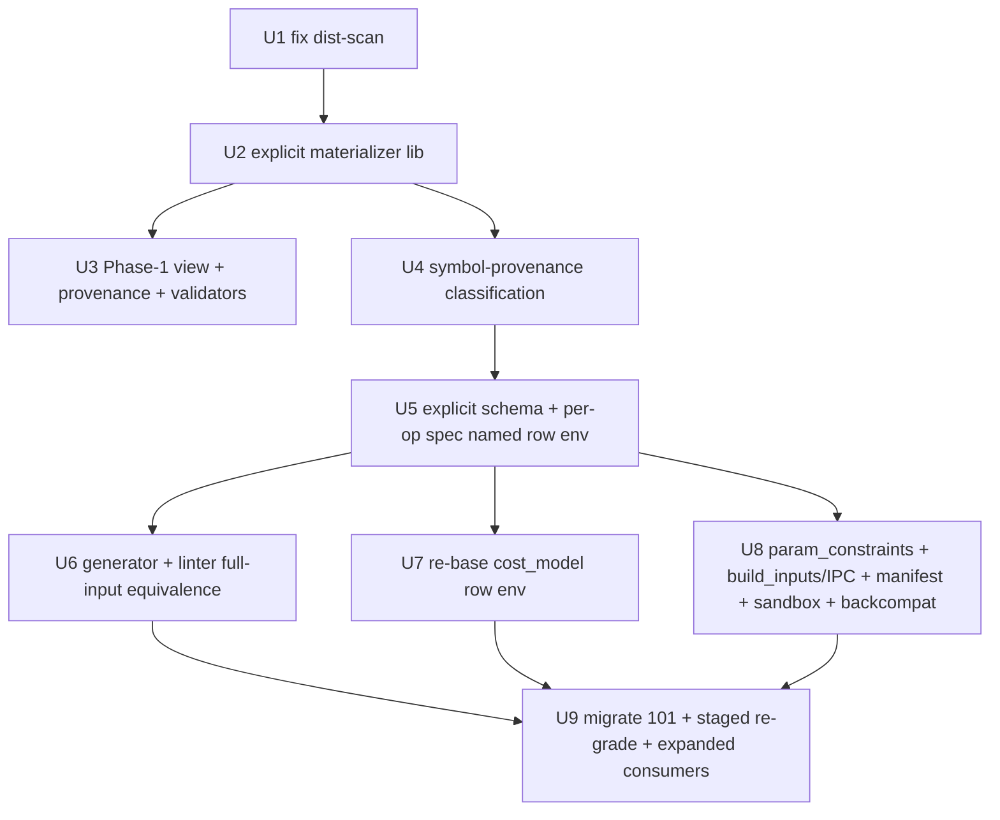

# Migrate shapes.yaml to explicit per-tensor shapes (retire the knob grid)

## Overview

Replace TAB's generic single-letter **knob-grid** shape authoring (`size_knobs: {B,L,D,…}` +
per-row `knobs:` overrides + `inputs[].dims` expressions over those knobs) with an **explicit
per-tensor authoring surface** matching the industry norm (NPUKernelBench/KernelBench): each shape row
lists every input tensor with a literal `shape: [...]`, `dtype`, and **named axes**, self-documenting
with no decoder ring. A thin **per-op generator + linter** re-derives everything the knob grid gave us
(single-axis/grid/edge sweeps, cross-tensor consistency), and `cost_model` / `param_constraints` are
re-based off knobs onto a **named row environment** (tensor axes + named non-tensor params). Delivered in two phases: a **manifest-neutral down-payment**
(readable explicit *view* + provenance, no re-grade) and an **authoritative cutover** (gated on a
staged full S2/C2/golden/roofline re-grade).

## Problem Frame

`shapes.yaml` is unreadable: median **60%** of a task's declared knobs are dead template boilerplate,
the single-letter names are undocumented, and a knob's meaning lives only implicitly in
`inputs[].dims`. The brainstorm (see origin) compared four peer benchmarks — all use explicit, named,
self-documenting shapes; none use a knob grid — and codex supervision rejected "keep knobs because
they're more expressive" as self-serving: explicit shapes lose nothing if a generator/linter layer
re-derives constraints/cost/sweep. The root cause is the **global template**, so documentation alone
("Direction A") only decorates it. The user chose **Direction B**: migrate to explicit shapes.

## Requirements Trace

(from origin `docs/brainstorms/2026-06-17-shape-definition-approach-requirements.md`)

- R1. Authoritative artifact = explicit per-tensor rows with literal `shape`, `dtype`, named axes.
- R2. Named axes replace single-letter knobs; no global template — each op declares only what it uses.
- R3. A deterministic per-op generator emits the rows (sweeps become generation, not hand-authoring).
- R4. A linter enforces cross-tensor consistency previously implicit in shared knobs.
- R5. `param_constraints` re-expressed and `cost_model` formulas re-based onto a **named row
  environment** — tensor axes **plus** named row-level parameters (scalar/flag/block/group symbols
  that are NOT any tensor dim). Codex review found 16 tasks whose cost symbols are non-axis (e.g.
  `L1_09:D`, `L3_13:CAUSAL`, `L3_15:G`; plus `CS/APPW/SOFTCAP/LSEB/DTSP/E/N/T`), so a pure
  tensor-axis basis is impossible — a lean named per-row parameter layer is required. Deepest item.
- R6. Per-row provenance (synthetic / NPUKB-borrowed / model-sourced / edge / hidden); real-model
  sourcing becomes a tracked, improvable metric.
- R7. Hidden rows stay sealed from the candidate sandbox; explicit per-row dtype policy.
- R8. Migrate all 101 tasks; full re-grade staged to keep the corpus green per batch.
- R9. Optional manifest-neutral down-payment: ship the explicit *view* + provenance before the cutover.
- R10. **Extensibility / scale**: the format must (a) host all 101 current tasks with no special-casing
  (verified), (b) add a new operator with one per-op spec and no global edit, (c) admit new input
  forms / dtypes / hardware (910B NPU) additively via **registered IR handlers** + `schema_version`
  (not a YAML label), and (d) keep validation total: every cost/constraint symbol is a declared tensor
  axis OR a declared `params:` key OR a declared scalar/dist input role. See `Scalability & Future
  Extension`.

## Scope Boundaries

- Not changing the grading pipeline semantics (S2 severance, C2 oracle-equiv, golden capture, roofline
  ranking) — only the shape *authoring surface* and the consumers that read knobs.
- Not adopting SOL-ExecBench's model-subgraph extraction; we stay operator-level. We only add
  real-model provenance *tracking*, not a new corpus-construction method.
- Not re-opening which shapes exist — the current graded shape *set* per task is preserved through the
  migration (same materialised tensors); only their *representation* changes.

## Context & Research

### Relevant Code and Patterns

- `tasks/level{1,2,3}/<task>/shapes.yaml` — current format: `size_knobs`, `public_shapes`,
  `hidden_shapes` (each row `id`/`name`/`knobs`), and a single `inputs:` block (`dims`/`dtype`/`dist`/
  `derive`/`scalar`/`scalar_knob`).
- `ascendbench/input_spec/inputs.py` — `build_inputs(shapes_doc, sid, seed)` materialises tensors from
  `inputs[].dims` + effective knobs; `split_inputs`/`merge_inputs` for the candidate-sandbox IPC.
- `ascendbench/input_spec/expr.py` — `eval_numeric`, AST-whitelisted knob-formula evaluator.
- `ascendbench/input_spec/param_constraints.py` — builds a synthetic `size_knobs` row + per-row
  overlay; evaluates predicate strings (`E >= 1`) over the effective knob set.
- `ascendbench/perf/cost_model.py` — `validate_formulas`; cost formulas are knob expressions
  (`flops: 2*B*L*N*D`, `bytes: (((N+127)//128)*B*L*D + …)`).
- `ascendbench/corpus/shape_manifest.py` — `canonical_manifest` hashes `inputs` + `size_knobs` +
  per-row `knobs`/`dtype` (so any representation change forces a re-grade); comments / unknown
  top-level keys are NOT hashed (basis for the manifest-neutral down-payment).
- `scripts/corpus/generate_shapes_and_contract.py` — current knob-grid generator (+ contract mirror).
- `scripts/corpus/extend_task_shapes.py` — sweep generation (value ladder + coprime grid + edges);
  its active-knob detector scans `dims` but **misses `dist`** (must fix before relying on it).
- `scripts/corpus/validate_tasks.py`, `validate_corpus_consistency.py` — corpus gates (cost-model
  universe = `size_knobs` keys + per-row knobs).
- `scripts/corpus/gpu_shape_probe.py`, `quarantine_shapes.py` — the per-shape GPU probe + surgical
  removal tools built this session; reused by the staged re-grade.
- The mailbox grading pipeline (`loop_mailbox`, actions `verify`/`oracle-equiv`/`gpu-rank`) and the
  full-regression driver pattern (`/tmp/fr_driver.py`) — reused verbatim for R8.

### Institutional Learnings

- `docs/reviews/2026-06-17-shapes-yaml-readability.md` — the consumer/blast-radius analysis and the
  60%-dead-knob measure.
- Prior-art comparison + codex supervision corrections in the origin brainstorm.
- This session's shape-expansion + quarantine + full-regression experience: the S2→probe→quarantine→
  C2/golden→roofline loop and "commit daemon-written metas FROM the GPU box" are the migration's
  re-grade backbone.

### External References

- NPUKernelBench (local `../AscendOpGenAgent/benchmarks/NPUKernelBench`): explicit per-tensor JSON
  rows — the target readability shape.
- KernelBench (github.com/ScalingIntelligence/KernelBench), TritonBench (github.com/meta-pytorch/
  tritonbench), SOL-ExecBench (NVIDIA, arxiv 2603.19173) — explicit shapes; sweeps/coupling done in a
  generator/Python layer (proof that B loses no capability).

## Key Technical Decisions

- **Explicit rows are authoritative; a per-op spec feeds a generator.** We do not hand-author 101 ×
  ~45 literal rows. A small per-op *spec* (named tensors + axis relationships + sweep intent) is the
  human-edited source; the generator expands it into explicit rows that are then committed and graded.
  Rationale: keeps determinism + sweep coverage (R3) while the *committed/read* artifact is explicit.
- **A named ROW ENVIRONMENT carries the cost/constraint basis — not tensor axes alone.** Codex
  supervision proved (with 16 real tasks) that some cost/constraint symbols have **no tensor-axis
  home** (block sizes, group counts, flags like `CAUSAL`, sequence-derived `E/N/T`). So the explicit
  format keeps, per row, a small **named parameter environment** = {tensor axes} ∪ {named scalar/flag/
  block/group params}, all *used* and *named* (no global template, no dead symbols). `cost_model` and
  `param_constraints` re-base onto this named environment. This is the honest refinement of Direction
  B: the *authoring surface* is explicit + self-documenting and the cryptic global knob grid is gone,
  but a lean, named, per-row parameter layer survives for non-tensor symbols (it is NOT a regression
  to the old template). Rationale: keeps analytic cost + machine-checkable constraints without
  pretending non-axis symbols are tensor dims (R5).
- **Symbol provenance precedes the format.** Before designing the explicit schema, every cost/
  constraint symbol corpus-wide is classified (tensor-axis / scalar-input / dist-param / row-only
  param / dead-or-bug) so the named environment is grounded in real usage, and dead symbols (e.g. a
  cost-only knob that is also a bug) are surfaced rather than carried forward.
- **Two-phase, manifest-aware delivery.** Phase 1 adds only non-hashed fields (explicit *view* +
  provenance) → zero re-grade, immediate readability. Phase 2 flips authority to explicit + re-bases
  consumers → manifest changes → staged re-grade. Rationale: de-risks the biggest cost (re-grade) and
  delivers value early (R9).
- **Preserve the exact graded shape set during cutover — proven on FULL inputs, not just shapes.**
  The Phase-2 generator must reproduce the *same materialised inputs* the current graded corpus has:
  not only tensor shape/dtype but the full `build_inputs` output — `dist` DSL draw order, `scalar` /
  `scalar_knob` values, structs, refs, and **authored input order** — across the **actual seed set**
  used downstream (correctness seed 0; timing seeds 1+/1000+). `build_inputs` is order- and
  seed-sensitive, so a shapes-only check is insufficient. Rationale: a divergence is a migration bug,
  not a new shape — and only a full-input multi-seed check can catch it.
- **Back-compat read window for staged migration.** `canonical_manifest` hashes `inputs` + `size_knobs`
  + row `dtype`/`knobs`, so the format flip changes the manifest for ALL tasks. To migrate green
  per-batch (not a 101-task big-bang), consumers must read BOTH the knob format and the explicit format
  during the cutover (a versioned schema tag + dual-path readers). Rationale: makes batched re-grade
  actually independent; otherwise the cutover is all-at-once.

## Open Questions

### Resolved During Planning

- Direction (A/B/C)? → **B** (origin decision).
- Does a manifest-neutral down-payment exist? → Yes; `canonical_manifest` ignores comments + unknown
  top-level keys, so an explicit *view* field + provenance add no hash churn.
- Can sweeps/constraints survive without knobs? → Yes, via the generator/linter (peer benchmarks prove
  it); confirmed by codex supervision.

### Deferred to Implementation

- Exact named-axis vocabulary (`batch`/`seqlen`/`head_dim`/…) and how composite dims (`E*L`) render in
  the explicit row — settle when writing the materializer against real `inputs[]` forms.
- Exact re-based form of each `cost_model` formula per task — grounded by U4 symbol provenance; U7 is characterization-first (snapshot-guarded) for this reason.
- Whether the explicit authoritative rows replace `shapes.yaml` in place or land in a new file with a
  back-compat read window — decide when the schema (U5) is drafted.
- Final per-op spec grammar (U4/U5) — directional sketch only until implementation.

## High-Level Technical Design

> *Directional guidance for review, not implementation specification. The implementing agent should
> treat it as context, not code to reproduce.*

Current (knob-indirect):
```
size_knobs:{B,L,D,N,…}  ─┐
public_shapes[].knobs    ─┼─▶ build_inputs ─▶ tensors
inputs[].dims = "E*L",H,D ┘     ▲
cost_model: 2*B*L*N*D ───────────┘ (knob basis)
param_constraints: "E>=1" ───────┘ (knob basis)
```

Target (explicit-authoritative, generator-backed):
```
per-op spec (named tensors + axis links + sweep intent)
        │  generator (ladder/grid/edge)            linter (cross-tensor axis equality)
        ▼
shapes.yaml rows (EXPLICIT):
  - id: P3   provenance: model-sourced
    tensors:
      q: {shape:[2048,16,128], dtype: bf16, axes:[num_seqs*seqlen, heads, head_dim]}
      k: {shape:[2048,16,128], …}                       ▲ self-documenting, no decoder
        │
        ├─▶ build_inputs (now literal-shape, knob-free)
        ├─▶ cost_model: over the named row env (q.head_dim … + params{block,causal})
        └─▶ param_constraints: q.head_dim == k.head_dim + param predicates
```

## Implementation Units



### Phase 1 — manifest-neutral down-payment (no re-grade)

- [ ] **Unit 1: Fix the active-knob detector `dist` gap**

**Goal:** Make "which knobs/axes does this input actually use" faithful by scanning `dist`/`derive`/
`scalar_knob` expressions, not just `dims`.

**Requirements:** R1, R2 (prerequisite for any faithful explicit view or dead-knob validator).

**Dependencies:** None.

**Files:**
- Modify: `scripts/corpus/extend_task_shapes.py` (active-knob detector, ~line 79)
- Test: `tests/unit_tests/test_extend_task_shapes.py`

**Approach:** Extend the reference scan to the union of `dims` + `dist` strings (e.g. `offsets:to=E*L`,
`full:L`) + `derive` + `scalar_knob`. Reuse `expr.py`'s tokenisation rather than a fresh regex where
possible.

**Patterns to follow:** the existing knob-extraction in `param_constraints.py` (which already evaluates
expressions over the knob set).

**Test scenarios:**
- Happy path: a task whose knob appears only in a `dist` string is reported as active (regression for
  the 6 tasks codex found).
- Edge case: composite expression (`E*L`) reports both `E` and `L`.
- Edge case: a genuinely-dead knob (in none of dims/dist/derive/scalar/constraints/cost) still reports
  dead.

**Verification:** the active-knob set for the 6 `dist`-only tasks now includes the previously-missed
knob; corpus-wide dead-knob count drops accordingly and matches a hand-audit on 3 sampled tasks.

- [ ] **Unit 2: Explicit-shape materializer library**

**Goal:** A pure function that turns a `(shapes_doc, sid)` into an explicit per-tensor description —
literal shapes + dtype + named axes — faithful to `build_inputs` (the basis for both the Phase-1 view
and the Phase-2 generator's equivalence check).

**Requirements:** R1, R2.

**Dependencies:** U1.

**Files:**
- Create: `ascendbench/input_spec/materialize.py`
- Test: `tests/unit_tests/test_materialize.py`

**Approach:** Resolve effective knobs (size_knobs ⊕ row knobs), evaluate each input's `dims`/`dist`/
`derive`/`scalar` via `expr.py` to literal shapes, and attach a named-axis label per dim derived from
the dim expression (e.g. `E*L → num_seqs*seqlen`). Must agree with `build_inputs` tensor shapes
exactly (shared resolution path, not a parallel reimplementation).

**Patterns to follow:** `ascendbench/input_spec/inputs.py::build_inputs` resolution; `expr.eval_numeric`.

**Test scenarios:**
- Happy path: materialized literal shapes equal `build_inputs(...).shape` for every input on a sampled
  set of tasks (norm, attention, moe, elementwise).
- Edge case: `derive`/`scalar_knob`/`scalar` inputs render without a dims list.
- Edge case: composite + offset dims (`E*L`, `offsets:to=E*L`) render correctly.
- Error path: an input whose expression references an undefined knob raises, not silently zero.

**Verification:** for ≥5 diverse tasks across all declared shapes, materializer shapes == `build_inputs`
shapes; named-axis labels match the dim expressions.

- [ ] **Unit 3: Phase-1 annotation — explicit view, provenance, validators, glossary**

**Goal:** Land the readability win with zero manifest churn: a generated, non-authoritative explicit
*view* + per-row provenance in `shapes.yaml`, a dead-public-knob validator, and the central glossary.

**Requirements:** R2, R6, R9.

**Dependencies:** U2.

**Files:**
- Create: `docs/reference/shape_knobs.md` (glossary — already prototyped in the readability review)
- Create: `scripts/corpus/annotate_explicit_view.py` (emits the view + provenance into each shapes.yaml
  as non-hashed fields/comments)
- Modify: `scripts/corpus/validate_tasks.py` (add dead-public-knob check + view/provenance schema)
- Test: `tests/unit_tests/test_explicit_view_annotation.py`, `tests/unit_tests/test_dead_knob_gate.py`

**Approach:** Write the explicit view under a top-level key the manifest ignores (verify against
`canonical_manifest`); tag each row's provenance (synthetic/NPUKB-borrowed/model-sourced/edge/hidden)
from generation metadata. The dead-public-knob validator fails a task whose public knob set ≠ its
referenced set (using U1's scan).

**Test scenarios:**
- Happy path: annotating a task leaves `shape_manifest_sha256` unchanged (manifest-neutral proof).
- Happy path: the view round-trips through the YAML rewrite path (`file_blocks.py`) without loss
  (structured field, not a comment — see readability review).
- Edge case: a hidden row's view is present in the authored file but excluded from the candidate
  sandbox projection (R7 sealing).
- Error path: a task with a dead public knob fails the new validator with the offending knob named.

**Verification:** corpus-wide annotate run changes no manifest hash; `validate_tasks` flags exactly the
dead-public-knob tasks; a newcomer can read any row's view and name every dimension.

### Phase 2 — authoritative cutover (gated on staged re-grade)

- [ ] **Unit 4: Corpus symbol-provenance classification**

**Goal:** Before designing the format, classify EVERY symbol used by any `cost_model`,
`param_constraints`, `dims`, `dist`, `derive`, or `scalar_knob` across all 101 tasks into:
tensor-axis / scalar-input / dist-param / row-only-param (block/group/flag) / dead-or-bug, AND
inventory the input FORMS in use (corpus scan already confirms exactly six: `dims`-tensor, `scalar`,
`scalar_knob`, `derive`, `scalar_seq`, optional/`null`; no `struct`/`ref`). This is the ground truth
the named row environment + schema (U5) is built on, and it surfaces the non-axis symbols codex found
(`L1_09:D`, `L3_13:CAUSAL`, `L3_15:G`, `CS/APPW/SOFTCAP/LSEB/DTSP/E/N/T`).

**Requirements:** R2, R5 (prerequisite -- de-risks U7).

**Dependencies:** U1.

**Files:**
- Create: `scripts/corpus/classify_symbols.py` (emits a per-task symbol -> class report)
- Create: `docs/reviews/2026-06-17-symbol-provenance.md` (the corpus-wide classification result)
- Test: `tests/unit_tests/test_classify_symbols.py`

**Approach:** Scan inputs (dims/dist/derive/scalar/scalar_knob via U1's fixed scanner) + meta
(cost_model formulas, param_constraints predicates). A symbol with no input home but used in cost is
flagged row-only or dead-or-bug for human adjudication.

**Test scenarios:**
- Happy path: `L1_09:D`, `L3_13:CAUSAL`, `L3_15:G` are classified row-only (or flagged), not
  tensor-axis (regression for codex's finding).
- Edge case: a symbol used both as a tensor axis and a scalar is classified by its dominant role with
  both recorded.
- Error path: a cost symbol referenced nowhere in inputs/constraints is flagged dead-or-bug.

**Verification:** every cost/constraint symbol corpus-wide has a class; the count of non-axis cost
symbols matches a hand-audit of the 16 tasks codex named.

- [ ] **Unit 5: Explicit schema + typed IR + per-op spec (named row environment)**

**Goal:** Define the authoritative explicit format AND a typed `InputSpec`/`RowSpec` **IR with
registered handlers** (codex's highest-leverage extensibility change) — per-tensor rows with literal
shapes/dtype/named axes (`dist` always explicit) PLUS a per-row named parameter environment for the
non-axis symbols. The IR (not raw YAML, not the `schema_version` label alone) is the extension boundary:
input-kind, dist-kind, dtype, row-env symbol, and future alias/view/multi-output contracts are
*registered handlers*, so manifest/build_inputs/IPC/sandbox/cost/constraints consume the IR and a new
kind/dtype = register a handler + bump `schema_version`, not edit every consumer. (R10.)

**Requirements:** R1, R2, R5, R7, R10.

**Dependencies:** U4.

**Files:**
- Create: `ascendbench/input_spec/row_ir.py` (typed `InputSpec`/`RowSpec` IR + handler registries for
  input-kind / dist-kind / dtype / row-env; the single extension boundary)
- Create: `docs/reference/shape_schema_explicit.md` (schema + per-op spec grammar + IR, directional)
- Modify: `docs/reference/task_api_contract.md`, `docs/reference/shape_policy.md` (+ zh mirrors)
- Test: `tests/unit_tests/test_row_ir.py` (registry round-trip; unknown kind rejected loudly)

**Approach:** A row carries `tensors: {name: {shape:[...], dtype, axes:[...], dist: <fill-rule>}}` --
**`dist` is REQUIRED** on tensor entries (randn/randint/`offsets:to=…`/`full:…`); omitting it (as the
earlier sketch did) makes tensor values non-reproducible and breaks the U6 full-input equivalence gate
-- plus a `params:` map for named non-tensor symbols (block/group/flag/seq-derived), `provenance`,
`role`, and a `schema_version` tag. A corpus scan confirmed the format must host **exactly six** input
forms: `dims`-tensor (405 inputs / all 101 tasks), `scalar` (79/51), `scalar_knob` (27/22, carries an
axis link), `derive` (14/13, keeps the expression), `scalar_seq` (4/4), and an **optional/`null`
input** (`q_descale:null` in L3_13, `base_output:null` in L3_03 -- 4 inputs / 2 tasks) which needs an
explicit `absent:true`/`null` marker. No `struct`/`ref` forms exist. The per-op spec declares named
tensors, axis-link relationships, the param set, dtype policy, and sweep intent. Validated against U4's
symbol-and-form inventory.

**Technical design:** *(directional)* `tensors` + `axes{links:[q.head_dim==k.head_dim]}` +
`params:{block:128, causal:false}` + `sweep:{axis:seqlen, ladder:...}`. Not implementation.

**Test scenarios:** `Test expectation: none -- schema/doc unit` (exercised by U6/U7/U8 tests).

**Verification:** codex/schema review accepts the format as self-documenting AND able to host all
input forms + all symbol classes from U4 (no symbol class is unrepresentable).

- [ ] **Unit 6: Per-op generator + linter (FULL-input equivalence)**

**Goal:** Generate explicit rows from the per-op spec (ladder/grid/edge sweeps), lint cross-tensor axis
links, and prove the generated rows reproduce the FULL current `build_inputs` output.

**Requirements:** R3, R4.

**Dependencies:** U5.

**Files:**
- Create: `scripts/corpus/gen_explicit_shapes.py`, `scripts/corpus/lint_explicit_shapes.py`
- Modify/supersede: `scripts/corpus/extend_task_shapes.py` (sweep logic emits explicit rows)
- Test: `tests/unit_tests/test_gen_explicit_shapes.py`, `tests/unit_tests/test_lint_explicit_shapes.py`

**Approach:** Port value-ladder + coprime-grid + edges to explicit rows; linter checks axis links. Render `dist`
explicitly (materialise the `randn` default for the 9 inputs that omit it) so the authoritative file
carries no implicit defaults.
Equivalence is on the FULL materialised input (tensor values, dist draws, scalars, structs, refs,
authored order) across the actual seed set (0 correctness; 1+/1000+ timing) -- not shapes alone.

**Test scenarios:**
- Happy path: for a sampled task, generated rows reproduce `build_inputs` byte-for-byte (all tensors +
  scalars) for every sid across the ACTUAL seed set -- correctness seed 0 + the timing warm-up (1..10) and
  measured (1000..1099) ranges, sampled -- the equivalence gate for U9.
- Edge case: dist-DSL inputs (`offsets:to=...`, `full:...`) reproduce the same draw at a fixed seed.
- Edge case: coprime-grid stride stays coprime per axis ladder (this-session regression).
- Error path: a violated axis-link is caught by the linter.

**Verification:** >=10 diverse tasks reproduce full inputs byte-identically across correctness seed 0
+ sampled warm-up (1..10) / measured (1000..1099) timing seeds;
linter catches an intentionally broken link.

- [ ] **Unit 7: Re-base `cost_model` onto the named row environment** *(highest risk)*

**Goal:** Convert every `cost_model` `flops`/`bytes` formula from knob symbols onto the named row
environment — tensor axes + named `params:` + scalar/dist-backed input roles (every symbol resolves to
one of these three; none free) — and re-validate.

**Requirements:** R5.

**Dependencies:** U4, U5.

**Files:**
- Modify: `ascendbench/perf/cost_model.py` (formula universe = tensor axes + `params:` + scalar/dist input roles)
- Modify: `scripts/corpus/validate_tasks.py`, `scripts/perf/audit_cost_model_formulas.py`,
  `scripts/perf/cross_check_cost_model_gpu.py` (universe + xcheck)
- Modify: all `tasks/*/meta.yaml` `cost_model:` blocks
- Test: `tests/unit_tests/test_cost_model_named_axes.py`

**Execution note:** Characterization-first -- snapshot each task's current `flops`/`bytes` numeric
outputs over its shape set BEFORE editing; the re-based formula must reproduce the same numbers. Do not
edit a formula without its snapshot guard. Non-axis symbols (block/group/flag) re-base onto the named
`params`, NOT a faked tensor axis.

**Test scenarios:**
- Happy path: re-based formula == knob formula numerically for every shape (snapshot match), sampled
  across cube/vector + the 16 non-axis tasks.
- Edge case: ceil-div (`(N+127)//128`) and flag-gated terms (`CAUSAL`) re-base correctly onto named
  params.
- Error path: a formula referencing an undefined symbol fails validation loudly.

**Verification:** cost-model + xcheck + audit pass corpus-wide on the named-environment universe;
characterization snapshots match 100% (a mismatch blocks the task).

- [ ] **Unit 8: Re-express `param_constraints` + format-reading consumers + back-compat**

**Goal:** Move constraint predicates to the named environment, and update every consumer that reads
`size_knobs`/`knobs` to read the explicit format -- with a dual-path (versioned) reader so batches
migrate independently. (Codex: these are distinct risk surfaces -- land them as SEPARATE commits in this order:
build_inputs/IPC -> manifest hashing -> sandbox sealing/sanitisation -> param_constraints; the unit is a
checklist of four independently-verifiable sub-steps, not one atomic change.)

**Requirements:** R5, R7, R8 (back-compat).

**Dependencies:** U5.

**Files:**
- Modify: `ascendbench/input_spec/param_constraints.py` (named-environment predicates)
- Modify: `ascendbench/input_spec/inputs.py` (build_inputs + split/merge IPC read explicit rows)
- Modify: `ascendbench/corpus/shape_manifest.py` (canonical projection + `schema_version`; dual-path)
- Modify: `ascendbench/integrity/process_isolation.py` (sandbox public-view sanitisation), and the
  hidden-row sealing / B' seed path
- Modify: `ascendbench/perf/scoring.py`, `ascendbench/engine/eval.py`, `scripts/loop/gpu_rank_one.py`,
  `scripts/oracle/precompute_oracle_reference.py`,
  `scripts/verify/oracle_consistency_anchor_runner.py` (computes shape volume from row `knobs`) --
  every consumer that still resolves `size_knobs`/`knobs`
- Test: `tests/unit_tests/test_param_constraints_named.py`, `tests/unit_tests/test_sandbox_sealing.py`,
  `tests/unit_tests/test_manifest_schema_version.py`, `tests/unit_tests/test_backcompat_dual_read.py`

**Approach:** A `schema_version` tag lets every reader accept both formats during cutover. Hidden rows
stay sealed from the sandbox public view. Manifest projection over the explicit rows must be
order-stable.

**Test scenarios:**
- Happy path: a constraint true under knobs (`E>=1`) holds under the named form for every shape.
- Edge case: cross-tensor predicate (`q.head_dim == k.head_dim`) -- newly expressible -- fires when
  violated.
- Integration: a knob-format task and an explicit-format task BOTH grade in the same corpus during
  cutover (dual-path proof); hidden rows absent from the sandbox public view; manifest hash stable on
  a no-op re-dump.
- Error path: build_inputs on a bad explicit dtype/shape raises, not silently coerces.

**Verification:** dual-format corpus passes consistency; sandbox excludes hidden rows; every consumer
codex listed reads the explicit format; constraints behave identically to the knob era (sampled audit).

- [ ] **Unit 9: Migrate all 101 tasks + staged full re-grade**

**Goal:** Convert every task to the explicit format and re-grade the corpus green batch-by-batch,
reusing this session's pipeline; report provenance coverage.

**Requirements:** R1, R6, R8.

**Dependencies:** U6, U7, U8.

**Files:**
- Modify: all `tasks/level{1,2,3}/<task>/shapes.yaml` + their `meta.yaml` (golden freshness stamping)
- Reuse: `scripts/corpus/gpu_shape_probe.py`, `quarantine_shapes.py`, the mailbox driver pattern
- Test: `validate_corpus_consistency.py` + `compute_release_planning_gate.py` (GREEN per batch)

**Approach:** Generate explicit rows per task (U6) under the full-input equivalence gate (no coverage
change); commit (RED); run the staged S2 -> probe/quarantine -> C2/golden -> roofline -> gates loop per
~20-task batch (dual-path readers from U8 keep un-migrated batches green); commit daemon metas FROM the
GPU box. Equivalence means the re-grade should mostly *confirm* prior verdicts -- any new failure is a
representation bug, not a shape to quarantine.

**Execution note:** Never a 101-task big-bang; each batch green before the next. Golden freshness stamps
and oracle-precompute mirrors must be refreshed for migrated tasks. The staged re-grade must be
**resumable/shardable** (batch checkpoints + idempotent re-runs) so a future larger corpus restarts from
the last green batch, not a single all-or-nothing pass.

**Test scenarios:**
- Integration: each batch reaches consistency GREEN + release-gate PROCEED before the next.
- Happy path: a migrated task's S2/C2/golden/roofline verdicts match its pre-migration verdicts.
- Error path: a task whose explicit rows diverge from full build_inputs is caught by U6's gate before
  grading.

**Verification:** end-to-end full regression GREEN on the explicit corpus (S2 101 PASS, C2 all
VERIFIED/CEILING, roofline RANKED/FLOOR, consistency GREEN, release-gate PROCEED); provenance coverage
metric reported; no task's graded shape set changed (full-input equivalence holds).

## System-Wide Impact

- **Interaction graph (expanded after codex review):** every reader of `size_knobs`/`knobs` is touched
  — `build_inputs`, `param_constraints`, `cost_model`, `shape_manifest`, `validate_tasks`, the
  candidate-sandbox projection + `process_isolation.py` sanitisation, the generators, AND the perf/loop
  consumers codex found still resolving knobs: `ascendbench/perf/scoring.py`,
  `ascendbench/engine/eval.py`, `scripts/loop/gpu_rank_one.py`,
  `scripts/perf/{cross_check_cost_model_gpu,audit_cost_model_formulas}.py`,
  `scripts/oracle/precompute_oracle_reference.py`. The grading daemon is unaffected in *logic* but
  re-runs on the new manifest.
- **Error propagation:** materializer/generator must raise on undefined axes (no silent zero-dim);
  cost/constraint re-base must fail loudly on a missing axis, surfaced by `validate_tasks`.
- **State lifecycle risks:** the manifest changes for all tasks → every S2/C2/golden PASS invalidates;
  the staged re-grade is the controlled re-validation. Partial migration must keep already-migrated
  batches green.
- **API surface parity:** `shapes.yaml` is read by the contract docs + `contract.md` mirror + the
  candidate sandbox — all must speak the explicit format or a documented back-compat shim.
- **Unchanged invariants:** the *set of materialised tensors per sid* is preserved (U6 full-input equivalence gate); grading semantics (S2/C2/golden/roofline) unchanged; hidden-row sealing preserved.

## Risks & Dependencies

| Risk | Likelihood | Impact | Mitigation |
|------|-----------|--------|------------|
| **Non-axis cost symbols have no tensor-axis home** (codex: 16 tasks — block/group/flag/`E/N/T`) → a pure named-axis re-base is impossible | High | High | U4 symbol-provenance classification first; U5 named **row environment** keeps a lean named-param layer for non-axis symbols; U7 re-bases onto it, not a faked axis |
| `cost_model` re-base changes numeric outputs (silent perf-metadata drift) | Med | High | U7 characterization snapshots — re-based formula must reproduce knob-era numbers exactly; mismatch blocks the task |
| Explicit generator silently changes the graded shape set | Med | High | U6 **full-input** equivalence gate (tensors+scalars+dist draws+order across seeds 0/1+/1000+), not shapes alone; divergence is a bug, not a new shape |
| Full re-grade cost (~2–3 h × possibly several passes) | High | Med | Phase 1 delivers readability with no re-grade; Phase 2 staged by ~20-task batch; equivalence gate means re-grade mostly *confirms* prior verdicts |
| Batched migration not actually independent (manifest format flips for all) | High | High | U8 `schema_version` dual-path readers — un-migrated batches read knob format, migrated read explicit, both grade in one corpus |
| Closed dtype/dist/kind registries make "extension" require shared-code edits (codex) | High | Med | U5 typed IR + registered handlers is the real extension boundary; a new kind/dtype registers a handler + bumps `schema_version`, not edits every consumer |
| Manifest projection bug re-hashes on no-op re-dump → spurious RED | Med | Med | U8 order-stability test (no-op re-dump leaves hash unchanged), mirroring the order-preserving `_ord` |
| Hidden-row leak into candidate sandbox under new format | Low | High | U8 sandbox-sealing + `process_isolation` sanitisation tests; preserve the split/merge projection boundary |
| Scope creep into "re-pick shapes" | Med | Med | Scope boundary: representation-only; same materialised inputs preserved |

## Scalability & Future Extension

**Verified all-task coverage (corpus scan + independent codex re-derivation).** The format hosts every
one of the 101 tasks. Six input forms — `dims`+`dist` (all 101), `scalar` (51), `scalar_knob` (22),
`derive` (13), `scalar_seq` (4), optional/`null` (2) — all map to `tensors`/`params`; no `struct`/`ref`
form is in use today. Two normalizations the migration must perform (codex):
- **`dist` default must be rendered explicit.** 9 tensor inputs across 6 tasks
  (`L1_23 masked_m`, `L1_25 problem_sizes1`, `L1_30 down_output/masked_m/output/problem_sizes1`,
  `L3_13 out`, `L3_16 o`, `L3_17 o`) omit `dist` and rely on `build_inputs` defaulting to `randn`. The
  explicit format must materialise `dist: randn` (no implicit defaults in the authoritative file).
- **Distinguish symbol classes precisely.** There are ~23 task-symbol pairs whose cost/constraint
  symbol is non-tensor-axis, in TWO classes: (a) **row-only / no-input-home** — 6 pairs (`L1_09:D`,
  `L3_13:CAUSAL`, `L2_29:G`, `L3_15:G`, `L3_18:G`, `L3_09:B`) that become declared `params:`; and
  (b) **non-axis but backed by a scalar/dist input role** (`CS`, `DTSP`, `APPW`, `SOFTCAP`, `LSEB`,
  `E/N/T`, …) that already have a home as scalar/scalar_knob inputs. The validator rule (U7/U8) is:
  every cost/constraint symbol is a tensor axis **or** a declared `params:` key **or** a declared
  scalar/dist input role — never free.

**Designed-in extension points — honest about the current registry boundaries (codex):**
- **New operators** author one per-op spec; discovery is glob-based (`dataset.py`), so a new *v1-form*
  op needs no global edit → linear authoring cost. (This holds only for the existing form/dtype/dist
  set; see the registry caveat below.)
- **The real extension boundary is a typed IR, not a YAML tag.** Today dtypes, dist kinds, and
  input kinds are **closed Python registries** (`inputs.py` `_DTYPES`, `parse_dist_spec`) and
  `build_inputs`/IPC/manifest/sandbox consume raw YAML — so `kind:` + `schema_version` alone is a
  *label*, and a new dtype/dist/form still requires shared-code edits. To make extension real, U5
  introduces a typed **`InputSpec`/`RowSpec` IR with registered handlers** for input-kind, dist-kind,
  dtype, row-env symbol, and (future) alias/view/multi-output contracts; manifest, build_inputs, IPC,
  sandbox, cost, and constraints all consume the IR. Then adding a kind/dtype = registering a handler
  + a `schema_version` bump, not editing every consumer.
- **A 7th input form (ragged / nested / sparse / quant-scale)** is then additive at the IR layer, but
  is NOT free: `build_inputs` has dormant `struct`/`ref` support yet the IPC boundary only permits
  tensors + JSON scalars/lists, so a genuinely new form still touches the IPC type set + sandbox +
  manifest. The IR makes this a bounded, single-surface change instead of a scattered one.
- **New dtypes** (fp4 / int4 / mxfp / NPU-native): per-tensor `dtype` in the row, but honest caveat —
  dtype leaks into `_DTYPES`, `_DTYPE_BYTES`, tolerance, cost-model dtype classes, and peak tables, so
  a new dtype registers a handler in those tables (the IR centralises the registration point).
- **910B NPU stage**: explicit literal shapes + named axes ARE hardware-agnostic (the corpus ports
  without reshaping), but dtype/alignment/tiling are NOT — they live in the dtype registry + named
  `params:` (hardware constants must be named params, never bare literals), so an NPU port re-targets
  the registry + params, not the shapes.
- **Value/layout coupling** (24 segment/coupled `dist` uses + `L1_15`'s `randn_inf_excl` referencing an
  earlier tensor) is preserved today via the dist DSL + authored input order (U6 equivalence guards
  it); first-class `ref`/layout metadata in the IR is the forward path for ragged/view inputs.
- **Corpus growth beyond 101 + larger sweeps**: deterministic per-op generator + batched mailbox
  re-grade are O(tasks × shapes), no O(N²); proven this session at ~50 shapes/op × 101 tasks. The plan
  must still specify **resume/sharding** for the re-grade (batch checkpoints + idempotent re-runs) so a
  500-task corpus is restartable, not a single 3-hour all-or-nothing pass.

## Phased Delivery

### Phase 1 (no re-grade, ships readability now)
- U1 → U2 → U3 — `dist`-scan fix, explicit materializer, then the explicit *view* + provenance +
  validators + glossary; strictly manifest-neutral (adds only non-hashed fields, preserves input order).

### Phase 2 (authoritative cutover, gated re-grade)
- U4 (symbol provenance) → U5 (schema + per-op spec) → {U6 generator/linter, U7 cost re-base, U8
  constraints+consumers+back-compat in parallel} → U9 (staged migration + full regression). De-risk U7
  first (after U4), as the highest-risk unit.

## Documentation / Operational Notes

- Update `docs/reference/task_api_contract.md`, `docs/reference/shape_policy.md`, and the zh mirrors to
  the explicit format; retire knob-grid references after cutover.
- Re-grade runs on the GPU daemon via the mailbox; commit daemon-written metas FROM the GPU box (per
  this session's lesson) to avoid resetting verdicts.

## Sources & References

- **Origin document:** [docs/brainstorms/2026-06-17-shape-definition-approach-requirements.md](../brainstorms/2026-06-17-shape-definition-approach-requirements.md)
- Readability analysis: `docs/reviews/2026-06-17-shapes-yaml-readability.md`
- Consumers: `ascendbench/input_spec/{inputs,param_constraints,expr}.py`, `ascendbench/perf/cost_model.py`,
  `ascendbench/corpus/shape_manifest.py`, `scripts/corpus/{validate_tasks,extend_task_shapes}.py`
- Prior art: NPUKernelBench (local), KernelBench, TritonBench, SOL-ExecBench (arxiv 2603.19173)
