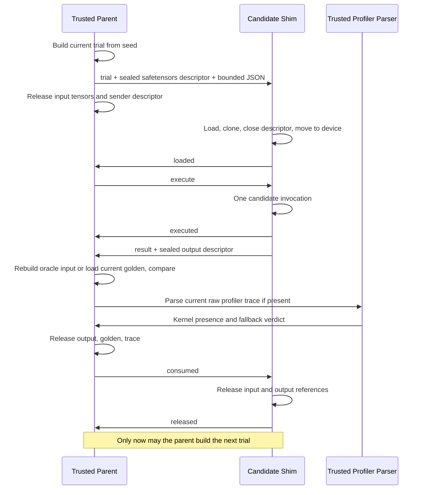

# Streaming Evaluation

`evaluate()` uses `InputSource` and an immediate result consumer. A source stores
shape IDs and a deterministic input builder, not tensors. Existing dictionary
and list calls to `run_candidate_isolated()` and `run_two_pass()` remain valid;
their caller-owned allocations are outside the streaming memory guarantee.

## Lifetime And Backpressure

The correctness child completes all shapes before its process group and owned
directories are destroyed. Timing then starts in a fresh child, with a fresh
HOME, TMPDIR, TRITON_CACHE_DIR and profiler root. Triton compilation occurs on a
separate streamed input before grading each shape; its references are released
before the graded input is built. The trusted parser is an additional helper,
never a candidate process, and has its own killable process group.

Linux `SOCK_SEQPACKET` carries bounded JSON control records (64 KiB maximum)
and `SCM_RIGHTS` descriptors. The receiver checks version, state, sequence ID,
descriptor count, regular-file type, byte count and payload size (256 decimal
GB maximum). Linux memfds are sealed against writing, shrinking, and growing.
The file fallback creates one temporary file, reopens it read-only, unlinks it
before transfer, and closes it after consumption. Neither transport uses pickle.
Loaded tensors are cloned to detach memory mappings and allow in-place input
updates. This is bounded copying, not a zero-copy claim.

The large-tensor residency target is
`O(max_shape(input + output + oracle workspace))`, including serializer and
transport copies with constant factors. Shape metadata and timing scalars grow
with the number of shapes/trials. PyTorch allocators and native libraries can
retain high-water allocations; the claim is about live tensors and owned IPC
resources, not immediate RSS return to the OS. Candidate-owned caches remain
adversarial and require external memory limits for a hard cap.

## Timing And Golden Semantics

Defaults remain 10 warmups, 100 measured calls, and 10 secret sampled outputs
per shape. One sampled measured call also supplies profiler evidence; its
host/event duration is excluded, leaving 99 clean timing samples. Input
generation, serialization, transmission, H2D, output D2H, parent validation,
and profiler parsing do not enter the measured invocation's timing window.
Event and host timers bracket the same invocation; no second call supplies
the checked output.

Correctness uses seed 0, warmups use `1 + w`, measured inputs use `1000 + t`.
The parent chooses sampled indices with a fresh CSPRNG. For offline golden
tasks only, sampled measured trials use seed 0 because that is the input covered
by the captured golden. This is a real anti-cache limitation: repeated seed-0
content may be recognizable and cacheable even when sample indices are secret.
Do not claim sampled inputs are indistinguishable by content. Other timing
trials still receive independently generated inputs. A richer offline golden
bank or a trusted executable reference is future work.

The golden index holds paths only. Integrity and usability checks precede the
run; each comparison loads and releases the current shape's golden. Oracle
inputs are rebuilt from the seed, so candidate in-place writes cannot corrupt
the reference. Only correctness verdicts, sample counts and timing/diagnostic
scalars survive the consumer callback. Missing or invalid output, protocol
failure, crash and timeout fail closed; partial timing arrays are discarded.

## Budgets And Isolation

`TAB_PASS_TIMEOUT_S` defaults to 90 seconds. Legacy calls retain their wall-clock
child timeout. Streaming applies the configured budget to accumulated candidate
execution waits, with a separate startup wait and separate per-operation
preparation and transfer budgets (300 seconds by default). Serialization and
parent verification are outside the candidate execution budget. Preparation
uses SIGALRM in the main Python thread; existing active alarm timers are
rejected. This is a Python interruption mechanism, not a hard preemption
guarantee for a stuck native call. Use an external supervisor for wall-clock and
memory enforcement.

`ASCEND_RT_VISIBLE_DEVICES`, `ASCEND_DEVICE_ID`, `DEVICE_ID`, or
`CUDA_VISIBLE_DEVICES` are syntax-validated and explicitly passed to the child.
The NPU backend uses logical device zero; for concurrent NPU work specify one
physical ID in `ASCEND_RT_VISIBLE_DEVICES`. Cache and scratch cleanup touches
only directories owned by that pass. The legacy `scrub_between_passes` API is
retained as a no-op compatibility hook: its pass-owned resources are already
reclaimed. Neither entrypoint deletes shared global cache paths.

The candidate receives neither shape documents nor generator/oracle/golden
objects. This preserves the repository's static checker and runtime audit
threat model. It does not add OS user separation, seccomp, container mounts or a
device allowlist. The compile audit window retains the existing documented
toolchain capability. A same-user hostile native candidate is not contained by
Python IPC validation alone.

Set `TAB_STREAM_REPORT_DIR` to an experiment-owned directory to collect
protocol metrics separately from the public evaluation JSON. Reports include
input byte totals, largest input, first-execution wait, release count, PIDs,
device selection, and per-shape diagnostic receipts. They do not disclose the
sampling schedule. Progress logs identify pass and shape, not sampled trials.

## Reproduction

`scripts/internal/streaming_validation.py inventory` fixes candidate/evidence
hashes and complete public/hidden shape documents. `task` checks health and
occupancy immediately before importing the accelerator runtime and executes
the full verified workflow. `campaign` ramps through 1, 2, 4 and 8 workers;
failed tasks retry up to three distinct existing candidates. The corpus task
files and golden artifacts are read from the explicitly inventoried task root.

The supervisor samples owned process-tree RSS and I/O plus the entire host's
file cache. Global cache and summed RSS overcount shared pages, making this a
conservative observational measure. Admission is below 800,000,000,000 bytes;
at 900,000,000,000 bytes only experiment-owned descendants are stopped. The
acceptance ceiling is 1,000,000,000,000 bytes. Polling is not a hard limit;
cgroup availability and any absence of hard enforcement must be reported.

`streaming_comparison.py` runs controlled synthetic CPU workloads against
`main`, `improvement-1`, and streaming. It reports host lifecycle metrics,
not NPU latency. Run comparisons sequentially with identical shapes/trials and
record background load. Formal shapes and random inputs must not be reduced
or reused to make the production evaluation fit memory.
