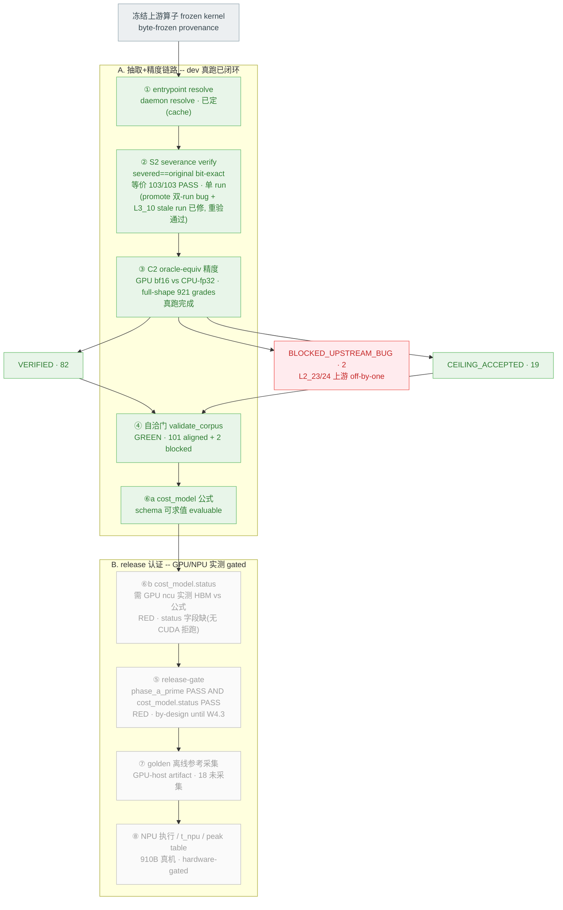

# TAB 自动化抽取+验证链路 — 全流程真跑状态

快照时刻：2026-06-04 ~21:00 CST。全量真跑(S2 severance + C2 精度)后的真实状态。

颜色含义：**绿=dev 侧已真跑闭环 · 黄=正在重验 · 灰=GPU/NPU 实测 gated(dev 做不了) · 红=上游 bug 阻断**。
关键区分：上半组是**自动化抽取+精度验证链路**(dev 可真跑、已闭环);下半组是 **release-certification**
(必须 GPU/NPU 真机实测才能认证,dev 做不了,by-design 未完成)。

## 真实状态小结

**A 组 — 自动化抽取+精度链路(dev 真跑、已闭环、可信)**

| stage | 状态 |
|---|---|
| ① resolve | 已定(cache) |
| ② S2 severance | 等价 103/103 PASS · 单 run;此前 promote 对 65 题有"双-run + 丢 classB"bug + L3_10 stale fp32 run,已修(`_has_module_level_run` guard + fail-closed equality check + classB merge),**GPU 重跑通过** |
| ③ C2 精度 | 82 VERIFIED + 19 CEILING_ACCEPTED + 2 BLOCKED_UPSTREAM_BUG,full-shape 921 grades |
| ④ 自洽门 | GREEN(对抗审计确认是真门) |
| ⑥a cost_model 公式 | schema 可求值 |

**B 组 — release-certification(GPU/NPU 实测 gated,by-design 未完成)**

| stage | 为什么 gated |
|---|---|
| ⑥b cost_model.status | 需在 live CUDA 上用 Nsight Compute 实测 HBM traffic 与公式对账(无 CUDA 直接拒跑);dev 做不了 |
| ⑤ release-gate | = phase_a_prime PASS **AND** cost_model.status PASS;后者缺 → RED(代码注释:expected RED until W4.3) |
| ⑦ golden | GPU-host 离线参考,18 个 score-eligible 题未采集 |
| ⑧ NPU | 910B 真机执行 / t_npu 打分 / peak table,无 910B 不可达 |

**一句话**:**抽取等价 → full-shape 精度对齐 → 自洽** 这条核心链路 dev 侧已真跑闭环、可信;
**release 认证**(cost_model GPU 实测 / golden 采集 / NPU 执行)按设计需 GPU/NPU 真机,dev 做不了,尚未完成。
