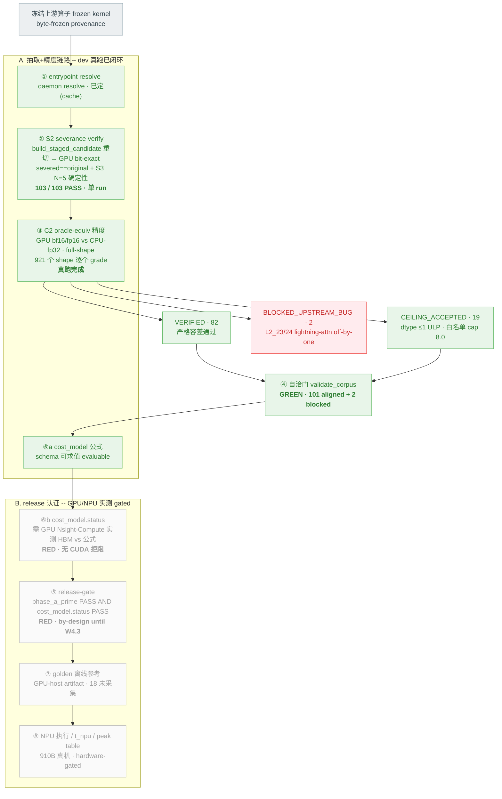

# TAB bench 全流程状态 — 基于全量真跑的可视化

数据来源:`fe7370a` 最新代码,全量 103 题端到端真跑 — S2 severance(`bs2final`)+ C2 oracle-equiv
(`bc2clean3`,清 `.pyc` 后的干净代码),2026-06-04 ~22:50 CST。

颜色:**绿=dev 真跑闭环 · 蓝=dev 静态门已过 · 灰=GPU/NPU 实测 gated(dev 做不了) · 红=上游 bug 阻断**。
上半组 A = 自动化抽取+精度链路(dev 真跑、已闭环);下半组 B = release 认证(需 GPU/NPU 真机,未完成)。

## 真实状态小结(全量真跑)

**A 组 — dev 真跑已闭环、可信**

| stage | fresh 结果 |
|---|---|
| ① resolve | 已定(cache) |
| ② S2 severance | **103/103 PASS**(severed==original bit-exact + S3 N=5 确定性,单 run) |
| ③ C2 精度 | **82 VERIFIED + 19 CEILING_ACCEPTED + 2 BLOCKED**,full-shape 921 grades,0 异常 |
| ④ 自洽门 | **GREEN**(101 aligned + 2 blocked,对抗审计确认是真门) |
| ⑥a cost_model 公式 | schema 可求值 |

**B 组 — GPU/NPU 实测 gated,by-design 未完成**

| stage | 为什么 gated |
|---|---|
| ⑥b cost_model.status | 需 live CUDA + Nsight-Compute 实测 HBM traffic 对账公式(无 CUDA 拒跑) |
| ⑤ release-gate | = phase_a_prime PASS **AND** cost_model.status PASS;后者缺 → RED(代码注释:expected RED until W4.3) |
| ⑦ golden | GPU-host 离线参考,18 个 score-eligible 题未采集 |
| ⑧ NPU | 910B 真机执行 / t_npu 打分 / peak table,无 910B 不可达 |

## 全量真跑额外暴露的运行时现象(诚实记录,非 corpus bug)

- **GPU 真机偶发非确定性**:L3_18 在 P4 大 shape 上 S3 五次跑结果不 bit-exact → 偶发 BLOCKED;重跑 PASS。某些 triton kernel 大 shape 用 atomic/非确定 reduction 的物理特性,bench 的 bit-exact S3(无 tolerance backdoor)如实暴露。
- **sync staleness(.pyc)**:首版全量 C2 因 daemon 用了 gpfs 旧 `.pyc`(verdict 缺 `bad_dtype_keys`,ceiling-accept 没生效)产生 L2_02 假 FAILED;force-touch + 清 gpfs `.pyc` 后重跑恢复 CEILING_ACCEPTED。

**一句话**:**抽取等价 → full-shape 精度对齐 → 自洽** 这条核心链路 dev 侧已全量真跑闭环、可信(82+19+2 + 103 S2 PASS);**release 认证**(cost_model GPU 实测 / golden 采集 / NPU 执行)按设计需 GPU/NPU 真机,dev 做不了,尚未完成。
