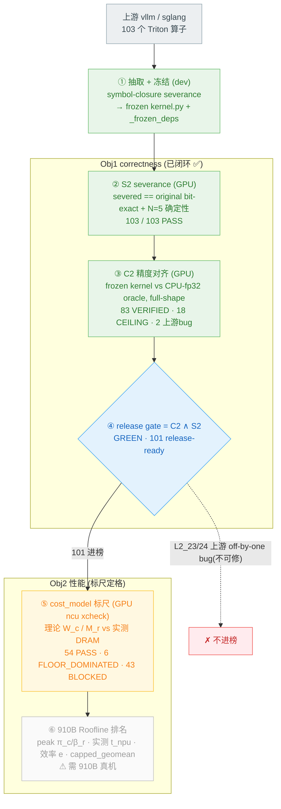

# TAB bench 构建进度 (2026-06-05)

bench = GPU-Triton → 910B NPU-Triton 迁移评测。构建流程分 6 步,两大目标:
**Obj1 correctness(精度对齐+编译=进榜资格)** 已闭环;**Obj2 性能排名** 的标尺(cost_model)已诚实定格,最终排名待 910B 真机。

## 当前在第 ⑤-⑥ 步之间

**①-④ 全绿(已闭环可交付)**:抽取→冻结→S2 编译/severance→C2 精度对齐→release gate。
**⑤ cost_model 标尺已诚实定格(黄)**:本轮工作主要在这。
**⑥ 910B 性能排名(灰)**:hardware-gated,eval daemon 是 CUDA GPU 不是 910B NPU,够不到。

## 本 session 的工作(都落在 ③⑤)

| 工作 | 步 | 结果 |
|---|---|---|
| cost_model 根因深挖 | ⑤ | 49 BLOCKED 主因不可 portable(GPU L2 write-absorb + data-dependent gather),codex confirmed |
| ncu profiler 修(3 真 infra bug) | ⑤ | L1_02/L1_31/L2_33 从 no-evidence → 有真 DRAM evidence,GPU 验证 |
| FLOOR_DOMINATED 重分类(6 个) | ⑤ | sub-burst index kernel 诚实归类(source-audited allowlist,L2_26 防误标) |
| **L2_03 oracle TF32 bug 真修** | ③ | CEILING → **VERIFIED**(补 oracle 漏的 TF32 truncation,GPU 验证全 9 shape) |
| L3_04 对抗审计 | ③ | codex 纠正:是真 ceiling(flash-vs-naive streaming drift),非 bug,不硬修 |

全程 codex 监督(7+ 轮),抓出 C2 sneak、L2_26 误标、L3_04 假 bug 等,防自嗨。

## 诚实定格的硬上限(不可在 dev+CUDA 消除)

- **C2 的 18 CEILING**:真 bf16/TF32 dtype 硬件上限(已对齐到极限);**2 上游 bug**(L2_23/24)不可修
- **cost_model 43 BLOCKED**:GPU L2 write-absorb + data-dependent gather,first-principles 不可 portable;硬刷=tune(红线)
- **⑥ 910B 排名**:需 910B 真机(peak table / t_npu)

**一句话**:dev + CUDA GPU 能做的(①-⑤ 全链)已做到诚实极限并可交付;唯一剩的 ⑥ 是 910B 真机阶段。
