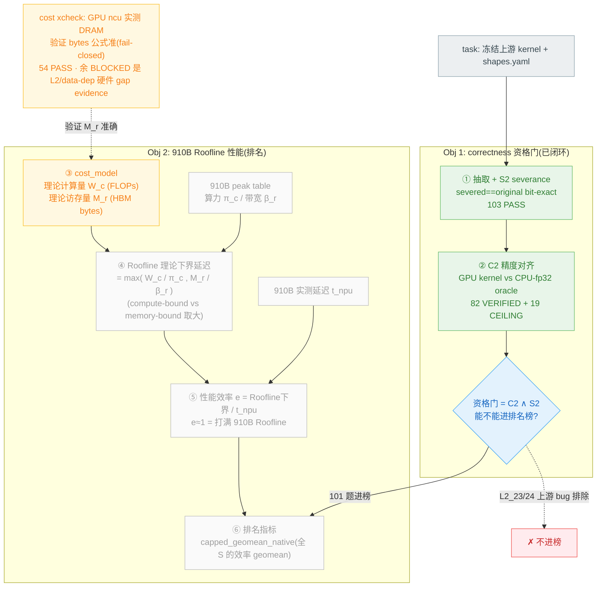

# TAB 双目标评分链路 — cost_model 的位置

这个 bench 是 **GPU-Triton → 910B NPU-Triton 迁移评测**,两个目标:
**Objective 1 = correctness(资格门,决定进不进榜)**;**Objective 2 = 910B Roofline 归一化性能(排名指标)**。
cost_model 是 Objective 2 的**理论标尺**。颜色:**绿=已闭环可交付 · 黄=cost_model evidence(bytes 已验) · 灰=需 910B 真机(hardware-gated)**。

## 怎么读这张图

- **左半(绿) = Objective 1 correctness**:抽取算子 → S2 验证编译/severance bit-exact → C2 验证精度对齐 → **资格门**。这条链是"算得对不对、能不能进榜",**已全闭环**(101 题进榜,L2_23/24 上游 bug 排除)。

- **右半 = Objective 2 性能排名**,cost_model 是核心理论标尺:
  1. **cost_model(黄)** 给出每个 kernel 的理论 FLOPs(`W_c`)+ 理论 HBM bytes(`M_r`);
  2. 配 910B peak(`π_c` 算力 / `β_r` 带宽)算出 **Roofline 理论下界延迟** `max(W_c/π_c, M_r/β_r)`;
  3. 用 910B 实测延迟 `t_npu` 比这个下界 → **效率 e**(打满 Roofline 则 e≈1);
  4. 全部题的效率 geomean = **排名指标**。

- **为什么要 cost_model 而非直接比延迟**:GPU 和 910B peak 不同,绝对延迟跨硬件不可比;只有用理论 FLOP/bytes + 各硬件 peak 做 **Roofline 归一化**才能公平比性能。

- **cost xcheck(我做的,黄)** = 用 GPU ncu 实测 DRAM 验证 `M_r`(bytes 公式)准不准——因为 `M_r` 错则 memory-bound kernel 的 Roofline 基准错、排名错。已把 54 题 bytes 修到与实测对齐;剩余 BLOCKED 是 L2 复用/data-dependent 的硬件 gap(诚实 evidence)。

- **灰 = 唯一剩下的 hardware-gated**:Roofline 下界要 910B peak table、效率要 910B 实测 `t_npu`、最终排名 —— 都需 **910B 真机**。这是 bench 交付后做最终 NPU 性能排名的部分。

**一句话**:correctness(C2+S2,绿)管"对不对、进不进榜",已闭环可交付;cost_model(黄)是性能维度的理论标尺,bytes 已用 GPU 实测验准 54 题;用它出最终 NPU 性能排名(灰)需 910B 真机。
