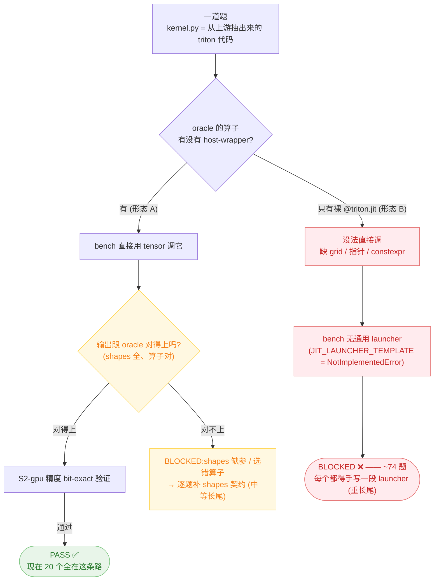

# 为什么剩下的题不能自动化 PASS — 天花板图解

## 一句话

bench 自动 PASS 一道题的方式是:**在 `kernel.py` 里找到一个"能直接用 tensor 调用"的入口函数,调它,跟 oracle 比对**。triton kernel 在源码里有两种形态——一种能这样调,一种不能。

## 两种形态(关键区别)

```python
# 形态 A:host-wrapper —— 普通 Python 函数,吃 tensor 吐 tensor。bench 能直接调。
def silu_and_mul(x: Tensor) -> Tensor:
    out = torch.empty(...)               # 替你分配输出
    grid = (cdiv(x.numel(), BLOCK),)     # 替你算 grid
    _silu_and_mul_kernel[grid](x, out, x.numel(), BLOCK=1024)  # 替你 launch
    return out
# bench: out = silu_and_mul(inputs["x"])  ✅ 直接能跑

# 形态 B:裸 @triton.jit —— 设备 kernel 本体。不能用 tensor 直接调。
@triton.jit
def _silu_and_mul_kernel(x_ptr, out_ptr, n, BLOCK: tl.constexpr):
    ...
# bench: _silu_and_mul_kernel(inputs["x"])  ❌ 报错:
#   缺 out_ptr / n / grid / BLOCK —— 这些得有人手写一个 launcher 来填
```

形态 B 要跑起来,必须有人**逐个 kernel 手写一段 launcher 代码**(分配输出、算 grid、传指针/stride、设 constexpr)。bench 故意没有"通用自动 launcher"——`JIT_LAUNCHER_TEMPLATE` 是个 `raise NotImplementedError` 占位(防止 stub 假装 PASS)。

## 每道题走的流程



## 为什么这不是"再打磨 pipeline"能解的

- **能自动的部分已榨干**:抽取→shim→resolve→bit-exact 验证 这条自动链,对"形态 A(有 host-wrapper)"的算子完全跑通——20 个 PASS 全是这么来的。能批量解锁 host-wrapper 算子的 infra(stub/shim/reducer/frozen_deps)基本用尽在 ~20-30。
- **剩下的卡点不是 pipeline 缺功能,而是"算子本体是形态 B"**:upstream 抽出来的大多数 kernel 就是裸 `@triton.jit`,没带 host-wrapper。bench 没法替它猜 launcher(每个 kernel 的 grid/输出/constexpr 都不一样,是 kernel-specific 的代码,得人写)。
- **所以往下是"另一种活"**:不是优化抽取/构建流程,而是**逐个算子手写 launcher**(形态 B,重)或**逐题补 shapes 契约**(形态 A 里缺参的,中等;且有 fp8 精度比较、变长输出比较这类需要定政策的深坑)。

## 三个方向(就是要你定的)

| 方向 | 做什么 | 能到哪 | 代价 |
|------|--------|--------|------|
| **建 bare-jit launcher 能力** | 给简单 elementwise/quant 裸 jit 做半自动 launcher 合成,复杂的逐题写 | ~40-60 | 实打实 infra 项目,数天级 |
| **逐题手工啃** | 不建框架,挑可解的简单题逐个手写 launcher/shapes | ~30+,每轮几个 | 慢,无复用 |
| **停在天花板交接** | 接受 ~20-30 为自动化上限,把手工 backlog 交 bench-team | 20-30 | 本线收尾 |

> 注:不管走哪条,**100% 全自动不可达**——它受限于 corpus 里有多少算子自带 host-wrapper(少数),加一条很长的手工尾巴。
